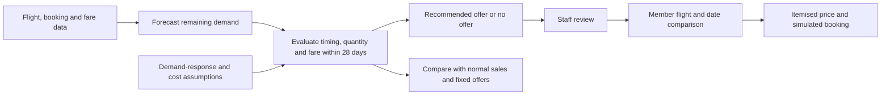

# UOption Fly Pass

**Forecast spare seats. Decide when, how many, and at what fare.**

A hackathon prototype for a paid flight membership concept for HK Express, developed by **Team Airplane CPU · E117** for **Cathay Hackathon 2026 — Student Track**, under **Low-cost Travel: Smart Offer & Borderless Booking**.

> **Status · 7 November 2026:** Documentation and prototype planning. The team has been invited to the Hackathon On-day. The features below are planned; this repository does not yet contain a runnable application or trained model.

## Overview

UOption Fly Pass connects flexible travellers with selected member flight offers. Members pay a subscription fee separately and may access a **zero or very low base fare**, plus fuel surcharges, taxes and applicable fees.

The core prototype evaluates offers within a **confirmed 28-day pre-departure window** and recommends:

- **WHEN:** when to open the offer.
- **HOW MANY:** how many seats to release.
- **WHAT FARE:** what member base fare to charge.

The 28-day window is the planning period. Each flight's recommended opening time is an output of the decision engine. An offer is optional when the evaluated alternatives do not justify releasing seats.

## Why this project

Flexible travellers can spend time comparing many dates without knowing when suitable offers will appear. Short sales windows make it difficult to plan, while an advertised low base fare alone does not explain the full trip cost. A recurring membership could make eligible offers easier to find and compare, subject to available inventory.

For the airline, a seat available today may still sell later at a normal fare. Opening an offer too early, releasing too many seats or setting an unnecessarily low fare may replace normal sales. Opening too late may leave travellers too little time to arrange a trip. The prototype connects demand forecasts to these three offer decisions and tests their commercial trade-offs.

These are project hypotheses to validate with users and airline experts, not claims that HK Express lacks existing revenue-management capabilities.

## How it works

## Hackathon scope

| Priority | Deliverable |
| --- | --- |
| Core | A reproducible dataset and a simple booking-pickup forecast baseline |
| Core | A decision engine that evaluates opening time, seat quantity and member base fare together |
| Core | An airline dashboard showing the recommendation, alternatives, assumptions and expected outcomes |
| Core | Comparison of normal sales, fixed offers and forecast-informed offers |
| Supporting demo | A simple member page with plan eligibility, date comparison, price breakdown and simulated confirmation |
| Supporting demo | A small membership-fee scenario worksheet within the application |
| Stretch | A stronger forecasting model, richer recommendation ranking and additional routes |

The first demonstration uses selected flights, a single application and simulated booking. Production ticketing, payments and airline-system integration are outside this prototype.

## Membership concept

- **Plan A / Plan B:** the current pitch proposes selected lower-demand routes for A and additional popular destinations at a higher fee for B. Route lists and fees remain open.
- **Duration:** six months or one year appeared in the original concept; final terms remain open.
- **Trip cost:** member base fare + fuel surcharges + taxes/mandatory fees + selected optional extras. Membership fees are displayed separately.
- **Availability:** selected flights and limited seats; usage limits, cancellation and refund rules remain to be defined.

## Data and evaluation

Training requires flight-level booking snapshots at different times before departure, sellable capacity and final net bookings. Fare snapshots and calendar information support pricing analysis and forecasting. Historical promotions, customer response and commercial costs are needed to validate offer decisions; where unavailable, they will be explicit simulation assumptions.

Current inventory, final unsold seats and boarded passenger counts are separate quantities. A no-show does not automatically represent an unsold ticket.

The team has requested **OAG Passenger Booking Data** and **OAG/Infare Airfare Data** access; approval and usable coverage are unconfirmed. The OAG Flight Info API reference supports schedule/capacity planning but does not supply the booking histories needed here. Synthetic data can support the demonstration, with results clearly labelled as simulated.

Evaluation covers forecast error, recommended opening time and actual booking lead time, final unsold seats, member demand served and incremental contribution after costs and displaced normal-fare sales. No real-world uplift or model accuracy has been established.

## Getting started

Start with the documents below. There are currently no dependencies to install or application commands to run. The proposed MVP stack is Python, Streamlit, pandas, scikit-learn and SQLite; implementation and dependency selection are pending.

| Document | Audience and purpose |
| --- | --- |
| [Team brief](docs/PROJECT_PLAN.md) | Product goals, detailed pain points, confirmed decisions, scope, roles and demo checklist — Traditional Chinese |
| [Technical design](docs/TECHNICAL_DESIGN.md) | Architecture, example data, decision algorithm, module contracts and implementation steps — Traditional Chinese |
| [Agent handoff](agent.md) | Read order, recent context, development priorities and continuation notes — English |

## Team and contributions

Team Airplane CPU combines AI research, software engineering, risk analysis and aviation experience. Team members should agree task ownership in the team brief, implement the core decision flow first and record the data source and assumptions used in every experiment.

## References and licence

- [Official challenge statements](https://hackathon.cathaypacific.com/documents/hackathon_2026/Cathay%20Hackathon%202026%20Student%20Track%20Challenge%20Statement%20-%20Initial%20Submission%20Stage.pdf)
- [OAG Passenger Booking Data](https://www.oag.com/passenger-booking-data)
- [OAG Airfare Data](https://www.oag.com/airfare-data)

This is a student concept, not an operating Cathay or HK Express product. A repository licence has not yet been selected. External datasets retain their own access and usage conditions.
