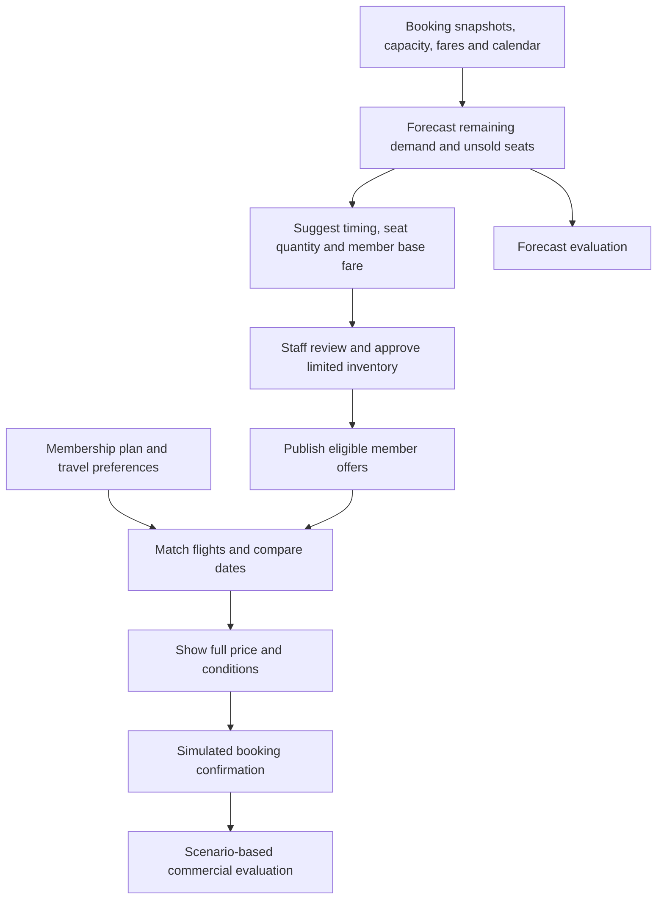

# UOption Fly Pass

**More value from every seat, and more reasons to fly.**

An AI-assisted membership concept that connects flexible travellers with selected flights whose seats are forecast to remain unsold at departure.

**Team Airplane CPU · E117 · Cathay Hackathon 2026 — Student Track**

[Detailed project plan / 詳細需求、進度及數據文檔](docs/PROJECT_PLAN.md)

> **Status — 6 November 2026:** The team has received an invitation to the Hackathon On-day. This repository is at the requirements and documentation stage. The application, forecasting models, datasets and integrations described below are planned; there is no runnable prototype in this repository yet.

## The idea

UOption Fly Pass is a proposed paid membership product for HK Express. Members would receive relevant flight offers, compare travel dates and book eligible seats at a **zero or very low base fare, plus fuel surcharges, taxes and applicable fees**. The membership fee is separate.

The airline-facing component would forecast remaining demand and help staff decide **when to open an offer, how many seats to release and what member base fare to offer**. The objective is to test whether a membership can create additional customer value and positive incremental contribution while protecting normal-fare sales.

This is a student project concept, not an operating Cathay or HK Express product. Offers would depend on eligible routes, available inventory and membership terms; zero base fare does not mean zero total payment.

| Project | Details |
| --- | --- |
| Product | UOption Fly Pass |
| Team | Airplane CPU — E117 |
| Theme | Low-cost Travel |
| Challenge | Smart Offer & Borderless Booking |
| Target business | HK Express |
| Target users | Flexible travellers and airline commercial staff |
| Current phase | On-day preparation; requirements and prototype planning |

## The problem we want to solve

**For travellers:** Finding an affordable trip can require repeated searches across dates. Short promotional windows may not fit when a traveller is ready to decide. A membership could make suitable opportunities easier to discover and compare.

**For the airline:** Seats that remain unsold at departure lose their selling opportunity. However, a seat available today may still sell at a normal fare tomorrow. Releasing discounts too early or too broadly can replace higher-value sales rather than create new demand.

Our central question is: **Can we identify suitable inventory early enough to offer flexible members useful choices, without giving away seats that would otherwise sell?** These customer and commercial benefits are hypotheses to validate, not measured results.

## How it would work



1. **Forecast:** Estimate the seats likely to remain unsold on a specific flight, using only information available at the prediction time.
2. **Decide:** Suggest an offer opening time, release quantity and member base fare. Staff approval and inventory limits are proposed prototype controls.
3. **Match:** Show eligible offers based on the member's plan, destination and date preferences.
4. **Compare and book:** Compare departures, display the full payable amount and complete a clearly labelled simulated booking.
5. **Evaluate:** Compare forecasting and commercial scenarios against simple baselines.

## Product design and open decisions

| Item | Current position |
| --- | --- |
| Paid membership | Core product direction |
| Member fare | Confirmed mechanism: zero or very low base fare, with fuel surcharges, taxes and applicable fees payable separately |
| Plan A / Plan B | Latest pitch proposal: Plan A covers selected lower-demand routes; Plan B adds popular destinations at a higher proposed annual fee |
| Membership duration | Six months / one year appeared on the whiteboard; the latest pitch uses annual pricing examples. Final terms remain open |
| Forecast horizon | Configurable; 28 days is an example in the latest pitch |
| Offer opening window | To be evaluated. The whiteboard's 14-day example is not a fixed product promise |
| Subscription fee | To be explored with historical fares, available inventory, usage and commercial scenarios |
| Usage and availability | Eligible routes, usage limits, allocation, cancellations and refunds remain to be defined |

The forecast horizon, the date an offer opens and the period used to study historical fares are separate parameters. The concept does not guarantee unlimited travel or availability on every flight.

### What a member pays

```text
Membership fee: paid separately for the selected plan and period

Per-trip payment = member base fare
                 + fuel surcharges
                 + taxes and mandatory fees
                 + any selected optional extras
```

The prototype should display each component and the total in the same currency. An offer with a zero base fare must still display its full payable amount.

## Planned hackathon prototype

All modules below are **planned**, not implemented.

| Module | Minimum demonstration |
| --- | --- |
| Data pipeline | Load documented real, sample or synthetic flight-level data and identify its provenance |
| Forecasting | Estimate final net bookings / unsold seats; compare with a historical booking-pickup baseline |
| Offer decision support | Produce an explainable opening-time, release-quantity and base-fare suggestion |
| Airline dashboard | Show current inventory separately from predicted final inventory; let staff review an offer |
| Member experience | Select a proposed plan, set preferences, compare dates and review itemised prices |
| Booking simulation | Confirm a demo selection and update the shared demo inventory without real payment or ticketing |
| Subscription simulator | Explore Plan A / B fees and usage under explicit supply, cost and demand assumptions |
| Evaluation | Compare normal sales, fixed discounts and forecast-informed offers under shared scenario assumptions |

The first version should complete one coherent end-to-end journey using a limited set of routes. Production airline integration, real payments, ticket issuance and a full airline revenue-management system are outside the hackathon MVP.

## Data we need

**Final load factor alone is insufficient.** To make a prediction before departure, we need to know what was already booked at that time and how bookings subsequently changed.

| Data | Why it matters |
| --- | --- |
| Flight instances and capacity | Identify a particular flight on a particular date, its route and sellable seats |
| Booking snapshots over time | Learn booking pickup and cancellations at different lead times |
| Final net bookings and final capacity | Label seats that remained commercially unsold |
| Actual boarded passengers, if available | Evaluate passenger load factor separately; no-shows are not automatically unsold tickets |
| Fare snapshots and charge breakdowns | Study last-minute prices and present comparable, transparent offers |
| Calendar and holiday information | Model recurring calendar effects using information known at prediction time |
| Promotion history and commercial inputs | Interpret demand changes and test costs, ancillary income and displacement of normal sales |
| Member preferences and interactions | Support matching and later evaluate relevance; synthetic personas are sufficient for the initial demo |

No passenger names, contact details, passport details or payment data are needed for the proposed forecasting prototype.

Access to Cathay / HK Express operational data has **not been confirmed**. The team has prepared a data-request email draft; sending it and receiving access are separate steps. If operational data is unavailable, the prototype will use explicitly labelled synthetic data. Synthetic experiments demonstrate workflow and scenario behaviour, not real-world accuracy or commercial uplift.

An OAG Flight Info API V2 reference is available for planning the flight-data adapter. Its schedule and aircraft-seat fields may support flight metadata and capacity estimates; `totalSeats` must not be treated as remaining unsold inventory. The supplied reference does not document the booking trajectories, actual passenger counts or fare histories needed for this model. API access and sample responses have not been verified. See the [OAG field assessment](docs/PROJECT_PLAN.md#oag-assessment).

See the [data requirements and schema](docs/PROJECT_PLAN.md#data-requirements) and [model evaluation plan](docs/PROJECT_PLAN.md#model-plan).

## How we will judge success

- **Forecasting:** Error and bias by prediction lead time, compared with a simple baseline; uncertainty and the risk of overestimating spare inventory.
- **Traveller experience:** Ability to find an eligible flight, compare dates and correctly understand the total price and restrictions.
- **Operational correctness:** Released inventory stays within limits; expired, unapproved or sold-out offers cannot be booked.
- **Commercial feasibility:** Incremental contribution versus normal sales, including membership income, retained trip revenue, costs and displaced normal-fare purchases.
- **Strategy outcomes:** Final unsold seats and the distribution of time from successful member booking to departure, reported separately from offer opening time.
- **Membership sustainability:** Enough suitable supply for member demand, tested across usage and route-plan scenarios.

No accuracy, conversion, willingness-to-pay or revenue improvement has yet been measured. A higher load factor alone is not proof of a better commercial outcome.

## Project documentation and getting started

The two maintained project documents are:

```text
.
├── README.md
└── docs/
    └── PROJECT_PLAN.md
```

There are currently no application source files, dependency manifests, trained models or setup commands. Start with the detailed plan before selecting a stack or implementing modules.

The next development steps are to agree the minimum data contract, create labelled demo data, implement a forecasting baseline, connect the staff and member journeys, and add the pricing / commercial scenario simulator. The [implementation backlog and acceptance criteria](docs/PROJECT_PLAN.md#delivery-plan) define these steps.

## Team

**Brice · Jerry · Lambert · Matthew**

The team combines AI research, software engineering, risk analysis and first-hand aviation experience. Implementation ownership will be assigned in the project plan.

## Background and references

The project evolved from the broader **SmartDemand AI** concept into a focused **UOption Fly Pass** membership experience. The whiteboard defines the core concept; the 25 October pitch adds route-based plans, offer-decision support and subscription scenarios. Neither presentation material nor a proposed architecture is evidence of completed software.

- [Official 2026 challenge statements](https://hackathon.cathaypacific.com/documents/hackathon_2026/Cathay%20Hackathon%202026%20Student%20Track%20Challenge%20Statement%20-%20Initial%20Submission%20Stage.pdf) — Low-cost Travel: Smart Offer & Borderless Booking.
- [Official 2026 Student Track terms](https://hackathon.cathaypacific.com/documents/hackathon_2026/Cathay%20Hackathon%202026%20-%20Student%20Track%20T%26C.pdf) — event and submission conditions.
- [OAG Flight Info API response reference](https://knowledge.oag.com/docs/flight-info-api-response-layout-descriptions) — the supplied PDF describes V2; actual field access requires verification.
- [Project decisions, source history and outstanding questions](docs/PROJECT_PLAN.md#decisions-and-sources).

A repository licence has not yet been selected. Any organiser- or partner-provided datasets and tools remain subject to their own access and use conditions.
