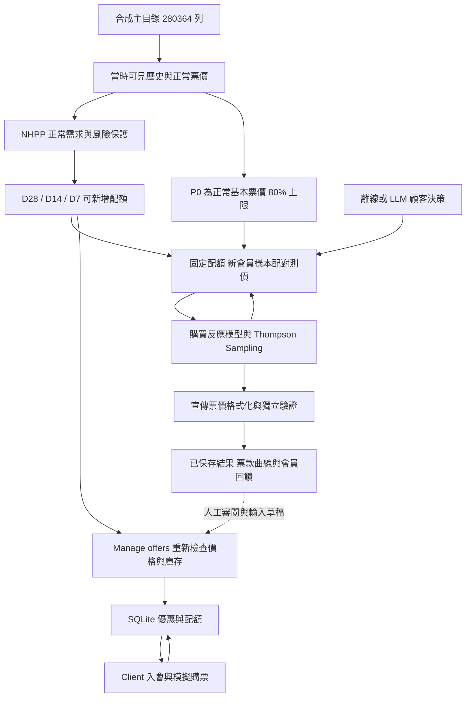

# NHPP 會員優惠平台技術實作

> 状态：现行 · 对应代码：`flight-policy-feedback-v9-marketing`、`formula-scan-v2-whole-hkd`、`nhpp-regime-mixture-v2`、`nhpp-smooth-mixture-v3`、`backend/forecast.py`、`shared-market-v3`、`three-round-release-v1`、`member-marketing-fare-v1`、`member-thompson-v5-marketing`、`frontend/adaptive-pricing.html`

更新：2026-11-15。新報價為整數港元，歷史觀測與證據保留原樣。最終會員基本票價向下取尾數9；取整後低於30元也設為0，所以30–38元歸零。Adaptive v5 每輪更換客群、配對比較初始價；優化器只讀公開特徵，私人預算與動機只供旅客及環境使用；每三輪可測試 LLM 提出的有據方向，最終以三批以上新客群，在格式化的候選價／格式化初始價／無優惠三種情境確認是否採用；收益按實際調整後價格計算。主 Optimize 入口 `/adaptive-pricing`：新 UI 實驗固定使用八類彈性、價格敏感的休閒旅客；移除目標情境／Legacy 選項，保留舊十四類客群的只讀歷史結果；所有人均已入會，只比較單張基本票價及分層加權客群、Logistic 近似後驗及 Thompson Sampling；並行 LLM 意向由程式統一扣位，獨立驗證保留收入下降的結果。詳細數學、口徑及運行命令以[現行規格](FLIGHT_SCOPED_OPTIMIZATION.md#adaptive-member-only-pricing)為準。這份文件記錄現有程式；早期提案文件已刪除（Git 歷史可查），與原計劃的差異見下文「與原計劃的差異及限制」。使用者最新決定是先使用 NHPP，不使用 LightGBM。

## 最新主流程：Thompson Sampling

Admin 四個入口為 Forecast seats、Optimize prices、Experiments、Manage offers。**Optimize 只保留 Thompson Sampling**，標準路徑 `/adaptive-pricing`；舊 `/admin?run=adaptive-…&round=4#optimization` 以 history replacement 轉到相同已保存實驗。Forecast／Manage offers 可攜帶航班與有效 D28／D14／D7 放票日進入。舊 Math／Math+LLM 表單、成本貢獻圖和參考定價區塊已移除，主頁不再載入 `optimization.js`／`continuous.js`。後端模型版本、資料庫及凍結證據沒有因介面整理而更動。

Forecast 分開顯示 NHPP 建議會員座位、預測會員空間、今天可新增配額、已發布可訂座位，配合座位圖、正常需求基線的預計訂位及歷史正常基本票價。NHPP 不建議放票的輪次停用定價。需求篩選仍按 D28 預測起飛時正常訂位率分類：Low <60%，Medium 60%–<85%，High ≥85%；缺失或過期資料為 Unclassified。當下配額仍按所選日重新計算，需求標籤不能代替供應檢查。

Thompson (`member-thompson-v5-marketing`) 在一班航班的一個放票時點，測試既有會員是否購買基本票價。P₀ 為正常基本票價的 80% 上限；可設定輪數、每輪人數、八類客群的權重、種子、驗證批數及 LLM 並行／呼叫上限。新 UI 實驗固定 `flexible_deal_seekers`，不再提供 Target customer scenario 或 Legacy 客群切換；相容 API 及舊結果保留原客群設定。離線顧客模擬和 Live LLM 是兩種行為來源，**並非兩套價格優化方法**。兩者都以公開特徵購買反應模型和 Thompson Sampling 選下一個價格，保留已保存實驗、逐輪表、價格／票款曲線、最終候選和獨立驗證。私人預算不提供給價格學習器；入會費、稅費、燃油和營運成本不計入這個基本票款實驗。

Experiments 只讀展示已保存的 What members said、輪次摘要與個別理由；支援 run／round 連結，查看或刷新不發起付費呼叫。歷史 Thompson 價格、規則與收益保持原樣，不套用新宣傳價覆寫。舊六階段 panel 仍在 `#panel`，共享市場在 `#market`。

活動預測入口仍為 `backend/forecast.py`：D28 使用凍結 v2 分布及新安全餘量，D14/D7 使用平滑 v3。詳見 [NHPP 平滑與校準](NHPP_V3_REVIEW.md)。主目錄仍為 1,549 班／280,364 筆，含獨立驗證共 680,364 筆。

Manage offers 保留自己的發布流程與相容引擎已驗證建議。Thompson 本次沒有自動套用或發布功能；審閱保留票價後需明確輸入優惠草稿，發布時重新檢查會員票價上限、已售位和前輪有效未售配額。Client 顯示基本票價及較小的費用／總付款；會員 plan 和結帳核價不變。

相容後端 `backend/optimization.py`（`flight-policy-feedback-v9-marketing`）仍保留 HK$399 固定會費、數學 P* 加細網格、舊 Live 搜尋、獨立市場驗證和 SQLite 帳目，供原有 API／Manage offers 建議及歷史審計使用。快速網格、全期連續定價與舊聯合 P/V 引擎也仍在程式內，但不是 Optimize 頁面的方法。詳細技術契約以 [航班優化流程](FLIGHT_SCOPED_OPTIMIZATION.md) 為準。

## 收入成本與 NO_OFFER 解釋

以下是保留的相容貢獻引擎及歷史案例；主 Thompson 頁面使用基本票款與獨立配對驗證，不顯示這些舊成本／利潤率欄位。

每條 optimization track 額外返回唯讀 `contribution_explanation`（`paired-contribution-explanation-v1`）：分開保留候選的搜尋及獨立驗證，按相同 seed／外生世界 SHA 配對。內容包括無優惠／有優惠的收入成本橋接、會費分攤及完整現金口徑、買家淨差、完成乘搭戶數和每次重播的服務門檻。資料缺失或配對身分不符時顯示 unavailable，不用 0 代替缺值。讀取不建立實驗、不修改舊結果或呼叫 LLM。

歷史實例 P84／V399 的 6 戶會員買家是對照市場中會買普通票的同 6 戶。在當時定義的單航班分攤口徑下，增量為 −HK$2,364；若計入本次實收全額新會費，現金貢獻差額為 −HK$1,380。兩者都沒有模擬會員後續行程的收入、成本或未來續會，不能據此推論完整會員計劃虧損或不可行。後續收益是「尚未建模」，不是零；也不能任意加上預期收入而省略相應成本、座位替代及對照市場。平均 75% 會員使用不代表每次都過 60%，兩次驗證為 100%／50%。歷史帳目及原始輸出保留於[逐筆審計](CONTRIBUTION_AUDIT_2026-11-14.md)。

相容引擎的 `NO_OFFER` 只表示這次單航班測試未接受候選，並非全年會員產品的結論。要回答完整會員期的盈利能力，需要在相同會員、完整時間線及多次行程中，只收一次會費，計入每次基本票價、附加收入、履約與服務成本，再與沒有會員方案的完整期間對照比較。這次需求篩選及原價起點更新沒有替相容引擎新增全年市場模擬。

所選航班從實驗時點到起飛之間的後續普通票、會員票及取消已在事件時間線內，不能說該相容引擎只算當天收入。尚未建模的是會員之後其他行程與實付續會。讀取結果另有 `economic_scope`，明示 `membership_term_evaluated: false`，未建模後續行程及續會貢獻使用 `null`，不是零。

## 架構

OAG回應與合成訂位資料沒有混成「真實訂位」。本地 HTTP 使用 Python 標準庫，前端不需要 Node build；模型使用 NumPy。SQLite交易確保一次扣位、同人同航班去重。這是本機展示應用，不是已部署的航空生產系統。

## 資料與時間

`simulation/network_generated/` 與 `simulation/member_demo_generated/` 各有 222 班、40,182 筆，37 個外站雙向共 74 條航線，每條三個日期。後者新增低／中正常需求的會員供應示範及高需求對照，沒有修改原始資料或校準。主目錄共 1,549 班／280,364 筆；原 CSV 下載仍為 200,000 筆，另 400,000 驗證資料不加入售票目錄，總數 680,364 筆。CTS／HFE 狀態仍保留，模擬日期不代表真實班表。

`simulation/generated/snapshots.csv.gz` 正好200000列：1104條D180–D0，以及1條D175–D0（其生成仍由D180暖機，只省略最早5個快照）。1105條都完整涵蓋D28至停售。D0定義為起飛前2小時，因此最後區間22小時。

每日欄位包括 flight_id、snapshot_at、days_to_departure、capacity、booked_seats、available_seats、empty_rate、normal_base_fare、mandatory_fees、normal_total_fare、gross_bookings、cancellations、interval_days。報價適用於快照之後；gross/cancellations記錄上一個完成區間。售罄與停售時報價為缺值，不當成零價。

資料有多航線、日期、容量和需求形狀。truth獨立保存潛在需求、未接受需求及生成參數，只作評估。模型不讀情境名稱、最終結果或未來報價。航班索引的情境與最終結果是事後檢視資料，不是預測特徵。

## 当前 NHPP 与历史验证

当前预测统一经 `backend/forecast.py`：D28 使用冻结 v2 需求分布及新校准的 v2 安全余量；D14/D7 使用完整窗口与近期窗口混合的 v3 及新余量。D28 的平滑候选未通过独立测试的突增组收入门槛，因此未启用。历史 v2 模型及报告保留，详见 [NHPP 平滑与校准](NHPP_V3_REVIEW.md) 和 [路演说明](PITCHING_BRIEF.md)。

新独立测试 600 班：实际启用策略的 D28/D14/D7 保护覆盖率为 99.17%/99.50%/99.83%，每班平均正常基础票价收入压力损失为 HK$20.32/0/0。保护覆盖不是原始 P90 覆盖；风险下降伴随释放量减少，不能当成真实市场准确率。

以下 v2 段落与旧测试保留为历史方法和证据。

冻结基线`nhpp-regime-mixture-v2`：歷史gross bookings似然、負／正beta、Gamma水準後驗、價格exposure假設、右截斷計數、變點後水準重估，以及未知未來持續／短暫跳變的混合路徑。給定每條強度路徑是NHPP，跨路徑是混合分布。取消與容量另行推進，未來真值與情境標籤不作輸入。

原始需求P90與校準操作保護量分開；D28／D14／D7分別校準。校準需符合模型設定和原始碼hash。定價模組讀取`demand_curve`及`protection_curve`，避免只用單一beta重建尾段。

凍結後240班final：D28突增保護覆蓋82.5%，同樣本原v1的16位規則為30%，v1經相同程序重校準為80%。原始需求分位數仍未達90%突增覆蓋。D14／D7需求MAE改善，D28整體需求MAE變差。參見[完整診斷](NHPP_V2_REVIEW.md)。

使用者要求更多資料後，再生成40萬筆，總資料60萬筆。模型及校準不變，對1200條新歷程產生7200次評分；D28突增200班保護覆蓋91.5%，D7尚未發生突增子群81.48%。兩批結果均保留；同一生成器擴樣不等於真實市場驗證。參見[擴大驗證](EXTENDED_VALIDATION.md)。

## 快速篩選用的定價市場

> 相容參考工具：舊 `#pricing` 頁仍可直接存取；已從 Optimize 的導航與介面移除，並非 Thompson 主流程。

一次比較完整會員期的同一客群、出行機會與正常購買意圖。會員費每個人只收一次；航班日程均在設定會員期內，期間所有模擬用票成本均計入。正常票價固定，因此原正常購買者轉去會員票可用配對基線衡量，不把原需求重新作一次獨立價格過濾。

放票時點固定為D28、D14、D7三輪。搜尋P={0,30,70,100}、V={199,399,599,799}及可釋出量比例={.25,.5,.75,1}，最多64組；開放日不再是搜尋維度。每輪先計算保護後的目標未售配額，再扣除所有前輪尚未售出的有效配額，只新增差額。D13開始的全新篩選只包含未來D7輪；D6開始已沒有新的放票輪次。最終仍與NO_OFFER比較。服務限制包括合資格請求履約率與未用過會員比例。

財務差額為有會員與無會員的貢獻之差：會費＋正常與會員基本票價＋附加服務毛利－增量載客成本－會員服務成本－計劃成本。示例必付費假設全數代收代付，因此不作貢獻；真實燃油附加費需重新定義。正常客轉會員的差額已在配對比較中，不再另扣一次蠶食損失。

預設300人、24班的有限合成供應情境、2次搜尋重播；前幾名獨立種子和四種壓力情境另作評估。這不是整個HK Express航網。價格市場暫不建模續會、取消、競爭航司及團體整單交易；相關限制顯示於回應。未來可擴展重播和TPE，但現有網格已提供完整可重播循環。

## LLM旅程與共用市場

14個角色涵蓋不同預算、日期彈性、出行頻率、同行、協助與路線需求；權重是假設，沒有聲稱代表實際HK Express市場份額。

`llm_agent/journey.py`目前以`traveller-journey-v2.2-en`輸出英文理由與HKD金額；畫面人物名稱同步英文，原背景語言不改變預算或回覆語言。新增單趟旅程＋會費預算說明與全體同行報價算術；新回覆先通過語言／幣別檢查，再執行合法動作。真實五人30回覆驗證全部通過，舊多語言raw紀錄保持原樣，詳見[場景說明](LLM_SCENARIO_DESIGN.md)。該旅程基線有訂閱、D28／D14／D7、行程變動和期末意向六階段。人物預算、會員、訂位、退款和記憶持續存在，但每個反事實世界庫存獨立。Codex子代理已實際產生168個決策；DeepSeek已完成112世界672個有效provider決策，完整raw回應及失敗紀錄公開於`llm_agent/experiments/`。見[基線分析](LLM_SCENARIO_DESIGN.md)。

`backend/shared_market.py`及`llm_agent/market_experiment.py`建立後續共用市場：多班異質航班、全體旅客共用時間線及庫存、實際年度多次旅程、正常需求獨立生成、same-seed政策配對。LLM只選擇；環境驗證並扣款扣位，NHPP控制正常需求保護。數學策略與LLM策略使用同一觀察和帳本。

少量預先指定候選包括NO_OFFER、固定政策與候選政策。快速搜尋現為64組；其最優項只是共享市場的候選，不直接冒稱新的最優價。啟用會員的政策均使用D28/D14/D7三輪，按輪保存新增、已售、過期及未售餘額，不能用重設配額的方式重複放票。新的結果同時顯示財務與旅客事件；已付會員費不隨意重新收取，續會意向不計收入。先前shared-market-v2實驗仍保留舊設定及結果，不當作新放票規則的成績。

共享市場提示更新為 `shared-market-customer-v3.2-en`：入會時分開當前／入會後有效性，程式提供同一行程的完整付款、預算不足與扣會費後節省。LLM 理由保留原文；有限的算術／資格矛盾檢查只加審計標記，不改寫行動。

審計記錄包含prompt版本、情境雜湊、無授權header的request、原始response、usage、latency、cache標記、解析、合法性與狀態轉移。失敗不換成離線答案。唯一合法行動由環境執行，標示environment_forced；快取與新provider呼叫分開統計。真實金鑰只存於忽略的`.env.local`。

## Admin與會員入口

Admin 位於 `/admin`，Optimize 使用 `/adaptive-pricing`，會員端位於 `/members`。舊 `#panel` 的 Customer panel 使用背景工作，Live上限100人、規則模式1,000人，預設100；先看結果摘要、客群分組及可搜尋分頁名單，再載入單人的六階段。每批Live預設60、最多120個決策嘗試，唯一合法動作不呼叫LLM，快取與真正dispatch分開。每人checkpoint與prompt／model／實作hash支持安全續跑，輪詢不自動延長額度。

會員端從同一SQLite已發布優惠查詢航班、確認完整價格、按伺服器plan入會及購票，並保存My trips。Admin只管理會費和發布庫存，不再混放旅客入會／購買控制。這是UI與路徑分開，沒有宣稱生產權限隔離。詳見[新介面與API](ADMIN_AND_MEMBER_UX.md)。

## HTTP介面

| 方法及路徑 | 用途 |
| --- | --- |
| GET /api/health | 健康檢查（Docker healthcheck 使用） |
| GET /api/adaptive-pricing/status、POST /api/adaptive-pricing/scope | Thompson 客群／provider 狀態及指定航班配額與 P₀ |
| POST / GET /api/adaptive-pricing/runs、GET /api/adaptive-pricing/runs/{id}、GET …/{id}/events、GET …/{id}/export | 主 Optimize 的 Thompson 實驗、保存輪次、會員回饋及驗證 |
| POST / GET /api/optimization/runs、GET /api/optimization/runs/{id}、POST …/{id}/resume、GET …/{id}/events、GET …/{id}/export | 相容貢獻／會費實驗 API；不在 Optimize UI 中使用，完整契約見 [航班優化流程](FLIGHT_SCOPED_OPTIMIZATION.md#persistence-and-api) |
| POST /api/optimization/initial-policy | 由所選航班快照計算 P₀，V₀ 固定 HK$399，不呼叫 LLM |
| GET /api/optimization/suggestions | 指定 flight_id／forecast_day 的已驗證價格及即時可發布配額建議 |
| POST / GET /api/pricing/runs、GET /api/pricing/runs/{id} | 參考用全期連續定價，見 [CONTINUOUS_PRICING](CONTINUOUS_PRICING.md) |
| GET /api/summary | 列數、航班數、模型與LLM配置狀態 |
| GET /api/flights | 航班目錄及 D28 預測需求分類 |
| GET /api/flights/{id} | 航班與歷史快照 |
| POST /api/forecast | flight_id、days_to_departure；返回風險預測及三輪放票狀態，讀取本身不發位 |
| POST /api/optimize | 相容參考用 64 組快速篩選（舊 `#pricing`）；返回候選／最佳／基線／測試 |
| GET /api/evaluation | 獨立測試報告 |
| GET /api/export/snapshots | gzip資料下載 |
| GET /api/personas | 客群覆蓋及假設人物 |
| POST /api/agents/run | 保留的小型同步相容介面；新Admin改用背景panel |
| POST / GET /api/agents/panels | 背景啟動／清單；live最多100人，rules最多1,000人 |
| GET /api/agents/panels/{id} | 進度、來源計數、分組及精簡人物列 |
| GET /api/agents/panels/{id}/people/{customer_id} | 按需讀取一人完整階段 |
| POST /api/agents/panels/{id}/resume | 明確增加一批額度 |
| GET /api/member-portal/config（或 plan）、flights、accounts/{id} | 會員plan、已發布航班、會員和行程 |
| POST /api/member-portal/plan、join、book | 管理會費、按plan入會、確認會員票 |
| GET /api/agents/runs、/api/agents/runs/{id} | 保存的審計與原始輸出；大實驗以gzip匯出讀取 |
| POST / GET /api/market/runs | 背景執行共用市場三組政策（逐批呼叫上限）／列出實驗 |
| GET /api/market/runs/{id} | 狀態、政策比較、財務及實驗統計 |
| GET /api/market/runs/{id}/cases/{case_id} | 同一case的航班、旅客、行為與帳本 |
| POST /api/market/runs/{id}/resume | 明確追加一批呼叫；不自動延長額度 |
| GET /api/evaluation/extended | 額外1200班凍結模型驗證 |
| GET /api/offers | 尚未到期的展示優惠 |
| POST /api/offers | 只在D28/D14/D7的未執行輪次發出新增配額，扣除前輪有效未售位 |
| POST /api/members | 相容入會路徑，亦使用伺服器plan會費；重複呼叫不再收費 |
| POST /api/bookings | 原子扣位、要求有效會員、阻擋重複購買 |
| GET /api/oag | 私有快取的正常化班表與預測容量 |
| GET /api/status | 外部服務狀態及限制 |

POST需要JSON、同源Origin、有效數值與ID。服務只綁定127.0.0.1，靜態檔案僅提供frontend/，不能下載.env或資料庫。會員購票永遠是模擬。新版SQLite示例允許同航班按D28→D14→D7推進，每輪最多發布一次，禁止時間倒退重開舊輪次。前輪仍有效未售位會結轉；售出會員位另計入物理佔用，避免靜態正常訂位快照漏算示例交易。非放票日仍可觀察預測，但不能新增優惠。詳見[三輪規則](THREE_ROUND_RELEASE.md)。

## 與原計劃的差異及限制

早期提案（LightGBM＋LLM循環）與現行實作的差異：

| 原計劃／風險 | 現有實作 | 原因與影響 |
| --- | --- | --- |
| LightGBM預測正常需求 | NHPP參數推斷，沒有LightGBM依賴 | 遵從最新決定；形狀、參數與不確定性可解釋 |
| 單一七天比例推斷beta | 最近多區間計數似然、先驗收縮、beta可負 | 降低單一小樣本的指數外推；仍需真實校準 |
| 原文beta截斷0至0.06 | 明示工程網格與先驗，無業界上限聲稱 | 允許需求衰退並揭露邊界假設 |
| 將需求均值直接當未售位 | 800條需求／取消／容量路徑 | 正確處理需求超容量與非線性截斷 |
| 名義P90當90%保護 | 原始分位數＋逐時點分情境校準保護量，保留兩批獨立驗證 | v2不同批次D28突增82.5%／91.5%；未知未來突增仍有缺口 |
| 用LLM虛擬人物當真實客群 | 新Thompson固定八類彈性客群；歷史14類情境、Codex pilot及DeepSeek呼叫保留並區分來源 | 原始回應可稽核，但模型選擇仍不是真人ground truth |
| 每輪重新訓練預測模型 | 固定NHPP及市場，搜尋商業參數 | 能分辨收益改變來自策略或世界假設 |
| 直接最優化P與V | 主流程固定D28/D14/D7放票時點；Thompson針對已入會顧客，只測試會員基本票價P | 會費與全年產品收益不在這個實驗內；全期P/V與固定會費引擎留作相容參考 |
| 預設高級優化／RL | 公開特徵購買反應模型、Thompson Sampling、每輪新客群和獨立確認 | 在80%票價上限內探索，區分搜尋與未見客群驗證，不宣稱真實最優價 |
| 一年會費與一班28天比較 | 主Thompson只比較一班的基本票款，既有會員不再次收費 | 結果不證明全年會員計劃盈利；其他多班／成本工具保留為相容參考 |
| 全部資料混放 | frontend/backend/simulation/llm_agent獨立 | 各角色可獨立開發與驗證 |
| OAG視為訂位／票價來源 | OAG背景私有快取，合成數據另列 | 實際取得10筆UO航班，座位是預測容量 |

仍需披露的限制：

1. **真實校準仍缺。** 全部 680,364 列均為合成數據，OAG Flight Info沒有每日訂位／報價或會員曝光轉換。優先取得真實計數、可售曝光、購買請求及促銷紀錄。
2. **未知未來突增不可由相同歷史辨認。** 混合風險先驗與保守保護量能改善部分覆蓋，不能預知事件；較高釋位也提高擠出正常客的風險。保留D28需求MAE退步及D7子群缺口。
3. **會員造成區間內售罄的exposure。** 如果會員在區間內用完位，正常gross=0不等於整日零需求。現時不超賣，但取消後的後續需求估計可能偏低。後續應記錄事件級可售時間並建立新的模型／校準版本。
4. **LLM不是需求真值。** 固定temperature不保證選擇相同；60次probe沒有排序或語言翻轉也不證明無偏。以真人同題實驗與試點交易校準，再估價格反應。
5. **有限目錄範圍。** 目前6–12班、有限已知出行機會；不是整個HK Express真實航網。基線以HKG出發為主，完整入境／來回聯程、競爭航司及全年未知新增出行仍需擴展。
6. **財務口徑。** 顯示貢獻包含增量載客、行李、會員服務和計劃成本；必付費為明示代收代付假設。沒有完整固定機隊成本、實際稅務或正式收益確認，因此不稱航空公司淨利。
7. **正式部署。** 本地服務與模擬SQLite不能公開當生產系統；需要身份授權、工作排程／限額、真實庫存、secret manager及票務整合。現時沒有真實付款或出票。

## 執行及驗證

參見README安裝與啟動指令。兩組unittest分別覆蓋既有模擬器／新資料、NHPP／市場／交易；目前 `backend/tests` 236 項、`tests/` 31 項，以 `python scripts/check_container.py` 一次執行。`scripts/smoke_api.py`對實際HTTP服務驗證資料、預測、64組搜尋、停售、人物、訂閱／購買及私有路徑保護。`scripts/smoke_three_round_api.py`驗證同班三輪發布、結轉、購票及不合法輪次拒絕。三輪回歸另檢查第二輪扣第一輪、第三輪扣前兩輪、售出不重扣、過期不結轉及輪次冪等。兩個API smoke及前端完整交易smoke皆重新通過。前端另有桌面及390px手機瀏覽器檢查，記錄於前端進度文件。

新三輪環境另外完成40種子×3政策＝120個規則市場，3240筆逐輪公式和所有帳本／庫存檢查通過，沒有新增LLM呼叫。結果與限制見[本次三輪驗證](THREE_ROUND_RELEASE.md#本次三輪規則的獨立市場重播)；v2報告保留為歷史證據。

## Continuous-pricing branch update — 2026-11-14

The new continuous-price and probabilistic-user path is documented in [CONTINUOUS_PRICING.md](CONTINUOUS_PRICING.md). It uses the existing shared engine, a fixed membership fee/release share, bounded cent-resolution search, paired NO_OFFER, independent validation and sensitivity stresses. Historical fixed-tier and LLM reports remain unchanged. No online human learning or autonomous live repricing is implemented. Windows locks and frozen prompt byte copies are portable; checkout rules preserve frozen NHPP source bytes.

## Docker 团队运行环境

完整应用可通过 `docker compose up --build -d --wait` 启动。单一 Linux 容器包含前端、API、NHPP、定价和用户模拟；保留原生 fcntl。持久化卷保存数据库和实验，服务凭据仅运行时注入。构建固定基础镜像摘要与 Python 依赖，测试服务独立且无外网。详见 [DOCKER.md](DOCKER.md)。
