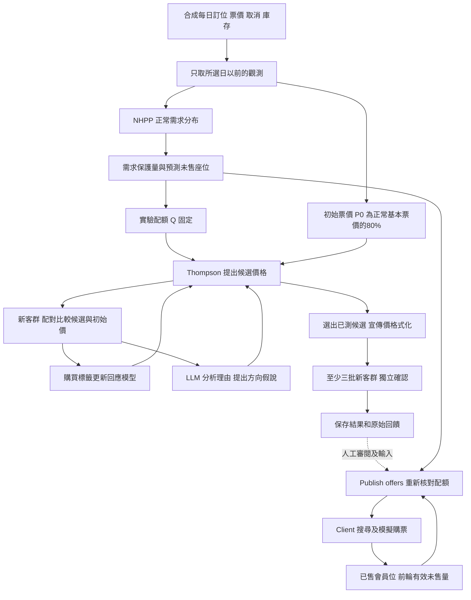

# UOption Fly Pass 技術速讀與 Present 指南

> 状态：现行 · 对应代码：`member-thompson-v5-marketing`、`analyst-retry-v1`、`public-member-response-v1`、`nhpp-regime-mixture-v2`、`nhpp-smooth-mixture-v3`、`backend/forecast.py`、`three-round-release-v1`、`member-marketing-fare-v1`、`backend/published_experiments.py`

更新：2026-11-15。Team Airplane CPU · E117。本文件涵蓋現行Admin、半年會員計劃、示範登入、From／To及Analyst有限重試；預測與定價數學沿用狀態行所列版本。主規格為 [Thompson 定價](FLIGHT_SCOPED_OPTIMIZATION.md)及[三輪放票](THREE_ROUND_RELEASE.md)。

**一句話：先預留可能按正常價格購票的需求，再把可釋放的座位提供給彈性會員，透過 Thompson Sampling 尋找值得採用的會員基本票價。**

本原型使用合成訂位及模擬顧客。定價針對「已入會會員、指定航班、一次購票機會」，比較基本票款與購買人數；全年會員費最優化和航空公司淨利潤不在這次實驗範圍。

## 1 三分鐘速讀

| 部分 | 要解決的問題 | 輸入 → 輸出 | Present 可以怎樣說 |
|---|---|---|---|
| 合成資料 | 沒有真實每日訂位與報價，怎樣測原型？ | 航班、票價路徑、需求情境 → 每日訂位／取消／空位 | 「我們建立可重現的市場情境，並保留未來真值來測試模型。」 |
| NHPP | 起飛前還會有多少正常需求？ | 截至當時的訂位、價格、庫存 → 需求分布、預期未售座位、保護量 | 「今天空著的座位，不代表起飛時賣不掉。」 |
| 三輪放票 | 現在可以新增多少會員位？ | 保護量、已售會員位、前輪未售量 → D28／D14／D7新增配額 | 「每輪重新評估，只補足配額，不重複放票。」 |
| Thompson 定價 | 便宜多少才值得？ | 航班、固定實驗配額、購買回應 → 下一輪價格、最終候選 | 「在每張票的收入與購買人數之間找取捨。」 |
| LLM Agent | 會員為甚麼買或不買？ | 角色、航班、報價 → 選擇、理由、下一步測試方向 | 「LLM提供行為與假說，Thompson決定實際測甚麼價。」 |
| 確認與會計 | 調價是否真的比原方案好？ | 新客群的候選價／初始價／無優惠 → 採用、保留、無定論或不放票 | 「搜尋選出候選，再用沒有參與搜尋的人確認。」 |
| 發布與 Client | 怎樣變成可以購買的優惠？ | 管理員人工發布 → 會員搜尋、模擬購票、庫存更新 | 「分析結果由管理員審閱，發布時再核對實際配額。」 |

**閱讀順序：** 快速講解看本節和第10節；回答算法問題看第3–7節；查程式及API看第9節；引用數字看第8節。

圖中兩種「輪次」不同：**D28／D14／D7是三次發布機會；定價的10輪是同一航班、同一時點的10次價格實驗。** 價格實驗不會把航班時間往前推。

## 2 資料怎樣生成

### 2.1 一筆資料是甚麼

一筆是「某班航班、某個時間點」的狀態。主要欄位如下，數字只是教學例子：

| 欄位 | 例子 | 含義 |
|---|---:|---|
| `flight_id`、`departure_at` | 某班 HKG→FUK、指定起飛時間 | 同一航線不同日期分開處理 |
| `snapshot_at`、`days_to_departure` | D14的時間戳、14 | 當時可見的資料截止點 |
| `capacity` | 180 | 可售總座位 |
| `booked_seats`、`available_seats` | 65、115 | 正常訂位及物理空位，兩者相加為容量 |
| `empty_rate` | 115÷180＝63.9% | 目前未售比例 |
| `gross_bookings`、`cancellations` | 4、1 | 進入此快照前一段時間的新訂位和取消 |
| `interval_days` | 1 | 該段觀測長度；最後一段是22／24天 |
| `normal_base_fare`、`mandatory_fees` | 500、250 | 下一時段的基本報價、另付費用 |
| `quote_status` | open／sold_out／closed | 可售、售罄或停售；缺失票價不等於免費 |

售票目錄有 **1,549班、280,364筆**觀測：原200,000筆加兩批各40,182筆的航線補充。另400,000筆用於擴大驗證，總共保留680,364筆。原始航班大多從D180逐日記到D0，所有航班都有完整D28–D0。D0代表起飛前兩小時停售，沒有模擬no-show，因此「空座率」是未售比例，不是登機後空座率。

### 2.2 生成一班航班的順序

1. 抽出需求規模、增長率、取消率與票價基準；設定低需求、一般、高需求、持續突增、短期脈衝或下降情境。
2. 預先產生正常票價路徑：臨期階梯漲價、促銷區間和小幅噪音。價格不偷看之後會賣多少。
3. 對每個日區間積分需求強度，抽出購票請求，按當時空位截斷成交。
4. 對區間開始時已訂位者抽取消；當日新訂位不在同區間取消。取消退回的座位下一段才可用。
5. 保存新快照；另存隱藏真值，用於驗證而不交給預測器。

生成器的概念公式為：

$$
\lambda(u)=\theta e^{\beta(u-180)}
\left(\frac{p(u)+F}{p_{ref}+F}\right)^{-0.8}J(u),\quad
D_t\sim\operatorname{Poisson}\left(\int_t^{t+\Delta t}\lambda(u)du\right)
$$

其中 $u=0$ 是D180；$J(u)$ 表示突增或脈衝；$F$ 是另付費用。原始生成器使用 $F=250$、彈性0.8等假設，並非航空公司提供的估計。

$$
G_t=\min(D_t,C-B_t),\quad
X_t\sim\operatorname{Binomial}(B_t,1-(1-c)^{\Delta t}),\quad
B_{t+1}=B_t+G_t-X_t
$$

給定一條需求強度路徑時是NHPP；實際成交還受容量限制。`truth.csv.gz`保存請求、拒絕需求及隱藏參數，模型不能把這些事後資訊當輸入。OAG Flight Info可提供班表背景，沒有補足真實訂位曲線或會員支付意願。

**講法：**「我們分開模擬需求和成交。賣完只表示沒有座位，不表示沒有需求。」

程式：[simulation/generate.py](../simulation/generate.py) 的 `simulate_flight()`；詳細資料口徑見[simulation說明](../simulation/README.md)。

## 3 NHPP 怎樣預測起飛前的空座

### 3.1 輸入及估計

預測器只讀截至選定日已完成的區間，主要使用最多約36日的近期歷史：新增正常訂位、取消、區間長度、對應正常票總價及可售庫存。它估計需求水平與時間趨勢，保留參數的不確定性。

核心形狀可以理解成 $\lambda(t)=a e^{\beta t}$：$a$是目前需求速度，$\beta$控制加速或減速。實作還會以假設的價格彈性調整歷史曝光，避免把因降價而增加的銷售全當成時間增長。未來正常票價暫固定在當時水平。

估計時在−0.08至0.10的181個網格點比較增長率，對需求水平使用Gamma先驗及Poisson似然；遇到售罄資料則加入尾端機率與重要性抽樣校正。未售罄的成交數使用Poisson機率；若只剩3位且全賣出，使用「需求至少3」的右截斷尾端機率。零庫存期間不當作零需求觀測。這避免把售罄航班誤判為冷門。

### 3.2 未來不是只有一條曲線

模型預設抽樣 **800條**未來路徑，包含參數不確定性、正常增長、可能突增或短期衝擊；再加入取消及容量限制。平滑v3混合完整窗口與近期變化後的估計，完整窗口權重至少20%，降低幾天噪音完全推翻舊資料的風險。

目前活動版本：D28使用v2需求分布與新安全餘量；D14／D7使用平滑v3。D28的v3候選未通過獨立收入風險門檻，所以保留已通過門檻的v2。其他觀測日選取其對應的較長校準期限；例如D13使用D14配置。

對第 $s$ 條路徑，模型模擬到停售時的訂位 $B^{(s)}_{cutoff}$：

$$
E[\text{未售座位}]\approx\frac1S\sum_s(C-B^{(s)}_{cutoff}),\qquad
E[\text{未售率}]=\frac{E[\text{未售座位}]}C
$$

所以包含取消、售罄時，不能一律用「現在空位−未來平均請求」代替路徑模擬。曲線可有小數，代表期望；真正發布和購買的座位必須是整數。

### 3.3 預期空座與可放會員位不同

$$
H=\operatorname{P90}(\text{未來正常購票請求})+
\left\lceil g_h\max(10,\operatorname{P90})\right\rceil
$$

$H$是正常需求保護量；$g_h$是用另一批合成資料校準的餘量係數。現行D28／D14／D7係數為1.05／1.60／2.15；例如原始P90＝26，D28額外餘量為28，保護量為54。這個保護量比平均需求保守，也不等於重新估計出的P99。

保護採用未來**總請求**，不預支未來取消所釋出的座位；預期未售座位則包含取消及容量的作用。資料太少或校準失效時，系統會限制或停止自動釋位。

**講法：**「我們先模擬多種未來，再預留正常需求和安全餘量。會員可用座位通常比平均預測空座少。」

程式：[forecast.py](../backend/forecast.py) 的 `forecast()`、[nhpp.py](../backend/nhpp.py)、[nhpp_v3.py](../backend/nhpp_v3.py)。公式與風險驗證見[NHPP v3說明](NHPP_V3_REVIEW.md)。

## 4 D28 D14 D7 怎樣放票

合成正常訂位快照不包含在Client新增的會員訂單，因此程式要補扣會員已售位一次。令 $B_n$ 為快照正常訂位、$S_m$ 為示例已售會員位、$U$ 為前輪仍有效未售配額：

$$
A=C-B_n-S_m,\quad T=\max(0,A-H),\quad N=\max(0,T-U)
$$

這是一般可釋位情況；實作還受資料品質限制、停售時間及輪次狀態約束。底層支援釋出比例，目前發布流程使用100%上限，管理員可以輸入較少的發行量。

**完整數字例子：** D14容量180、正常訂位65、已售會員票5，因此物理空位110。若原始P90為22，D14額外餘量為36，正常需求保護為58，目標未售會員空間為52。D28尚有15位有效未售，因此D14最多新增 **52−15＝37位**。不能再發52位，也不能把已售5位重扣一次。

只允許D28／D14／D7新增；同一輪發過就不能再發。若保護量上升導致目標小於既有配額，新增為0；已發批次保留，但可成交量會受最新風險及物理空位限制。D13可以看預測，不能新增一輪優惠。

| 畫面數字 | 如何理解 |
|---|---|
| 預期未售座位 | 模擬至停售時平均還剩多少 |
| NHPP會員空間 | 根據合成快照與正常需求保護得到的風險空間 |
| 今天可新增配額 | 再扣示例已售會員位、前輪有效未售位並檢查輪次後的數量 |
| 已發布可訂座位 | 已人工發行且目前可合法購買的量；不是尚未發布的建議量 |

**講法：**「Forecast是判斷，發布是操作。刷新預測不會自動增加會員庫存。」

程式：[release_policy.py](../backend/release_policy.py)、[store.py](../backend/store.py) 的 `Store._status()`／`offer()`、[seat_inventory.py](../backend/seat_inventory.py) 的 `describe()`。

## 5 Thompson Sampling 怎樣學會員票價

### 5.1 實驗的輸入和範圍

選定一班航班及D28／D14／D7，將當時觀測的正常基本票價向下取整為 $p_n$，並讀取NHPP配額 $Q$：

$$
P_0=\lfloor0.8p_n\rfloor,\qquad p\in\{0,1,\ldots,P_0\}
$$

例如正常基本票價690，搜尋初始價為552。此上限表示至少比正常基本票價便宜20%。P₀由資料計算，不由LLM任意填寫。

一次實驗固定航班、日期、正常票價與供應。`flight_scope()`直接以合成快照預測配額，**不讀會員網站的交易庫存**。每個報價都是重置的對照世界，不會真的消耗Client的座位或會員預算；發布優惠時再核對Client狀態。

另有明確標示的 `zero-fare-stress-v1` 宣傳價示範：假設正常基本票價為55／60／65，八類客群的私人票價預算乘0.10，初始上限仍為44／48／52。這些情境保留來源航班的配額作固定供應，不聲稱已在較低正常價下重新預測NHPP；來源scope、假設與雜湊均另存。它們沿用相同Thompson及歸零函式，並將「宣傳候選0」與「驗證保留價」分開。只讀展示不會取代一般航班推薦或發布建議；設定與重播命令見[現行定價規格](FLIGHT_SCOPED_OPTIMIZATION.md#explicit-low-fare-demonstration-inputs)。

### 5.2 學的不是「正確價格標籤」

模型學的是不同價格下買會員票的機率 $q_i(p)$：

$$
q_i(p)=\sigma\left(a+a_{g_i}+c\frac{\log(1+\min(d_i,365))}{\log29}
-\operatorname{softplus}(b)\frac p{p_n}\right)
$$

- $g_i$：客群類型；$d_i$：公開申報的日期彈性。
- $\sigma$：把分數轉成0–1機率；`softplus`確保同樣條件下價格上升不會提高模型預測購買率。
- 學習標籤是搜尋期的 `BUY_MEMBER=1`、其他選擇為0；精確私人預算、興趣及願付價不交給學習器。
- 用高斯先驗、加權logistic擬合及局部Laplace近似更新參數分布。同一人的配對回答總權重最多相當於一個人，避免重複曝光冒充新樣本。

因此需要**逐輪更新小型購買回應模型**，但不用先準備「最優價格ground truth」，也沒有訓練LightGBM或微調LLM。

### 5.3 每一輪如何選價

1. 第一輪測P₀；之後從當前近似後驗抽一組參數，產生一條可能的購買回應曲線。
2. 在0至上限的整數價格中，選該抽樣曲線預期會員票款最高者；同一組參數用於整條曲線。
3. 提出價格後，才產生這一輪的新顧客。每人分別看到候選與P₀，兩個世界使用相同人物及庫存排序，互相看不到另一報價或答案。
4. 程式結算真實整數席位，再把購買意願標籤加入模型。下一輪換新客群。
5. 每三輪安排一次有證據支持的LLM方向測試，詳見下一節；其餘使用一般Thompson探索。

這裡沒有為每個整數價格呼叫一次LLM：模型先計算整條曲線，LLM只評估實際選出的報價及對照。

對預設 $M=16$ 人及配額 $Q$，先由128人的獨立公開特徵樣本估計加權購買機率 $\bar q(p)$：

$$
K\sim\operatorname{Binomial}(M,\bar q(p)),\quad
R_m(p)=p\,E[\min(Q,K)]
$$

此處 $R_m$ 是預期**會員基本票款**。使用 $E[\min(Q,K)]$，而非把期望人數直接截成 $\min(Q,E[K])$。例如100個座位但只向16人報價，一輪最多成交16張；庫存多不會自動產生更多顧客。

### 5.4 搜尋結束與宣傳價

搜尋結束後，以48組後驗抽樣估計平均會員票款，只在**實際測過的價格**中，選達最高值95%以上且預測買家最多者。95%是可調的預期票款取捨，不是實際收益保證。再向下調整為尾數9，調整後低於30歸零：255→249、103→99、259→259、29→0；30–38也會歸零。搜尋期間可以測任意合法整數，不要求每輪都以9結尾。

初始對照也同樣格式化，例如552→549；候選273→269。用新客群比較的是549和269，不能用552或273的收入替代。圖上其他未測價格只是模型估計。

**講法：**「我們讓模型保留不確定性，所以有時會探索不同價格。最後選出候選後，還要測真正準備展示給會員的宣傳價。」

程式：[initial_policy.py](../backend/initial_policy.py) 的 `flight_scope()`、[member_response.py](../backend/member_response.py) 的 `PurchasePosterior`／`recommend()`、[adaptive_pricing.py](../backend/adaptive_pricing.py) 的 `_worker()`、[fare_policy.py](../backend/fare_policy.py)。

## 6 LLM 場景 回饋與客群權重

### 6.1 模擬誰

| 客群 | 預設假設權重 |
|---|---:|
| 大學生 | 24% |
| 目的地彈性的優惠獵手 | 20% |
| 臨時獨行旅客 | 16% |
| 高頻優惠旅行者 | 12% |
| 可平日出發者 | 10% |
| 朋友同行 | 8% |
| 情侶 | 6% |
| 偶爾被低價觸發者 | 4% |

這是可調的產品目標客群假設，不是HK Express實測人口比例。每個人已持有會員資格，只買自己的一個座位；同行者的票不在這次實驗內。角色有私人預算、旅行興趣、目的地吸引力、近期旅行和留在家的選項，因此付得起也可以不買。

每個正權重客群至少一人，其餘用最大餘數法分配；若某群權重 $s_g$、抽到 $n_g$ 人，每人的估計權重為 $w_i=s_g/n_g$。加權是推估目標客群，不會創造半張票。

### 6.2 兩種行為來源 同一套定價

| 角色 | 責任 |
|---|---|
| 離線顧客 | 以獨立的隨機效用規則產生選擇，用於快速可重現測試 |
| Live LLM顧客 | 看角色、航班、報價及合法動作，輸出英文JSON選擇與理由 |
| LLM分析員 | 歸納價格／日期／同行／庫存／其他理由，引用顧客ID，提出lower／higher／hold等方向 |
| 程式環境 | 驗證輸出與預算，依固定隨機優先序分配整數座位，處理會員位不足時的正常票或放棄回退 |
| Thompson | 用購買標籤更新模型，計算並選擇下一個價格 |

顧客選擇為 `BUY_MEMBER`、`BUY_REGULAR` 或 `DECLINE`。購買意願與因庫存不足而無法成交分開保存；模型學意願，帳本記實際成交。

分析員不能直接編出「這個人願付300」當標籤。驗證器要求降價方向引用拒絕者，且報告的價格異議數至少為1；目前沒有逐一核對價格異議是否來自被引用的那一人。加價方向須引用會員票購買者。每第三輪，合法方向只限制同一條Thompson抽樣曲線的搜尋範圍：相對前價、半徑最多為`ceil(0.25 × 票價上限)`港元。方向沒有合法候選或證據不足，就回到一般探索。回饋假說是否支持，先以該輪候選和配對初始價比較；最終採用仍看新客群確認。

### 6.3 呼叫及審計

預設10輪、每輪16人、3批確認、並行4個顧客請求。完整Live預算上界為：

$$
\text{calls}_{max}=R(2M+3)+3HM=10(35)+3(3)(16)=494
$$

其中每輪最多兩組報價與三次分析嘗試（首次加最多兩次重試），確認為三方案乘H批；相同價格重用或只有唯一合法動作時可少呼叫。API預設`max_calls=600`，設定小於完整實驗上界會在開始前被拒絕；這不是執行時間估計。

每次保存原始請求／回應、驗證結果、來源及提示雜湊。顧客決策失敗仍會停止後續派送，不能用虛構購買補上。Analyst則使用`analyst-retry-v1`：驗證失敗帶上具體錯誤及前次不可信回覆重試，暫時傳輸錯誤可重試；永久錯誤或預算耗盡可提前結束。最多三次均計入同一預算，重試不重新詢問顧客。

仍失敗時，該輪保存`analysis=null`、`analysis_status=unavailable`、具體錯誤及各次嘗試；顧客選擇、學習資料及配對結果照常保存，後續用一般Thompson探索，不借用前幾輪的舊分析。最終獨立確認仍需完成。新計數`analyst_retries`是額外派送次數，`analyst_unavailable`是無有效分析輪數；`failures`仍記所有失敗嘗試。審計寫入或程式內部故障不會被此容錯吞掉。

Optimize及Member feedback顯示每輪狀態與實際錯誤；展開原始回覆時才讀取審計，沒有回應本文的傳輸故障會明確標示。`analysis-attempts`端點不帶round時只返摘要，帶`?round=N`時返該輪原始回覆。這些查閱不發付費呼叫。舊實驗保持原紀錄與提示雜湊，不會自動重跑或回填成成功。

**講法：**「我們用LLM測不同類型會員的選擇和理由；這些是可追查的模擬回應，真正的轉化率仍需要真人資料校準。」

程式：[weighted_population.py](../llm_agent/weighted_population.py)、[adaptive_customers.py](../llm_agent/adaptive_customers.py)、[顧客prompt](../llm_agent/prompts/adaptive_customer_v4_en.txt)、[分析員prompt](../llm_agent/prompts/adaptive_analyst_v2_en.txt)。

## 7 如何比較票款並決定採用

### 7.1 搜尋與最終確認分開

候選宣傳價一旦選定，就用至少三批全新客群，在每批內配對比較：**格式化初始價、格式化候選價、NO_OFFER**。NO_OFFER代表不提供會員優惠，仍可買正常票或放棄。這些確認資料不回流調參，也不根據確認結果另挑一個新候選。

搜尋的目標是預期會員票款；**最終確認另外計算正常票回退收入**，避免把本來會買正常票的人轉買優惠票，全部當作新增收入。

$$
R_{actual}=pN_m+p_nN_n,\qquad
R_{weighted}=M\sum_i w_i\times\text{實際基本付款}_i
$$

$N_m$、$N_n$ 為實際獲配的會員／正常票買家。沒有容量限制時比較目標客群加權票款；如果庫存限制造成拒絕，或加權人數會超出庫存，就統一用實際可成交的面板帳本比較。

**例子：** 假設正常票500，無優惠時4人購買，票款2,000；會員價200時8人買會員票、1人買正常票，合計2,100，增量只有100，而不是8×200＝1,600。這是說明計算的假設例子，不是實驗結果。

會費、稅費、燃油和營運成本不計入上述票款。零元會員票的直接基本票款為0；它的宣傳或長期會員價值尚未量化。

### 7.2 結果怎樣解讀

先檢查NO_OFFER；若不符合，再依序判斷KEEP_INITIAL、ADOPT_CANDIDATE，否則INCONCLUSIVE。

| 結果 | 當前規則的意思 |
|---|---|
| `ADOPT_CANDIDATE` | 對初始價及無優惠的配對差額，其描述性bootstrap下界均大於0，且每批差額都不為負 |
| `KEEP_INITIAL` | 候選等於初始價，或平均票款不如初始價；保留初始方案 |
| `INCONCLUSIVE` | 尚未滿足改價證據門檻；保留初始價 |
| `NO_OFFER` | 初始與候選平均票款都沒有超過無優惠對照；不建議發布 |

bootstrap以確認批次重抽2,000次，使用2.5%／97.5%分位。只有少量合成批次，這是原型採用規則，不是已認證的真實航空收益保證。

`recommendation.price`是候選；`validation.retained_price`才是通過判斷後保留的價格，NO_OFFER時為空。前端的break-even conversion表示在候選正常票收入不變下，多少會員成交才能追平初始基本票款，不是包含全部成本的財務盈虧平衡點。

**講法：**「我們不只看降價後多賣幾張，也比較沒有會員優惠會收到多少基本票款。證據不足時保留原方案。」

程式：[adaptive_pricing.py](../backend/adaptive_pricing.py) 的 `settle()`、`compare_validation()`。

## 8 可以引用哪些已保存成果

### 8.1 座位保護驗證

下列是另一批600班合成航班的結果；同一批在三個時點評估，不能說成1,800班。

| 時點 | 校準後正常需求保護覆蓋 | 持續突增組覆蓋（各100班） | 每班平均可釋放位 舊→現行 |
|---|---:|---:|---:|
| D28 | 99.17%（595／600） | 95% | 5.66→2.76 |
| D14 | 99.50%（597／600） | 97% | 11.97→9.01 |
| D7 | 99.83%（599／600） | 99% | 20.88→14.74 |

覆蓋是「保護量足以涵蓋實際模擬後續正常請求」的航班比例，不是人數預測準確率。提高保護也減少可放位；這是各時點的獨立壓力測試，尚未證明完整三輪加會員策略的總收益。數值來源：[凍結測試報告](../simulation/generated/nhpp_v3_robust_final.json)及[NHPP說明](NHPP_V3_REVIEW.md)。

### 8.2 當前 Thompson Live 案例

已保存的 `adaptive-749c60ea38b34eb2`：SYN-00017，HKG→FUK，2027-05-17，D7，10輪×16人，另3批新客群確認。原價690，搜尋初始552、原始候選273，最後比較宣傳價549與269。

| 確認指標 | 初始549 | 候選269 |
|---|---:|---:|
| 加權會員購買率 | 8.22% | 58.67% |
| 每批平均實際基本票款 | HK$732.00 | HK$2,421.00 |
| 每批加權平均基本票款 | HK$722.24 | HK$2,525.01 |

這次結果為ADOPT_CANDIDATE。新provider呼叫213次（顧客203、分析10），快取0、強制動作245、失敗0。強制動作不是LLM回答，兩者不能合計後稱為「458次LLM測試」。

上述六份原始結果保持不變。現已公開全部24份現行v5實驗：23份完成、1份失敗，包含DEMO_LLM0–9、六份假設低價／低預算歸零情境，以及其他既有實驗。完成結果為11份採用候選、9份保留初始價、3份無定論；這是保存歷史，不是隨機抽樣基準，不能計算真實市場成功率。六份歸零情境的HK$0只是宣傳候選，收入確認仍保留39／39／49。原始報告與審計見[v5證據索引](../llm_agent/experiments/README.md)。

## 9 前後端與資料庫如何接起來

### 9.1 畫面與入口

以下是本機目前使用的8001端口；服務預設端口為8000，可用`--port 8001`指定。

| 畫面 | URL | 操作後實際發生甚麼 |
|---|---|---|
| Forecast | [Admin Forecast](http://127.0.0.1:8001/admin#flights) | 讀歷史、重新預測和顯示配額；瀏覽不發布 |
| Optimize | [Thompson](http://127.0.0.1:8001/adaptive-pricing) | 建立指定航班實驗，或讀已保存輪次；不改Client庫存 |
| Member feedback | [會員回饋](http://127.0.0.1:8001/admin#customers) | 只讀當前v5實驗及原始理由；不增加provider呼叫 |
| Publish offers | [人工發布](http://127.0.0.1:8001/admin#members) | 人工輸入航班、輪次、價格、數量；通過檢查才寫優惠 |
| Results | [售出與配額](http://127.0.0.1:8001/admin#results) | 已售會員位、未使用配額及基本票款；未使用不等於當下可訂 |
| Client | [示範登入](http://127.0.0.1:8001/members/login) | 會員／未入會帳戶登入，搜尋已發布優惠、模擬入會及購票 |

Client支援出發／目的機場、地區、日期範圍及彈性選擇。展示的航班是合成目錄和已發布優惠，不代表真實可出票班表。大字顯示基本票價，小字列必付費用和完整付款；會費由Publish offers獨立設定，Thompson不替它定價。

### 9.2 執行及儲存

| 模組／儲存 | 職責 |
|---|---|
| `backend/server.py` | Python標準庫HTTP，同一服務提供原生HTML／JS和JSON API；前端不需Node建置 |
| `backend/data.py`、`simulation/` | 讀取合成歷史、航班目錄及需求分類；Low <60%、Medium 60%–<85%、High ≥85%取D28預測正常訂位率 |
| `data/private/adaptive_pricing/experiments.sqlite3` | `adaptive_runs`保存設定、輪次、模型、確認結果；`adaptive_events`保存請求、回覆及審計事件 |
| `data/private/demo.sqlite3` | `offers`、`members`、`bookings`、`flight_clocks`、`membership_plan`保存Client交易狀態；`demo_sessions`保存示範登入的token雜湊及到期時間 |
| `llm_agent/experiments/` | 脫敏公開report、壓縮audit及SHA256 manifest；服務啟動時自動成為Saved experiments只讀來源 |
| `backend/published_experiments.py` | 驗證並讀取公開實驗；與私有SQLite結果合併去重，同ID以本機為先，按頁讀取原始審計 |

發布和結帳使用SQLite `BEGIN IMMEDIATE`交易。發布檢查合法輪次、是否已發行、時間方向、最新保護和整數價格上限；購票API先核對會員確認的票款，Store再於交易內檢查會員有效性、有效批次與物理／風險庫存，扣席並保存訂單；同人同班唯一約束防止重複購買。新一輪發布推進該航班的示例時鐘；瀏覽較早預測不能倒退交易時鐘。Client目前沒有取消或退款操作。

會員計劃預設HK$399／六個曆月：`backend.store.membership_expiry`依香港時間加六個月（月底夾限），新入會保存確切到期時刻；既有會員保留原紀錄。`plan()`提供`term_months=6`和`term_label="6 months"`，`term_days`僅為查詢當日的相容估算。

`backend/demo_auth.py`提供兩個公開示範帳戶（詳見[登入操作](ADMIN_AND_MEMBER_UX.md#client-portal)）。伺服器產生隨機session token，只存SHA256雜湊，Cookie為HttpOnly、SameSite=Lax、24小時有效；登出撤銷session。會員帳戶僅首次登入初始化會籍；Guest入會後狀態持續保存。HTTP層對保留帳戶核對session，拒絕跨帳戶讀取、入會及購票。現有任意ID開發介面仍只供本機測試。

Admin新版以共用航班欄串連Forecast、Optimize、Publish offers和Results，Member feedback保持只讀。From／To採用Client完整機場與國家目錄，支持Anywhere；需求分類只篩選Flight，Flight顯示日期及完整合成航班編號。無匹配時保留條件並清除舊航班scope。Results從既有優惠計算已售會員位及基本票款，保留暫扣座位分類；後端與Client Portal沿用`55506db`版本。

目前是本機模擬身份、付款及訂單，沒有航空出票、真實支付或生產登入。密鑰、私有SQLite及OAG原始回應不公開；對外只匯出脫敏合成證據。

### 9.3 HTTP查詢表

| 方法及路徑 | 用途 |
|---|---|
| GET `/api/health`、`/api/summary`、`/api/status` | 健康、資料摘要、provider及資料來源狀態 |
| GET `/api/flights`、`/api/flights/{id}` | 航班、需求分類及歷史；模型自行截取當時可見部分 |
| POST `/api/forecast` | 預測及當前放票狀態，讀取不發位 |
| GET `/api/evaluation`、`/api/evaluation/extended` | 已保存的NHPP驗證 |
| GET `/api/export/snapshots`、`/api/oag` | 合成資料下載及正常化OAG背景資料 |
| GET `/api/adaptive-pricing/status` | 當前版本、八類權重及provider設定狀態 |
| POST `/api/adaptive-pricing/scope` | 航班／時點的P₀、原價及實驗配額 |
| GET／POST `/api/adaptive-pricing/runs` | 讀取當前v5列表／明確開始新實驗 |
| GET `/api/adaptive-pricing/runs/{id}`、`/{id}/events`、`/{id}/export` | 進度、結果、回饋及匯出 |
| GET `/api/adaptive-pricing/runs/{id}/analysis-attempts`、`?round=N` | 分析嘗試摘要；指定輪次時提供已脫敏原始回覆，只讀審計 |
| GET／POST `/api/offers` | 讀優惠／人工發布 |
| GET `/api/member-portal/config`、`/plan`、`/flights`、`/accounts/{id}` | 會員plan、可訂優惠及訂單 |
| POST `/api/member-portal/plan`、`/join`、`/book` | 更新plan、模擬入會、購票 |
| POST `/api/member-portal/login`、`/logout`；GET `/api/member-portal/session` | 公開示範帳戶登入、登出及目前帳戶狀態 |

請求須使用允許的本機Host；狀態修改要求合法JSON及數值，若提供Origin，須為允許的本機服務來源。已刪除的舊定價API與腳本返回404；舊hash入口顯示不可用，不會轉成另一方法。

## 10 五分鐘 Present 與操作順序

| 時間 | 展示 | 可以直接說的話 |
|---|---|---|
| 0:00–0:40 | 痛點＋流程圖 | 「有些會員日期和目的地都很彈性，看到便宜才決定出發。我們把這種需求，與航空公司可能未售的座位連接起來。」 |
| 0:40–1:40 | Forecast，選一班及D7 | 「先估計剩下的正常需求，再加安全餘量。這裡分開顯示預期空座與可新增配額，避免把今天的空位全部當作可優惠座位。」 |
| 1:40–2:50 | 已保存Thompson實驗及確認結果 | 「固定同一班的供應，逐輪測價並更新購買機率；最後用新客群比較候選、初始及無優惠。這個案例的基本票款和購買率都有改善。」 |
| 2:50–3:30 | Member feedback一個購買、一個拒絕理由 | 「有些人拒絕是因為目的地或時間，不一定是價格。LLM整理理由，提出下一步可測試方向，不直接編出最優票價。」 |
| 3:30–4:30 | Publish offers → Client → 刷新庫存 | 「管理員決定是否發布；系統重新核對三輪配額。會員購買後，訂單和庫存一起更新。」 |
| 4:30–5:00 | 證據限制及下一步 | 「這是合成資料上的可運行原型。接下來用真實訂位及會員曝光／購買記錄校準，進行受控試點。」 |

現場用已保存結果，不必等候完整Live呼叫。乾淨clone／新部署即使沒有密鑰及私有資料庫，也會自動列出24份公開實驗。從Saved experiments選DEMO_LLM0或DEMO_LLM1演示正常定價，選DEMO_ZERO1／2演示HK$29→0候選與收入確認保留價的差別。Member feedback和Analyst checks讀取原始回饋、重試及錯誤；查看不呼叫模型，也不恢復失敗實驗或自動發布優惠。啟動／部署說明見[DOCKER](DOCKER.md)。

演示前預先載入SYN-00017／D7、對應實驗和會員回饋。Client請選合成資料的實際日期，例如2027-05-15至21，或Any dates；Next month按現實香港日期計算，不會自動跳到合成月份。入會與購票是兩次確認，入會不保留座位；使用已啟用的示例會員則可直接展示購票。

示範發行前先確認該航班輪次尚未發行且有可新增量。已發過的輪次不應重發；可以展示現有優惠並以新的示例會員購買。同一人不能重複買同一班。現場人工發布不表示實驗結果已自動部署。

### 常見追問的簡短回答

| 問題 | 回答 |
|---|---|
| 沒有最優價格標籤，怎麼學？ | 學價格對購買機率的影響，再計算有容量限制的票款；價格是決策，不是監督標籤。 |
| 已經用AI代表整個HK Express客群嗎？ | 目前是八類彈性優惠客群的合成角色與假設權重，還需要真實會員回應校準。 |
| 為甚麼有45位卻只一人買？ | 配額限制能賣多少；每輪人數、價格、旅行動機決定需求，兩者不同。 |
| 降到0是不是一定最好？ | 0元可提高吸引力，但會員基本票款為0；現行模型未量化宣傳與長期價值。 |
| 99%是不是預測準確率？ | 是加安全餘量後的正常需求保護覆蓋；同時要看因此少放了多少位。 |
| 每輪都反向優化NHPP嗎？ | 沒有。一次價格實驗固定NHPP供應，更新的是購買回應模型和選價。 |
| 已找到最賺錢的票價嗎？ | 找到的是當前假設及候選中通過原型確認的選擇；基本票款不等於全年淨利潤。 |
| 為甚麼不直接自動發布？ | 實驗與Client庫存分開；人工審閱後發布，才能再次核對當下的配額和價格。 |

## 11 驗證與後續實作邊界

`python scripts/check_container.py`覆蓋後端、根目錄、發布連結及證據校驗；`python scripts/smoke_api.py --url http://127.0.0.1:8000`為無付費呼叫的API檢查；瀏覽器測試見[frontend說明](../frontend/README.md)。最近完整驗證通過280項Python測試（238項後端、42項根目錄）；執行紀錄與瀏覽器驗證見[維護紀錄](ITERATION_2_PROGRESS.md)。軟件測試通過、合成效果改善、真人市場有效是三個不同層次。

下一步優先收集真實訂票／取消／可售庫存／報價歷史，以及隨機報價下的會員曝光、購買和不購買資料。接著校準需求和回應模型，測完整三輪策略與正常銷售替代，最後才擴展至全年會員使用、續會、會費和成本。

與最初構想相比，現行方案已明確收斂為 **NHPP保護正常需求、Thompson學會員基本票價、LLM提供模擬行為及方向假說**；沒有LightGBM、舊Math／Math+LLM定價器或全年會費優化流程。更完整的商業講稿見[Pitching brief](PITCHING_BRIEF.md)。
