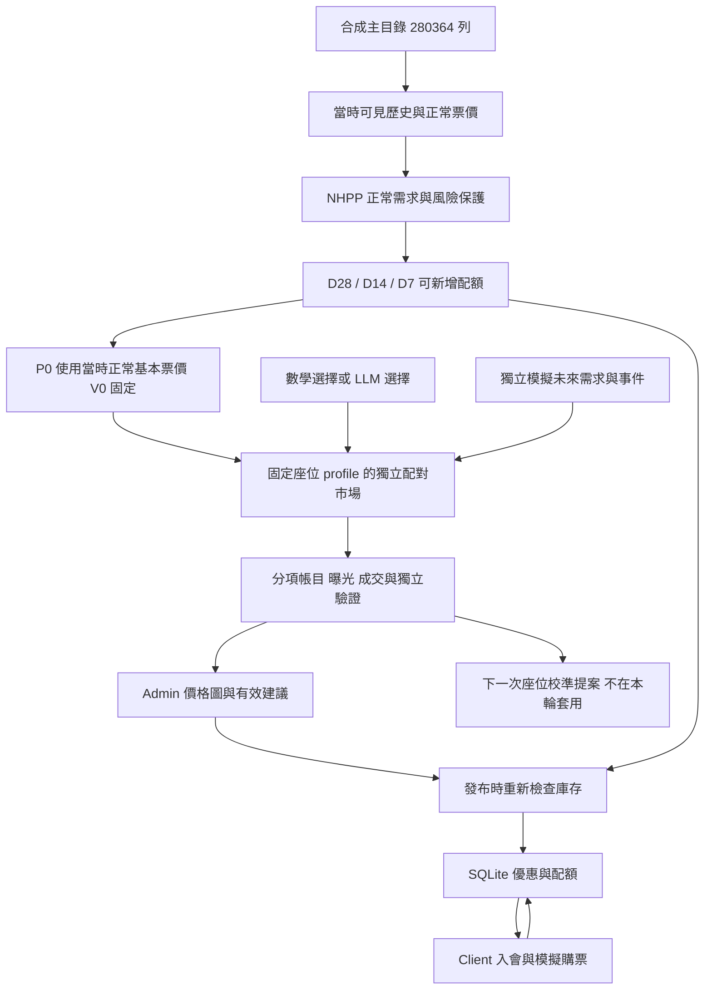

# NHPP 會員優惠平台技術實作

更新：2026-11-14。這份文件記錄現有程式；早期提案文件已刪除（Git 歷史可查），與原計劃的差異見下文「與原計劃的差異及限制」。使用者最新決定是先使用 NHPP，不使用 LightGBM。

## 最新主流程：雙軌逐輪優化

**最新修正：** 現行規格以 [航班優化流程](FLIGHT_SCOPED_OPTIMIZATION.md) 為準（`flight-policy-feedback-v4-original-fare`）。需求篩選、原價 P₀ 與收益範圍的修改經過見 [需求篩選與原價起點](DEMAND_FILTER_AND_ORIGINAL_FARE.md)；會員供應、配額三種口徑、零供應阻擋、購買者分組及固定座位 profile 的修正經過與驗證證據見 [2026-11-14 會員供應修正](MEMBER_SUPPLY_CORRECTIONS_2026-11-14.md)。新增 member demo 後主目錄 1,549 班／280,364 筆，含獨立驗證合共 680,364 筆。

Admin 已改為紫／青／白配色，四個主入口是 Forecast seats、Optimize prices、Experiments、Manage offers。Forecast 分開顯示預測會員空間、今天可新增配額、已發布可訂座位；座位圖使用同一 API 分解。正常需求基線的預計空位／訂位曲線及截至所選日的正常基本票價另外顯示。使用者指定移除的長篇假設、驗證及每日快照表已從該頁移除；資料及評估 API 保留。

Forecast seats 及 Optimize prices 均可按 Low／Medium／High demand 篩選航班。分類使用固定 D28 的 NHPP 預測起飛時正常訂位率，低於 60% 為 Low，60% 至低於 85% 為 Medium，85% 或以上為 High；不是直接讀取模擬情境名稱或事後真值。索引缺失、過期或無有效預測的航班列為 Unclassified。切換 D14／D7 後仍使用明示的 D28 分類參考；當下預測、供應及放票規則照常重新計算。

`backend/optimization.py` 的主流程版本為 `flight-policy-feedback-v4-original-fare`，必須選擇航線、日期／航班及 D28／D14／D7。新實驗的 P₀ 等於所選時點最近可見的正常基本票價，不能手動覆寫，也不再乘以 15% 或採用舊快照的折扣起點欄位；V₀ 可填寫並在該次搜尋固定。數學及 Live LLM 都在同一指定航班的獨立反事實世界內運行，使用該班已訂位、空位、正常基本票價及歷史；不再以一般多航班市場代替所選航班。啟動前檢查所選輪次有正會員配額；P₀ 附近先測試 ±25%，再做明示邊界探索。價格圖同時顯示貢獻、利潤率及會員買家，三項最大值分開標示；普通票買家、入會、票數及報價曝光另列，無供應／無曝光不作價格排名。

NHPP 本體及凍結校準保持不變；同一次價格搜尋和獨立驗證固定初始座位 profile，以免供應規則變化混入價格比較。完成市場仍根據正常需求誤差計算 proposed next calibration，僅記錄為下次實驗提案，不在本次套用。最後用兩個獨立種子驗證保留的價格候選。單航班收入分攤三分之一新年費／會員服務成本，實際現金仍收全額一次，因此不宣稱是最佳全年會費。詳見 [現行航班優化規格](FLIGHT_SCOPED_OPTIMIZATION.md)；修正經過見 [v3 會員供應修正](MEMBER_SUPPLY_CORRECTIONS_2026-11-14.md) 及 [v4 原價起點](DEMAND_FILTER_AND_ORIGINAL_FARE.md)。

SQLite 保存 run、world、round、event。Scoped Live 現在可在指定總額度內自動跨越內部小批次；總額度耗盡或 provider 失敗仍停止，UI 可追加額度。Manage offers 自行選航班／輪次，只建議同航班同輪次、版本符合且獨立驗證接受的結果，發布時再扣除已售會員位及前輪有效未售配額。Client 主要金額顯示 base fare，下方小字顯示費用及總付款；結帳核價不變。

以下快速網格、多航班會員期搜尋和既有實驗仍保留為參考及歷史證據。舊聯合優化引擎（`joint-policy-feedback-v1`）的兩維 P/V 搜尋只供測試及歷史實驗，不再是主要 Admin 的行為。

## 收入成本與 NO_OFFER 解釋

每條 optimization track 額外返回唯讀 `contribution_explanation`（`paired-contribution-explanation-v1`）：分開保留候選的搜尋及獨立驗證，按相同 seed／外生世界 SHA 配對。內容包括無優惠／有優惠的收入成本橋接、會費分攤及完整現金口徑、買家淨差、完成乘搭戶數和每次重播的服務門檻。資料缺失或配對身分不符時顯示 unavailable，不用 0 代替缺值。讀取不建立實驗、不修改舊結果或呼叫 LLM。

歷史實例 P84／V399 的 6 戶會員買家是對照市場中會買普通票的同 6 戶。在當時定義的單航班分攤口徑下，增量為 −HK$2,364；若計入本次實收全額新會費，現金貢獻差額為 −HK$1,380。兩者都沒有模擬會員後續行程的收入、成本或未來續會，不能據此推論完整會員計劃虧損或不可行。後續收益是「尚未建模」，不是零；也不能任意加上預期收入而省略相應成本、座位替代及對照市場。平均 75% 會員使用不代表每次都過 60%，兩次驗證為 100%／50%。歷史帳目及原始輸出保留於[逐筆審計](CONTRIBUTION_AUDIT_2026-11-14.md)。

主流程的 `NO_OFFER` 只表示這次單航班測試未接受候選，並非全年會員產品的結論。要回答完整會員期的盈利能力，需要在相同會員、完整時間線及多次行程中，只收一次會費，計入每次基本票價、附加收入、履約與服務成本，再與沒有會員方案的完整期間對照比較。這次需求篩選及原價起點更新沒有替單航班主流程新增全年市場模擬。

所選航班從實驗時點到起飛之間的後續普通票、會員票及取消已在事件時間線內，不能說主流程只算當天收入。尚未建模的是會員之後其他行程與實付續會。讀取結果另有 `economic_scope`，明示 `membership_term_evaluated: false`，未建模後續行程及續會貢獻使用 `null`，不是零。

## 架構

OAG回應與合成訂位資料沒有混成「真實訂位」。本地 HTTP 使用 Python 標準庫，前端不需要 Node build；模型使用 NumPy。SQLite交易確保一次扣位、同人同航班去重。這是本機展示應用，不是已部署的航空生產系統。

## 資料與時間

`simulation/network_generated/` 與 `simulation/member_demo_generated/` 各有 222 班、40,182 筆，37 個外站雙向共 74 條航線，每條三個日期。後者新增低／中正常需求的會員供應示範及高需求對照，沒有修改原始資料或校準。主目錄共 1,549 班／280,364 筆；原 CSV 下載仍為 200,000 筆，另 400,000 驗證資料不加入售票目錄，總數 680,364 筆。CTS／HFE 狀態仍保留，模擬日期不代表真實班表。

`simulation/generated/snapshots.csv.gz` 正好200000列：1104條D180–D0，以及1條D175–D0（其生成仍由D180暖機，只省略最早5個快照）。1105條都完整涵蓋D28至停售。D0定義為起飛前2小時，因此最後區間22小時。

每日欄位包括 flight_id、snapshot_at、days_to_departure、capacity、booked_seats、available_seats、empty_rate、normal_base_fare、mandatory_fees、normal_total_fare、gross_bookings、cancellations、interval_days。報價適用於快照之後；gross/cancellations記錄上一個完成區間。售罄與停售時報價為缺值，不當成零價。

資料有多航線、日期、容量和需求形狀。truth獨立保存潛在需求、未接受需求及生成參數，只作評估。模型不讀情境名稱、最終結果或未來報價。航班索引的情境與最終結果是事後檢視資料，不是預測特徵。

## NHPP v2與驗證

目前使用`nhpp-regime-mixture-v2`：歷史gross bookings似然、負／正beta、Gamma水準後驗、價格exposure假設、右截斷計數、變點後水準重估，以及未知未來持續／短暫跳變的混合路徑。給定每條強度路徑是NHPP，跨路徑是混合分布。取消與容量另行推進，未來真值與情境標籤不作輸入。

原始需求P90與校準操作保護量分開；D28／D14／D7分別校準。校準需符合模型設定和原始碼hash。定價模組讀取`demand_curve`及`protection_curve`，避免只用單一beta重建尾段。

凍結後240班final：D28突增保護覆蓋82.5%，同樣本原v1的16位規則為30%，v1經相同程序重校準為80%。原始需求分位數仍未達90%突增覆蓋。D14／D7需求MAE改善，D28整體需求MAE變差。參見[完整診斷](NHPP_V2_REVIEW.md)。

使用者要求更多資料後，再生成40萬筆，總資料60萬筆。模型及校準不變，對1200條新歷程產生7200次評分；D28突增200班保護覆蓋91.5%，D7尚未發生突增子群81.48%。兩批結果均保留；同一生成器擴樣不等於真實市場驗證。參見[擴大驗證](EXTENDED_VALIDATION.md)。

## 快速篩選用的定價市場

一次比較完整會員期的同一客群、出行機會與正常購買意圖。會員費每個人只收一次；航班日程均在設定會員期內，期間所有模擬用票成本均計入。正常票價固定，因此原正常購買者轉去會員票可用配對基線衡量，不把原需求重新作一次獨立價格過濾。

放票時點固定為D28、D14、D7三輪。搜尋P={0,30,70,100}、V={199,399,599,799}及可釋出量比例={.25,.5,.75,1}，最多64組；開放日不再是搜尋維度。每輪先計算保護後的目標未售配額，再扣除所有前輪尚未售出的有效配額，只新增差額。D13開始的全新篩選只包含未來D7輪；D6開始已沒有新的放票輪次。最終仍與NO_OFFER比較。服務限制包括合資格請求履約率與未用過會員比例。

財務差額為有會員與無會員的貢獻之差：會費＋正常與會員基本票價＋附加服務毛利－增量載客成本－會員服務成本－計劃成本。示例必付費假設全數代收代付，因此不作貢獻；真實燃油附加費需重新定義。正常客轉會員的差額已在配對比較中，不再另扣一次蠶食損失。

預設300人、24班的有限合成供應情境、2次搜尋重播；前幾名獨立種子和四種壓力情境另作評估。這不是整個HK Express航網。價格市場暫不建模續會、取消、競爭航司及團體整單交易；相關限制顯示於回應。未來可擴展重播和TPE，但現有網格已提供完整可重播循環。

## LLM旅程與共用市場

14個角色涵蓋不同預算、日期彈性、出行頻率、同行、協助與路線需求；權重是假設，沒有聲稱代表實際HK Express市場份額。

`llm_agent/journey.py`目前以`traveller-journey-v2.2-en`輸出英文理由與HKD金額；畫面人物名稱同步英文，原背景語言不改變預算或回覆語言。新增單趟旅程＋會費預算說明與全體同行報價算術；新回覆先通過語言／幣別檢查，再執行合法動作。真實五人30回覆驗證全部通過，舊多語言raw紀錄保持原樣，詳見[場景說明](LLM_SCENARIO_DESIGN.md)。該旅程基線有訂閱、D28／D14／D7、行程變動和期末意向六階段。人物預算、會員、訂位、退款和記憶持續存在，但每個反事實世界庫存獨立。Codex子代理已實際產生168個決策；DeepSeek已完成112世界672個有效provider決策，完整raw回應及失敗紀錄公開於`llm_agent/experiments/`。見[基線分析](LLM_SCENARIO_DESIGN.md)。

`backend/shared_market.py`及`llm_agent/market_experiment.py`建立後續共用市場：多班異質航班、全體旅客共用時間線及庫存、實際年度多次旅程、正常需求獨立生成、same-seed政策配對。LLM只選擇；環境驗證並扣款扣位，NHPP控制正常需求保護。數學策略與LLM策略使用同一觀察和帳本。

少量預先指定候選包括NO_OFFER、固定政策與候選政策。快速搜尋現為64組；其最優項只是共享市場的候選，不直接冒稱新的最優價。啟用會員的政策均使用D28/D14/D7三輪，按輪保存新增、已售、過期及未售餘額，不能用重設配額的方式重複放票。新的結果同時顯示財務與旅客事件；已付會員費不隨意重新收取，續會意向不計收入。先前shared-market-v2實驗仍保留舊設定及結果，不當作新放票規則的成績。

共享市場提示更新為 `shared-market-customer-v3.2-en`：入會時分開當前／入會後有效性，程式提供同一行程的完整付款、預算不足與扣會費後節省。LLM 理由保留原文；有限的算術／資格矛盾檢查只加審計標記，不改寫行動。

審計記錄包含prompt版本、情境雜湊、無授權header的request、原始response、usage、latency、cache標記、解析、合法性與狀態轉移。失敗不換成離線答案。唯一合法行動由環境執行，標示environment_forced；快取與新provider呼叫分開統計。真實金鑰只存於忽略的`.env.local`。

## Admin與會員入口

新增`/admin`及`/members`兩個介面。Admin的Customer panel改為背景工作，Live上限100人、規則模式1,000人，預設100；先看結果摘要、客群分組及可搜尋分頁名單，再載入單人的六階段。每批Live預設60、最多120個決策嘗試，唯一合法動作不呼叫LLM，快取與真正dispatch分開。每人checkpoint與prompt／model／實作hash支持安全續跑，輪詢不自動延長額度。

會員端從同一SQLite已發布優惠查詢航班、確認完整價格、按伺服器plan入會及購票，並保存My trips。Admin只管理會費和發布庫存，不再混放旅客入會／購買控制。這是UI與路徑分開，沒有宣稱生產權限隔離。詳見[新介面與API](ADMIN_AND_MEMBER_UX.md)。

## HTTP介面

| 方法及路徑 | 用途 |
| --- | --- |
| GET /api/optimization/suggestions | 指定 flight_id／forecast_day 的已驗證價格及即時可發布配額建議 |
| GET /api/summary | 列數、航班數、模型與LLM配置狀態 |
| GET /api/flights | 航班目錄及 D28 預測需求分類 |
| GET /api/flights/{id} | 航班與歷史快照 |
| POST /api/forecast | flight_id、days_to_departure；返回風險預測及三輪放票狀態，讀取本身不發位 |
| POST /api/optimize | flight_id、days_to_departure、config；返回候選／最佳／基線／測試 |
| GET /api/evaluation | 獨立測試報告 |
| GET /api/export/snapshots | gzip資料下載 |
| GET /api/personas | 客群覆蓋及假設人物 |
| POST /api/agents/run | 保留的小型同步相容介面；新Admin改用背景panel |
| POST / GET /api/agents/panels | 背景啟動／清單；live最多100人，rules最多1,000人 |
| GET /api/agents/panels/{id} | 進度、來源計數、分組及精簡人物列 |
| GET /api/agents/panels/{id}/people/{customer_id} | 按需讀取一人完整階段 |
| POST /api/agents/panels/{id}/resume | 明確增加一批額度 |
| GET /api/member-portal/config、flights、accounts/{id} | 會員plan、已發布航班、會員和行程 |
| POST /api/member-portal/plan、join、book | 管理會費、按plan入會、確認會員票 |
| GET /api/agents/runs/{id} | 保存的審計與原始輸出；大實驗以gzip匯出讀取 |
| POST /api/market/runs | 背景執行共用市場三組政策，逐批呼叫上限 |
| GET /api/market/runs/{id} | 狀態、政策比較、財務及實驗統計 |
| GET /api/market/runs/{id}/cases/{case_id} | 同一case的航班、旅客、行為與帳本 |
| POST /api/market/runs/{id}/resume | 明確追加一批呼叫；不自動延長額度 |
| GET /api/evaluation/extended | 額外1200班凍結模型驗證 |
| GET /api/offers | 尚未到期的展示優惠 |
| POST /api/offers | 只在D28/D14/D7的未執行輪次發出新增配額，扣除前輪有效未售位 |
| POST /api/members | 相容入會路徑，亦使用伺服器plan會費；重複呼叫不再收費 |
| POST /api/bookings | 原子扣位、要求有效會員、阻擋重複購買 |
| GET /api/oag | 私有快取的正常化班表與預測容量 |
| GET /api/status | 外部服務狀態及限制 |

POST需要JSON、同源Origin、有效數值與ID。服務只綁定127.0.0.1，靜態檔案僅提供frontend/，不能下載.env或資料庫。會員購票永遠是模擬。新版SQLite示例允許同航班按D28→D14→D7推進，每輪最多發布一次，禁止時間倒退重開舊輪次。前輪仍有效未售位會結轉；售出會員位另計入物理佔用，避免靜態正常訂位快照漏算示例交易。非放票日仍可觀察預測，但不能新增優惠。詳見[三輪規則](THREE_ROUND_RELEASE.md)。

## 與原計劃的差異及限制

早期提案（LightGBM＋LLM循環）與現行實作的差異：

| 原計劃／風險 | 現有實作 | 原因與影響 |
| --- | --- | --- |
| LightGBM預測正常需求 | NHPP參數推斷，沒有LightGBM依賴 | 遵從最新決定；形狀、參數與不確定性可解釋 |
| 單一七天比例推斷beta | 最近多區間計數似然、先驗收縮、beta可負 | 降低單一小樣本的指數外推；仍需真實校準 |
| 原文beta截斷0至0.06 | 明示工程網格與先驗，無業界上限聲稱 | 允許需求衰退並揭露邊界假設 |
| 將需求均值直接當未售位 | 800條需求／取消／容量路徑 | 正確處理需求超容量與非線性截斷 |
| 名義P90當90%保護 | 原始分位數＋逐時點分情境校準保護量，保留兩批獨立驗證 | v2不同批次D28突增82.5%／91.5%；未知未來突增仍有缺口 |
| 用LLM虛擬人物當真實客群 | 14類情境、Codex實際pilot、DeepSeek真實呼叫，與規則來源分開 | 原始回應可稽核，但模型選擇仍不是真人ground truth |
| 每輪重新訓練預測模型 | 固定NHPP及市場，搜尋商業參數 | 能分辨收益改變來自策略或世界假設 |
| 直接最優化P與V | 固定D28/D14/D7三輪；主流程在指定航班上固定V₀、只搜尋會員票價P，與NO_OFFER配對比較 | 按最新業務規則把放票時點與數量分開；全期P/V搜尋只留作參考工具 |
| 預設高級優化／RL | 參考用快速篩選器為完整有限網格（64組）；主流程為有界局部票價搜尋 | 固定三輪後移除開放日維度；不用先建立昂貴RL訓練 |
| 一年會費與一班28天比較 | 固定會員期內多班合成目錄，全部用票成本計入 | 避免重複算會費或漏算後續使用 |
| 全部資料混放 | frontend/backend/simulation/llm_agent獨立 | 各角色可獨立開發與驗證 |
| OAG視為訂位／票價來源 | OAG背景私有快取，合成數據另列 | 實際取得10筆UO航班，座位是預測容量 |

仍需披露的限制：

1. **真實校準仍缺。** 全部 680,364 列均為合成數據，OAG Flight Info沒有每日訂位／報價或會員曝光轉換。優先取得真實計數、可售曝光、購買請求及促銷紀錄。
2. **未知未來突增不可由相同歷史辨認。** 混合風險先驗與保守保護量能改善部分覆蓋，不能預知事件；較高釋位也提高擠出正常客的風險。保留D28需求MAE退步及D7子群缺口。
3. **會員造成區間內售罄的exposure。** 如果會員在區間內用完位，正常gross=0不等於整日零需求。現時不超賣，但取消後的後續需求估計可能偏低。後續應記錄事件級可售時間並建立新的模型／校準版本。
4. **LLM不是需求真值。** 固定temperature不保證選擇相同；60次probe沒有排序或語言翻轉也不證明無偏。以真人同題實驗與試點交易校準，再估價格反應。
5. **有限目錄範圍。** 目前6–12班、有限已知出行機會；不是整個HK Express真實航網。基線以HKG出發為主，完整入境／來回聯程、競爭航司及全年未知新增出行仍需擴展。
6. **財務口徑。** 顯示貢獻包含增量載客、行李、會員服務和計劃成本；必付費為明示代收代付假設。沒有完整固定機隊成本、實際稅務或正式收益確認，因此不稱航空公司淨利。
7. **正式部署。** 本地服務與模擬SQLite不能公開當生產系統；需要身份授權、工作排程／限額、真實庫存、secret manager及票務整合。現時沒有真實付款或出票。

## 執行及驗證

參見README安裝與啟動指令。兩組unittest分別覆蓋既有模擬器／新資料、NHPP／市場／交易；本次91＋19項全部通過。`scripts/smoke_api.py`對實際HTTP服務驗證資料、預測、64組搜尋、停售、人物、訂閱／購買及私有路徑保護。`scripts/smoke_three_round_api.py`驗證同班三輪發布、結轉、購票及不合法輪次拒絕。三輪回歸另檢查第二輪扣第一輪、第三輪扣前兩輪、售出不重扣、過期不結轉及輪次冪等。兩個API smoke及前端完整交易smoke皆重新通過。前端另有桌面及390px手機瀏覽器檢查，記錄於前端進度文件。

新三輪環境另外完成40種子×3政策＝120個規則市場，3240筆逐輪公式和所有帳本／庫存檢查通過，沒有新增LLM呼叫。結果與限制見[本次三輪驗證](THREE_ROUND_RELEASE.md#本次三輪規則的獨立市場重播)；v2報告保留為歷史證據。

## Continuous-pricing branch update — 2026-11-14

The new continuous-price and probabilistic-user path is documented in [CONTINUOUS_PRICING.md](CONTINUOUS_PRICING.md). It uses the existing shared engine, a fixed membership fee/release share, bounded cent-resolution search, paired NO_OFFER, independent validation and sensitivity stresses. Historical fixed-tier and LLM reports remain unchanged. No online human learning or autonomous live repricing is implemented. Windows locks and frozen prompt byte copies are portable; checkout rules preserve frozen NHPP source bytes.

## Docker 团队运行环境

完整应用可通过 `docker compose up --build -d --wait` 启动。单一 Linux 容器包含前端、API、NHPP、定价和用户模拟；保留原生 fcntl。持久化卷保存数据库和实验，服务凭据仅运行时注入。构建固定基础镜像摘要与 Python 依赖，测试服务独立且无外网。详见 [DOCKER.md](DOCKER.md)。
