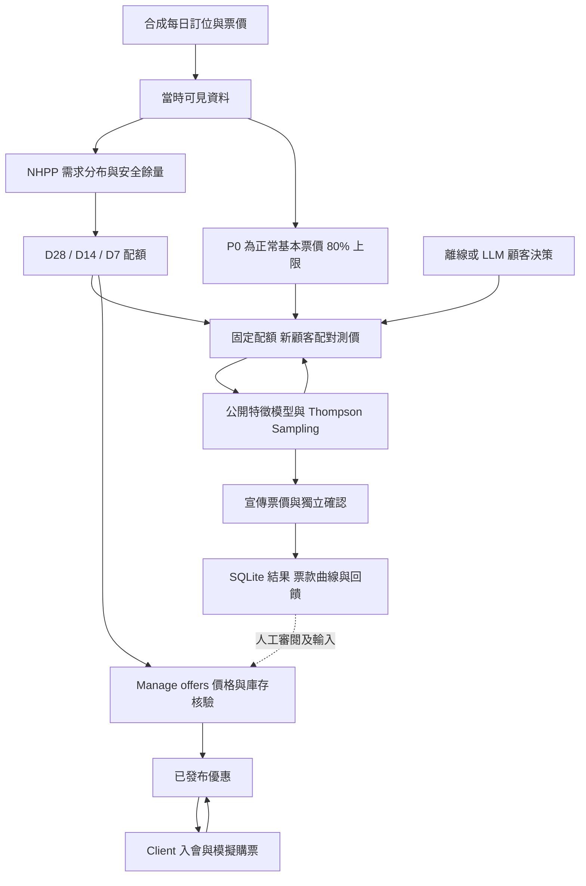

# NHPP 與 Thompson 平台技術實作

> 状态：现行 · 对应代码：`hkx-network-2`、`member-thompson-v5-marketing`、`public-member-response-v1`、`nhpp-regime-mixture-v2`、`nhpp-smooth-mixture-v3`、`backend/forecast.py`、`three-round-release-v1`、`member-marketing-fare-v1`

更新：2026-11-15。目前只保留 NHPP 座位預測、Thompson Sampling 會員基本票價、已保存會員回饋、人工發布及 Client 模擬購票。舊 Math／Math+LLM、聯合會費、共用市場、panel、journey、連續定價程式與資料已移除；不再提供相容入口。現行規格以 [Thompson 流程](FLIGHT_SCOPED_OPTIMIZATION.md) 及 [三輪放票](THREE_ROUND_RELEASE.md) 為準。

## 架構

Python 標準庫 HTTP 服務直接提供前端靜態資源，無 Node build。數值模型使用 NumPy；SQLite 保存實驗與示例交易。Admin 四入口為 Forecast、Optimize、Experiments、Manage offers；會員端為 `/members`。界面配色為紫 `#6F2C91`、青 `#24BCDC`、白。

## 資料與預測

**預設售票目錄為 HK Express 航線網絡（`hkx-network-2`，`simulation/hkx_generated/`）**：1,558班／281,998筆每日觀測，涵蓋全部40個航點雙向（80條航線）及四種機型（A320 180座、A320neo 188座、A321 230座、A321neo 236座，一架239座）。13個出發日期跨淡季、平季及暑假、國慶黃金周、聖誕、農曆新年，並混合平日與週末；每個日期沿用OAG樣本周（2026-11-16至22，HKG出發410班）同一星期幾的航班號、出發時間、機型及飛行時間（`simulation/hkx_schedule_profile.json`；原始回應只存於被忽略的 `data/private/`）。樣本周未運營的6個季節航點只在IATA夏季日期以假設班次運行；回程用去程航班號+1。票價隨飛行時間及市場變化，稅費按出發國家假設；需求沿用原外生票價NHPP。生成時檢查：平均載客率82.9%、起飛時售罄26.5%、提前30天以上售罄2.7%；同一種子逐位元重現。凍結預測器在新目錄的樣本外檢查（`simulation/hkx_validation/report.json`，未調參）：D28／D14／D7保護覆蓋99.8%／99.7%／99.9%，放票航班5.8%／14.3%／25.7%，放票造成正常收入損失0.04%／0.08%／0%；D28預測剩餘需求偏高約21%，放票偏保守。

舊目錄（`UOPTION_DATASET=legacy`）保留1,549班／280,364筆，包含原200,000筆及兩批40,182筆補充航線資料；另400,000筆用於獨立擴大評估。已保存實驗所用航班（如 `SYN-00017`、`NET-HKG-KMQ-20270518`）屬舊目錄。全部訂位、票價與取消都是合成資料。OAG Flight Info只提供班表／容量背景，不能冒充真實訂位曲線或顧客價格反應。

預測入口為 `backend/forecast.py`。D28使用凍結v2分布及重新校準的安全餘量；D14／D7使用平滑v3。資料截止所選日，不讀未來銷量、事後空座或隱藏生成參數。預測保留參數不確定性、跳變路徑、售罄截斷與取消；詳見 [NHPP v3](NHPP_V3_REVIEW.md) 及 [NHPP v2](NHPP_V2_REVIEW.md)。校準報告與失敗候選仍保留，不能因清理舊定價工具而刪除預測證據。

Forecast分開顯示NHPP建議會員空間、預測會員空間、今天可新增配額及已發布可訂座位；正常訂位與價格曲線另列。Low／Medium／High需求標籤取D28預測正常訂位率，不是放票保證。發布只限D28／D14／D7，扣除已售會員位及前輪有效未售配額，詳見三輪規格。

## 唯一定價流程

`backend/adaptive_pricing.py`管理每個指定航班的實驗；`member_response.py`以公開的客群及日期彈性特徵擬合購買機率，用近似後驗的Thompson抽樣選下一個整數價格。旅客私人預算、動機及未來結果不交給學習器。

所有新實驗固定八類`flexible_deal_seekers`，權重可調。每輪新客群在候選／初始價的重置世界中配對選擇；模型只學搜尋期資料，最終確認的顧客不回流調價。LLM理由可提出有證據的方向假說，再由有界Thompson價格測試驗證，不能直接當作真人支付意願。

P₀為正常基本票價80%上限。最終會員價向下取尾數9，低於HK$30歸零；原始30–38取整為29，亦歸零。候選及初始對照均先格式化，再由至少三批新顧客與無優惠比較。收入均按實際格式化票價計算；有較高均值並不自動通過採用門檻。

顧客已入會；價格目標是會員基本票款與購買人數的取捨，不計會費、稅費、燃油或營運成本。確認保留正常票替代及NO_OFFER對照，不能把折價取代正常購票當作完全新增收入。結果可能為ADOPT_CANDIDATE、KEEP_INITIAL、INCONCLUSIVE或NO_OFFER，並非已證明真實最優價。

## 持久化及執行邊界

- `adaptive_store.py`保存當前v5的設定、輪次、分析、決策、驗證及原始輸出審計；只有支援的八類客群結果對外提供。
- `store.py`保存優惠、示例會員及訂位；發布與結帳以SQLite交易處理，防止重發、超賣及重複購買。
- `llm_agent/adaptive_customers.py`與provider適配層進行有限並行呼叫；新呼叫、快取、強制動作及失敗分開計數。provider失敗不以合成成功回覆替代。
- `.env.local`、`data/private/`及OAG原始快取不公開；目前實驗的公開匯出使用已遮蔽report／audit／manifest。
- 會員網站庫存與定價實驗的重置世界分開。結果不自動發布；Manage offers須人工輸入並重新檢查。

## HTTP介面

| 方法及路徑 | 用途 |
|---|---|
| GET `/api/health`、`/api/summary`、`/api/status` | 健康、資料摘要及服務狀態 |
| GET `/api/flights`、`/api/flights/{id}` | 航班目錄、需求分類及當時可見歷史 |
| POST `/api/forecast` | 正常需求、座位保護及放票狀態；讀取不發位 |
| GET `/api/evaluation`、`/api/evaluation/extended` | 已保存NHPP驗證；缺少必要證據返回不可用狀態 |
| GET `/api/export/snapshots`、`/api/oag` | 合成資料下載、正常化OAG背景資料 |
| GET `/api/adaptive-pricing/status` | 當前客群設定及provider狀態 |
| POST `/api/adaptive-pricing/scope` | 指定航班的P₀、正常票價和會員配額 |
| GET／POST `/api/adaptive-pricing/runs` | 列出目前v5實驗／明確建立新實驗 |
| GET `/api/adaptive-pricing/runs/{id}`、`/{id}/events`、`/{id}/export` | 進度、輪次、回饋、審計與匯出 |
| GET／POST `/api/offers` | 查閱／人工發布三輪配額 |
| GET `/api/member-portal/config`、`/plan`、`/flights`、`/accounts/{id}` | 會員plan、優惠及行程 |
| POST `/api/member-portal/plan`、`/join`、`/book` | 更新會員plan、模擬入會及購票 |

狀態修改要求JSON、同源Origin及合法數值。示例身份是本機ID，並非生產身份驗證；沒有真實付款或航空出票。舊定價／panel／共用市場API及舊實驗ID返回404，不會映射為新的成功結果；舊頁面hash顯示不可用。舊optimization_run_id／mode優惠綁定欄位會被拒絕。

## 與最初構想的差異

| 原構想 | 現行實作及原因 |
|---|---|
| LightGBM直接預測會員價 | NHPP保護正常需求，Thompson另學基本票價，分開風險和行為問題 |
| 同時找全年會費與票價 | 已入會顧客，只測一班票價；沒有宣稱最佳全年會費 |
| 用LLM答案當真實標籤 | 合成行為實驗，保留原始輸出；仍需真人或航空曝光／成交資料校準 |
| 每輪改座位預測器 | 一次價格比較固定配額，避免供應變化混入票價效果 |
| 價格最高均值即採用 | 新客群配對確認，保留無定論及不採用結果 |

軟件測試、資料完整性與經濟驗證是不同層次。當前執行紀錄見 [維護紀錄](ITERATION_2_PROGRESS.md)，公開定價結果見 [v5實驗索引](../llm_agent/experiments/README.md)。
