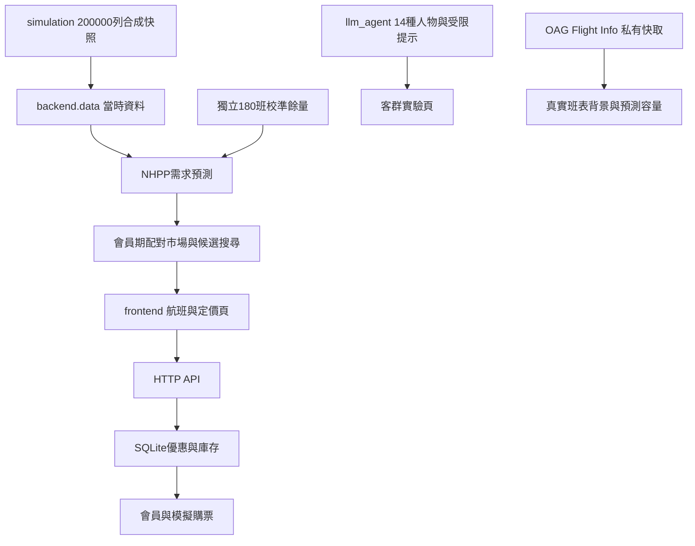

# NHPP 會員優惠平台技術實作

更新：2026-11-14。這份文件記錄現有程式；早期 TECHNICAL_DESIGN.md 及 PRICING_SIMULATION_PLAN.md 保留為歷史提案。使用者最新決定是先使用 NHPP，不使用 LightGBM。

## 架構

OAG回應與200000列合成資料沒有混成「真實訂位」。本地 HTTP 使用 Python 標準庫，前端不需要 Node build；模型使用 NumPy。SQLite交易確保一次扣位、同人同航班去重。這是本機展示應用，不是已部署的航空生產系統。

## 資料與時間

`simulation/generated/snapshots.csv.gz` 正好200000列：1104條D180–D0，以及1條D175–D0（其生成仍由D180暖機，只省略最早5個快照）。1105條都完整涵蓋D28至停售。D0定義為起飛前2小時，因此最後區間22小時。

每日欄位包括 flight_id、snapshot_at、days_to_departure、capacity、booked_seats、available_seats、empty_rate、normal_base_fare、mandatory_fees、normal_total_fare、gross_bookings、cancellations、interval_days。報價適用於快照之後；gross/cancellations記錄上一個完成區間。售罄與停售時報價為缺值，不當成零價。

資料有多航線、日期、容量和需求形狀。truth獨立保存潛在需求、未接受需求及生成參數，只作評估。模型不讀情境名稱、最終結果或未來報價。航班索引的情境與最終結果是事後檢視資料，不是預測特徵。

## NHPP

以決策時點為t=0，局部正常需求強度為 `lambda(t)=rate*exp(beta*t)`。用最近35日可觀測gross計數與區間積分作似然，beta網格[-0.12,0.12]、常態先驗均值0.015／標準差0.04，以及rate的Gamma先驗。對beta與rate抽樣800條未來路徑，取消另作估計並受容量限制。

這是明確的參數推斷，不是訓練價格回歸器。負beta合法；beta邊界和先驗是工程假設，不是航空業標準。達容量的區間不當成完整需求；刪除截斷區間可能仍造成選擇偏差，所以截斷超過25%、可用歷史不足7個區間或偵測突增時不釋出新會員位。

模型輸出需求均值、預期未售座位／比例、預測訂位曲線與P10/P90，以及原始需求P90和操作保護量。未知未來衝擊與票價改變不會被神奇預知。未實作完整截斷似然或價格彈性估計，需列入後續改善。

## 校準與獨立驗證

180班校準與180班測試ID不重疊。校準使用`actual potential demand - raw P90`的上方次序統計量，得到非負16位保護餘量。調整的是操作保護量，不更改預測均值／帶，也不聲稱得到新後驗P90。

獨立測試結果：需求MAE29.2387（最近7天基線35.1529）、未售位MAE13.0674、原始P90覆蓋75%、加餘量83.89%、持續突增子群47.62%。最終測試後未再次調參。此校準針對D28，其他天採用相同餘量只是保守工程轉用，並未逐日驗證。校準檔含cohort及模型版本資訊，修改模型後需重新分開校準與評估。

## 定價市場

一次比較完整會員期的同一客群、出行機會與正常購買意圖。會員費每個人只收一次；航班日程均在設定會員期內，期間所有模擬用票成本均計入。正常票價固定，因此原正常購買者轉去會員票可用配對基線衡量，不把原需求重新作一次獨立價格過濾。

搜尋P={0,30,70,100}、V={199,399,599,799}、開放日={28,14,7}及可釋出量比例={.25,.5,.75,1}。D28最多192組；D7排除過去開放日；D0不開優惠。最終必須與NO_OFFER比較。服務限制包括合資格請求履約率與未用過會員比例。

財務差額為有會員與無會員的貢獻之差：會費＋正常與會員基本票價＋附加服務毛利－增量載客成本－會員服務成本－計劃成本。示例必付費假設全數代收代付，因此不作貢獻；真實燃油附加費需重新定義。正常客轉會員的差額已在配對比較中，不再另扣一次蠶食損失。

預設300人、24班的有限合成供應情境、2次搜尋重播；前幾名獨立種子和四種壓力情境另作評估。這不是整個HK Express航網。價格市場暫不建模續會、取消、競爭航司及團體整單交易；相關限制顯示於回應。未來可擴展重播和TPE，但現有網格已提供完整可重播循環。

## LLM與客群

14個情境涵蓋彈性低預算、學生、固定假期、高頻休閒、家庭、雙人、探親訪友、臨時必要、自費商務、入境、小組、安排協助、低頻與無匹配旅客。權重是假設，不能聲稱覆蓋了實際分布。

入會與購票分兩階段。每階段只有合法選項、完整價格和目前預算；LLM不知道航空公司利潤目標。JSON輸出經行動、option_id與預算驗證。live模式兩階段均可呼叫HTTPS Chat Completions服務；最多5人（每人最多兩次呼叫），快取模型／提示／情境相同的有效結果。失敗直接回報，不偷偷改成離線答案。

目前未配置LLM金鑰，因此實際展示預設deterministic，live接口尚未實測。定價搜尋使用數學市場；個體LLM結果不會自動當作真實價格ground truth，也不會在每輪修改用戶偏好以美化收益。

## HTTP介面

| 方法及路徑 | 用途 |
| --- | --- |
| GET /api/summary | 列數、航班數、模型與LLM配置狀態 |
| GET /api/flights | 航班目錄 |
| GET /api/flights/{id} | 航班與歷史快照 |
| POST /api/forecast | flight_id、days_to_departure；返回forecast |
| POST /api/optimize | flight_id、days_to_departure、config；返回候選／最佳／基線／測試 |
| GET /api/evaluation | 獨立測試報告 |
| GET /api/export/snapshots | gzip資料下載 |
| GET /api/personas | 客群覆蓋及假設人物 |
| POST /api/agents/run | deterministic或live、count、會員價與票價 |
| GET /api/offers | 尚未到期的展示優惠 |
| POST /api/offers | 基於當前預測保護量發出限額 |
| POST /api/members | 以customer_id建立一年示例會員，重複呼叫不再收費 |
| POST /api/bookings | 原子扣位、要求有效會員、阻擋重複購買 |
| GET /api/oag | 私有快取的正常化班表與預測容量 |
| GET /api/status | 外部服務狀態及限制 |

POST需要JSON、同源Origin、有效數值與ID。服務只綁定127.0.0.1，靜態檔案僅提供frontend/，不能下載.env或資料庫。會員購票永遠是模擬；有效優惠最長24小時，D1為22小時，不跨過停售。已發出優惠的同一航班不能直接切換模擬日期以重新取得庫存。

## 執行及驗證

參見README安裝與啟動指令。兩組unittest分別覆蓋既有模擬器／新資料、NHPP／市場／交易。`scripts/smoke_api.py`對實際HTTP服務驗證資料、預測、192組搜尋、停售、人物、訂閱／購買及私有路徑保護。前端另外以桌面及390px手機瀏覽器檢查，記錄於前端進度文件。
