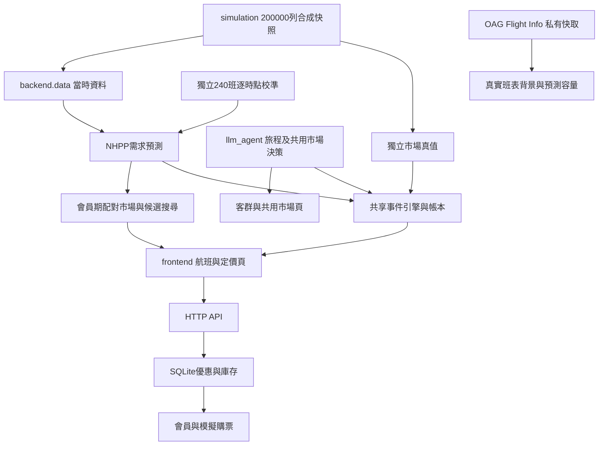

# NHPP 會員優惠平台技術實作

更新：2026-11-14。這份文件記錄現有程式；早期 TECHNICAL_DESIGN.md 及 PRICING_SIMULATION_PLAN.md 保留為歷史提案。使用者最新決定是先使用 NHPP，不使用 LightGBM。

## 架構

OAG回應與200000列合成資料沒有混成「真實訂位」。本地 HTTP 使用 Python 標準庫，前端不需要 Node build；模型使用 NumPy。SQLite交易確保一次扣位、同人同航班去重。這是本機展示應用，不是已部署的航空生產系統。

## 資料與時間

`simulation/generated/snapshots.csv.gz` 正好200000列：1104條D180–D0，以及1條D175–D0（其生成仍由D180暖機，只省略最早5個快照）。1105條都完整涵蓋D28至停售。D0定義為起飛前2小時，因此最後區間22小時。

每日欄位包括 flight_id、snapshot_at、days_to_departure、capacity、booked_seats、available_seats、empty_rate、normal_base_fare、mandatory_fees、normal_total_fare、gross_bookings、cancellations、interval_days。報價適用於快照之後；gross/cancellations記錄上一個完成區間。售罄與停售時報價為缺值，不當成零價。

資料有多航線、日期、容量和需求形狀。truth獨立保存潛在需求、未接受需求及生成參數，只作評估。模型不讀情境名稱、最終結果或未來報價。航班索引的情境與最終結果是事後檢視資料，不是預測特徵。

## NHPP v2與驗證

目前使用`nhpp-regime-mixture-v2`：歷史gross bookings似然、負／正beta、Gamma水準後驗、價格exposure假設、右截斷計數、變點後水準重估，以及未知未來持續／短暫跳變的混合路徑。給定每條強度路徑是NHPP，跨路徑是混合分布。取消與容量另行推進，未來真值與情境標籤不作輸入。

原始需求P90與校準操作保護量分開；D28／D14／D7分別校準。校準需符合模型設定和原始碼hash。定價模組讀取`demand_curve`及`protection_curve`，避免只用單一beta重建尾段。

凍結後240班final：D28突增保護覆蓋82.5%，同樣本原v1的16位規則為30%，v1經相同程序重校準為80%。原始需求分位數仍未達90%突增覆蓋。D14／D7需求MAE改善，D28整體需求MAE變差。參見[完整診斷](NHPP_V2_REVIEW.md)。

使用者要求更多資料後，再生成40萬筆，總資料60萬筆。模型及校準不變，對1200條新歷程產生7200次評分；D28突增200班保護覆蓋91.5%，D7尚未發生突增子群81.48%。兩批結果均保留；同一生成器擴樣不等於真實市場驗證。參見[擴大驗證](EXTENDED_VALIDATION.md)。

## 快速篩選用的定價市場

一次比較完整會員期的同一客群、出行機會與正常購買意圖。會員費每個人只收一次；航班日程均在設定會員期內，期間所有模擬用票成本均計入。正常票價固定，因此原正常購買者轉去會員票可用配對基線衡量，不把原需求重新作一次獨立價格過濾。

放票時點固定為D28、D14、D7三輪。搜尋P={0,30,70,100}、V={199,399,599,799}及可釋出量比例={.25,.5,.75,1}，最多64組；開放日不再是搜尋維度。每輪先計算保護後的目標未售配額，再扣除所有前輪尚未售出的有效配額，只新增差額。D13開始的全新篩選只包含未來D7輪；D6開始已沒有新的放票輪次。最終仍與NO_OFFER比較。服務限制包括合資格請求履約率與未用過會員比例。

財務差額為有會員與無會員的貢獻之差：會費＋正常與會員基本票價＋附加服務毛利－增量載客成本－會員服務成本－計劃成本。示例必付費假設全數代收代付，因此不作貢獻；真實燃油附加費需重新定義。正常客轉會員的差額已在配對比較中，不再另扣一次蠶食損失。

預設300人、24班的有限合成供應情境、2次搜尋重播；前幾名獨立種子和四種壓力情境另作評估。這不是整個HK Express航網。價格市場暫不建模續會、取消、競爭航司及團體整單交易；相關限制顯示於回應。未來可擴展重播和TPE，但現有網格已提供完整可重播循環。

## LLM旅程與共用市場

14個角色涵蓋不同預算、日期彈性、出行頻率、同行、協助與路線需求；權重是假設，沒有聲稱代表實際HK Express市場份額。

`llm_agent/journey.py`目前以`traveller-journey-v2.2-en`輸出英文理由與HKD金額；畫面人物名稱同步英文，原背景語言不改變預算或回覆語言。新增單趟旅程＋會費預算說明與全體同行報價算術；新回覆先通過語言／幣別檢查，再執行合法動作。真實五人30回覆驗證全部通過，舊多語言raw紀錄保持原樣，詳見[場景說明](LLM_SCENARIO_DESIGN.md)。該旅程基線有訂閱、D28／D14／D7、行程變動和期末意向六階段。人物預算、會員、訂位、退款和記憶持續存在，但每個反事實世界庫存獨立。Codex子代理已實際產生168個決策；DeepSeek已完成112世界672個有效provider決策，完整raw回應及失敗紀錄公開於`llm_agent/experiments/`。見[基線分析](LLM_BASELINE_EXPERIMENTS.md)。

`backend/shared_market.py`及`llm_agent/market_experiment.py`建立後續共用市場：多班異質航班、全體旅客共用時間線及庫存、實際年度多次旅程、正常需求獨立生成、same-seed政策配對。LLM只選擇；環境驗證並扣款扣位，NHPP控制正常需求保護。數學策略與LLM策略使用同一觀察和帳本。

少量預先指定候選包括NO_OFFER、固定政策與候選政策。快速搜尋現為64組；其最優項只是共享市場的候選，不直接冒稱新的最優價。啟用會員的政策均使用D28/D14/D7三輪，按輪保存新增、已售、過期及未售餘額，不能用重設配額的方式重複放票。新的結果同時顯示財務與旅客事件；已付會員費不隨意重新收取，續會意向不計收入。先前shared-market-v2實驗仍保留舊設定及結果，不當作新放票規則的成績。

審計記錄包含prompt版本、情境雜湊、無授權header的request、原始response、usage、latency、cache標記、解析、合法性與狀態轉移。失敗不換成離線答案。唯一合法行動由環境執行，標示environment_forced；快取與新provider呼叫分開統計。真實金鑰只存於忽略的`.env.local`。

## Admin與會員入口

新增`/admin`及`/members`兩個介面。Admin的Customer panel改為背景工作，Live上限100人、規則模式1,000人，預設100；先看結果摘要、客群分組及可搜尋分頁名單，再載入單人的六階段。每批Live預設60、最多120個決策嘗試，唯一合法動作不呼叫LLM，快取與真正dispatch分開。每人checkpoint與prompt／model／實作hash支持安全續跑，輪詢不自動延長額度。

會員端從同一SQLite已發布優惠查詢航班、確認完整價格、按伺服器plan入會及購票，並保存My trips。Admin只管理會費和發布庫存，不再混放旅客入會／購買控制。這是UI與路徑分開，沒有宣稱生產權限隔離。詳見[新介面與API](ADMIN_AND_MEMBER_UX.md)。

## HTTP介面

| 方法及路徑 | 用途 |
| --- | --- |
| GET /api/summary | 列數、航班數、模型與LLM配置狀態 |
| GET /api/flights | 航班目錄 |
| GET /api/flights/{id} | 航班與歷史快照 |
| POST /api/forecast | flight_id、days_to_departure；返回風險預測及三輪放票狀態，讀取本身不發位 |
| POST /api/optimize | flight_id、days_to_departure、config；返回候選／最佳／基線／測試 |
| GET /api/evaluation | 獨立測試報告 |
| GET /api/export/snapshots | gzip資料下載 |
| GET /api/personas | 客群覆蓋及假設人物 |
| POST /api/agents/run | 保留的小型同步相容介面；新Admin改用背景panel |
| POST / GET /api/agents/panels | 背景啟動／清單；live最多100人，rules最多1,000人 |
| GET /api/agents/panels/{id} | 進度、來源計數、分組及精簡人物列 |
| GET /api/agents/panels/{id}/people/{customer_id} | 按需讀取一人完整階段 |
| POST /api/agents/panels/{id}/resume | 明確增加一批額度 |
| GET /api/member-portal/config、flights、accounts/{id} | 會員plan、已發布航班、會員和行程 |
| POST /api/member-portal/plan、join、book | 管理會費、按plan入會、確認會員票 |
| GET /api/agents/runs/{id} | 保存的審計與原始輸出；大實驗以gzip匯出讀取 |
| POST /api/market/runs | 背景執行共用市場三組政策，逐批呼叫上限 |
| GET /api/market/runs/{id} | 狀態、政策比較、財務及實驗統計 |
| GET /api/market/runs/{id}/cases/{case_id} | 同一case的航班、旅客、行為與帳本 |
| POST /api/market/runs/{id}/resume | 明確追加一批呼叫；不自動延長額度 |
| GET /api/evaluation/extended | 額外1200班凍結模型驗證 |
| GET /api/offers | 尚未到期的展示優惠 |
| POST /api/offers | 只在D28/D14/D7的未執行輪次發出新增配額，扣除前輪有效未售位 |
| POST /api/members | 相容入會路徑，亦使用伺服器plan會費；重複呼叫不再收費 |
| POST /api/bookings | 原子扣位、要求有效會員、阻擋重複購買 |
| GET /api/oag | 私有快取的正常化班表與預測容量 |
| GET /api/status | 外部服務狀態及限制 |

POST需要JSON、同源Origin、有效數值與ID。服務只綁定127.0.0.1，靜態檔案僅提供frontend/，不能下載.env或資料庫。會員購票永遠是模擬。新版SQLite示例允許同航班按D28→D14→D7推進，每輪最多發布一次，禁止時間倒退重開舊輪次。前輪仍有效未售位會結轉；售出會員位另計入物理佔用，避免靜態正常訂位快照漏算示例交易。非放票日仍可觀察預測，但不能新增優惠。詳見[三輪規則](THREE_ROUND_RELEASE.md)。

## 執行及驗證

參見README安裝與啟動指令。兩組unittest分別覆蓋既有模擬器／新資料、NHPP／市場／交易；本次91＋19項全部通過。`scripts/smoke_api.py`對實際HTTP服務驗證資料、預測、64組搜尋、停售、人物、訂閱／購買及私有路徑保護。`scripts/smoke_three_round_api.py`驗證同班三輪發布、結轉、購票及不合法輪次拒絕。三輪回歸另檢查第二輪扣第一輪、第三輪扣前兩輪、售出不重扣、過期不結轉及輪次冪等。兩個API smoke及前端完整交易smoke皆重新通過。前端另有桌面及390px手機瀏覽器檢查，記錄於前端進度文件。

新三輪環境另外完成40種子×3政策＝120個規則市場，3240筆逐輪公式和所有帳本／庫存檢查通過，沒有新增LLM呼叫。結果與限制見[本次三輪驗證](THREE_ROUND_RELEASE.md#本次三輪規則的獨立市場重播)；v2報告保留為歷史證據。
