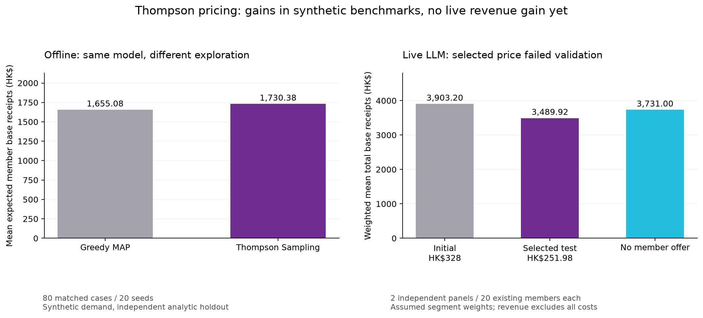

# Flight-specific Admin workflow

> 状态：现行 · 对应代码：`flight-policy-feedback-v8-whole-hkd`、`fixed-seat-profile-local-fare-v2-whole-hkd`、`formula-scan-v2-whole-hkd`、`backend/fare_policy.py`、`nhpp-completed-market-feedback-v1`、`nhpp-d28-demand-catalog-v1`、`member-thompson-v4-paired`、`public-member-response-v1`、`weighted-member-panel-v3-motivation`、`adaptive-member-decisions-v4-hypotheses`、`whole-hkd-quotes-v1`、`backend/forecast.py`

Current specification, updated 2026-11-14 for engine `flight-policy-feedback-v8-whole-hkd` (`backend/optimization.py`) with price protocol `fixed-seat-profile-local-fare-v2-whole-hkd`. This document is the single current contract for the selected-flight Admin workflow. Change records are preserved unchanged: the v2→v3 supply and evidence diagnosis in [member supply and evidence corrections](MEMBER_SUPPLY_CORRECTIONS_2026-11-14.md), and the v3→v4 demand filter, original-fare P₀ and economic scope in [demand filter and original fare](DEMAND_FILTER_AND_ORIGINAL_FARE.md). v5 capped member fares at 50% of the normal base fare (superseding the v4 original-fare P₀); v6 replaced the mathematical track's search with a formula scan plus a simulated fine grid. v7 changed the shared cap to 80%; v8 enforces whole-HKD executable quotes and updates the separate member-only Thompson experiment described below; v5/v6 reports retain their original settings. Release rounds and quota carry-over follow [the three-round release rule](THREE_ROUND_RELEASE.md). Previous v2/v3 experiments retain their original settings and evidence.

## What each screen does

Forecast seats and Optimize prices share a **Demand filter** (All / Low / Medium / High / Unclassified) based on the D28 NHPP forecast of final normal load: Low < 60%, Medium 60% to < 85%, High ≥ 85%. It is precomputed in `simulation/demand_catalog.json` (rebuild with `python scripts/build_demand_catalog.py`, then restart); a missing or provenance-mismatched entry shows Unclassified. The band is a browsing aid only: it does not enter the NHPP, customer behaviour or contribution, and Low does not guarantee releasable quota.

1. **Forecast seats:** select a route, dated flight and observation day. The catalog includes 222 supplemental flights: 74 directed HKG routes on 15, 18 and 21 May 2027. Forecasting reads only observations available at that day. The seat forecast, protection, member allocation and observed normal base-fare chart remain separate quantities. Four seat cards use distinct definitions (see [Seat measures](#seat-measures)): **NHPP recommended member seats** (the model's own output, `available_seats − protection_p90`, where protection is the P90 normal-demand reserve plus its safety allowance, before earlier rounds and sold member seats are deducted), **Forecast headroom**, **New seats releasable today** and **Published seats bookable now**; a zero value states its concrete reason and the next release day. On a release round where NHPP leaves no member headroom, the page shows an explicit "do not release" decision and disables pricing. The lower round-breakdown/published-rounds panel, model-parameter/source-download footnote and Admin footer have been removed; the four seat cards, allocation chart and two forecast/price charts remain. Release accounting and export/status APIs are unchanged.
2. **Optimize prices:** explicitly choose route, departure/flight and D28, D14 or D7. The immutable scope records capacity, booked and empty seats, observed price, fees, history hash and selected time. `P₀` is derived by the server (no setup input) and equals the member fare cap, 80% of that snapshot's latest observable normal base fare (see below). The page shows the same "do not release" decision, and disables Start, when NHPP allows no member seat or the release share rounds the allowance down to zero. New flight-scoped runs always use `V₀ = HK$399`, enforced in both initial-policy and run creation even if the request supplies another fee. The setup shows only demand/route/flight/round, customer model and bounded live-decision controls. Removed experiment controls now use explicit frontend defaults: 6 Live LLM rounds, 14 travellers per market, 2 search markets, seed 117, 50% release share, 60% minimum new-member use and HK$0 programme overhead. The mathematical track keeps its formula plus fine-grid evaluations. Search bounds are server-derived from zero to the flight cap. Saved historical fees and legacy unscoped experiments retain their original values. The actual mathematical and LLM worlds contain this one selected flight rather than a generic six-flight catalog.
3. **Review outcomes:** each point plots tested member base fare against mean flight-attributed contribution. Point size shows purchasing households; details include tickets and margin. Highest tested profit, highest margin and most buyers are reported separately. A dashed line shows the matched no-offer contribution (`baseline_contribution`), with a green or red stem per price for the gain or loss; the rounds table shows the same value and the signed difference. The fixed pass fee is not repeated in the results. Purple mathematical and cyan live-LLM tracks are different behavioral assumptions. An independent validation must accept the selected candidate before it becomes a publishable suggestion.
4. **Manage offers:** select the route, flight/date and release round independently. Matching validated results appear automatically above the fare and quantity fields, and refresh when returning to Manage offers. If no result exists, an inline **Optimize this flight** link opens Optimize with that exact flight and release round selected and focuses its heading. Pending, failed, completed NO_OFFER and historical-provenance results have distinct read-only summaries; they cannot become publishable price suggestions. Applying a suggestion copies its price, current permissible quantity and experiment ID. Changing flight or round clears the old draft. Publishing rechecks the experiment binding, current inventory and the member fare cap: a base fare above 80% of the normal base fare visible at that release day is rejected.
5. **Client:** primary prices are base fares. A smaller line shows mandatory charges and the total payable. Checkout still verifies the complete amount; no charge is removed from the ledger.

## Supplemental observations and initial price

**Default catalogue (since `hkx-network-2`):** the app serves `simulation/hkx_generated/` — 1,558 HK Express flights / 281,998 snapshots over all 40 destinations (80 directed routes) and all four fleet types, with flight numbers, departure times, aircraft and elapsed times taken from an OAG sample week. See [CURRENT_IMPLEMENTATION](CURRENT_IMPLEMENTATION.md#資料與時間). The paragraphs below describe the legacy catalogue, still available with `UOPTION_DATASET=legacy`; worked examples that cite `SYN-`, `NET-` or `DEMO-` flights refer to it.

`simulation/network_generated/` contains 40,182 additional D180–D0 snapshots and separate truth. All 37 remote airports in the member catalog have both directions and three dates. The requested CTS scenario remains schedule-unconfirmed; HFE retains its announced status. These simulated dates do not assert actual airline schedules.

`simulation/member_demo_generated/` adds a further 222 flights / 40,182 snapshots on the same 74 directions and dates, with deliberately low (15 May), medium (18 May) and high-demand control (21 May) normal demand, so that member supply exists on many default flights. Low-supply directions are retained; a positive member allocation is never guaranteed. These are designed business scenarios, not HK Express vacancy distributions.

The served catalog now contains 1,549 flights and 280,364 daily observations. Original 200,000 observations and the extra 400,000 validation rows remain unchanged. The original CSV download still exports exactly 200,000 rows; `catalog_rows` describes the expanded served catalog. Total stored simulation observations are 680,364.

**Member fare cap.** A member base fare never exceeds 80% of the normal base fare (`backend/fare_policy.py`, rounded down to whole HKD). New experiments start at the cap (`initial_policy.flight_scope`, `initial_fare_source = snapshot.normal_base_fare_x_member_cap`):

```
normal_quote = floor(latest observable normal_base_fare)
cap = floor(0.8 × normal_quote)
P₀  = cap;  fare_max = min(requested fare_max, cap)
```

New quoted fares and pass fees are whole HKD. Fractional submitted prices are rejected; historical observations are retained as `observed_normal_base_fare` and NHPP history is unchanged. Weighted revenue estimates, costs and historical reports may retain decimals. Base fares exclude mandatory charges. P₀ is only the first tested candidate, not a recommended member fare or a willingness-to-pay estimate. A wider requested `fare_max` is narrowed to the cap; a narrower one must still contain P₀. The same cap filters the legacy pricing grid and is enforced again by `POST /api/offers`. The v4 rule (P₀ = full normal fare, ceiling `max(500, P₀)`) is superseded. The older `member_initial_base_fare = 0.15 × normal_base_fare` column and historical P₀ values (e.g. P84) are kept only for reproducing v2/v3 records. A sold-out snapshot uses the last available **earlier** quote and records `quote_age_days`; a missing price is never interpreted as HK$0. Spoofing P₀ in a request cannot override the data-derived value. User-selected search bounds must contain it.

## Adaptive member-only pricing

The Admin **Experiments** page (`/admin#customers`) is a read-only view of saved adaptive member feedback. Choose a run and round to see **What members said**, including the stored analysis and individual decisions. Adaptive pricing links to the current run's feedback; its round-price line chart has been removed while the round table, revenue curve and validation comparison remain. Legacy journey and market tools remain on `#panel` / `#market`; see [UI behavior](ADMIN_AND_MEMBER_UX.md#experimentswhat-members-said).

After integration with main, new adaptive scopes use `backend/forecast.py`: the accepted v2 distribution/guard at D28 and smooth v3 at D14/D7. New run provenance hashes the active wrapper, v3 implementation and its calibration/validation dependencies. Historical adaptive reports retain their original v2 scopes and source hashes; the historical pricing gains below are not a validation of the newly combined pipeline.

The separate `/adaptive-pricing` Admin page runs `member-thompson-v4-paired`: existing members, one optional leisure ticket per person, fresh paired search cohorts and independent confirmation. Only basic ticket receipts enter its objective; no membership fee, tax, fuel surcharge, ancillary or operating cost is deducted. The contribution/annual-fee engine below remains a separate workflow. All new executable quotes use whole HKD and the 80% normal-fare cap. Frozen NHPP, source data, earlier prompts and historical experiment reports remain unchanged.

### Target population and private motivation

The default `flexible_deal_seekers` profile retains eight assumed shares: university students 24%, destination-agnostic deal hunters 20%, spontaneous solo travellers 16%, frequent bargain travellers 12%, flexible weekdays 10%, friends 8%, couples 6%, occasional deal-triggered travellers 4%. These are product-audience assumptions, not measured HK Express demographic shares. The old `broad_coverage` generator remains byte-for-byte reproducible. Selecting it now uses the current prompt; old saved reports retain their original prompts and outcomes.

Each positive stratum gets one panel slot; remaining slots use largest-remainder allocation. A person's estimation weight is target share / stratum count. The target profile has broad date/destination flexibility and no mandatory fixed-date, urgent or business journey. Each member pays for one personal seat; companions have separate tickets outside this experiment.

Before any candidate price exists, the generator draws private hard budget, travel interest (low/medium/high), recent travel, destination appeal and strength of the stay-home/save alternative. A traveller can afford a fare but prefer not to make this optional trip. There is no imposed refusal quota or generated numeric willingness-to-pay target. The [customer v4 prompt](../llm_agent/prompts/adaptive_customer_v4_en.txt) uses English and the computed legal action/fallback lists. An invalid output stops dispatch and is audited; it is not silently repaired or replaced.

### Public-feature learning boundary

`backend/member_response.py` is the new `public-member-response-v1` learner. The older `backend/thompson.py` remains only for historical benchmark reproduction. The new `learner_view` allows exactly customer ID, segment, declared flexibility and sampling weight. It excludes exact budget, private motivation, eligibility truth, outside-option text, future actions and LLM reasons. Public segment/flexibility are assumed observable in this prototype; real deployment would need a valid source for them.

```
q_i(p) = sigmoid(a + segment_intercept[g]
                 + c * log(1 + declared_flexibility_days) / log(29)
                 - softplus(b) * p / normal_base_fare)
```

Unlike the old private-budget model, this response averages over unobserved affordability and motivation. All exposed BUY_MEMBER/not-BUY_MEMBER outcomes enter learning, including an environment-forced affordability decline. The environment still enforces the private budget when executing the decision. Inventory denials are separate from purchase intentions; every search quote has positive initial member inventory. Private constraints never become probability masks or candidate boundaries inside the learner.

A proper Gaussian prior and local Laplace approximation represent parameter uncertainty. Repeated paired decisions from one person share at most one unit of likelihood power, preserving relative poststratification weights. Duplicate person/price/normal-price rows are deduplicated and conflicting duplicates rejected. Fitting a non-search phase is rejected. These are synthetic choices and an approximate posterior, not calibrated human demand.

### Fresh paired search and Thompson Sampling

For each of R rounds, the system proposes a price **before generating that round's people**, then draws M new stratified members with seed `seed + 1009*round`. Each person sees the candidate and initial price in separate reset worlds. The other price and earlier answers are absent from their observation. Both worlds share the same persona, latent synthetic choice draw and integer inventory-clearing priority. Quote evaluation order alternates by round. If both prices are identical, the single world is reused and contributes one observation per person. Repeating a price in a later round still generates new people and new evidence.

Proposals are evaluated on an independent 128-person **public-only support**, generated with seed `seed + 20000003`. The support distribution stays fixed during search; `target_customers=M` separately controls forecast market size. It contains no budgets. Round 1 uses `P0=floor(0.8*normal_quote)`. Ordinary later rounds use one joint Thompson parameter draw shared across every whole-HKD price `0..cap`. The numerical grid does not trigger LLM calls at every price. Parameter draws and public features are vectorized in bounded chunks.

For each draw, `q_bar=sum(weight_i*q_i)` and `K~Binomial(M,q_bar)`. The objective uses exact `p * E[min(Q,K)]` under that assumed count model, where Q is frozen NHPP member quota; it does not use `min(Q,E[K])`. Actual accepted transactions always use integer seats and whole-HKD fares. Weighted estimates never create physical seats.

### Feedback becomes a bounded experiment

The [analyst v2 prompt](../llm_agent/prompts/adaptive_analyst_v2_en.txt) returns a summary, reason counts, hypothesis, cited customer IDs and `suggested_direction` (lower/higher/hold/insufficient_evidence). Lower-price hypotheses require a cited refusal and reported price objection; higher-price hypotheses require a cited member purchase. It is never asked to invent a willingness-to-pay value or overwrite the purchase label.

Every third round reserves a hypothesis test slot. A valid previous-round direction restricts the **same Thompson-drawn curve** to integer candidates on that side of the previous price, within 25% of the fare cap. The model selects the highest predicted receipts within that bounded set. At a boundary or without evidence, ordinary Thompson search continues. This 1-in-3 allocation and 25% width are explicit design choices, not empirically optimal constants.

The proposed candidate is compared with the initial quote on that round's new people. `supported`/`not_supported`/`inconclusive` describes this provisional paired revenue comparison; it is not a causal comparison with the previous round's different people and not final adoption evidence. Reasons remain hypotheses, not extra observations. Every round gets its own analysis, even if the price repeats.

### Final choice, confirmation and accounting

The final candidate comes only from tested prices. Among those with at least the configured fraction (default 95%) of the best posterior mean **member receipts**, choose the one with most predicted member purchasers. The report separately exposes the revenue-maximizing and buyer-maximizing tested candidates. The dense full-domain chart is a model estimate, not a list of live-tested fares. The 95% model preference is not a guarantee of actual retained revenue.

Freeze the selected candidate, then draw H>=3 fresh cohorts using `seed+500003+1009*j`. Initial, selected and NO_OFFER are replayed on the same people within each confirmation cohort. No holdout decision enters learning or chooses a replacement candidate. When no rationing occurs, comparisons use poststratified target-mix receipts. With capacity binding, or when reweighted expected ticket counts would exceed available inventory, use the actual feasible panel ledger consistently.

`adoption_result` is distinct from the model's selection:

- `ADOPT_CANDIDATE`: positive descriptive paired bootstrap lower bounds against both initial and NO_OFFER, with no negative cohort delta for either comparison.
- `KEEP_INITIAL`: the tested candidate equals initial or has lower average receipts.
- `INCONCLUSIVE`: insufficient confirmation to change the reference price.
- `NO_OFFER`: both initial and selected mean receipts fail to exceed the no-offer control.

Three cohorts and bootstrap intervals are a conservative **prototype rule**, not a statistically certified airline guarantee. No result automatically publishes an offer. The UI shows `retained_price`, observed purchase rate and the member conversion required to match initial receipts. The break-even diagnostic subtracts selected regular-ticket receipts before dividing by candidate fare and cohort size; at zero fare it is null unless initial receipts are already matched, and feasibility is bounded by member quota as well as 100% of the cohort. It does not forecast how regular sales would change at that conversion rate.

### Audit, costs of experiments and optional human pilot

Fresh calls, cache hits, forced actions and failures have separate counters. Both configured key slots share one finite limit, with at most eight parallel customer calls (default four). The first failure stops further dispatches; in-flight calls may finish, with no automatic retries or synthetic replacements. Requests, raw responses, validated decisions, prompts/context hashes and accounting are persisted in ignored private SQLite and redacted on export. Historical evidence is never overwritten.

A complete live run needs an explicit budget covering `R*(2*M+1) + 3*H*M` calls. The estimate deliberately overcounts identical-price reuse and forced choices. Default M=16, H=3; minimum M covers every positive-weight segment. The final validation is read only once after selection. Same-price cache reuse is not new evidence, while a new person's answer is.

`simulation` mode uses a declared random-utility oracle with private motivation coefficients in `adaptive_customers.synthetic_probability`; it is independent of the public response learner and is not human calibration. Legacy mathematical benchmarks pin their original broad population and old learner. New `scripts/benchmark_paired_pricing.py` runs 12 prespecified seeds on the new engine and never calls a provider.

`scripts/member_choice_calibration.py` prepares a private, blank human-response pilot and validates supplied answers. Participants receive one randomly assigned whole-HKD quote; their own voluntary travel preferences matter, rather than a dictated synthetic wallet. Exports include contextual hashes and anonymous IDs. Responses must be explicitly labelled `human_self_report`, whose authenticity is unverified. Summaries are descriptive, retain no respondent free text, and never feed the learner or final holdout automatically. A generated questionnaire is not collected human evidence.

```
python -m backend.server --port 8001
python scripts/run_adaptive_pricing.py --mode synthetic --rounds 6 --customers 16 --validation-repeats 3 --max-calls 0
python scripts/run_adaptive_pricing.py --mode live --rounds 6 --customers 16 --validation-repeats 3 --concurrency 4 --max-calls 342
python scripts/run_adaptive_pricing.py --export-run-id RUN_ID --output llm_agent/experiments/NEW_DIRECTORY
python scripts/benchmark_paired_pricing.py --output llm_agent/experiments/NEW_BENCHMARK
python scripts/member_choice_calibration.py --help
```

GET `/api/adaptive-pricing/status`, GET/POST `/api/adaptive-pricing/runs`, POST `/api/adaptive-pricing/scope`, and GET run `/events` or `/export` remain. Run state preserves profile, each search cohort, public training rows, separate prediction support, paired controls and final confirmation. Old saved reports display their original decimals/semantics; they are not rewritten to the current protocol.

### Executed paired public-feature v4 results — 14 November 2026

The [live report](../llm_agent/experiments/paired_public_live_20261114_v4/report.json) and [raw audit](../llm_agent/experiments/paired_public_live_20261114_v4/audit.jsonl.gz) preserve run `adaptive-1afc5c96d92f465d`: HKG→Komatsu `NET-HKG-KMQ-20270518`, D28, normal quote HK$410, integer cap HK$328 and 73 member seats. Seed `20261122`, six search rounds with 16 **new** members each (96 distinct search people), 128 independent public support profiles, and three independent 16-person confirmation cohorts (48 held-out people). The learner had 112 unique person/price observations because five candidate/initial pairs quoted the same price and were evaluated once. No private budget or motivation entered its features or candidate grid.

Search prices were `[328,328,328,255,328,328]`. Repeated HK$328 rounds used fresh people and produced new evidence. Only **two distinct fares** were live-tested, so the result is not a global-optimum claim. The model's tested revenue-maximizing candidate was HK$328; its volume candidate and selection under the 95% predicted-revenue rule were HK$255. That selection was frozen before confirmation.

| Paired confirmation policy | Whole-HKD member fare | Weighted member purchase rate | Weighted basic receipts per 16-person cohort | Actual mean basic receipts |
|---|---:|---:|---:|---:|
| Initial | HK$328 | 40.11% | HK$2,105.03 | HK$2,186.67 |
| Selected | HK$255 | 61.33% | HK$2,502.40 | HK$2,465.00 |
| NO_OFFER, normal quote HK$410 | — | 0% (regular tickets only) | HK$1,209.96 | HK$1,230.00 |

Weighted receipts increased **HK$397.37 (+18.88%)** against initial. Actual unweighted mean receipts rose HK$278.33 (+12.73%); one actual cohort lost HK$74, while all weighted cohort deltas were positive. The configured target-mixture rule returned `ADOPT_CANDIDATE`, retained HK$255, and did not publish any offer automatically. The required member conversion to match initial weighted receipts was **51.59%**, versus observed **61.33%**. Revenue averages retain decimal precision; executable ticket prices are integer amounts.

Completed in **88.86 seconds**: **174 fresh calls** (168 customer, 6 analyst), **0 cache hits**, **88 forced decisions**, **0 failures**, peak **4** parallel calls, primary/secondary **87/87**, **354,315 tokens**. The explicit run cap was 342; no further provider calls were made, keeping the task below its announced 600-call budget. Same-price paired-world reuse is reported separately from provider-cache hits.

Across **146 unique affordable member exposures**, the LLM chose BUY_MEMBER 106 times and DECLINE 40 times. For example, one flexible-friends persona with budget HK$631 declined fare HK$328 because its low current travel interest, recent trip and strong preference to keep the schedule free made this optional journey unappealing. The prompt never prescribed a refusal rate. This is evidence that the richer scenario produces non-budget refusals, not proof that the 27.4% refusal rate matches real customers.

The live analyst proposed hold or higher. Round 3 tested hold and tied the paired initial price; round 6 could not test higher beyond the cap and returned to ordinary Thompson selection. Thus this run verifies the bounded feedback plumbing but does **not** establish that a directional LLM hypothesis improved pricing. Unit tests also exercise lower/higher proposals, evidence requirements and boundaries.

The [offline robustness report](../llm_agent/experiments/paired_public_math_20261114_v4/report.json) covers 12 prespecified seeds, the same six-round fresh-cohort protocol and a declared private-motivation random-utility generator. Seven selected candidates improved confirmation receipts and five did not; the decision rule adopted six, kept initial in five and marked one inconclusive. Mean candidate-minus-initial receipts were HK$231.40 per cohort. Runtime 15.52 seconds, zero provider calls. This is a one-flight, ample-quota synthetic check; it is not a comparison against a real-market optimum or proof that the method always wins.

Both experiments preceded small boundary-only consistency fixes: the public-model cap helper now uses the shared floor-normal-then-cap rule for fractional raw inputs; weighted estimates that would exceed supply now trigger actual-ledger confirmation; break-even feasibility includes quota and a zero-receipt/zero-fare case. All evaluated normal quotes were integers, quota exceeded cohort size and tested fares were positive, so these fixes do not change the recorded results. Their original source hashes remain intact and neither experiment was rerun or overwritten to alter its outcome.

Validation: **349 backend tests + 31 root tests**, complete native `check_container.py`, frozen SHA/artifact/publication checks, mocked adaptive/seat-supply browser tests and real read-only desktop/mobile checks passed. New whole-HKD submissions are enforced by API/store as well as input controls. A blank 24-person real-response pilot is ready privately; it currently contains **zero human responses**. Population, prompt and learner all changed since v3, so cross-version differences cannot be attributed to one component alone.

### Historical flexible-cohort v3 — 14 November 2026

The historical [completed flexible-cohort report](../llm_agent/experiments/thompson_flexible_live_20261114_v3/report.json) is `adaptive-6f1c300f719e47f7`. It used HKG→Komatsu `NET-HKG-KMQ-20270518`, D28, normal basic fare HK$410, initial member cap HK$328 and 73 available member seats. The search used 32 people, seed `20261116`, seven rounds and the new eight-group weights. Three fresh 32-person holdouts used seeds `20761119`, `20762128`, `20763137` (96 held-out personas). The seven tested prices were `[328,293.89,293.89,293.89,269.54,293.89,293.89]`; the tested selection HK$269.54 was frozen before evaluating holdouts.

| Independent holdout policy | Member base fare | Weighted member purchase rate | Weighted basic-ticket revenue per 32-person cohort | Actual mean ticket sales |
|---|---:|---:|---:|---:|
| Initial offer | HK$328.00 | 75.37% | HK$7,910.99 | 24.33 |
| Search-selected offer | HK$269.54 | 84.17% | HK$7,259.47 | 27.00 |
| No member offer; normal fare HK$410 | — | 0%; only regular tickets available | HK$5,340.05 | 13.33 |

The selected discount raised weighted purchasing by 8.79 percentage points but reduced weighted basic-ticket receipts by **HK$651.51 (8.24%)** against the initial offer: `DID_NOT_IMPROVE`. It still exceeded NO_OFFER by HK$1,919.43 (35.94%); the initial offer exceeded NO_OFFER by HK$2,570.94 (48.14%). These are simulated ticket receipts with fees/costs excluded, not net profit, market forecasts or proof of a true optimum. Capacity did not bind, so the reported verdict uses the weighted target mixture. The optimizer never refitted on the held-out outcomes or deployed this candidate automatically.

Completed run: **299 fresh provider calls** (296 customer, 3 analyst), **104 cache replays**, **144 environment-forced declines**, **0 failures**, peak **4** concurrent requests, primary/secondary slots **150/149**, **504,627 tokens**, **125.42 seconds**. Cached responses are not additional observations. Forced declines arise from affordability/availability gates and are separate from LLM refusals.

Behavioral audit: **228 unique affordable member exposures all chose BUY_MEMBER**, including search and held-out price/person pairs. In the three NO_OFFER holdouts, 15 affordable regular-ticket decisions did decline and 40 bought; the other 41 were environment-forced declines. Thus the new optional-trip framing produces some voluntary refusals at the normal fare, but has **not** resolved the near-deterministic affordable-member-purchase behavior. We did not add a forced refusal rate or retune the prompt until revenue improved. The observed response still depends heavily on hard synthetic budgets and the supplied normal-price comparison. More repetitions of the same personas do not validate real price elasticity. Future improvements should use fresh cohorts and externally calibrated value/choice scenarios; the small known-budget learner remains a limitation.

A [failed preliminary attempt](../llm_agent/experiments/thompson_flexible_failed_20261114_v3/report.json), `adaptive-70f6996ca79e4b21`, is preserved separately with its raw [audit](../llm_agent/experiments/thompson_flexible_failed_20261114_v3/audit.jsonl.gz). It used prompt v2 and stopped after 49 fresh calls, with two invalid normal-ticket fallbacks (normal HK$410 exceeded budgets HK$372/HK$387.77). No holdout was evaluated. Prompt v3 and an explicit computed fallback allowlist fixed the contract; invalid answers remain rejected, never normalized into successful purchases. The new successful attempt used a fresh search seed, seven rather than eight rounds, and an explicit 551-call cap so the **combined 348 calls** stayed below the announced 600-call task budget. The failed report is not completed optimization evidence.

The previous V1/V2 reports below retain their original broad population and prompt versions. Changes in budgets, profile, sample size and prompt mean differences across those runs cannot be attributed to prompt wording alone. The benchmark script pins the old broad population explicitly; its frozen 80-case evidence was not regenerated.

Verification: 305 backend tests and 31 root data/documentation tests passed, including strict fallback rejection, target-profile propagation, legacy-generator SHA reproduction and frozen artifact integrity. Mocked and real browser checks cover both profiles, saved historical results and mobile layout; the real checks made no new experiment requests.

### Historical broad-cohort results — 14 November 2026

The result is mixed: Thompson exploration helped in the prescribed mathematical benchmark, but the live LLM experiments did **not** validate an improvement in revenue. Both negative live results are retained.

| Evidence | Initial / comparator | Thompson result | Interpretation |
|---|---:|---:|---|
| 80 offline cases, mean expected member receipts | Greedy MAP HK$1,655.08 | HK$1,730.38 | +4.55% versus the same response model without Thompson exploration |
| Offline mean numerical-oracle ratio | Greedy 85.80% | TS 89.77% | Best attainable under the declared synthetic response, not airline truth |
| Live v1, weighted mean total base receipts | Initial HK$5,319.07 at P=328 | HK$4,948.90 at P=244.35 | −6.96%; selected candidate rejected |
| Live v2, weighted mean total base receipts | Initial HK$3,903.20 at P=328 | HK$3,489.92 at P=251.98 | −10.59%; selected candidate rejected |

The [offline benchmark report](../llm_agent/experiments/thompson_math_benchmark_20261114_v2/report.json) covers 20 prespecified seeds × two response families (heterogeneous Logistic and a discontinuous reference-price rule) × two capacity regimes, with 28 search members, 10 rounds and independent 140-person weighted support for analytic holdout scoring. Thompson won 37 cases, tied 25 and lost 18 against greedy. In the Logistic/scarce-capacity group it was slightly worse on average. Those 80 cases reuse 20 seed panels across conditions and are not 80 independent customer samples. The original-cap baseline is deliberately poor in several synthetic scenarios, so its much larger lift is not the headline. V2 repeats the prespecified V1 benchmark after correcting repeated-exposure handling; it is a method correction, not a newly unseen test suite. Runtime: 76.19 seconds, zero provider calls.

Both live experiments used synthetic flight `NET-HKG-KMQ-20270518`, HKG→Komatsu, D28, observed normal basic fare HK$410 and cap HK$328. Neither run retrained on holdout. The [v1 report](../llm_agent/experiments/thompson_live_20261114_v1/report.json) used 10 rounds × 28 members and two independent validation cohorts. It made 294 fresh calls in 130.93 seconds, with 4 peak concurrent requests, 147 calls per key slot, zero cache hits and zero failures. Validation averaged 16.5 buyers at the starting fare versus 20.5 at the selected fare; lower revenue despite more buyers caused rejection. V1 preserves its original source hashes, before the later durable-output redaction and replay hardening.

The [final v2 report](../llm_agent/experiments/thompson_live_20261114_v2/report.json) used a new search seed `20261114`, disjoint holdout IDs, 7 rounds × 20 members and two holdout cohorts. The tested fares were `[328,251.98,251.98,292.70,251.98,251.98,251.98]`; the selected tested fare was HK$251.98. Runtime was **52.28 seconds**, with **115 fresh provider calls, 56 cache replays, 112 forced decisions, 3 analyst calls and 0 failures**. Peak concurrency was 4; the primary/secondary slots handled 58/57 calls. Across both runs, **409 fresh calls** were used, below the 600-call task limit; the remaining budget was not spent just to seek a favorable result. The smaller V2 panel and caching both affect runtime, so these runs are not a controlled speed comparison.

| Final v2 independent validation, mean over 2 panels | Initial P=328 | Selected P=251.98 | No member offer |
|---|---:|---:|---:|
| Actual panel buyers | 11.5 | 13.0 | 9.0 |
| Actual base receipts | HK$3,772.00 | HK$3,275.74 | HK$3,690.00 |
| Weighted target-mix base receipts | HK$3,903.20 | HK$3,489.92 | HK$3,731.00 |
| Weighted member purchase rate | 59.50% | 69.25% | 0% |



The rejection concerns the selected candidate, not proof that all discounted fares or the membership business are unviable. The starting fare can outperform both the candidate and NO_OFFER. With only two holdout cohorts, these are descriptive outcomes, not reliable significance estimates.

### Review findings and next improvements

All ten V1 Thompson draws were distinct, but nine selected the same HK$244.35 budget boundary. This was not a broken random generator: the small, fixed population made that threshold attractive across many plausible curves. V2 avoids paying again for those exact requests and prevents them changing the distribution of training evidence. Actual sampling and proposal parameters remain recorded.

Customer validity checks revealed a substantive limitation: **all 31 unique affordable member choices in V1 and all 36 in V2 chose BUY_MEMBER**. The effective live response was close to “buy whenever the stated budget permits.” The training panel's budget threshold did not generalize to the fresh holdout budget distribution. More iterations over the same people cannot repair that. Recommended next work is to validate the scenario with real respondent choices, model uncertain budget distributions across fresh cohorts, and test outside options and travel value without inventing known willingness-to-pay labels. Maintain independent holdouts and preserve negative results.

The purchase learner currently supports a monotone smooth response plus known budget jumps. The discontinuous benchmark demonstrates remaining model mismatch. A future comparison can add a monotone nonparametric response model or hierarchical budget distribution, using a new calibration set and new final seeds. Search still optimizes member receipts rather than a multinomial model of total incremental receipts; any upgrade to that objective must learn ordinary-ticket substitution explicitly.

Verification completed: 290 backend tests and 31 publication/data/documentation tests; native `scripts/check_container.py`, frozen hashes and new evidence invariants passed. Browser smoke covers weights, budgets, empty inventory, raw-text safety, replay labels, adaptive curves, read-only reload and mobile layout. Both real live runs were inspected through the UI without additional POSTs. No main-branch merge, PR, OAG call or frozen NHPP change was made.

## Active normal demand forecast

当前预测统一经 `backend/forecast.py`：D28 使用冻结 v2 需求分布及新校准的 v2 安全余量；D14/D7 使用完整窗口与近期窗口混合的 v3 及新余量。D28 的平滑候选未通过独立测试的突增组收入门槛，因此未启用。历史 v2 模型及报告保留，详见 [NHPP 平滑与校准](NHPP_V3_REVIEW.md) 和 [路演说明](PITCHING_BRIEF.md)。

The active protection gate is selected per horizon from independent synthetic validation. The base distribution and guard stay fixed during each price comparison and its holdout; proposed seat-feedback updates remain next-run proposals only.

## Market and search

`initial_policy.flight_scope` truncates history at the selected release day and freezes its SHA-256. `scoped_market.create_scoped_market` copies only this flight, its true simulated departure clock, occupancy and as-of history into the shared chronological environment. Inbound routes preserve their direction.

Future normal demand is independently sampled: its level uses the last approximately 14 observed daily gross-booking counts, a Gamma multiplier, random growth and a possible persistent jump. It does not take NHPP expected demand as its future truth. Future synthetic normal quotes are replayed only when their scheduled event arrives; they do not enter the initial forecast or earlier traveller observations. This continuation is still an assumption, not real route-calibrated demand.

The existing probabilistic or live-LLM traveller chooses whether to join, buy, wait or cancel. The environment applies budgets, full quotes, party constraints, release rounds, inventory and cash accounting. Same-seed worlds pair the candidate with NO_OFFER.

**Supply gate.** Before an experiment is created, `floor(releasable_seats × release_fraction)` for the selected round must be at least one seat; otherwise the request is rejected with no experiment record and no provider call. If every completed replica still releases zero member seats, the run records `optimization_no_member_supply` and retains no price hypothesis.

**Fare search — mathematical track (`formula-scan-v2-whole-hkd`).** V remains fixed. Before the run starts, `backend/fare_estimate.py` scores every member fare from `fare_min` to the cap at HK$1 steps (plus the cap itself). It builds the same simulated travellers as the search replays (same seeds) and uses the probabilistic customer model's logit utilities in expectation: join probability, member/regular purchase or wait at each remaining D28/D14/D7 round, member and normal base revenue, passenger cost and the attributed share of fee and service cost, compared with the same travellers without the offer. The highest expected incremental contribution is `P*` (ties go to the higher fare). This takes about 20 ms and is stored as `config.formula_estimate`. It ignores member quota, background demand, cancellations and seat rationing, so it is only a search aid.

The full simulation then evaluates `P*` (`search_step = formula_p_star`) and 8 nearby fares (`fine_grid`): step = (cap − fare_min)/32, alternating sides, clipped to the bounds; a bound within ±4 steps is always included. The simplified Admin fixes the Live LLM track at 6 rounds; mathematical evaluations are determined by this fine grid. On five demo flights the formula P* matched the best fare of a 9-point coarse simulated grid; on one HK$830-fare flight simulation moved the best tested fare from P* HK$370 to HK$344.06 within the grid. A run on DEMO-ISG-HKG took about 13.5 s.

**Fare search — Live LLM track.** Unchanged: cent-resolution local search around P₀ with a 25% step; a zero P₀ uses 5% of the permitted span. It then tries named exploration points (`boundary_low`, `wide_upper`, `boundary_high`), followed by halving refinements around the best informative candidate. Prior tests are never rewritten.

**Fixed seat profile.** Within one price search and its independent validation, every candidate uses the same initial seat profile, so supply-rule changes cannot leak into the price comparison. Completed markets still compute a proposed next seat-feedback profile from normal-demand error, but it is only a proposal for a later experiment and is labelled as not applied. The selected candidate is checked on two independent seeds.

Seat-feedback semantics (`backend/seat_feedback.py`, `nhpp-completed-market-feedback-v1`; the frozen NHPP model and calibration are never rewritten):

- Labels exist only after a simulated world completes: future background normal requests (including capacity-denied requests) plus accepted foreground normal seats, companions included. Member seats and LLM explanations are excluded; unmet foreground intent is unobserved, so labels are not a full unconstrained demand curve.
- Per D28/D14/D7: `rate_scale = (Σ actual + 100) / (Σ base mean + 100)`, clipped to `[0.5, 2]` (the 100-count prior is an explicit shrinkage assumption); `extra_protection = min(400, ceil(p90_residual × n / (n + 20)))`, where residuals are nonnegative excesses over the base reserve. Base safety reserve and fail-closed gates stay.
- A repeated seed/flight/horizon is one training sample, not new independent evidence. Expected empty seats and occupancy curves keep the frozen base NHPP Monte Carlo result; the forecast page shows the base NHPP.

**Exposure.** Each candidate records seats actually released, member-offer exposures (packets and distinct customers) and bookable exposures. A candidate with no supply (`uninformative_no_supply`) or no member-offer exposure (`uninformative_no_member_exposure`) is excluded from best-price ranking and the price curve; normal-revenue and cancellation differences remain visible only as accounting outcomes. A price line connects informative evaluated outcomes; it is still a small-sample synthetic comparison, not a calibrated price-elasticity curve.

The engine recommends OFFER only if both search and independent validation meet the member-use constraint and show positive incremental contribution. Otherwise NO_OFFER remains the result. NO_OFFER is a decision for this selected flight only, not a verdict on the whole membership programme. A one-round experiment only evaluates P₀. More rounds explore more prices, without certifying a global optimum.

## Profit, margin and buyers

```
attributed revenue = normal/member base fares + ancillary revenue
                     + one third of newly paid annual pass revenue
attributed costs   = passenger + ancillary + programme costs
                     + one third of new-membership service costs
flight contribution = attributed revenue - attributed costs
margin = flight contribution / attributed revenue   (undefined at zero revenue)
incremental contribution = candidate - paired NO_OFFER
```

The actual full membership fee is charged once and remains in the cash ledger; the one-third allocation is only an explicit accounting assumption for this flight's comparison. Other annual trips are not replayed, so this cannot determine an optimal annual fee. The full per-run programme cost is retained. Mandatory charges are assumed pass-through; aircraft fixed costs and already-booked passengers' historical income are excluded. Therefore the chart is future flight contribution, not airline net profit. Sales of the selected flight from the snapshot through cutoff are simulated; the same members' later trips and paid renewals are not. Each scoped result therefore returns `economic_scope` with `membership_term_evaluated: false` and `future_member_trip_contribution` / `future_renewal_contribution` set to `null` (unknown, not zero). Whole-term profitability or an optimal annual fee cannot be derived from it.

Buyers count distinct simulated customer households with accepted bookings, including later cancellations; anonymous background demand and every person in a party are not separate buyers. Tickets count accepted party seats, including replacement bookings. Separate fulfilled-buyer/ticket fields count flown bookings; cancellation does not erase the original purchase decision. Member buyers, normal-fare buyers, new memberships, member and normal tickets, flown bookings and cancellations are reported separately. Member and normal buyers can overlap (a member's companions pay normal fares), so they must not be added as independent people. Each result also stores revenue and cost components and their differences from paired NO_OFFER. Highest contribution, highest margin and highest buyer count can occur at different prices; service feasibility and holdout acceptance still control the recommendation.

## Seat measures

`forecast.seat_inventory` is the single API decomposition used by Forecast cards and the seat bar: capacity, normal bookings, confirmed member bookings, physically available seats, protected seats, member risk headroom, bookable published quota, unpublished headroom and held quota. For a consistent snapshot the bar segments sum to capacity.

```
NHPP recommended     = available seats − (P90 normal-demand reserve + safety allowance)   [risk_release_ceiling]
forecast headroom   = space left after normal-demand protection and member seats already sold
new releasable today = on a D28/D14/D7 round only: target quota minus earlier still-valid unsold quota
published bookable   = min(published valid unsold quota, current risk headroom)
```

Headroom on a non-release day does not create new quota, but earlier valid quota remains bookable. Normal-demand forecast curves and expected empty seats are labelled as the normal-demand baseline, not total inventory including members. If a synthetic normal snapshot plus member sales exceeds capacity, the raw `confirmed_member_bookings` / `reported_occupied` values are kept and the conflict is reported rather than hidden by truncation. Historical or already-advanced views disable publishing and purchase rather than showing a non-existent next round.

## Persistence and API

SQLite database `data/private/optimization/experiments.sqlite3` (ignored by Git), with WAL, foreign keys and parameterized statements (`backend/optimization_store.py`):

| Table | Stored data |
| --- | --- |
| `optimization_runs` | Configuration, status, counters, progress, source/prompt hashes and provider identity hash |
| `optimization_worlds` | Track, phase, round, seed, exact policy, resumable market state and complete accounting result |
| `optimization_rounds` | Evaluated pair, score, service, incumbent, exact seat profile and next profile |
| `optimization_events` | Redacted original LLM requests/responses, mathematical choice probabilities, accepted actions, financial changes and round/holdout events |

Accepted actions and the resulting world state commit in one SQL transaction. Original model output is stored before a decision is applied; invalid JSON or illegal choices never become a hidden mathematical fallback. A response recorded just before an interruption may reappear as a cache replay, but committed market state prevents double charging. Each non-forced live attempt reserves a durable budget slot before transport; `provider_calls` (confirmed in the audit) and `live_attempts` (conservative reserved count) are intentionally distinct. A process lock and thread guard prevent concurrent optimizer writers; interrupted jobs stay interrupted until resumed. Source, prompt, calibration and provider identity must match the frozen provenance, otherwise resume is refused and a new experiment is required. Credentials are never stored; provider text passes through the secret redactor.

Seeds: search replay `i` uses `seed + i×101`; independent validation uses `seed + 50003` and `seed + 50104` (`_seeds` in `backend/optimization.py`).

```
POST /api/optimization/runs
POST /api/optimization/initial-policy
GET  /api/optimization/runs
GET  /api/optimization/runs/{id}
POST /api/optimization/runs/{id}/resume
GET  /api/optimization/runs/{id}/events?limit=100&offset=0
GET  /api/optimization/runs/{id}/export
GET  /api/optimization/suggestions?flight_id=...&forecast_day=28
```

The older whole-term joint P/V engine (`joint-policy-feedback-v1`) is reachable only with `legacy_market: true`, which only `backend/tests/test_optimization.py` uses; no UI sends it. Its completed experiments remain in `llm_agent/experiments/joint_*` and [joint optimization validation](JOINT_OPTIMIZATION_VALIDATION.md).

## Provenance

Each new experiment freezes SHA-256 hashes of the optimizer, market, NHPP source, `calibration_v2.json`, customer prompt/contract and the `network_generated` and `member_demo_generated` manifests. Missing provenance fails closed. Completed earlier records are not backfilled; see `MEMBER_DEMO_DATA_ATTESTATION_2026-11-14.json`.

## Bounded automatic live execution

An internal `max_calls` batch (1–120) no longer forces manual continuation for new scoped runs. The worker saves state and automatically begins another internal batch while `total_live_budget` remains. Default total is 1,500 decision attempts; the validated maximum is 10,000. Fresh calls and cache replays both consume attempt slots; forced actions do not require a call. Counters distinguish calls, cache, forced actions, math decisions and failures.

The worker stops on the overall cap or provider failure. The UI shows the overall limit, remaining progress and an explicit additional-budget control. `additional_live_budget` extends the total rather than silently overriding it. A zero-sized automatic batch is rejected, and a running experiment cannot have its budget mutated by resume. Provider errors are preserved, never replaced with fabricated mathematical answers. Historical unscoped runs preserve their older batch semantics.

## Publishing safety

`GET /api/optimization/suggestions?flight_id=...&forecast_day=28` searches completed, current-provenance experiments for the exact flight and round. The newest completed result in each track supersedes older results, including a newer NO_OFFER. Only independently validated OFFER results become `suggestions`. The response also contains `latest_run` (newest matching run status and provenance) and `results` (latest completed outcome per mode, including NO_OFFER or historical provenance) for read-only display. These summaries remain available if current inventory blocks publication. They never authorize publication or silently turn an old price into a current recommendation.

The suggestion quantity is recalculated using the current base NHPP and demo ledger:

```
validated ceiling = min(base NHPP ceiling, ceiling with selected seat profile)
remaining ceiling = max(0, validated ceiling - live demo member seats sold)
target unsold = floor(remaining ceiling * optimized release fraction)
new seats = max(0, target unsold - earlier still-valid unsold quota)
```

The existing release transaction still enforces D28/D14/D7, round idempotency and physical capacity. The selected candidate’s frozen seat profile can only reduce the suggestion below base NHPP capacity; it does not change the global forecast model. Source run/mode bindings reject stale, cross-flight, cross-round or changed-price drafts. The published membership plan must equal the tested V₀; the UI asks the user to save it first, and the offer transaction rechecks it atomically. Manual drafts remain possible within the existing inventory limits.

## Reproduce checks

```sh
docker compose up --build -d --wait
docker compose --profile test run --rm tests
python3 scripts/smoke_scoped_admin.py --url http://127.0.0.1:8000
# Explicitly runs a small real provider check, bounded to 64 attempts:
python3 scripts/smoke_scoped_admin.py --url http://127.0.0.1:8000 --live
cd frontend
APP_URL=http://127.0.0.1:8000 npm run test:flight-offers
```

The HTTP smoke creates synthetic saved experiments but does not publish offers. Private SQLite files and credentials remain excluded from Git. See [iteration progress](ITERATION_2_PROGRESS.md) for the final test counts and real-call evidence from this implementation.

## Executed verification — 14 November 2026 (v2 engine, historical)

The results below were produced by `flight-policy-feedback-v2` and are preserved unchanged. v3 verification is recorded in [member supply and evidence corrections](MEMBER_SUPPLY_CORRECTIONS_2026-11-14.md#驗證).

- Docker on native Apple Silicon: **168 backend + 19 simulator tests**, all passed. All 22 dataset/experiment artifact groups verified after exporting the three new runs.
- **666 forecasts** across 222 flights and D28/D14/D7: finite demand and bounded release; 232 positive allocations and 434 zero allocations. This is an operational sanity check, not a new forecast-coverage claim. [Recorded check](validation/network_forecasts_20261114.json).
- Chrome desktop/mobile: scoped optimizer, member checkout, flight-offer bindings, existing Admin smoke and historical price chart passed. The suggestion fixture specifically tests saving the matching pass fee before publication and clearing a draft on flight change.
- Actual HTTP math: outbound HKG–HND on 18 May starts at P₀85.50 with 102 empty seats; inbound HND–HKG on 21 May starts at P₀117 with 54 empty seats. Three search rounds each, V99 fixed, eight completed worlds each, all inventory/accounting checks passed. Both independently rejected the selected offer.
- Actual DeepSeek: same outbound flight, one traveller, one candidate round, six baseline/search/holdout worlds. **21 fresh calls, zero cache hits, zero failures, 27 forced actions**. With an intentionally small two-decision internal batch, the worker automatically continued ten times and completed within the 64-attempt total budget. NO_OFFER: holdout incremental contribution was −HK$11.50 despite full member use. This tiny experiment verifies execution and evidence preservation, not real customer demand or a price optimum.

Saved evidence: [HTTP summary](validation/flight_scoped_http_20261114.json), [outbound math](../llm_agent/experiments/flight_hnd_outbound_math_20261114/report.json), [inbound math](../llm_agent/experiments/flight_hnd_inbound_math_20261114/report.json), [live report](../llm_agent/experiments/flight_hnd_live_20261114/report.json) and each directory's redacted `audit.jsonl.gz`. Historical failed/unaccepted hypotheses are retained rather than relabelled as profitable solutions.

Final local runtime: the updated Docker app now binds `127.0.0.1:8000`. Health, Admin, Client, 222 supplemental flights and the completed 21-call experiment were rechecked after container recreation; the named data volume was preserved.
