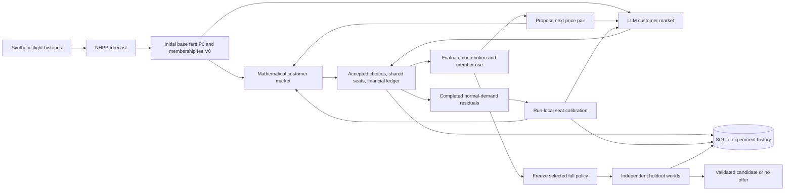

# Portal redesign and feedback optimisation

Implementation log, 2026-11-14. This document replaces the old blue Admin layout as the current design direction. User-requested colours: purple `#6F2C91`, cyan `#24BCDC`, white `#FFFFFF`.

## Incoming GitHub changes

The local checkout advanced from `9996fcf` to `ffc997e` (merge of `6632542`, continuous member pricing). The incoming work added:

- A probabilistic customer choice model, with stable keyed Gumbel draws, budget checks, and quote/subscription utility assumptions.
- A bounded continuous member-base-fare search at HKD-cent resolution. Membership fee and release share were fixed; there was no iterative LLM search.
- Background pricing jobs and a price-search panel, plus independent validation and sensitivity tests.
- Portable process locking and LF source conventions for reproducible source hashes across platforms.
- New synthetic evidence in `simulation/continuous_price_validation/`. Its result selected NO_OFFER; it is preserved unchanged.

The incoming change did not tune NHPP. Existing synthetic calibration, licensed OAG responses and historical LLM audits remain intact.

## New workflow

The mathematical and LLM tracks start at the same prices and exogenous worlds, then keep separate optimisation histories. A round is one tested joint price pair per track, not a single LLM call. No-offer comparisons and final validation require additional full worlds.

## Seat feedback semantics

`backend/seat_feedback.py` adds a versioned, run-local correction layer. It preserves the frozen NHPP model and calibration files.

- Labels become available only after a simulated world completes. They consist of future background normal requests, including capacity-denied requests, plus accepted foreground normal seats (including companions). Member seats and LLM explanations are excluded.
- Foreground unmet intent is unobserved. These labels therefore do not establish the complete real-world unconstrained demand curve.
- Per D28/D14/D7, the rate correction is `(sum(actual) + 100) / (sum(base mean) + 100)`, clipped to `[0.5, 2]`. The 100-count prior is an explicit shrinkage assumption.
- Additional protection is the nonnegative 90th-percentile residual above the base reserve, shrunk by `n/(n+20)` and rounded up. The original safety reserve and fail-closed quality gates are retained.
- A repeated seed/flight/horizon is one training sample, not a new independent observation. Newly completed candidate outcomes replace previous outcomes for that training identity.
- Each candidate stores the exact profile used to evaluate it. The selected full price-and-seat policy is frozen for holdout. Holdout outcomes never change the selected price or calibration.
- The expected empty count and occupancy curves retain the frozen base NHPP Monte Carlo result. Correcting unconstrained demand cannot be subtracted linearly from vacant seats because capacity and cancellations intervene. This feedback layer updates normal-demand diagnostics and protection, not the underlying occupancy distribution. The forecast page continues to show the base NHPP.

The calibration is feedback learning within the simulator, not neural-network training or evidence of improved airline performance. Changes in training contribution can reflect both prices and seat protection; they must not all be attributed to price changes.

## Progress

- [x] Fetched and fast-forwarded the latest GitHub main; analysed incoming continuous-price work.
- [x] Added the completed-world seat-feedback module and optional shared-market hook.
- [x] Verified seven focused seat-feedback tests, including future-label isolation, exclusion of member purchases, duplicate-world handling and preservation of base protection.
- [x] Complete both portals and joint optimisation integration.
- [x] Run 149 backend tests, 19 original simulation tests, and verify preserved artifact checksums.
- [x] Browser checks: Admin forecast/legacy pricing/panel/shared market; Client real SQLite purchase; six-round math optimizer, persisted reload, responsive charts and paginated audit API.
- [x] Six-round mathematical experiment: 18 worlds, 3,131 mathematical choices and 2,415 forced actions; zero provider calls. Export: `llm_agent/experiments/joint_math_20261114/`.
- [x] Complete and export the bounded live-provider comparison: 3 rounds per track, 16 worlds, 169 actual DeepSeek decisions, zero cache/failures. Evidence in [validation](JOINT_OPTIMIZATION_VALIDATION.md).
- [x] Record final results and include source, documentation and redacted evidence in the GitHub update.

## Review corrections

Independent review found and corrected four issues before final validation: compare base and calibrated coverage using the same reserve definition; respect both lower and upper bounds for suggested prices; preserve the base vacancy forecast instead of linearly subtracting unconstrained demand; and clearly label the publishing handoff as price-only. Holdout diagnostics are shown separately from search replay diagnostics.

## Differences from the requested loop

The delivered loop searches `(member fare, membership fee, run-local seat profile)` under a fixed round budget. Discontinuous purchases and finite inventory make a derivative-free bounded search practical; a guaranteed global optimum or convergence certificate is not claimed. Mathematical and LLM tracks keep independent recommendations, rather than averaging incompatible behavior assumptions.

The NHPP base intensity model, frozen calibration and vacancy Monte Carlo remain intact. Normal-demand feedback corrects the aggregate mean and can add protection; it does not train on member purchases, LLM reasons or held-out outcomes. This separation avoids inventing unconstrained-demand ground truth from a customer roleplay.

The public shopping site remains a local simulated booking flow. A validated experimental price can be copied into a draft, while flight-specific seats require separate review and publication. No experiment automatically changes a saved membership or existing ticket.
