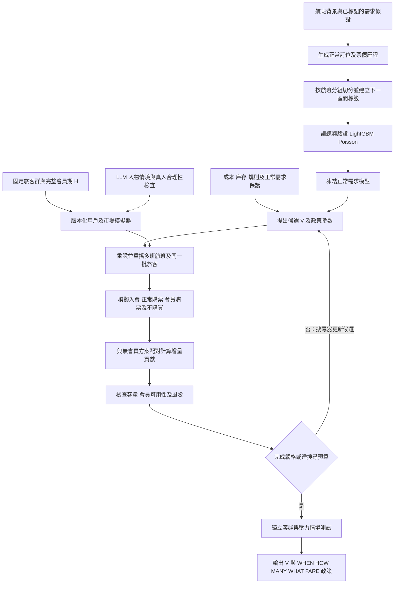

# UOption Fly Pass 會員定價模擬與優化執行計劃

> 2026-11-14 更新：此文保留早期規劃。已實作版本改採 NHPP，請以 [最新技術實作](CURRENT_IMPLEMENTATION.md) 與 [優化審查](OPTIMIZATION_REVIEW.md) 為準。

2026-11-14 · E117 Airplane CPU · 新構想的 Hackathon 實作提案

這個構想是：建立可重現的模擬市場，讓不同會員票價及會費在同一批旅客、航班和成本假設下競爭，選出增量貢獻較好、又能提供可用優惠的方案。LightGBM 負責正常需求預測，顧客模型負責模擬選擇，優化器負責搜尋策略。三者有不同工作，不需要由一個模型包辦。

本計劃延伸 [現有模擬器](../src/README.md)、[產品範圍](PROJECT_PLAN.md) 和 [技術設計](TECHNICAL_DESIGN.md)。新增會員費與用戶模擬的實驗，但保留已確認的核心：每班航班在 D28 至停售之間，決定 WHEN、HOW MANY、WHAT FARE。下面的時間、價格網格、旅客數、會員期和測試門檻都是實作建議，並非已驗證的 HK Express 商業參數。

## 1 構想與目前基礎

白板將 FE、BE 分開，後端包含上座率相關模型、定價相關模型，以及「價格 → Agent 模擬用戶 → 決策 → 利潤 → 優化 → 新價格」循環。可落實成以下分工：

| 元件 | 回答的問題 | 方法 | 產出 |
| --- | --- | --- | --- |
| 航班與需求模擬器 | 在某個世界中，旅客機會、正常需求及庫存如何發生 | 分段需求強度、Poisson 抽樣、庫存及取消規則 | 訓練歷程、可重播情境 |
| 正常需求預測器 | 現在的資料顯示，之後還可能有多少正常需求 | LightGBM `objective="poisson"`，另保留簡單基線 | 下一銷售區間正常需求均值及後續情境 |
| 會員與旅客模擬器 | 哪些人入會，何時買正常票、會員票或不買 | 有狀態的旅客＋離散選擇；LLM 補充少量行為情境 | 曝光、選擇、購票、拒絕、取消紀錄 |
| 定價政策 | 當下開不開、開幾位、會員基本票價多少 | 有庫存及正常需求保護的規則 | `NO_OFFER` 或時間、Q、P |
| 財務與搜尋器 | 哪個會費及政策組合值得採用 | 配對模擬、網格搜尋；之後 Optuna TPE | 候選排名、增量貢獻、風險及推薦 |

截至本次檔案檢視，`src/simulator.py`、`scripts/generate_demo_data.py` 和測試已存在；正常票價與訂位模擬已實作。現有程式沒有 LightGBM、會員行為、會員費優化或有身份旅客的政策比較。此計劃沒有執行訓練，也沒有產出最佳價格。

現有程式的票價會回應庫存，所以整體是有回饋的條件 Poisson 模擬，並非固定強度、獨立增量的嚴格 NHPP。若要使用嚴格分段 NHPP，先把強度及正常票價路徑設為外生；需求衝擊仍可用強度的分段跳變描述。

## 2 先定義價格與兩個時間尺度

| 符號 | 定義 | 在實驗中如何變動 |
| --- | --- | --- |
| R | 正常機票總價 | 橋接版在各候選重播相同正常報價路徑，不納入會員政策搜尋 |
| P | 會員每程基本票價 | 優化變數；可以是 0、30、70、100 等候選 |
| F | 會員機票必付附加費及稅項 | 旅客比較 `P + F`，不是只比較 P |
| V | 一個完整會員期的會費 | 方案層級的優化變數，每位入會者收一次 |
| H | 會員有效期 | 開始實驗前固定；不同 H 不可用相同 V 直接比較 |
| Q | 本次可供會員使用的座位量 | 受未承諾庫存及正常需求保護限制 |
| a | 最早可開放優惠的出發前天數 | 位於 28 天窗口內，例如 28、14、7 |
| φ | 定價及配額政策參數 | 初版為 `(P, a, release_fraction)`，之後可擴展 |

`P0、V0` 是第一組待評估候選，不是 LightGBM 自動知道的最優價格。若 P 在你的草圖也包含正常票價，建議先把正常票價獨立為 R，避免同時改兩種產品而難以解釋結果。

每班航班的決策期是 D28 至停售；會員有效期 H 是另一件事。若示例使用年費，就模擬該會員完整一年的機會、優惠供應與使用成本。可先用一批稀疏的合成航班接通年度流程，之後增加供應密度做敏感度分析；這批航班不能當成真實全年供應。只有 28 天結果時，應固定 V 或明確改成一個獨立的短期示例方案，不能把整年會費與 28 天成本直接比較。

同一個會員在整段 H 內使用多班航班，會員費不會每班重新收取。測試另一個 V 時，應重設整個合成客群，讓它重新決定是否入會；不能對上一輪已付費會員追溯改價。

## 3 LightGBM 如何訓練及使用

第一個模型預測下一銷售區間的正常 gross demand，即未扣取消、未受容量截斷的正常購票請求量。它不是價格回歸器，也不是會員轉換率模型。[LightGBM 官方文件](https://lightgbm.readthedocs.io/en/stable/Parameters.html) 提供 Poisson 目標函數；使用這個 loss 不會自動給出經校準的預測區間。

| 項目 | MVP 定義 |
| --- | --- |
| 一筆樣本 | 一條合成航班歷程的一個快照及它之後的銷售區間 |
| X | 距離停售時間、路線、當時已知日曆、正常總價、過去正常票價變動、已觀測正常訂位及最近 1／3／7 天流量、當時可購狀態 |
| y | 該快照之後一段的正常潛在購票請求數，非負 |
| ŷ | 下一段的正常需求條件均值，例如 4.6 次請求 |
| 不可作 X | 隱藏熱度 theta、未來報價、最終上座率、未來需求、事後才知道的衝擊、最優策略標籤 |
| 切分 | 依完整航班及背景複本分組；不同列不能把同一條歷程切到訓練和測試兩邊 |
| 評估 | 與按出發前天數的平均需求基線比較；檢查誤差、Poisson deviance、售罄附近和跳變情境 |

現有預設 ensemble 是同一航班背景的多次隨機重播。訓練前應增加不同出發日期、正常需求形狀及航班背景，才有足夠群組作獨立切分；只有同一背景時，最多測試該背景下的新隨機歷程，不能聲稱跨航班泛化。現有 `flight_id` 可含情境名稱，只作連接鍵，不作模型特徵。

模擬資料允許從 truth 檔取 y，但真實航空公司的成交紀錄通常不能直接提供售罄後的潛在需求。接入真實資料時需另外處理截斷與曝光，不能把沒有成交當成沒有需求。取消另建規則或模型；淨新增訂位可能為負，不可直接餵給 Poisson 目標。

用 `flight_id + observed_at` 等明確鍵連接下一區間標籤。現有快照的 `gross_new_bookings_1d` 是上一段已知結果，不能誤作當天之後的 label。D0 沒有下一銷售區間。最後 22 小時與完整一天的 exposure 不同：可統一時間單位後以 exposure 加權訓練 rate，或另外處理最後區間；不要把 22 小時計數無條件當成 24 小時計數。

正常需求模型應把會員成交與正常成交分開。推出會員後，正常購買可能被替代，不能將全部成交混成正常需求再重訓，否則會把政策造成的變化誤認為原有需求。

預測未來多天時，用當時可知的正常票價政策及狀態逐步 rollout，不能讀取模擬器已知的未來實現值。正常需求保護量可從這些預測路徑取較高分位數；需要在獨立合成情境檢查覆蓋率。只用 Poisson 均值不等於得到可信的 P90，更不等於 90% 不會擠走正常旅客。

橋接版 MVP 在優惠開始前，利用已知歷史產生一套未來每日的基準需求預測／保護量，搜尋期間固定這套預測。開售後用實際庫存更新可釋出量，但不把「正常客轉買會員票後下降的正常成交」直接餵回無會員模型當成需求變弱。這版不宣稱能自動識別政策推出後的反事實需求；更完整的即時更新需要另做渠道替代調整與驗證。模擬器重播的未來報價仍只能在到達該時點時揭露給策略。

## 4 旅客模擬採用混合方法

大量決策由可控、快速的數學選擇模型執行；LLM 用於少量具體情境、方案理解與拒絕理由。所有旅客行為設定均保存在版本化配置中。單靠「你是 HK Express 旅客」的 prompt，不能得到有代表性的真實購買率。

有關 LLM 個人模擬的研究使用真實受訪者的訪談／問卷建立 agent，並在未見回答上驗證；這支持以資料建立人物，而不是保證無資料的角色提示能預測航空會員購買。[Park 等人的研究](https://arxiv.org/abs/2411.10109)。另一項用戶模擬研究也專門檢驗 LLM 與真人選擇的偏離。[Yoon 等人的研究](https://arxiv.org/abs/2403.09738)。

### 4.1 每位旅客保留狀態

| 類別 | 最少欄位與作用 |
| --- | --- |
| 身份 | `customer_id`、`trip_id`，確保同一人不被重複計為增量旅客 |
| 出行機會 | 期內旅行次數、可出發日期、目的地、同行人數、是否仍有出行需要 |
| 選擇偏好 | 預算、價格敏感度、日期彈性、最低提前安排時間、其他旅行方式／不出行選項 |
| 會員狀態 | 是否入會、入會日、有效期、已付會費、使用次數及方案資格 |
| 約束 | 餘額、已買航段、重疊旅程、剩餘會員使用次數 |
| 資料來源 | `assumed`、`llm_simulated` 或實際收集來源；不得混稱真實訂位 |

可用「日期有彈性的旅客」「固定假期旅客」「較高旅行頻次旅客」作情境。族群比例、頻次、願付價格及敏感度沒有真實依據時，設定低／中／高範圍測試，不宣稱代表 HK Express 客群。

### 4.2 入會與購票分開

入會時，旅客評估完整 H 內的預期價值。簡單的示例模型為：

`Pr(join_i) = sigmoid((B_i - V - friction_i) / scale_i)`

其中 `B_i` 是相對不入會時的預期可實現價值：需考慮真正可用的航班、日期、配額和使用限制；不是把每次正常票價減 P 後全部相加。`friction_i` 是條款、預訂麻煩或不確定性的成本，`scale_i > 0` 控制選擇的隨機性。這些數值是情境假設。

第一版可用歷史／探索模擬估計分群的可訂概率，給各群保守與樂觀兩個範圍；它是入會時的預期，不得偷看這個旅客未來實際會搶到的座位。實際執行後再測量可訂成功率，防止會員數上升卻沿用過度樂觀的供應預期。

購票時，旅客在合法選項間選擇。令各選項的效用為 `U_ij`：

`Pr(choice_i = j) = exp(U_ij) / sum_k exp(U_ik)`

可包括正常票、會員票及不買。加入等待需要明確的後續再考慮時間；初版可先只有前三種。效用考慮總付款、日期／目的地匹配及行程限制；價格係數按情境固定為負。非法或售罄選項直接移出選擇集。這是離散選擇模型的用法，可參考 [Train 的 logit 與 mixed logit 章節](https://eml.berkeley.edu/books/choice2.html)。具體航空係數仍需校準。

已付會費通常不會在每次購票再從錢包扣除；初次入會價值和後續單次購票效用需分開。若要模擬「想把會費用回本」的心理，另設明示參數，不把同一會費當成每次付款。

### 4.3 LLM agent 的最小規格

建議先做 10–20 位固定人物、每人若干具體選擇，展示日期不合、總價太高、會費不值或有合適優惠等原因。大量候選搜尋不必逐次呼叫 LLM。

提示結構可如下：

```text
任務：依照給定旅客狀態，在本次合法選項中選一個行動。
只使用提供的預算、日期、目的地、會員條款及完整價格。
不可假設未提供的優惠、退款、航班或未來空位。
不得替航空公司決定價格或以航空公司收益為選擇目標。

旅客：{固定人物設定與目前狀態}
選項：{合法行動、完整價格、可用性與限制}

輸出 JSON：
{
  "action": "JOIN_PASS | BUY_REGULAR | BUY_MEMBER | DECLINE",
  "option_id": "... 或 null",
  "reason_code": "...",
  "reason": "一句話理由"
}
```

入會與購票分別給合法 action 清單，環境檢查餘額、庫存及會員資格，再執行 action。Agent 不直接寫入庫存或計算利潤。重試策略必須固定；不能重試到得到想要的購買答案。紀錄模型版本、prompt 版本、完整輸入和輸出；即使 temperature 為零也應保存結果，不能假設外部服務永遠完全重現。

如果之後用 LLM 輸出訓練 Logistic Regression／LightGBM 轉換模型，得到的是模仿該 LLM 的代理模型；它可加速模擬，但不會因此變成真實客群模型。應先收集一小批真人對完整價格、會員期及可用性情境的選擇作合理性檢查；問卷意向仍不等於實際支付。

### 4.4 避免把同一需求算兩次

現有模擬器已用正常價格影響 Poisson 購票請求數。不要再把這些請求當成完全未決定的曝光，用同一價格彈性過濾一次；也不要把 LLM 的正常買票再加到原有正常訂位之上。

Hackathon 建議使用橋接方法：保留正常價格與正常購票請求生成；替正常請求賦予 `customer_id/trip_id`，代表在無會員世界原本會買正常票的人。另建明確不重複的潛在增量客群。推出會員後，原本正常買家可轉用會員票，或因無位流失；同一個 trip 只執行一次購買。不同政策在相同時間點重播相同出行機會。

橋接版有兩項額外約束。第一，從無會員分支固定一條正常報價路徑，在各會員候選中原樣重播；只固定價格政策不夠，因為現有政策會受到會員佔用庫存影響。第二，正常買家在無會員分支保留原有正常購買意圖，不能再被一次獨立 logit 抽樣篩掉；可使用固定偏好與選擇擾動，只在會員選項提高效用時改選。增量客群則定義為在同一正常報價下會選擇不買的人。若不能保持這些基準選擇，就改採下一段的統一機會模型，讓正常與會員選擇從頭使用相同生成機制。

較完整版本可將 NHPP 改為生成未經價格過濾的「出行／購買機會」，再統一透過正常票／會員票／不買的選擇模型決定成交。切換後要從這套新引擎的無會員分支重新產生一次正常模型訓練資料，不能假設舊生成器的目標分布完全相同。

## 5 用哪個財務目標選價格

每個候選都模擬相同 H、班表及旅客機會的兩個世界：有會員方案，以及沒有會員方案。

`ΔΠ = Π_with_pass - Π_without_pass`

每個世界的計劃貢獻可寫成：

`Π = 淨會員費收入 + 正常票與會員票的保留收入 + 附加服務毛利 - 增量載客成本 - 計劃營運及獲客成本`

退款、支付手續費及會員服務成本須有清楚口徑；使用「退款後收入」時不再重複扣退款。稅項若為代收代付，不能當成航空公司利潤。燃油附加費也要按實際保留／成本口徑處理，不能一律等同稅或一律當純利。附加服務如果已使用毛利，勿再扣同一項服務成本。

相同班表下本來就會發生的固定成本通常在兩臂抵消；本實驗報告的是增量貢獻，不是整間航空公司的淨利。若會員方案改變開班或機型，新增固定成本才需納入。公司整體虧損不能直接作每張會員票的定價標籤。

原本會買正常票的人轉買會員票，其收入差已由兩臂比較反映；不要再扣一次泛化的 cannibalization penalty。若無法追蹤這種替代，才另用明示替代比例做近似，並標示這不是身份配對模擬。

除貢獻外，至少檢查：容量及承諾配額不超額、正常需求保護、會員的可訂成功率，以及價格和條款的界線。否則搜尋器可能選擇「收很多會費，但幾乎不提供可訂座位」的方案。可訂成功率的分母是有具體合資格出行請求的會員請求數，另報告整段期間沒有可用優惠的會員比例，避免只看成功曝光者。

## 6 搜尋方法與收斂

### 6.1 第一版用網格搜尋

先固定橋接版的正常報價路徑、客群偏好、成本、會員期 H、使用限制及保護位規則，再搜尋少量商業參數。以下是純示例的網格：

| 變數 | 候選 |
| --- | --- |
| 會員基本票價 P | HK$0、30、70、100 |
| 會費 V | HK$199、399、599、799，均指同一完整 H |
| 最早開放日 a | D28、D14、D7 |
| 釋出比例 f | 25%、50%、75%、100% 的可安全釋出量 |

共 `4 × 4 × 3 × 4 = 192` 組，另外保留無會員方案及固定優惠基線。候選 V 範圍只是搜尋起點，不是價格建議；若最佳落在邊界，需檢查範圍是否合理，而非自稱找到市場最優。

接線時先固定 a 和 f，只跑 16 組 P × V，驗證會員期帳本和兩臂差額。這是中途驗收點；完成後才擴至 192 組，加入項目要求的 WHEN／HOW MANY 比較。若時間不足，先減少 LLM 情境和重播規模，保留三項決策及清楚的模擬限制。

對每個航班、每個決策時點，先計算：

`A = 容量 - 已訂正常位 - 已訂會員位 - 其他有效承諾位`

`Qmax = max(0, A - 正常需求保護量)`

只有進入候選開放窗口，才可發出 `Q = floor(f × Qmax)` 的新配額；未達條件或 Q 為零就 `NO_OFFER`。初版優惠可有效到次日重算，期間庫存按交易更新；尚未失效的配額不可每天重新加發。以庫存帳本的唯一口徑處理已售與已保留位，不能重複扣除或釋出。

先在這個有限網格找最佳方案，足以完成「評估 → 更新候選 → 再評估」。不是一定要有神經網絡或 RL 才算優化。

### 6.2 第二版用 Optuna TPE 搜尋政策函數

若想讓票價隨航班狀態改變，先把規則擴展成低維參數，例如 `P_28_15`、`P_14_8`、`P_7_cutoff`，加上 a、f、V；或按照預測剩位的幾個區間選價格。這形成 `P = πφ(當時狀態)`，不同航班、不同天可有不同價格，並非所有時點共用一個 P*。

參數多時，[Optuna TPESampler](https://optuna.readthedocs.io/en/stable/reference/samplers/generated/optuna.samplers.TPESampler.html) 可利用已評估候選的分數提出下一組。它是這個黑盒搜尋的工具；此處調的是商業策略，不是只調 LightGBM 的樹深或學習率。

| 方法 | 本項目的使用順序 |
| --- | --- |
| 網格搜尋 | 第一選擇；候選少、容易核對，也容易展示價錢熱圖 |
| 隨機搜尋 | 擴展維度時的簡單對照；檢查 TPE 是否值得增加依賴 |
| TPE | 評估一次較貴或參數增多時使用；無全域最佳保證 |
| 強化學習 | 等有可靠環境及多期策略需求再評估；Hackathon 首版不需要 |
| 直接反向傳播 | 決策、庫存、LLM 及樹模型不是現成可微系統；首版不採用 |

### 6.3 固定世界，更新策略

在一次搜尋中凍結正常需求模型、用戶偏好、成本和 LLM 設定；主要更新 `(V, φ)`。若每輪同時重訓預測器、修改 persona、改成本，就難以知道收益提高來自哪一項改動。需要改假設時開一個新實驗版本，而不是為了提高收益一直改顧客。

每個候選使用同一批外部情境和旅客機會，但行為結果可因價格而不同。以 `(scenario_id, customer_id, trip_id, decision_kind)` 建立固定亂數鍵；只是共用一個 seed，不足以保證不同政策仍在比較同一批事件。

初始搜尋可每候選 10 次重播，候選前幾名再增加至 50–100 次；先量度一個情境的運行時間後設定預算。這些次數是工程起點，不是統計精度保證。分開三種不確定性：同一假設下的隨機波動、未知客群／成本參數，以及模型形式本身的差異。增加重播次數只能降低第一種估計誤差。

網格跑完即可停止。TPE 可設最多 50–100 次候選評估；也可在最近 15 次候選未出現超過預先設定的實務改善門檻時停止。前幾名需用配對的獨立重播檢查改善是否大於噪聲。這是搜尋停止條件，不是價格已在真實市場收斂的證明。

新候選可能比前一候選差，這是探索的一部分；「至今最佳分數」才不會下降。最後輸出一個表現相近且穩健的價格區間或候選集合，通常比聲稱唯一精確最優價更合理。

### 6.4 獨立測試與壓力情境

用搜尋集選策略、驗證集決定簡化及門檻，最後測試集只作一次結果評估。不同 seeds 不代表涵蓋模型錯配，因此還要測試未參與搜尋的弱會員興趣、高使用頻次、低附加收入、高增量成本、正常需求突增與團體購票情境。需求強度跳變與單次多人團體訂位需分開生成。

可先報各情境的平均增量貢獻、模擬分位數、虧損頻率及會員可訂率，再用「在指定情境集合中最差的平均增量貢獻」挑穩健方案。這是情境內的選擇標準，不保證涵蓋所有真實世界。最終測試看完又調策略，就需要一批新的最終測試。

## 7 完整工作流程



LLM 不負責判定自己模擬的市場是否真實，也不負責自己宣告利潤最優。搜尋箭頭回到候選政策；主循環不需要回到 LightGBM 重訓。

```python
# 流程偽碼；不是現有可執行介面。
model = train_normal_demand_model(training_data)
world = freeze_customer_cost_and_supply_assumptions(config)
baseline = simulate_no_pass(world, search_scenarios)
history = []

for candidate in searcher:  # grid 或 TPE 的 ask/tell
    # 每次還原客群與會員狀態；同一批出行機會，價格可改變行為。
    outcomes = simulate_full_membership_term(
        model=model, world=world, candidate=candidate,
        scenarios=search_scenarios,
    )
    evaluation = paired_incremental_contribution(outcomes, baseline)
    feasible = check_inventory_and_member_service(outcomes)
    searcher.observe(candidate, evaluation, feasible)
    history.append((candidate, evaluation, feasible))

shortlist = select_and_validate(history, validation_scenarios)
report = evaluate_once(shortlist, untouched_test_scenarios)
```

## 8 Hackathon 的實作順序與分工

先完成可計算的閉環，再加入較多 LLM 情境。下列為相對開始時間的積極排程，需要多人平行及熟悉工具；年度多航班帳本可能超出此估計。先通過 16 組候選的中途驗收，再擴展核心決策和展示，不以時鐘取代驗收。

| 階段 | 工作與分工方向 | 可檢查的交付物 |
| --- | --- | --- |
| 0–1 小時 | 一起定義 P、V、H、會員使用限制、收益口徑及共用 schema | 一份版本化 config；固定正常票價與客群假設 |
| 1–4 小時，資料／模型 | 重用模擬器、補齊特徵及 label、做 flight-group split、訓練基線與 LightGBM | 模型檔、特徵欄位及獨立誤差報告；無需先追求大量調參 |
| 1–5 小時，模擬／商業 | 建旅客身份、入會及購票狀態機、橋接正常買家與增量客群、寫完整 H 的帳本 | 同一候選可以重播；正常／會員／不買互斥 |
| 4–8 小時，決策／評估 | 接保護量、配額及 P／V 網格、兩臂比較和硬限制 | `candidate_results.csv`、最佳候選及無優惠案例 |
| 6–10 小時，前端／展示 | 做策略總覽、用戶選擇、價格熱圖、貢獻拆解 | 能從推薦追到輸入假設與交易；明示合成數據 |
| 8–12 小時，LLM 與測試 | 加 10–20 位 agent 情境、獨立 seeds 及壓力測試 | 有合法 action 的 agent 紀錄、策略穩健性報告 |
| 主流程完成後 | 若網格太大，加入 TPE；若要動態價格，增加少量時段參數 | 與網格／隨機搜尋比較；不阻塞基本 demo |

最小完整版本可以不用 LLM 決定大量購買；只要數學旅客模型、財務帳本與策略搜尋已連通，就已能回答 P 和 V 在指定假設下如何取捨。LLM 的價值在具體人物情境和可理解的行為展示。

建議新增檔案如下；這些介面尚待實作：

```text
configs/pricing_experiment.json  # H、候選範圍、行為及成本假設
src/forecast.py                 # LightGBM、基線、當時可知的特徵
src/customers.py                # 人物、trip、會員與選擇狀態
src/member_market.py            # 事件重播、購買與配額交易
src/pricing_policy.py           # WHEN、Q、P、NO_OFFER
src/economics.py                # 收入成本帳本及兩臂差額
src/optimize.py                 # 網格；可選 TPE
src/llm_customer.py             # 可選、結構化輸出、合法性驗證與快取
scripts/train_forecast.py
scripts/evaluate_pricing.py
app.py                         # 可接現有前端；未有時可用 Streamlit
outputs/pricing/candidate_results.csv
outputs/pricing/customer_events.csv
outputs/pricing/holdout_report.json
```

候選結果至少記錄：experiment/config/model/prompt 版本、H、候選 V 與 φ、情境／seed、入會人數、正常／會員購票數、各收入成本分項、增量貢獻、未售座位、可訂成功率、違反限制的原因。用戶事件另記曝光時提供的選項，不能只有買了的訂單。

## 9 必須通過的驗收

1. 當需求不變、會員功能關閉且計劃成本為零時，兩臂應一致；不會憑空產生收益。
2. 每位入會者只計一次 V；同一 trip 不會同時買正常票與會員票，也不會把同一人反覆計成新增會員。
3. 庫存、取消、退款和未到期配額守恆；售罄與資格不足時無非法成交。
4. P 為零仍收取適用 F，也仍計算增量載客成本；不等同 `NO_OFFER`。
5. y 及時間對齊正確；隱藏情境、未來結果與未來價格不會進入預測器。
6. 已有會員費不會在單班定價反覆計入；年度收益不會只扣 28 天使用成本。
7. 同一人物及外生事件能在候選間配對；提高 V 時，固定其他條件的入會機率不應因程式錯誤增加。
8. 會員基本票價降低可能提高成交，但沒有保證利潤提高；至少展示一個不應釋出優惠的航班。
9. 需求突增或供應減少時能降低新配額；不撤回已成交或仍有效的承諾。
10. 結果標記為合成市場測試；不把平均誤差、模擬分位數或收益提升宣稱為真實 HK Express 表現。

## 10 向評委展示甚麼

先用一班具體航班顯示當前訂位、正常需求預測及可釋出量，接著展示會員看到的完整價格。以幾位固定人物說明有人訂閱、有人因日期不合或會費太高拒絕；旁邊能查看購票及成本帳本。

再展示固定其他政策時的 P × V 熱圖：不同組合在會員數、使用次數及增量貢獻之間有甚麼取捨。若同時搜尋開放日和配額，熱圖須清楚標示它們是固定值，還是每格已另外最佳化；不可混在一起而不說明。

最後比較無會員方案、固定優惠、搜尋後方案，並切換正常需求突增或高使用成本情境。畫面分開顯示「本次候選」與「至今最佳」，以及獨立測試結果，不製造每輪都上升的假象。

可用的表述是：

> 我們以航班背景和明確標記的合成需求，建立正常需求預測與會員市場模擬。系統比較不同會費、開放時間、配額和會員基本票價，找出在指定假設下可提高增量貢獻、且符合供應限制的政策。真實會員反應需要後續以訪談、報價選擇與實際試點校準。

本階段交付的是可檢查、可替換假設的決策原型。真正值得展示的能力，是當需求、成本或會員反應不同時，系統能解釋為甚麼改價、改配額或不開優惠。
