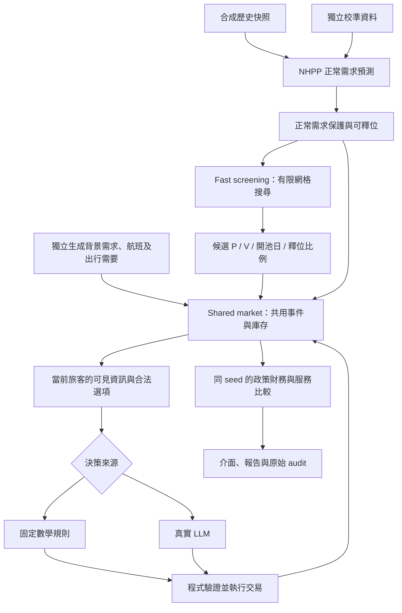

# UOption Fly Pass：目前功能、算法與實作邏輯總覽

更新日期：2026-11-14（香港時間）

團隊：Airplane CPU／E117

程式基準：`9e48f97`，本文件根據現有程式及已保存實驗整理。

> 目前產品是一個可以操作、重播及核對帳目的 Hackathon 原型。使用 NHPP 預測正常需求，再比較會員優惠政策；LLM 可以在共用市場中作出真正影響模擬庫存與收益的選擇。所有訂位歷史、會員行為及收益實驗仍屬合成資料，沒有真人購買率的 ground truth。

## 1. 項目要解決甚麼問題

對航空公司而言，**今天未售出的座位，不一定是起飛時賣不出的座位**。如果過早把正常旅客本來會購買的座位低價賣出，增加的會員交易可能只是取代正常票收入；如果過度保護座位，又可能錯過填補真正剩餘座位的機會。

對旅客而言，低價是否有用取決於可用日期、目的地、提前安排時間、同行人數、行李、完整付款及是否真的訂得到。會員基本票價為 HK$0，也不代表整趟旅程免費；年費及必付費用都會影響會員價值。

因此，系統的核心決策是：

| 決策 | 含義 | 現有做法 |
| --- | --- | --- |
| 開放時間 | 何時開始提供會員票？ | 在最早 D28 的優惠窗口內比較開池日 |
| 釋出數量 | 哪些剩餘座位可以提供會員？ | NHPP 正常需求保護量，加上策略釋出比例 |
| 會員基本票價 P | 每次使用會員票付多少基本票價？ | 比較候選 P，另外顯示必付費用 |
| 會員費 V | 一個會員期收多少費用？ | 納入同一會員期內多次使用、成本及正常票替代 |
| 是否提供優惠 | 會員政策是否比維持普通售票好？ | 必須與同市場的 `NO_OFFER` 比較 |

**目前沒有一個直接把輸入 X 回歸成「真實最優票價 y」的模型。** 實際分工是：

```text
NHPP → 預測正常需求與空座分布
保護規則 → 決定可釋出的座位
候選政策 → 指定 P、V、開放日及釋位比例
旅客決策＋市場環境 → 產生模擬交易與成本
同市場政策比較 → 評估候選的增量貢獻
```

## 2. 已實作的使用者功能

前端採用原生 HTML／CSS／JavaScript，沒有正式執行所需的 Node build。五個頁面都讀取本地後端的實際結果。

| 頁面 | 可以操作／查看的內容 | 用途與範圍 |
| --- | --- | --- |
| **Flight decisions** | 選擇航班、D28–D0；查看歷史訂位、票價、預測曲線、預期空座及可釋位；查看驗證報告與每日觀測 | 解釋某班航班的需求保護決策；圖表只顯示決策時已知歷史 |
| **Fast screening** | 調整會員期、客群與成本設定；比較最多 192 組政策；查看 P×V 熱力圖、貢獻、履約、對照及壓力測試；匯出 CSV | 快速數學篩選；可把候選參數帶到 Shared market 再測試 |
| **Journey baseline** | 選擇規則或真實 LLM，運行個別人物的六階段旅程；查看理由、預算及原始回應 | 解釋單人的選擇；各世界庫存獨立，不用此頁證明多人競爭收益 |
| **Shared market** | 運行三政策對照、選擇 seed、設定候選 P／V／開池日／釋位比例、限制 LLM 批次；查看航班庫存、旅客事件及帳本 | 所有人共用同一時間線與庫存；LLM 的選擇會改變政策結果 |
| **Member experience** | 發布限量優惠、建立示例會員、模擬預訂；查看完整付款及剩餘優惠位 | SQLite 交易展示，不收真實款項、不出票；與研究市場的狀態分開 |

另外已實作：保存及重新讀取實驗、手動續跑、原始 audit 下載、公開實驗匯出、來源標記、資料 hash 校驗及桌面／手機版介面。

## 3. 整體架構與三套模擬的分工



| 模組 | 主要檔案 | 核心責任 |
| --- | --- | --- |
| 資料生成 | `simulation/generate.py` | 正常需求、價格、取消、庫存快照及獨立 truth |
| 需求預測 | `backend/nhpp.py` | 只讀當時歷史，估計正常需求與空座不確定性 |
| 快速定價 | `backend/pricing.py` | 數學客群、會員期收益、網格搜尋及壓力測試 |
| 個人旅程 | `llm_agent/journey.py`、`journey_runner.py` | 六階段人物狀態及決策基線 |
| 共用市場 | `backend/shared_market.py` | 全市場事件排序、合法交易、會員及整數金額帳本 |
| 市場 Agent | `llm_agent/market_adapter.py` | 相同觀察交給規則或 LLM，解析、驗證及記錄回答 |
| 實驗管理 | `llm_agent/market_experiment.py` | seed／政策配對、版本凍結、批次續跑及結果匯出 |
| Web 背景工作 | `backend/market_jobs.py` | 有上限的非同步批次與工作狀態 |
| HTTP／展示交易 | `backend/server.py`、`backend/store.py` | 前端 API、SQLite 優惠／會員／預訂 |
| OAG | `backend/oag.py` | 可選的班表／容量背景資料、私有快取及額度處理 |

三套模擬並未合併成同一個算法：

- **Fast screening** 使用較簡化的數學需求與購買規則，快速比較大量候選。
- **Journey baseline** 使用個別旅客獨立世界，主要觀察理由與狀態連貫性。
- **Shared market** 使用獨立生成的需求真值及共用庫存，作更完整的政策重播；同一市場可切換規則與 LLM 決策。

Fast screening 的候選可以帶入 Shared market，但其分數不會自動成為共用市場的結果。目前也沒有讓 LLM 結果自動重新訓練 NHPP、持續自動調價直到收斂的閉環。

## 4. 數據：已有甚麼、如何生成

### 4.1 資料規模與欄位

目前保存 **600,000 筆每日快照、3,315 條航班歷程**：原展示資料 200,000 筆，加上兩批各 200,000 筆擴大驗證資料。不同批次的識別應使用 `(seed, flight_id)`，不能只用重複的 `flight_id` 合併。

| 欄位 | 說明 | 使用方式 |
| --- | --- | --- |
| `flight_id`、`snapshot_at` | 航班及觀測時間 | 排序、選擇當時可見資料 |
| `days_to_departure` | 距起飛日數 | 決策時點與預測長度 |
| `capacity`、`booked_seats` | 可售容量、當時訂位數 | 庫存限制；訂位不是已驗證的實際登機人數 |
| `available_seats`、`empty_rate` | 未售座位、未售比例 | `available = capacity - booked` |
| `gross_bookings` | 上一完成區間的新訂位 | 預測需求的計數觀測，不把淨訂位變化直接當需求 |
| `cancellations`、`interval_days` | 取消數與區間長度 | 取消率及曝光時間估計 |
| `normal_base_fare` | 正常基本票價 | 模擬價格及交易 |
| `mandatory_fees`、`normal_total_fare` | 必付費用及完整報價 | 購買決策與過去需求的價格調整 |
| `origin`、`destination`、`departure_at` | 航線及起飛時間 | 旅客行程匹配 |
| `cutoff_at`、`quote_status` | 停售時間與報價狀態 | 區分正常報價、售罄及停售 |
| `source_kind`、`currency` | 來源與幣別 | 清楚標示合成資料與 HKD |

大部分歷程涵蓋 D180–D0；每批為滿足精確列數，最後一條歷程略短，但全部保留完整 D28–D0。**D0 快照是起飛前兩小時的停售點**，最後一個區間為 22 小時。報價適用於快照之後，gross bookings／取消數則屬於剛完成的區間。售罄或停售的缺失報價不等於免費票。

### 4.2 合成需求算法

生成器為每班航班抽取需求規模、趨勢、價格路徑、取消率及情境。在給定這些參數後，各區間的請求數使用 NHPP 增量：

\[
D_{a,b}\sim\operatorname{Poisson}\!\left(\int_a^b\lambda(u)\,du\right)
\]

強度可概括為：

\[
\lambda(u)=\theta e^{\beta(u-180)}
\left(\frac{\text{當期完整報價}}{\text{參考完整報價}}\right)^{-0.8}
\times\text{情境倍率}(u)
\]

其中 `0.8` 是假設的價格彈性，不是從 HK Express 資料估計的結果。價格路徑包含階梯調整、促銷區間及隨機噪音，事前生成，不讀取未來訂位來決定價格。

六類情境為低需求、一般、高需求、持續突增、短暫脈衝及下降。持續突增改變之後的到達強度；脈衝只在短期提高強度。

實際接受訂位與潛在需求分開：

```text
本期接受訂位 = min(本期潛在請求, 期初可售座位)
未接受需求   = 本期潛在請求 - 本期接受訂位
下期訂位數   = 期初訂位數 + 本期接受訂位 - 本期取消
```

取消從既有訂位按 Binomial 抽樣，於區間末釋回座位。潛在請求、拒絕量、真實 beta 及情境名稱另存 `truth.csv.gz`，只用於評估，不能作為預測輸入。

### 4.3 OAG 的實際角色

已實作 Flight Info API 的讀取、快取及狀態顯示，可提供班表與預測容量背景。它沒有提供本項目需要的逐日真實訂位、歷史報價或會員價格轉換率。OAG 回應保留於私有路徑；60 萬列資料仍全部標為合成，沒有包裝成真實航空紀錄。

## 5. NHPP v3：輸入、推斷與輸出

> 2026-11-14 起執行版本為 `nhpp-regime-mixture-v3`。v2 原始碼凍結於 `backend/nhpp_v2.py`，只用於驗證既有 v2 報告。修正內容、校準及新 final 比較見 [NHPP v3](NHPP_V3.md)。

### 5.1 輸入與輸出

入口是 `backend.nhpp.forecast(rows, days_to_departure, seed)`。

輸入只限同一航班截至決策時的歷史：容量、訂位、完整票價、gross bookings、取消及區間長度。程式先移除未來列，再使用決策日前正好 35 個完整每日區間（五個整週，`d < D + 35`）。v2 的端點多算一天，最多 36 個區間，v3 已修正。

| 輸出 | 含義 |
| --- | --- |
| `beta`、`rate_now` | 當前趨勢及需求水準的抽樣平均 |
| `expected_remaining_demand` | 從現在到停售的正常潛在請求期望；可以超過剩餘座位 |
| `expected_empty_seats`、`expected_empty_rate` | 考慮容量及取消後的停售空座期望 |
| `demand_p10`、`demand_p90` | 模型下剩餘需求的分位數 |
| `raw_protection_p90` | 正常需求原始上側分位數 |
| `protection_allowance`、`protection_p90` | 額外校準保護量及加總後的操作保護量 |
| `releasable_seats` | 通過資料品質及保護限制後的可釋位 |
| `forecast_curve` | 未來訂位期望與分位數路徑 |
| `demand_curve`、`protection_curve` | 同一批模擬路徑的未來剩餘需求及保護量 |
| `diagnostics` | 變點、截斷比例、有效抽樣數、校準與情境假設；`release_significance`（放票顯著性門檻）及 `calendar`（週末／假日判斷） |

**NHPP 不輸出會員票價 P 或年費 V。** 它為後續政策提供正常需求與容量風險依據。

目前 NHPP 不把航線、星期、節假日或旅客分類當作回歸特徵；唯一的日曆用途是 5.4 節的週末／假日近端衝擊先驗。預測未來正常需求時，假定正常完整票價維持目前參考水準；它沒有另一個預測未來正常票價曲線的模型。

### 5.2 基礎強度與參數估計

以決策時刻為相對時間零點，基礎強度為 `rate × exp(beta × t)`。過去每個區間再按當時完整票價與目前參考票價之比，調整需求曝光。

實作使用：

1. **beta 網格**：181 個點，範圍 `[-0.08, 0.10]`，允許需求下降及上升。
   **週區塊似然**：beta 的似然按 7 日區塊合計計數及 exposure（`Π G_b(β)^{C_b}`），而非逐日相乘，週內固定形狀不會被讀成趨勢；Gamma 水準後驗仍使用全部計數。
2. **beta 先驗**：中心 `0.012`，一般標準差 `0.025`；偵測變點後使用 `0.018`。
3. **水準先驗／後驗**：Gamma–Poisson 結構；未截斷區間更新計數及加權曝光。
4. **不確定性抽樣**：先產生 2,400 個參數 proposal，再按權重重抽 800 條預測路徑。

這些參數是目前程式的研究設定，不是航空業已證實的 beta 上下界。也不是用 60 萬列做監督式「票價標籤訓練」；NHPP 會對每班航班的當時歷史重新推斷需求參數。

### 5.3 售罄造成的觀測截斷

如果某區間只有 5 位可售，最後賣出 5 位，只能知道需求至少為 5，不能知道需求恰好為 5。

- 未售罄：使用 `Pr(D = 觀測訂位數)` 的 Poisson 似然。
- 達容量：使用 `Pr(D ≥ 可售容量)` 的右截斷似然。
- 區間開始已無位：跳過該段零售票，不當成「有供應但沒有需求」。

程式使用較寬的需求水準 proposal 及重要性加權處理截斷，並輸出有效抽樣數 ESS。這改善售罄資訊的使用，但目前仍缺少會員在日內買光座位後的精確正常客可售時間，詳見限制。

### 5.4 如何處理需求突然增加

模型有兩層處理：

**已經發生的改變：變點偵測。** 比較最近 7／14／21／28 日（整週）與較早區間的需求水準。需要足夠區間及計數；對數似然比至少為 5，而且水準比達到上升 `1.8` 倍或下降至 `0.55` 倍以下，才接受候選變點。若偵測到改變，使用變點後資料重新估計水準及趨勢。

**尚未發生的改變：未來風險情境。** 預測路徑可包含沒有新衝擊、持續突增、短暫脈衝，或已觀察上升後回落。D28 無已知變點時，持續／脈衝的基準機率分別為 `0.22`／`0.10`；倍率範圍為 `2–4` 倍。實際機率按剩餘天數及是否已有變點調整；週五至週日出發，或資料明確標示 `is_public_holiday` 的航班，兩項機率再乘 `1.5`（工程假設，假日不會被推斷）。

**兩輪之間：按星期對齊的突增預警。** `surge_alarm()` 比較最近 3 個完整日與前 1–4 週相同星期的 3 日；最近 3 日 ≥ 6 次、水準比 ≥ 1.8、log-LR ≥ 4 才觸發。共用市場在非放票日觸發時重算預測，並只可提高正常需求保護量（見 7.2 節），不會發行配額。

因此模型可以反映「可能突然增加」的不確定性，但不能從相同歷史提前知道哪一天必然發生未知事件。

### 5.5 從需求到空座分布

每條路徑逐日抽樣正常請求及取消，並施加實際容量限制。概念上：

\[
B_{t+1}=B_t+\min(D_t,C-B_t)-X_t
\]

其中 `C` 是容量、`B` 是訂位、`D` 是潛在請求、`X` 是從期初訂位抽出的取消。最後計算各路徑的 `C - B_final`。

「需求 100、只剩 60 位」不會變成賣出 100 位；但剩餘需求仍可報為 100，保留供應不足的訊息。空座期望也不簡化成 `max(空位 - 平均需求, 0)`，因為容量截斷和取消具有非線性。

### 5.6 校準、保護與釋位

首先從 800 條路徑取得原始需求上側分位數 `q90`，再加上獨立校準集得到的保護修正：

\[
H_d=q_{90,d}+\left\lceil a_d\max(10,q_{90,d})\right\rceil
\]

`a_d` 在 D28／D14／D7 分別校準：對不同合成情境計算相對低估殘差的上側次序統計量，再取最保守情境的係數。執行時同一時點所有航班共用係數，不把航班情境標籤交給預測器。其他決策日使用相應較長校準時點的係數。

操作保護量 `H` 的欄位雖沿用 `protection_p90`，**不能把加了校準修正的數值稱為理論保證的 90% 後驗分位數**。

在資料品質條件成立時：

\[
Q_{\text{available}}=\max(0,\text{目前空位}-H_d)
\]

若到達停售、歷史不足、超過一半區間無供應／受容量截斷，或 ESS 小於 20，程式不釋出會員位。

**漸近顯著性門檻：** 以 `SE(q90) = (Q(.95) − Q(.85))/0.1 × √(0.09/n_eff)`（`n_eff = min(800, ESS)`）估計保護分位數的抽樣誤差，並傳到含校準修正的 `SE(H)`。只有 `Q_available > 1.645 × SE(H)` 才釋出，否則為 0。高客座率航班的 1–5 位小額釋出通常落在這個誤差內。正常需求保護按 gross 請求計算，不先依賴未來取消來擴大會員供應。

**純示意例子：** 現在剩 60 位、原始需求分位數 24、額外保護 6，則可釋位為 30；政策選擇 75% 時，當次會員配額為 `floor(30 × 0.75) = 22`。這不是任何真實航班的決策結果。

## 6. 會員票價與會費：快速搜尋如何工作

### 6.1 搜尋空間

`backend/pricing.py` 在 D28 比較：

| 參數 | 候選 |
| --- | --- |
| 會員基本票價 P | 0、30、70、100 |
| 會員費 V | 199、399、599、799 |
| 開放日 | D28、D14、D7 |
| 可釋位比例 | 25%、50%、75%、100% |

共 `4 × 4 × 3 × 4 = 192` 組。較晚分析時不能回到過去開池；目前程式會把較早候選壓到當前決策日並去重。D0 直接返回 `NO_OFFER`。

### 6.2 數學行為與收益

預設每個搜尋重播包含 300 人、24 班航班及 365 日會員期；同一個重播的各政策使用相同身份、出行機會及隨機數。

入會價值綜合預期出行次數、日期彈性、提前安排匹配、估計訂位可用性與每次節省。以 sigmoid 把「預期價值 − 會費 − 摩擦成本」轉為入會機率，再和固定的個人隨機數比較。新增購票意願使用假設分布，正常購買意圖則在配對比較中保留。

這些是明示的數學假設，不是從 OAG 或真實會員交易訓練出的購買機率。快速市場仍以預測需求均值生成需求，且把選定航班的部分條件延伸至有限供應目錄；所以它主要用於候選篩選，不能取代獨立市場壓力測試。

每個候選模擬訂閱、正常票及會員票交易，計算完整會員期的增量貢獻。預設限制要求合資格會員請求履約率至少 60%、未使用會員比例最多 75%；所有搜尋重播都通過限制，且平均增量貢獻大於零，才可能取代 `NO_OFFER`。

預設搜尋重播為 2 次；選出的優惠另以 4 個新 seed 評估，並測試高乘客成本、低會員興趣、正常需求突增及相關四人需求。驗證結果不回頭重新挑選同次搜尋的候選。

### 6.3 目前的「優化」是甚麼

目前採用**有限網格枚舉＋完整模擬評分**。沒有 LightGBM、強化學習、梯度下降或貝葉斯優化器；也沒有證明連續價格空間的全局最優。展示的最佳價格是特定假設與候選集內的結果。

## 7. 共用市場：多人交易如何連續發生

正式比較預設使用 14 位假想旅客、9 班異質航班、每人 3 個出行機會；底層引擎的未覆寫旅客預設為 24 人。數量由實驗 config 決定，不應把兩個預設混為一談。

### 7.1 時間與世界狀態

1. 先用固定 seed 生成航班、背景正常需求、價格、旅客出行需要及外部事件。
2. 所有事件按全市場時間排序，包括搜尋、正常請求、取消、每日快照及起飛。
3. 遇到旅客決策，建立當時合法選項，交給規則或 LLM。
4. 程式重新驗證行動，成功才扣款扣位並記錄記憶。
5. 繼續下一個時間事件；後來的旅客看到更新後的庫存。
6. 全部事件及已購會員期結束後，才計算完整排名。

`WAIT` 不保留位或價。例如甲買走最後一位，之前等待的乙之後可能只能買正常票、改選其他航班或放棄。

### 7.2 正常需求與預測分離

共用市場的背景需求由獨立生成器事前產生，**不拿 NHPP 的預測均值當作未來真值**。同 seed 的不同政策使用相同外生背景、旅客身份及出行機會，並保存 `exogenous_sha256` 作核對。

會員持有人的優惠座位不計入正常 gross bookings，同行者的正常票則計入。NHPP 在 D28、D14、D7 根據實際已發生的歷史重算保護量與剩餘會員配額：

```text
若未到政策開放日：會員剩餘配額 = 0
若已開放：會員剩餘配額 = floor(NHPP 可釋位 × release_fraction)
```

每次重算的是當下的剩餘配額，不是無條件累加新的免費座位。實際成交仍受物理空位及正常需求保護約束。

兩輪之間（D27–D1 的非放票日），若仍有未售會員配額，每日執行按星期對齊的突增預警；觸發時重算 NHPP，令 `正常需求保護 = max(原保護, 新保護)`。這只會擋下尚未售出的有效配額，不新增、取消或重設批次；紀錄在 `monitor_history`。

### 7.3 已實作的交易規則

| 規則 | 實作邏輯 |
| --- | --- |
| 會員有效性 | 訂票及實際起飛時均須有效；每人本次實驗最多購買一個新會員期 |
| 同行者 | 只有持有人享會員基本票價，同行者付正常票價 |
| 整組購票 | 全部同行人有位且預算足夠才一起成交，不接受半組 |
| 行程匹配 | 檢查目的地、日期、時段、提前安排、協助與預算 |
| 重複購買 | 同一出行機會不能重複訂；同日行程另有約束 |
| 取消 | 使用實際已訂航班的兩小時截止；基本票價和行李不可退，必付費用扣取消費後退回 |
| 成本 | 實際乘機時記載客及行李成本；取消未飛者不產生該筆乘機成本 |
| 會員期 | 所有新購會員都追蹤至實際到期，即使超過初始第 365 日 |
| 續會 | 只有下一期預算下的續會意向，不收第二次會費、不算收入 |

有限目錄只設定三個已計劃出行機會；最後一個機會之後明確假定沒有其他新增旅行。追蹤到到期並不等於模擬了真實航空公司全年所有潛在旅次。

## 8. LLM Agent 的場景、輸入輸出及紀錄

### 8.1 客群範圍

`population.py` 包含 14 類假想情境：彈性低預算、學生、固定假期上班族、高頻休閒、家庭、雙人旅遊、探親訪友、臨時必要出行、自費商務、入境／跨市場、小組同行、協助需求、低頻／首次旅行，以及沒有合適航線日期。

人物具有不同預算、頻次、日期彈性、同行人數、提前安排及航線匹配；這是**情境覆蓋，不是 HK Express 真實市場比例**。目前航班目錄仍以 HKG 出發為主，列出入境人物並不代表已實作完整入境及聯程航網。

### 8.2 兩種旅程

- 單人基線：入會 → D28 → D14 → D7 → 行程變更 → 期末意向，共六階段，各人物世界獨立。
- 共用市場：每次出行會遇到訂閱考慮、查票、等待、購買及可能的計劃變化，多次旅行共用同一會員和預算；本人記憶保留最近 20 個事件及經歷統計。

### 8.3 LLM 能看到與不能看到的資訊

| 可見 | 不提供給 Agent |
| --- | --- |
| 本人的需求、剩餘預算、會籍及已訂位 | 其他旅客的私有狀態 |
| 現在可訂的航班、日期、完整整組價格 | 未來報價、配額及正常需求 |
| 本人曾訂不到票、等待或購買的記憶 | 尚未發生的計劃變更 |
| 當前合法 action 與 option ID | 航空公司成本、利潤目標、政策名稱及反事實結果 |

Prompt 要求從旅客自身利益出發比較完整付款、可用性及安排限制，不替航空公司追求較高利潤。輸出範例：

```json
{
  "action": "BUY_MEMBER",
  "option_id": "環境提供的合法選項 ID",
  "reason_code": "AFFORDABLE_MATCH",
  "reason": "日期符合安排，而且整組總價在剩餘預算內。",
  "confidence": "medium"
}
```

這只是格式示意。LLM 不能自行新增航班、改票價、創造庫存或直接修改帳本；短理由與 confidence 也不是經驗證的真人解釋或轉換機率。

### 8.4 決策及執行分離

```text
同一個 observation
    ├─ 固定規則 → action
    ├─ 真實 DeepSeek → JSON → action 驗證
    └─ 只有唯一合法選項 → environment_forced
                         ↓
       再驗證當前庫存、會員、預算與時效
                         ↓
       更新同一個市場、帳本及個人記憶
```

固定規則會估計目前可見節省、出行次數及可用性是否足以支持會費；購票時在單次旅行預算內選較低總價，並有明示的等待與取消條件。LLM 看到相同合法環境，但可作不同取捨。環境硬限制為會期剩餘預算；規則額外使用 `trip_budget` 篩選，這是已披露的行為差異。

### 8.5 真實呼叫、快取與 audit

已接入 `deepseek-flash`，共用市場使用 JSON 輸出、temperature 0 及有限輸出長度；DeepSeek 請求明確停用 thinking。temperature 0 不保證回覆完全穩定。

逐次保存：prompt 版本、可見 observation、情境 hash、無認證資訊的 request、原始 response、解析後 action、驗證結果、tokens／延遲、狀態轉移、快取及來源標記。

- Provider 失敗或行動非法：保存錯誤並暫停該 case，不偷偷換成數學答案。
- 只有一個合法動作：環境直接執行，不算 LLM 決策。
- 快取：相同完整呼叫情境的已驗證回應可以重播，單獨計數，不算新的獨立回答。
- Web 每批最多 100 次呼叫上限；CLI 每批最多 200 次。額度用完後要明確續跑。
- 同一實驗以檔案鎖避免同時寫入；live 每次完成交易後保存狀態。
- 新實驗凍結引擎、NHPP、生成器、實際校準檔及 prompt 等 hash；不匹配就拒絕續跑。

舊實驗漏列實際 v2 校準檔的 hash，已保留原 spec 並另附事後檔案比對證明；沒有回寫成「原先已逐次記錄」。原始回答和公開索引見 [實驗目錄](../llm_agent/experiments/README.md)。

## 9. 收益與服務指標如何計算

共用市場所有內部金額使用整數 cents，輸出才換成 HKD。

\[
\text{Contribution}=\text{會員費}+\text{正常基本票收入}+\text{會員基本票收入}
+\text{行李收入}+\text{取消服務費}
-\text{載客成本}-\text{行李成本}-\text{會員服務成本}-\text{計劃成本}
\]

政策增量貢獻為同 seed 政策與無會員基準之差：

\[
\Delta\Pi=\Pi_{\text{policy}}-\Pi_{\text{NO\_OFFER}}
\]

這不是航空公司淨利；固定機隊成本未納入。D28 前既有訂位的收入及成本視為共同沉沒項，不重新計算。必付費用目前假設為代收代付；真實燃油附加費的會計處理需要另作校準。

| 共用市場預設假設 | 金額 |
| --- | ---: |
| 每人必付費用 | HK$250 |
| 每位實際乘機者增量成本 | HK$120 |
| 每件已購行李費／成本 | HK$80／HK$15 |
| 每個新會員期服務成本 | HK$30 |
| 啟用會員計劃一次的成本 | HK$1,500 |
| 取消服務費 | HK$100，上限為可退必付費用 |

快速搜尋有自己較簡化的成本設定，例如預設增量乘客成本為 HK$90，並直接使用附加服務毛利。它在有新會員時才計入計劃成本；共用市場則在啟用會員政策時就計入一次計劃成本，即使沒有新會員。兩套環境的財務結果應各自在其 config 下解讀，不能直接拼接。

**兩種 `service_rate` 的分母不同：**

| 模組 | 定義 |
| --- | --- |
| Fast screening | 成交會員票數 ÷ 合資格且有購買意願的會員請求數 |
| Shared market | 至少完成一次會員票旅程的新會員人數 ÷ 新會員人數 |

共用市場另記錄正常票轉會員的同人同出行機會配對，以及背景正常需求被容量拒絕的差額。這些解釋收入變化，但影響已在帳本差額中，不能再扣一次「蠶食損失」。

## 10. 交易正確性與資料保護

共用市場檢查以下不變量：

```text
現金收取 - 退款 = 不含代收費用的收入 + 待代付費用 + 已代付費用
期末佔位 = D28 前既有佔位 + 所有未取消訂位的人數
0 ≤ 已佔位 ≤ 容量
0 ≤ 剩餘會員配額 ≤ 實際空位
個人剩餘預算 = 初始預算 - 會費 - 機票支出 + 退款
每人新會員費最多收取一次
```

Member experience 的展示交易另由 SQLite `BEGIN IMMEDIATE` 及 `(flight_id, customer_id)` 唯一限制防止競態超發及重複預訂。發布優惠會扣除已承諾量；同一航班已有優惠時不能切換模擬日重新取得配額。優惠最多有效 24 小時，D1 為 22 小時，不跨停售。

本地服務只綁定 `127.0.0.1`，靜態檔案只提供 `frontend/`；POST 檢查 JSON、Origin、ID 及數值範圍。金鑰、OAG 原始回應、私有快取及資料庫不進 GitHub。公開的是去憑證的合成實驗檔案，不是完整生產票務系統。

## 11. 已完成的測試與發現

### 11.1 NHPP 驗證

模型版本及校準凍結後，保留第一批 240 班 final，再以 1,200 班新航班擴大驗證。後者在 D28／D14／D7 對 v1、v2 共計 7,200 次評分。

| 擴大驗證時點 | v1 需求 MAE | v2 需求 MAE | 同批 v1 突增保護覆蓋 | v2 突增保護覆蓋 |
| --- | ---: | ---: | ---: | ---: |
| D28 | 27.63 | 30.28 | 89.5% | 91.5% |
| D14 | 18.85 | 14.97 | 96.5% | 97.0% |
| D7 | 10.67 | 8.45 | 91.5% | 91.5% |

此表 v1 也經相同程序重新校準，不是舊固定 16 位規則。第一批 final 的 v2 D28 突增覆蓋為 82.5%，歷史 47.62% 又屬不同樣本，不能混成一條直接提升曲線。擴大驗證中 D7 尚未發生突增的子群覆蓋仍只有 81.48%；D28 需求 MAE 亦退步。以上全部是 v2 結果，未被覆寫。

v3 在 v2 校準種子上重新校準，再以首次開啟的 seed 20261117（240 班）作一次性 final 比較：D28 突增保護覆蓋 82.5% → 85.0%，D7 突增 92.5% → 95.0%，各時點覆蓋都不低於 v2；每班平均釋出少約 0.7–1.1 位，整體需求 MAE 略差。D28–D14 間開始突增的 12 班中有 11 班在 D14 前觸發預警。詳見 [NHPP v3](NHPP_V3.md)。

### 11.2 行為與市場驗證

| 已完成實驗 | 規模／結果 |
| --- | --- |
| Codex 子代理 pilot | 168 份實際生成決策；獨立旅客場景 |
| DeepSeek 六階段基線 | 672 份全新有效回答；不是共用市場收益測試 |
| 行為 probes | 60 份全新有效回答；12 組相同輸入中有 3 組重複回答不一致 |
| 數學市場擴大測試 | 40 seed × 3 政策＝120 個完整市場 |
| 同世界規則對照 | 再完成 12 個市場，外生 hash 與 live 對應世界相同 |
| 共用市場開發 seed | 3 政策；265 份新回答、160 次快取、500 個環境強制動作 |
| 共用市場獨立驗證 | 3 seed × 3 政策；1,383 份新回答，零快取、零失敗；另 1,390 個環境動作 |

預先指定的兩個會員政策為：

- `FIXED`：P70、V399、D14 開池、50% 釋位比例。
- `CANDIDATE`：P30、V199、D28 開池、75% 釋位比例。

三個 live 驗證 seed 都是 `NO_OFFER` 貢獻最高。FIXED 平均比基準少 HK$1,172，CANDIDATE 少 HK$2,626.33；候選完成的 17 個會員旅次中，有 16 個在基準世界已由相同旅客以正常票完成。

這反映目前假設下的正常票替代風險，不代表已證明會員產品不可行。如果只移除假設的 HK$1,500 計劃開支、保持同一批交易不變，FIXED 的平均增量貢獻變成 +HK$328；因此成本假設也會改變結論。

最後一輪已通過 **74 項 backend＋19 項資料／模擬測試**，以及前端與 API smoke。擴大重播找出的替代航班取消截止 bug 已修正；校準版本 hash 漏列和 gzip 下載半行 JSONL 問題亦已修正。這些是上一輪已完成驗證的紀錄，本文件更新沒有重新呼叫付費 LLM。

## 12. 已實作與尚未實作的界線

| 項目 | 目前狀態 |
| --- | --- |
| NHPP 推斷、容量截斷、變點與未來風險情境 | 已實作，但未達所有情境的目標覆蓋 |
| 會員價格、年費、時間及配額比較 | 已有網格與少量候選共用市場重播 |
| LLM 選擇影響庫存與財務 | 已實作，保留原始回答及交易後果 |
| 完整會員期多次使用 | 有限目錄下已實作；不是全年真實航空網絡 |
| 真實會員購買率、價格彈性及成本校準 | 尚缺實際資料 |
| LLM 精確代表整個 HK Express 客群 | 未證實；14 類只是覆蓋設計 |
| 未知未來事件的確定預知 | 不具備；只能作風險情境與保護 |
| 會員日內售罄後的正常可售曝光 | 尚未精確建模，可能使後續需求偏低 |
| LLM 回饋自動重訓 NHPP／自動尋優至收斂 | 未實作；現有模型及驗證固定，以避免自我驗證 |
| 真實支付、出票、退票及航空庫存同步 | 未實作，只有模擬交易 |
| 正式登入、權限、多使用者生產排程及部署 | 未完成；目前是本機 Hackathon 展示 |

## 13. 執行及查閱方式

```bash
# 安裝並啟動本地展示
python3 -m venv .venv
source .venv/bin/activate
python -m pip install -r requirements.txt
python -m backend.server

# 不會產生外部 LLM 呼叫的測試及資料校驗
python -m unittest discover -s tests -v
python -m unittest discover -s backend/tests -v
python scripts/verify_artifacts.py
```

瀏覽器開啟 `http://127.0.0.1:8000`；共用市場為 `http://127.0.0.1:8000/#market`。預設展示頁讀原有 20 萬筆資料，額外 40 萬筆保存在獨立驗證目錄，並非全部混進同一航班選單。

如需只跑數學市場，可建立一個新的本地實驗路徑：

```bash
python -m llm_agent.market_experiment create --output data/private/shared_market/example --seeds 117
python -m llm_agent.market_experiment run --output data/private/shared_market/example --max-calls 0 --max-steps 10000
python -m llm_agent.market_experiment report --output data/private/shared_market/example
```

真實 LLM 需要後端私有設定，並以 `--modes live` 建立實驗。不要覆寫已開啟的驗證資料來重新調參。

## 14. 詳細文件與程式入口

- [README：啟動及總覽](../README.md)
- [NHPP 程式](../backend/nhpp.py)、[NHPP v3 修正與驗證](NHPP_V3.md)、[NHPP v2 診斷與限制](NHPP_V2_REVIEW.md)
- [數據生成器](../simulation/generate.py)、[擴大驗證](EXTENDED_VALIDATION.md)
- [快速定價程式](../backend/pricing.py)
- [共用市場程式](../backend/shared_market.py)、[市場規則](SHARED_MARKET.md)
- [Agent 決策與紀錄](SHARED_MARKET_AGENT.md)、[Prompt](../llm_agent/prompts/shared_market_v3_en.txt)
- [真實 LLM 市場驗證及成本敏感度](SHARED_MARKET_VALIDATION.md)
- [原始實驗檔案索引](../llm_agent/experiments/README.md)
- [目前 HTTP 介面及架構](CURRENT_IMPLEMENTATION.md)
- [原計劃差異、修正與下一步](OPTIMIZATION_REVIEW.md)
