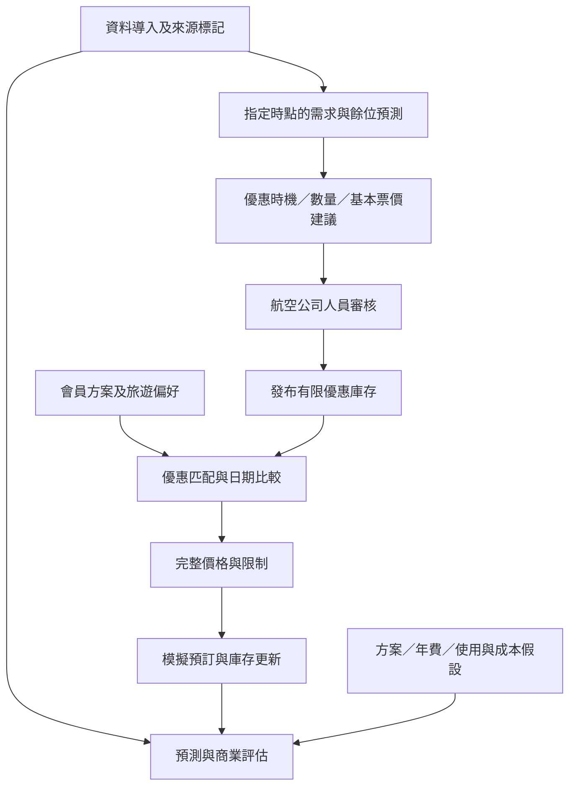

# UOption Fly Pass — 項目需求、目前階段與數據計劃

**Team Airplane CPU · E117 · Cathay Hackathon 2026 Student Track**  
**更新日期：2026-11-06（香港時間） · 文檔版本：0.1**  
[返回 README](../README.md)

這份文檔是團隊接下來實作與驗收的工作依據，記錄「要做甚麼、目前做到哪裡、需要甚麼數據、如何驗證」。產品方向來自白板、團隊確認及已有展示稿；架構、欄位與驗收條件是本版提出的實作方案，不表示已經開發完成。

| 標記 | 含義 |
| --- | --- |
| 已確認 | 團隊已明確確認的方向，或已有文件支持的事實 |
| 展示提案 | 已出現在白板或 pitch，但未成為最終商業條款 |
| 實作建議 | 本文為完成原型而提出的設計，可由團隊調整 |
| 待決 | 尚未有足夠資料或團隊決定 |
| 待實作 | 有需求或設計，但沒有可驗證的實作成果 |

**閱讀順序：** [目標與範圍](#project-scope) → [目前進度](#current-status) → [功能需求](#functional-requirements) → [數據需求](#data-requirements) → [模型計劃](#model-plan) → [交付計劃](#delivery-plan)。

<a id="project-scope"></a>
## 1. 項目目標與範圍

### 1.1 一句話定義

UOption Fly Pass 是面向 HK Express 的付費會員產品構想：預測指定航班在出發時可能仍未售出的座位，協助航空公司決定優惠開放時間、座位數量及會員基本票價，再讓行程靈活的會員找到和比較適合的出行機會。

會員每次優惠的基本票價可為 **0 元或超低價**，另外支付燃油附加費、稅項及適用費用；會員費另計。這個票價機制已由團隊確認，但會費、每次優惠價格及使用規則尚未定案。

### 1.2 我們希望驗證的價值

| 對象 | 問題假設 | 希望達到的結果 | 需要的證據 |
| --- | --- | --- | --- |
| 行程靈活的旅客 | 跨日期搜尋繁複，限時優惠未必配合決策時間 | 更容易找到合資格航班、比較日期和理解總價 | 可用性測試、搜尋完成率、理解度、付費意願訪談 |
| 航空公司商務人員 | 現有空位未必會在起飛時剩下，優惠可能取代正常收入 | 更有依據地選擇優惠航班與釋出條件 | 預測誤差、釋出風險、與正常銷售情境比較 |
| 會員產品營運者 | 收入與實際可提供的優惠供應可能不匹配 | 找到有足夠旅客價值及正向增量貢獻的方案 | 供需、使用頻率、會費和成本的敏感度分析 |

目前沒有真實測量證明以上改善已經發生；不能將它們寫成已實現的成效。

### 1.3 聚焦的問題

原本的 SmartDemand AI 背景涵蓋廣泛的航空需求管理。現在以 **Fly Pass 會員產品** 為主線，核心是「預測 → 優惠決策 → 會員體驗 → 驗證」。不把一般票價全面調整、所有促銷產品或多渠道分銷重新加入第一版。

本項目的 Challenge Statement 為 **Low-cost Travel — Smart Offer & Borderless Booking**。重點是相關優惠、透明價格與簡化選擇；不因題目名稱而額外承諾跨境支付、翻譯或完整 OTA 功能。

### 1.4 產品決定與時間窗口

| 項目 | 現時內容 | 狀態／實作處理 |
| --- | --- | --- |
| 付費會員 | 會員可購買指定航班優惠，與現有機票產品並行 | 核心方向已確認 |
| 基本票價 | 0 元或超低價，燃油附加費及稅費另付；會員費另計 | 團隊已確認；每次實際金額待決 |
| Plan A | 選定的較低需求航線 | 10/25 展示提案；路線清單待決 |
| Plan B | 加入較熱門目的地，提出較高年費 | 10/25 展示提案；不等於所有熱門日期保證有位 |
| 會員期 | 白板提出半年／一年；較新展示稿使用年費例子 | 最終期數待決；模擬器可以參數化 |
| 歷史票價研究窗口 | 白板提出研究出發前最後 14 天票價 | 研究例子，不能直接推出最優會費 |
| 預測範圍 | 10/25 展示稿以提前 28 天為例 | 可配置的預測範圍，不等於從 D28 起一定有優惠 |
| 優惠開放時間 | 根據風險及供需決定何時開放 | 待驗證；白板的 14 天不是硬性條款 |
| 訂閱定價 | 以歷史票價、供應、需求和使用情境作分析 | 待實作；輸出情境，不宣稱最佳年費 |
| 使用次數、取消、改期、退款 | 尚未定義 | 待決；原型清楚顯示示例限制 |

需要分開三個概念：**看多遠的預測範圍、甚麼時候開放優惠、用哪段歷史價格做研究**。模型評估用的 D28／D14／D7 等提前期也不是會員條款。

<a id="current-status"></a>
## 2. 目前階段與已知證據

**目前階段：已獲邀參加 On-day，處於需求整理、數據取得準備及原型規劃。**

截至 2026-11-06，本地工作區沒有既有應用程式碼；查詢指定 GitHub repo 的遠端 references 沒有取得任何分支或提交。這次新增的是 README 與本需求文檔，不能把已寫好說明等同已完成產品。

| 工作項目 | 狀態 | 證據／限制 |
| --- | --- | --- |
| 白板內容與核心範圍 | 已整理 | 三張照片的逐字轉錄與範圍整理檔 |
| E117 隊號與會員票價機制 | 已確認 | 團隊在對話中明確確認 |
| Initial Submission 素材 | 已有本地準備版本 | one-pager、簡報及四人影片稿存在；未逐項核對實際上傳的最終版本 |
| On-day 入選 | 已收到邀請 | 主辦方 2026-10-30 邀請電郵 PDF |
| 出席確認及資源表格 | 本次未核實提交狀態 | 不把邀請視為已完成所有行政步驟 |
| GitHub repo | 已建立，文檔準備中 | `Horse-MA00/E117-AirplaneCPU`；目前未見既有程式碼 |
| 向 Cathay 詢問數據 | 已起草郵件 | 未有已寄出、獲回覆或獲准取數據的確認 |
| 真實航空營運數據 | 未確認取得 | 不能假設已有 PAX、訂位、票價、內部 API |
| OAG Flight Info API 欄位說明 | 已有本地 PDF，已讀取 | 是 V2 schema 參考，不是已取得 API 存取權或真實回應樣本 |
| 合成數據、baseline、模型 | 待實作 | 沒有已檢視的數據檔、訓練程式或模型產物 |
| 航空公司與會員介面 | 待實作 | 已有敘事／視覺概念，尚無可運行系統 |
| 定價模擬及成效評估 | 待實作 | 沒有已測得的準確率、轉換率或收益提升 |

### 2.1 已知活動節點

| 日期（HKT） | 事項 | 本文如何使用 |
| --- | --- | --- |
| 2026-10-25 23:59 | Initial Submission 截止 | 歷史節點，不是現在仍可提交的期限 |
| 2026-10-30 | 收到 On-day 邀請 | 支持目前已獲邀的階段判斷 |
| 2026-11-04 23:59 | 邀請電郵中的出席／個人資料確認期限 | 已過；本次未核實團隊提交紀錄 |
| 2026-11-08 23:59 | 邀請電郵中的雲端、資料及 AI 資源申請期限 | 團隊需核對自身申請狀態；本文未代為提交 |
| 2026-11-14 09:00 至 11-15 18:00 | 邀請電郵列出的 Cathay City On-day 時段，內含 24 小時開發 | 實際日程及後續通知優先 |

邀請電郵要求的 On-day 產出包括 **prototype 與 code repository link、PDF slides、one-page poster**。不能直接把 Initial Submission 的一頁 PDF 規格當作現場 poster 尺寸。Pitch 時長、Q&A、評分細則及可用的賽前準備範圍，按主辦方後續通知核實。

<a id="functional-requirements"></a>
## 3. 需要實現甚麼

### 3.1 最小端到端流程



下列 P0 代表第一版必要，P1 代表主流程穩定後補強。所有功能目前均為待實作；需求編號可直接用於建立 GitHub issues。

### F01 · 數據導入與質量檢查 — P0

導入統一格式的航班、訂位快照、票價及結果標籤。第一版可使用本地 CSV 或同等簡單儲存格式，不需要先建完整資料平台。

**驗收：** 每份資料能辨識來源、真實／合成性質、時間範圍及版本；同一航班可以連接快照與結果；重複 key、負容量、錯誤時區、缺失價格和異常航班有明確處理紀錄。未知值不能默認為 0。

### F02 · 基線與餘位預測 — P0

在指定 `as_of` 時點，輸出該航班的預期後續淨訂位、最終淨訂位及預期未售座位。先做可解釋的歷史 booking-pickup 基線，再評估一個適合表格數據的模型。

**驗收：** 顯示「現在可售／已訂」與「預測最終餘位」兩組數字；輸出包含預測時間、資料版本、方法和不確定性說明；只有當時已知的資料可用於推論。未經校準的區間不能標成已證實的信賴保證。

### F03 · 優惠決策建議 — P0

以明示規則提供 **WHEN／HOW MANY／WHAT BASE FARE**：候選開放時間、最多釋出座位及候選基本票價。第一版使用少量候選時間／價位與可解釋規則即可；不要求完成最優動態定價系統。

**驗收：** 每項建議能追溯到預測、實際可售庫存和政策參數；釋出量為非負整數，不能超過可售庫存或人員設定上限；預測不足以支持優惠時可明確回覆「不釋出」。建議價格的情境收益要標明需求反應假設。

### F04 · 航空公司 dashboard — P0

顯示航班／日期列表、訂位進度、當前可售量、預測餘位、建議和原因。人員可批准、調整或拒絕建議。人工確認是本版實作建議，不是已接入航空公司現行工作流程。

**驗收：** 未批准的建議不出現在會員頁；更新建議或撤回優惠後，會員端同步反映；保留批准時間、示例操作人和版本，不需要真實員工帳戶。

### F05 · 會員方案與偏好 — P0

提供 Plan A／B 的示例選擇，以及目的地、日期範圍和可接受總價。用固定 demo 帳戶或模擬身份即可，不開發真實會員扣款系統。

**驗收：** 航線資格依 plan 設定篩選；同一熱門航線沒有可用優惠時能清楚呈現；示例年費、期限、次數限制均標為示例／待驗證。方案不得承諾保證有位。

### F06 · 航班匹配與日期比較 — P0

只從已批准且有庫存的優惠中，按目的地、日期、資格和預算篩選，再用透明的排序規則呈現。第一版無需訓練推薦模型。

**驗收：** 至少能比較多個出發日期；說明推薦原因，例如符合目的地及日期偏好；沒有結果時提供可調整的偏好；不可把不合資格的便宜航班混入可預訂結果。

### F07 · 價格展示與模擬預訂 — P0

會員費與單次旅程費用分開。每個 offer 顯示基本票價、燃油附加費、稅費、其他必收費用、已選可選項目及合計，並提供清楚的庫存與有效期條件。

**驗收：** 0 元只形容 base fare；總價等於展示的各項之和；模擬確認前重新檢查資格、有效期和庫存。最後一個位不能同時被兩個 demo 請求成功預訂；重複確認不重複扣庫存。成功畫面清楚標示「模擬預訂」，不產生真實付款或機票。

### F08 · 會員定價與商業模擬器 — P0（簡化版）

輸入 Plan A／B 航線組合、會費、會員數、使用頻率、可提供座位、候選基本票價、每次旅程的留存收入／成本，以及可能取代正常購票的比例。

**驗收：** 輸出每個情境的可滿足使用需求、未滿足需求、貢獻及關鍵假設；至少比較正常銷售、固定優惠、預測輔助優惠。變動使用率或替代比例時結果會更新；不把結果標為經證實的最優年費。

### F09 · 評估與可重現 demo — P0

保存資料版本、隨機種子、配置及結果，讓另一位隊員能重現同一段示範。預測指標與商業模擬指標分開報告。

**驗收：** README 在有程式碼後補上實際安裝與執行命令；一條完整路徑可重現「查看航班 → 批准優惠 → 會員比較 → 模擬確認 → 查看結果」。失敗／沒有合適庫存的情境也能合理處理。

### F10 · 主流程後的補強 — P1

可加入校準過的預測區間、較完整的費率／取消規則、會員行為事件記錄、更多路線及角色權限。推送只需在介面內模擬；真實電郵、SMS 或付費通知服務不是第一版依賴。

### 3.2 明確不屬於第一版

- 真實付款、票務、PNR、改票退款及航空公司生產系統串接。
- 全航網所有票價的自動調整、成熟收益管理平台或自主代理售票。
- 必須使用 LLM、深度學習或強化學習才能成立的架構。
- 無限飛行、所有航線適用、任何日期保證有位等商業承諾。
- 在未取得真實驗證前，保證提升收入、降低多少空座或達到某個準確率。

## 4. 建議系統設計

### 4.1 邏輯模組

| 模組 | 輸入 | 輸出／責任 |
| --- | --- | --- |
| Data adapter | 可獲准使用的真實／樣本／合成檔案 | 統一 schema、質量檢查、來源紀錄 |
| Forecast service | 航班、觀測時點、當時特徵 | 最終訂位／餘位預測與方法版本 |
| Offer policy | 預測、可售庫存、候選價格及限制 | 開放時機、數量、基本票價建議 |
| Offer store | 建議、批准、使用事件 | 共用優惠狀態與剩餘可用量 |
| Member experience | 方案、偏好、已批准優惠 | 匹配、比較、完整價格及模擬確認 |
| Evaluation / simulator | 保留測試集、策略和情境參數 | 預測指標、商業及會員供需結果 |

第一版採單一應用加簡單本地儲存亦可。是否前後端分開、使用甚麼語言／框架、部署在哪裡，尚未決定；先確立資料與功能合約，不虛構已有技術棧或執行命令。

### 4.2 核心實體與狀態

| 實體 | 關鍵內容 |
| --- | --- |
| `FlightInstance` | 唯一航班實例、航線、日期時間；不是只用會重複的 flight number |
| `BookingSnapshot` | 航班、觀測時間、當時容量／有效訂位／可售量 |
| `Forecast` | 航班、as-of、預測值、區間性質、資料／模型版本 |
| `Offer` | 航班、方案資格、開始／結束時間、批准量、已使用量、價格組成、狀態 |
| `MembershipPlan` | 示例期限、航線範圍、會費、示例使用限制 |
| `DemoBooking` | offer、示例會員、數量、確認價格、`confirmed_at`、去重識別、狀態 |
| `SimulationRun` | 策略、參數、資料版本、種子、結果與限制 |

優惠狀態建議為 `draft → approved → active → expired / exhausted / withdrawn`。實際可購買還要同時滿足時間、會員資格及全航班庫存限制。Plan A 和 B 可以共享座位，但不能各自重複計算同一批供應。

當前原型可用本地合約連接模組；例如「給定航班及 as-of 取得預測」、「批准 offer」、「查詢 eligible offers」、「確認 demo booking」。這些是待實作介面，並不是已存在的 API endpoints。

<a id="data-requirements"></a>
## 5. 所需數據

### 5.1 必須先分清的定義

| 概念 | 本項目中的含義 |
| --- | --- |
| 飛機物理座位數 | 機型配置的座位數，不一定全部可售 |
| 可售容量 `C_t` | 在時點 t、排除不售座位後的容量；可能因機型或控制而變更 |
| 有效淨訂位 `B_t` | 在時點 t、仍有效且佔用座位的已確認訂位／票量，定義需與資料方核對 |
| 當前實際可售量 `I_t` | 訂位／庫存系統實際允許再出售的數量；不一定等於 `C_t - B_t` |
| 最終有效淨訂位 `B_final` | 按約定銷售截止時間統計的有效訂位，不把已售但未登機自動當成未售 |
| 未售座位 `U_final` | 在資料定義一致的前提下，`max(C_final - B_final, 0)` |
| 實際登機人數 | 實際搭乘旅客數，與已售票量分開保存 |
| 載客率／滿座率 | 必須註明分子分母：訂位／可售容量，或實際旅客／營運座位；兩者不能混用 |

**為何不能只要「滿座率」：** 相同最終載客率可能來自很不同的訂位軌跡。D14 時已訂 50 位和已訂 150 位的航班，需要不同判斷。模型必須看到當時狀況，以及之後的淨新增訂位，才有機會學會預測。

### 5.2 優先級與用途

資料 P0 指首版相應功能所需，可先以合成資料滿足；不代表主辦方已同意提供。票價是產品與定價分析的 P0，但單獨的訂位基線在缺票價時仍可先建。

| 優先級 | 資料 | 用途 | 若取得不到 |
| --- | --- | --- | --- |
| P0 | 航班實例、時間、航線、容量 | 所有模組的基本鍵與座位上限 | 以有明確標籤的模擬航班示範 |
| P0 | 出發前的訂位快照 | 預測未來 pickup 與最終餘位 | 合成軌跡；不能宣稱真實預測能力 |
| P0 | 最終淨訂位、最終容量 | 監督學習和預測評估標籤 | 沒有真實標籤就不能驗證真實準確率 |
| P0 | 可購票價快照與費用組成 | 比較優惠、研究臨期票價與定價情境 | 示例價錢，明確標示合成／假設 |
| P0 | 星期、月份、相關市場假期 | 日曆特徵 | 使用有來源的公開日曆或示例值 |
| P1 | 新增、取消、改期、容量變更 | 解釋軌跡與異常 | 用淨訂位變化，但承認無法拆解成因 |
| P1 | 實際成交票價、促銷／庫存控制紀錄 | 區分報價與收入，理解政策影響 | 不把公開報價當作真實 yield |
| P1 | 增量旅客服務成本、附加收入與成本 | 商業情境分析 | 用可調假設做敏感度分析，不宣稱真實利潤 |
| P1 | 實際登機／no-show 匯總 | 額外的載客率分析 | 優先保留商業未售座位目標 |
| P2 | 會員偏好、曝光、點擊、轉換、使用 | 後續推薦和付費意願研究 | 第一版使用合成 personas 與模擬行為 |

### 5.3 建議向 Cathay 要求的最小範圍

優先請求**去識別化、航班層級**資料，不要求乘客個人身份。可以先接受少量航線的樣本，或主辦方核准的合成資料。

- **範圍建議：** 約 3–5 條有不同需求特性的航線，實際路線由可獲得資料決定。
- **時間建議：** 如可能，12 個月以涵蓋季節；24 個月可增加跨年度比較機會。這是期望，不是保證模型有效的最低樣本門檻；較短樣本也可用於接通流程，但限制要說明。
- **觀測粒度：** 每日訂位與票價快照較理想；最低可先詢問 D28／D21／D14／D7／D3／D1 及最終結果，若只有 D30 等不同節點則按實際粒度使用。
- **觀測內容：** 當時可售容量、有效淨訂位、可售庫存、可購基本票價、燃油附加費、稅費、幣別，以及最終容量／有效訂位。實際 PAX 另外列出。
- **補充：** 有無促銷、取消航班或機型變更；如可提供，再加入匯總成交票價、附加消費與成本。
- **取得條件：** 資料字典、授權用途、能否用於 demo／訓練、能否公開樣本／衍生模型、存取及保留方式。

如果只有月度或航線層級載客率，可用於背景分析，但無法直接作為「某一天某班機 D14 時點」的訓練資料。OAG 或其他航班資料資源的可用欄位需要實際查閱，不能假設包含訂位、載客率或成交價格。

### 5.4 建議資料表與欄位

以下是 **schema 提案**，不是已有資料檔。數值的單位、null 含義及統計口徑都要寫入 data dictionary。

#### A. `flight_instances` — 每一班實際營運航班

| 欄位 | 類型／單位 | 說明 |
| --- | --- | --- |
| `flight_id` | string，唯一鍵 | 連接所有表；不能只用 flight number |
| `carrier`, `flight_number` | string | 可去識別化，但同一實例需一致 |
| `origin`, `destination` | airport code | 可做航線特徵與會員資格 |
| `scheduled_departure_at` | 帶時區 timestamp | 建議以 UTC 保存 |
| `origin_timezone` | IANA timezone | 轉回出發地日期與星期 |
| `aircraft_type` | string，可缺 | 機型變更須保留 as-of 紀錄，不能回填未來資訊 |
| `flight_status` | enum | 正常、取消等；狀態變化若用作特徵也需時間戳 |

容量放在 snapshots／outcomes 中以保留時間差異，不用一個最終容量覆蓋所有歷史快照。

#### B. `booking_snapshots` — 一班機在一個觀測時點

| 欄位 | 類型／單位 | 說明 |
| --- | --- | --- |
| `flight_id`, `observed_at` | 複合唯一鍵 | `observed_at` 必須帶時區 |
| `available_at` | timestamp | 資料真正可被系統使用的時間；如有延遲，不得用晚到資料回填當時推論 |
| `sellable_capacity` | integer，seats | 當時可售容量 |
| `net_booked_seats` | integer，seats | 當時有效淨訂位 |
| `available_to_sell` | integer，seats，可缺 | 當時實際可售量；缺少時估算值要另行標示 |
| `new_bookings_since_previous` | integer，可缺 | 新增訂位；可選 |
| `cancellations_since_previous` | integer，可缺 | 取消；可選，改期計法需一致 |
| `inventory_control_state` | string，可缺 | 暫停銷售、封鎖等原因 |
| `source_kind` | real / sample / synthetic | 樣本是否真實亦需在 manifest 說明 |

`days_to_departure` 可由出發與觀測時間相減導出，保存精確差值，評估時再按明確規則分桶。淨訂位可以因取消而下降，不可強制改成單調上升。

#### C. `flight_outcomes` — 僅作標籤及事後評估

| 欄位 | 類型／單位 | 說明 |
| --- | --- | --- |
| `flight_id` | string，唯一鍵 | 與航班表連接 |
| `sales_cutoff_at` | timestamp | 約定的最終銷售統計時點 |
| `label_available_at` | timestamp | 最終結果何時可用，決定能否納入某次訓練 |
| `final_sellable_capacity` | integer | 最終可售容量 |
| `final_net_booked_seats` | integer | 最終有效訂位；已售但 no-show 不自動扣除 |
| `boarded_passengers` | integer，可缺 | 實際乘客數，單獨使用 |
| `operated_seat_capacity` | integer，可缺 | 計算實際載客率時使用的容量口徑 |
| `cancelled_or_disrupted` | flag / category | 異常航班分開分析，不能當作一般需求樣本 |

`final_unsold_seats` 可由最終容量與訂位導出。超售、保留位、嬰兒及團體訂位的計法需要資料方確認；異常不能只靠裁切數值隱藏。

#### D. `fare_snapshots` — 當時可購買的報價

| 欄位 | 類型／單位 | 說明 |
| --- | --- | --- |
| `flight_id`, `quoted_at`, `fare_product_id` | 複合鍵 | 視不同產品／渠道補足唯一性 |
| `available_at` | timestamp | 報價何時可供系統使用 |
| `currency` | currency code | 不把不同幣別直接比較 |
| `base_fare` | decimal，money | 基本票價；0 是合法值，null 是未知 |
| `fuel_surcharge` | decimal | 燃油附加費 |
| `taxes`, `mandatory_fees` | decimal | 避免同一項費用重複計入 |
| `optional_extras` | 明細／另表 | 行李等可選費用及是否已選 |
| `total_payable` | decimal | 已含所選項目的合計，需檢查加總 |
| `journey_basis`, `passenger_basis` | enum | 單程／來回、成人／其他；必須同口徑比較 |
| `fare_conditions`, `channel` | string，可缺 | 行李、退改、渠道等條件 |
| `is_available` | boolean | 已售罄不是價格 0 |

每筆資料須註明是可購報價、歷史成交價，還是模擬會員價。三者不能放在同一欄後默默混用。公開網站報價不能證明已售多少張票。

#### E. `calendar_features` — 已知的日曆資訊

`date`、`market`、`day_of_week`、`month`、`holiday_name`、`is_public_holiday`、`known_at`、`source`。出發地與目的地假期可不同；只有當時已公布的活動才可作特徵。促銷、天氣或搜尋趨勢不是預設必需資料。

#### F. `promotion_events` / `sales_aggregates` — 強烈建議取得的補充

記錄航班、政策開始／結束、渠道、候選／實際票價、釋出量、成交數、取消數及按時間匯總的收入。這有助辨別後續訂位增長是否來自促銷。

成交價以航班／時段／產品的匯總即可開始，不要求可識別乘客資料。若沒有促銷紀錄，模型學到的只能是歷史混合政策下的結果，不能聲稱代表「完全不做優惠」的自然需求。

#### G. `commercial_assumptions` — 模擬參數，與事實分開

至少包括 scenario ID、plan、期間、會員數、會費、每人使用次數分布、可用供應、每次留存收入、附加服務收入及成本、旅客增量成本、營運／付款／服務成本、替代正常購票比例，以及每項參數的來源或假設範圍。

未知成本保存為未知或明示情境區間，不填 0 然後當成沒有成本。稅費通常是代收轉付項，分析時按資料提供方的收入口徑區分；燃油附加費也不能自動全數視為利潤。

#### H. `demo_members` / `interaction_events` — 原型匹配資料

先使用合成 `member_id`、plan、目的地、日期範圍、預算、使用配額。若記錄互動，可保存 offer 曝光、選擇和模擬確認的時間與事件類型。不需要真實姓名、電話、電郵、證件或付款資料。

### 5.5 品質與時間一致性

- 所有表可用穩定的 `flight_id` 連接；同一天往返／多班次不能混為一班。
- 同一時間點的容量、訂位與報價對齊；保存時間與資料可用時間。
- 未來取消、最終票價、最終容量及最終 PAX 不能混入較早時點的特徵。
- 取消航班、換機、超售及暫停銷售需分開處理；記錄排除規則與數量。
- 金額統一口徑；若換匯，保留匯率日期及來源；不能把機票總價再加一遍已包含的稅費。
- 若以稀疏節點插值，標示為估算；不可把插值當成真實每日觀測。

### 5.6 數據存取與發布

每份資料建立 manifest：來源、取得日、涵蓋期間、欄位字典、真實／合成性質、缺失情況、版本／checksum、使用及分享條件。賽事提供資料的使用範圍見官方條款第 14.7 節；是否能公開樣本、衍生模型或截圖，按實際授權處理。

repo 優先存 schema、產生合成資料的程式和可分享的小樣本。受限原始資料及憑證不放入 Git；待建立資料管線時，同步設定忽略規則與可重現的取數說明。

### 5.7 沒有真實資料時的路線

| 可得資料 | 可以做到 | 無法合理宣稱 |
| --- | --- | --- |
| 航班級歷史快照＋結果＋票價 | 真實樣本上的預測回測和有限情境分析 | 因果收益提升、最佳價錢或保證泛化 |
| 最終訂位／載客率，沒有中途快照 | 背景統計、粗略歷史基線 | 經驗證的 D14／D28 動態 pickup 模型 |
| 只有時刻表或公開價格 | 介面、航線及價錢比較示範 | 真實餘位、真實成交收入 |
| 完全合成 | 完整流程、正確性、可重現策略情境 | 真實需求、真實付費意願、真實預測準確率 |

合成器應能產生不同航線、日曆、booking curve、取消及需求高低情境，固定種子並記錄假設。避免只用同一簡單公式產生資料、再讓模型重現該公式，卻把高分稱為航空預測能力。

<a id="oag-assessment"></a>
### 5.8 已有 OAG Flight Info API 說明可以支援甚麼

工作區已有 `Flight Info API - Response Layout & Descriptions.pdf`，為 OAG 官方說明頁的 14 頁匯出，列明適用 **V2**，頁面更新日期為 2024-10-02。本版已讀取全文並檢視座位欄位頁面；未取得 API 真實回應，也未驗證帳戶權限或現行版本差異。

| 文檔列出的欄位／類別 | 可支援的工作 | 不能直接推斷的事情 |
| --- | --- | --- |
| `scheduleInstanceKey`、carrier、`flightNumber`、departure／arrival | 建立航班實例、航線、出發日期與時間 | 需保留上游 ID 並確認與其他資料的連接方式 |
| `aircraftType`、航班時刻及狀態 | 航班清單、機型／時間特徵、異常標記 | 事後狀態或實際機型不能回填成過去已知特徵 |
| Predicted seats 的 `totalSeats`／各艙位 seats | 航空公司資料或 OAG 模型推算的座位配置／容量參考 | 不是「預測還沒賣掉多少位」，也不等於 airline 可售庫存 |
| Actual seats 的 `totalSeats`／各艙位 seats | 根據已識別機尾號與機隊資料取得的實際配置參考 | 不是實際 PAX、實際售出票數或起飛剩餘空位 |
| `bookingClasses` | 訂位艙等代碼與相關餐食資訊 | 不是各艙等還有幾個位，也不是價格表 |
| `onTimePerformance` | 準點表現資訊 | 不是載客率或需求強弱 |

依這份 reference，可先規劃 **OAG 航班／容量資料＋另行取得的訂位／票價資料** 的接合。它沒有列出我們需要的 booking snapshots、最終淨訂位、實際乘客數或機票成交／報價歷史；這是對所讀文檔的判斷，不代表 OAG 所有產品都沒有其他資料。

若用 OAG 資料製作 demo，保留來源的座位值為獨立欄位，例如 `reported_total_seats` 及其 predicted／actual 性質。只有在明示假設下才轉為模擬可售容量，不直接映射為 `available_to_sell`。接入前確認版本、回應中完整欄位路徑、授權欄位、歷史覆蓋和時間戳；本文不猜測 JSON 的巢狀路徑。

來源：[OAG Flight Info API — Response Layout & Descriptions](https://knowledge.oag.com/docs/flight-info-api-response-layout-descriptions)，本版以工作區保存的 PDF 內容為依據。

<a id="model-plan"></a>
## 6. 模型、決策與評估計劃

### 6.1 先定義預測目標

建議先預測從觀測時點到銷售截止的 **後續淨訂位**：

```text
net_pickup(t) = B_final - B_t
predicted_final_bookings = B_t + predicted_net_pickup(t)
predicted_unsold_seats = max(assumed_final_capacity - predicted_final_bookings, 0)
```

後續淨訂位可以因取消多於新增而為負值。預測時若不知道未來容量，就用當時可知的容量作明示假設；回測不得偷偷使用最終換機後容量。也可直接預測最終訂位或未售座位，但不同目標要分開比較。

以上預測首先反映**歷史已觀測政策下的結果**。若要回答「不推出會員優惠時本來會賣多少」，需要額外的對照、政策標記或因果／情境假設，不能只改模型名稱便當成可識別的事實。

### 6.2 基線、模型與特徵

1. **基線：** 按航線、出發星期及提前期估計歷史平均／中位數後續 pickup；資料不足時逐層退回較粗粒度群組。
2. **候選模型：** 一個適合表格資料的回歸或分位數模型。先比簡單基線，再決定額外複雜度是否值得。
3. **可用特徵：** 當前有效訂位、當前容量、距出發時間、過去可觀測訂位增速、航線、當地星期／月份／假期、當前可購價格與已知促銷狀態。
4. **不確定性：** 有足夠資料再估計分位數或校準區間；資料不足時用明示的情境上下限，不能偽裝成統計保證。

推薦匹配可以先用規則；會員年費可以先用情境模擬。不需要把每個模組都做成機器學習模型。

### 6.3 如何拆分訓練與測試

- 依出發日期按時間建立 train／validation／test；比例按樣本量決定。
- **同一航班的所有快照只屬於同一集合**，不能隨機拆快照，讓模型在訓練見過測試航班的較晚紀錄。
- 模擬每個歷史推論時點時，訓練集只能使用 `label_available_at` 早於該時點的標籤。可用 rolling-origin 回測，或留出足夠的時間間隔避免重疊洩漏。
- 特徵必須同時滿足 observed／available time；所有標準化、補值及參數選擇只在訓練／驗證部分完成。
- 保留測試集在模型及策略選定後才用；有條件時另測未見航線，並分開說明泛化問題。

### 6.4 預測指標

| 指標 | 用途 |
| --- | --- |
| MAE（座位） | 平均預測偏差有多少座位 |
| RMSE（座位） | 較大誤差的懲罰 |
| Signed bias | 是否系統性高估餘位，導致過度釋出 |
| 分提前期／航線結果 | D28、D14、D7 等不能混成一個平均數 |
| 區間覆蓋率與寬度 | 只在實際建立區間時報告 |
| 高估餘位／過度釋出風險 | 對優惠決策的實際影響；歷史 proxy 與模擬情境分開 |

未售座位常可為 0，因此不以 MAPE 作唯一指標。每個結果都列樣本量、資料性質與 baseline；沒有真實測試資料時，標題明確寫「synthetic experiment」。

### 6.5 從預測到優惠

建議依較保守的餘位估計與政策上限控制釋出：

```text
remaining_policy_quota = max(0,
    total_flight_policy_quota
    - already_consumed_member_seats
    - outstanding_offer_allocations
)

release_limit = floor(max(0, min(
    unallocated_available_to_sell,
    unallocated_conservative_unsold_estimate,
    remaining_policy_quota
)))
```

這是原型規則，不是已證實的最優庫存策略。`total_flight_policy_quota` 是同航班跨方案的總限額，不是每次新建 offer 都重設的限額。`outstanding_offer_allocations` 是尚未使用、未過期或未撤回的已分配量，已使用量不得同時留在這一欄。

實際可售量與保守餘位估計都需先轉為尚未分配的額度。若上游可售量已扣除保留位，不再扣同一筆分配；若未扣，才在 adapter 中扣除。保守餘位預測若已基於使用後的訂位更新，也不可再次扣已使用座位。用統一 ledger 記錄這些定義，避免超額釋出或重複扣減。缺少真實可售量時，只能對模擬庫存操作；預測值不能取代實際庫存。

可比較數個開放提前期和候選基本票價，但 **歷史報價與訂位相關性不等於因果價格彈性**。沒有實驗資料時，價格對需求的影響只能以透明假設進入模擬。

## 7. 商業與會員定價評估

### 7.1 三組比較

| 情境 | 設定 |
| --- | --- |
| Normal sales | 維持正常銷售，作為無會員方案的基準 |
| Fixed discounts | 在固定提前期，按固定數量／折扣規則提供優惠 |
| Forecast-informed offers | 使用預測與限額規則決定時機、數量及候選價錢 |

三組必須共享同一批航班、容量、底層需求情境、成本假設及可比較的隨機種子。Fixed 與 Forecast-informed 若要比較決策方法本身，應使用相同會員設計；如果連會員產品都不同，結果要分開解釋產品效果與策略效果。

### 7.2 以增量貢獻為核心

```text
Contribution(strategy, period)
  = membership income attributed to that period
  + retained ticket / surcharge / ancillary revenue
  - passenger-related variable costs
  - programme / payment / service costs

Incremental contribution
  = Contribution(proposed strategy, period)
  - Contribution(normal sales, period)
```

計算要涵蓋同一期間與同一銷售範圍。代收轉付稅項不當作留存收入，附加服務也要考慮成本。

正常銷售被較低價會員訂單取代的損失，若已體現在完整策略收入比較中，不再額外扣一次。若只做「會員方案新增部分」的簡化估算，則需要另列被取代正常銷售的貢獻損失。兩種算法不可混用導致雙重扣減。

### 7.3 會員模擬器至少需要的控制項

| 類別 | 參數 | 要回答的問題 |
| --- | --- | --- |
| 方案 | Plan A／B 路線、期間、會費、示例使用限制 | 不同方案提供甚麼價值？ |
| 會員需求 | 人數、使用頻率、目的地／日期偏好、轉換假設 | 有多少人想用、甚麼時候用？ |
| 供應 | 航班、每班可釋出量、開放時機、跨方案共用規則 | 有沒有足夠且合適的優惠位？ |
| 每次旅程 | 會員基本票價、留存附加收入、增量成本 | 多一名旅客帶來甚麼貢獻？ |
| 替代風險 | 本來會正常購票的比例與貢獻 | 有多少優惠只是取代原價銷售？ |
| 不確定性 | 低／中／高需求與成本情境 | 結論對假設有多敏感？ |

輸出至少包括：總／人均貢獻、各策略最終未售座位數、會員需求被滿足的比例、無合適優惠的比例、使用次數分布，以及結果對會費、供應及替代比例的敏感度。

另記錄 **成功會員預訂距出發的提前期分布**：`scheduled_departure_at - confirmed_at`，用於檢查能否讓旅客較早作決定。這與「優惠何時開始開放」是兩個不同指標，不能用開放日期代替實際預訂日期。

使用年度會費時，需用同一年度／會員期間的供應與使用假設；不能用幾天 demo 的收入直接聲稱一年獲利。歷史票價可以提供比較基準，但無法單獨決定顧客願付多少會費。

### 7.4 旅客與介面驗證

請測試者完成「選方案 → 設偏好 → 比較日期 → 說出總價 → 模擬預訂」任務，記錄完成率、所需時間、價格／限制理解及沒有供應時的反應。付費意願訪談與真實購買行為分開，不能以口頭有興趣代替轉換率。

<a id="delivery-plan"></a>
## 8. 交付計劃與工作分配

下列是建議順序，並非主辦方的開發時段規定。實作開始時間與可用的賽前成果須按最新活動通知安排。負責人尚未分配，不自行替隊員承諾工作。

| 階段 | 工作與需求編號 | 完成標準 | 建議責任範圍 | 目前狀態 |
| --- | --- | --- | --- | --- |
| 0 | 文檔與範圍 | README、需求、資料、未決事項可供團隊使用 | 全隊確認 | 本版已撰寫，待團隊確認提案 |
| 1 | Schema 與資料路線，F01 | 明確 data contract、小樣本、來源 manifest、質量摘要 | 數據／建模 | 待實作；真實數據存取未確認 |
| 2 | 基線與模型，F02 | 時間切分、可重現 baseline、按提前期報告 | 數據／建模 | 待實作 |
| 3 | 完整產品流程，F03–F07 | 一班機從建議到批准、匹配、總價和模擬確認 | 後端／前端 | 待實作 |
| 4 | 商業情境，F08 | A／B 及三種策略可比較，假設可調且一致 | 商業／風險分析 | 待實作 |
| 5 | 評估與整合，F09 | 可重現 demo、預測結果、正負情境及限制 | 全隊 | 待實作 |
| 6 | On-day 材料 | prototype＋repo link、PDF slides、one-page poster 與實作一致 | 展示／整合 | 待準備現場版本 |

### 8.1 下一批可直接建立的 issues

| ID | 工作 | 依賴 | 驗收產物 |
| --- | --- | --- | --- |
| TASK-01 | 團隊確認本文與 P0 範圍，分配 owner | 無 | 決策紀錄；每項有負責人 |
| TASK-02 | 跟進數據請求／資源申請與可用欄位 | 無，可與 01 並行 | 回覆狀態、資料字典與存取條件 |
| TASK-03 | 定義 schema 與合成小樣本 | TASK-01 | 可連接的航班／快照／結果／票價 |
| TASK-04 | 先做 baseline 與時間切分 | TASK-03 | baseline、資料檢查、測試結果 |
| TASK-05 | 建立共用優惠庫存及批准流程 | TASK-03 | F03／F04／F07 的操作合約與狀態 |
| TASK-06 | 會員方案、偏好與日期比較 | TASK-03，接入時依賴 05 | 可操作的會員流程 |
| TASK-07 | 建立模型及比較 baseline | TASK-04 | 指標、限制及選型理由；無提升也如實記錄 |
| TASK-08 | A／B 與三種策略的簡化模擬 | TASK-03、商業假設 | 供需與貢獻比較、敏感度分析 |
| TASK-09 | 串接、失敗情境及 demo 腳本 | TASK-05–08 | 另一隊員可重現的整體示範 |
| TASK-10 | 更新 README 執行說明與現場展示材料 | TASK-09 | 實際命令、repo 版本、slides／poster |

### 8.2 第一版完成的判定

- [ ] 清楚列明所有資料來源及真實／合成性質。
- [ ] 至少一個 baseline 和一個候選方法可比較，或說明資料不足而只保留 baseline。
- [ ] 能展示同一班機的當前訂位與預測最終餘位，兩者不混用。
- [ ] 工作人員能審核優惠，會員只能看到已批准且合資格的庫存。
- [ ] 能比較出發日期，正確顯示會員費與單程總付款的區別。
- [ ] 模擬確認正確扣減庫存，並處理重複請求、售罄和過期。
- [ ] 年費與三種策略情境使用一致的收入、成本和時間口徑。
- [ ] 沒有可用優惠或不應釋出優惠時，系統能明確顯示原因。
- [ ] README 有經實際執行確認的啟動方法；資料與模型步驟可重現。
- [ ] slides／poster 使用實際成果，將示例、模擬及待驗證項目標示清楚。

這是原型的驗收清單，不是商業上線標準。模型沒有勝過 baseline 亦應保留結果，不透過挑選測試樣本製造提升。

<a id="decisions-and-sources"></a>
## 9. 待決事項、來源及更新方法

### 9.1 需要團隊或主辦方解答的問題

| 問題 | 決策方／依據 | 未定時的原型處理 |
| --- | --- | --- |
| 實際可獲得哪些數據、何時可用？ | Cathay／資源提供方 | 同時準備合成資料路線 |
| 淨訂位、可售容量與 PAX 的確切定義？ | 資料提供方 | 文檔明示假設，不混用標籤 |
| Plan A／B 是哪些路線、共享多少庫存？ | 團隊＋航空商務建議 | 使用配置化示例，不宣稱真實開售航線 |
| 會費、期限、使用次數與會員名額？ | 團隊＋供需／商業分析 | 以可調參數展示 |
| 優惠何時開放，如何防止高估餘位？ | 模型評估＋商務決策 | 保守規則、釋出上限及人工確認 |
| 取消、改期、退款、未使用權益如何處理？ | 產品決策 | 第一版不處理真實交易，列出待決條款 |
| 是否已有資源申請／數據郵件提交紀錄？ | 團隊確認 | 只記錄已知草稿，不假設已提交 |
| On-day poster 規格、pitch／Q&A、開發規則？ | 最新主辦方通知 | 不沿用未確認的往年／initial 規格 |
| 技術棧、部署方式及工作負責人？ | 開發團隊 | 先定邏輯合約，不虛構既有系統 |

### 9.2 來源與適用順序

**團隊明確確認的內容**優先；較新展示稿反映目前敘事，但沒有自動把所有示例變成正式條款。主辦方規定以官方最新通知為準。背景文件中的角色指示和 master prompt 是背景文字，不是 repo 的開發指令。

| 來源 | 本文採用的資訊 | 限制 |
| --- | --- | --- |
| 三張白板照片 `IMG_1971 / 1972 / 1974` 及逐字稿 | Fly Pass、LAST SEATS、會員、歷史 PAX／票價、14 天及半年／一年例子 | 例子與未定條款不能升格為承諾 |
| 團隊後續對話確認 | 隊號 E117；0 元或超低基本票價＋燃油附加費及稅費 | 未確認具體年費或無限使用 |
| `03_pitching_video_script_en.txt`，更新 2026-10-25；`E117_slide_script.txt` | Plan A／B、28 天預測例子、WHEN／HOW MANY／WHAT、年費模擬、三種策略比較 | 較新的展示提案，非已完成功能 |
| 已有 one-pager、slides 及範圍整理檔 | 項目敘事、材料準備和舊版概念 | 本地存在不代表已核對實際上傳版本；舊版 14 天描述需與新提案區分 |
| 主辦方邀請電郵 PDF，2026-10-30 | On-day 入選、活動／資源節點、現場交付物 | 不代表本隊已完成出席或資源表格 |
| 指定 GitHub repo 與本地工作區，2026-11-06 檢查 | 目前未見程式碼及遠端提交 | 之後開發完成應更新狀態 |
| `Flight Info API - Response Layout & Descriptions.pdf`，本地已有參考 | OAG V2 時刻、航班狀態、predicted／actual seat 配置欄位 | schema 不是實際取數；座位配置不是餘位或 PAX |
| 較早 SmartDemand AI 背景文件 | 團隊背景與早期願景 | 不恢復已縮小範圍外的全部功能 |

本次沒有將上述私人素材複製進 repo。OAG 說明 PDF 原已出現在工作區，本文只讀取和引用，沒有修改或替它執行 Git 提交。團隊可按分享條件管理參考檔與最終展示版本。

官方參考：

- [2026 Challenge Statements](https://hackathon.cathaypacific.com/documents/hackathon_2026/Cathay%20Hackathon%202026%20Student%20Track%20Challenge%20Statement%20-%20Initial%20Submission%20Stage.pdf)：Low-cost Travel 題目與商業方向。
- [2026 Student Track Terms & Conditions](https://hackathon.cathaypacific.com/documents/hackathon_2026/Cathay%20Hackathon%202026%20-%20Student%20Track%20T%26C.pdf)：3.3 同一題目延續；13.2 評分／pitch 規則依通知；14.7 主辦方資料與工具的使用範圍。書面與口頭語言規則見 1.7–1.8，兩者不必相同，變更需按官方規定處理。
- [Hackathon Portal](https://hackathon.cathaypacific.com/portal/en_HK)：查看團隊自己的確認、資源及後續通知。

### 9.3 後續如何維護

每完成一項工作，更新狀態並加上能核對的程式、測試、數據版本或結果連結。取得新數據時先更新 schema 與使用條件；改變會員條款、時間窗口或策略時，同步更新 README、介面及展示稿。

| 日期 | 版本 | 更新 |
| --- | --- | --- |
| 2026-11-06 | 0.1 | 整合白板、團隊確認、較新 pitch 與 On-day 階段；建立功能需求、數據契約、評估方法及交付計劃 |
