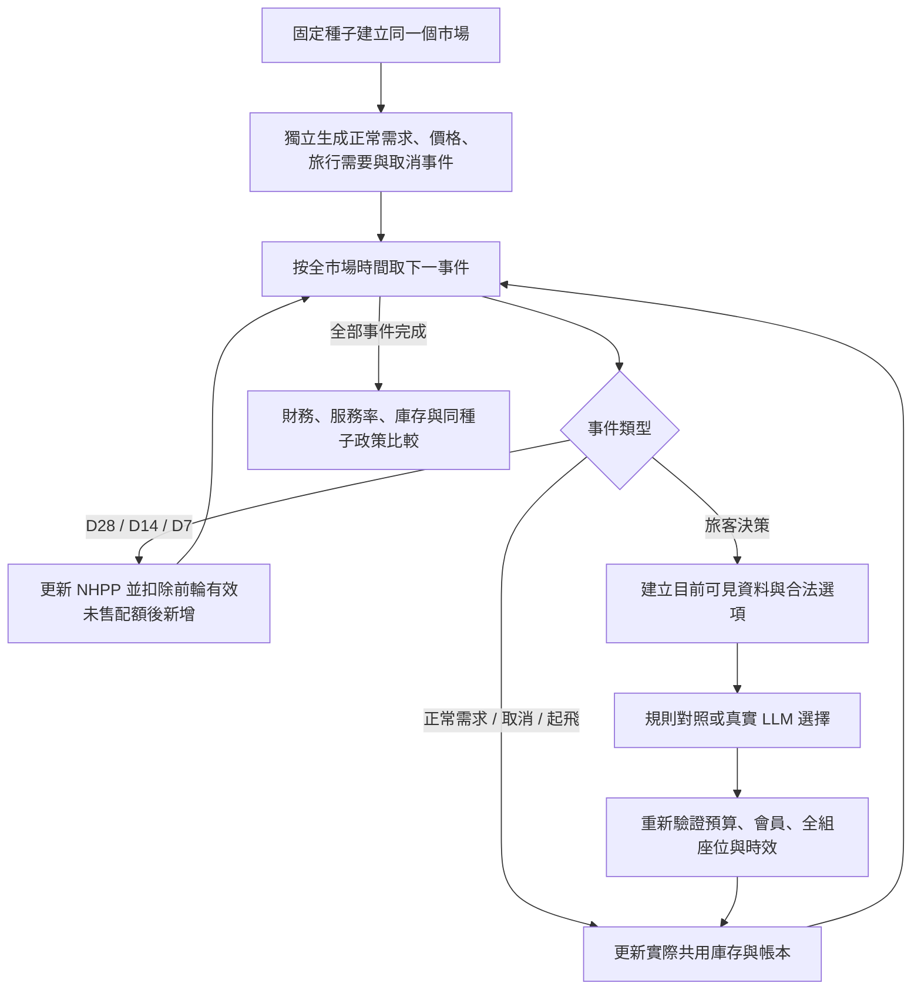

# 共用市場、會員與財務模擬

2026-11-14。實作：`backend/shared_market.py`，目前環境版本`shared-market-v3`，放票規則版本`three-round-release-v1`。目前規則採D28、D14、D7三輪增量放票。舊`shared-market-v2`報告保留原設定，不作新規則的驗證。本文件記錄可執行的環境規則；旅客的決策由另一個可替換的 adapter 提供，不由航空公司的收益目標控制。

## 這次改了甚麼

舊版逐位旅客完成整段旅程，不能表達「甲先買走最後一位，乙再看就已售罄」。新版將所有人的搜尋、正常需求、取消、NHPP 更新及起飛放進同一個時間排序事件隊列。每次只暫停一個旅客行動；行動完成後，其他旅客會看到已更新的座位與報價。

預設是 365 天日曆、9 班異質航班、24 個決策者，每人 3 個明確的旅行機會。可設定 6–12 班航班、2–3 個旅行機會。航班分散在三個時段，涵蓋不同日期、目的地、出發時間、容量、票價及需求情境。這是有限目錄的完整實驗，不是把少量航班乘上某個倍數冒充全年航空公司。

每張新購會員卡都觀察到實際到期時間，即使超過實驗最初的第 365 日。三個預先列出的旅行機會已是這位假想旅客在此目錄內的全部計劃；最後一次旅行之後的空白段明確假定沒有額外旅行，並非把未處理的未來使用成本刪去。這項假設不能代替真實全年使用次數調查。較晚入會的人無法把先前已錯過的旅程變成會員使用。

## 工作流程



## 真實世界模擬與預測分開

`simulate_flight(index, seed)` 先生成每班獨立的 180 日正常需求歷史與未來請求，包括持續跳升、短暫脈衝和下降情境。這個生成器不讀 NHPP 的預測均值、會員配額或政策名稱。未來請求時間、報價和取消抽樣在政策比較前固定，同一 seed 的所有政策共享同一組外生事件。

正常請求先到先得；被容量擋住的請求記為 denied。LLM 旅客是另外一個明確列出的假想客群，兩者不是把同一個客人算兩次。基準政策和會員政策都保留同樣的正常客流、旅客身份及旅行機會，才能觀察優惠取代原本正常購票，以及新增同行者是否擠走後來的正常需求。

Day 28 以前已訂位的人是期初佔用，付款與既有成本視為沉沒項，不計入比較帳本；這些期初旅客在本市場內不再取消。新產生的背景訂位及 Agent 訂位則會計入收入、取消與實際乘機成本。

NHPP 只接收每班航班截至目前的歷史。會員持有人座位不納入正常需求的 gross bookings；同行者正常票會納入。模型使用全機當時已佔座位處理剩餘容量。會員售票可能使正常需求更早被容量截斷，因此原本在獨立合成航班校準的覆蓋率，不能直接宣稱在這個有政策回饋的市場仍然相同。模型沒有因這次市場擴充而重新調整參數或使用 final 資料調參。

具體已確認的限制：若區間開始剩 4 位，途中 4 位被會員買走，而正常售票是 0，現有每日 NHPP 介面仍可能把這筆正常 count=0 視為完整可售區間的零需求。它沒有每分鐘的「仍可售給正常客人的 exposure」。當下已售罄所以配額為 0，不會超賣，但日後有取消重新放位時，正常需求估計可能向下偏。後續應提供事件時間的可售 exposure 或排除受會員售罄影響的區間，重新校準再另開驗證集；本次凍結實驗不把這項限制隱藏成已解決。

## 合法行動與時間規則

| 時點 | 可做的事 | 環境強制條件 |
| --- | --- | --- |
| 每個 D28／D14／D7 搜尋前 | 加入、保持現有會員、拒絕 | 會費在剩餘預算內；現有有效會員不重複收費；本次市場最多購買一個新會員期 |
| 搜尋 | 正常票、會員票、等待、放棄 | 航線、日期、時段、提前安排、協助需要、預算與整組座位都符合 |
| 已有訂位 | 保留訂位 | 同一旅行機會不能重複買；同一天不能持有第二個行程 |
| 出發前計劃改變 | 保留或取消 | 只使用當時已揭露的情況；取消須在起飛前兩小時之前 |
| 會員到期／目錄結束 | 續訂意向或拒絕 | 顯示明確假定的下一期預算；不收第二次會費，不把意向當轉化收入 |

會員卡只折扣持有人，同行者使用正常票價。三人同行時，整組付款是「1 張會員基本票價 + 2 張正常基本票價 + 3 人必付費用 + 所需行李」。整組一起成交或全部不成交。所有正常票、會員票與同行者共用同一份物理庫存。

會員必須在訂票當下及實際起飛時都有效，到期時間採 exclusive 上界。資料中顯示的出發時間、售票截止及事件時間一致。WAIT 不保留價格或座位。

NHPP只在D28、D14、D7三輪觸發新的配額決策。每輪目標未售量`T=floor(max(0,空位−正常需求保護量)×release_fraction)`；新增量`N=max(0,T−U)`，其中`U`是前面所有輪次仍有效的未售配額。第二輪扣第一輪，第三輪扣前兩輪；每輪保存獨立批次，不能直接覆寫剩餘配額。購票按先發先售消耗批次，取消不自動補發已消耗配額。新批次於共同停售點到期。

正常售票會扣減尚未滿足的正常需求保護量。當新目標小於舊未售配額時新增0，保留先前批次紀錄，但實際購票仍受物理容量及正常需求保護限制。沒有足夠可售座位時，即使名義配額還在，整組購票仍被拒絕。啟用會員的固定政策與候選政策都使用三輪時點，不另選首次開池日。完整公式、SQLite示例與前端語義見[三輪放票規則](THREE_ROUND_RELEASE.md)。

## LLM 實際看到甚麼

`next_observation` 僅輸出目前旅客的個人需要、剩餘預算、會員狀態、已訂位、目前可買的完整價格，以及合法 action／option ID。它包含本人最近 20 個事件和等待、放棄、無合法報價、同行座位不足等經驗計數。

不輸出其他旅客狀態、航空公司利潤、成本、政策名稱、政策 hash、未來價格、未來配額、未來需求、未發生的計劃變更或反事實購買意圖。當前訂閱參考報價是現時資訊，並不保留座位。LLM 不能自行建立航班、改價、預訂或改帳本。

`packet_id` 是環境事件識別碼，不包含政策名稱或政策 hash。Audit 層另外記錄 case／policy；Agent 不需要知道比較組別。不同政策若給完全相同的可見情況，可以共享同一個已驗證回應快取；是否命中快取仍須在 audit 分開記錄。

## 財務帳本

所有內部金額採 HKD cents 整數，外部報告再轉為元。所有必付費用暫按代收代付處理，不當成收入；此處沒有把燃油附加費的真實會計歸類當成已驗證事實。

| 項目 | 入帳時間與定義 |
| --- | --- |
| `membership_revenue` | 新會員期購買一次；既有期初會員不產生新會費 |
| `normal_base_revenue` | 正常旅客及會員同行者的正常基本票價 |
| `member_base_revenue` | 會員持有人的基本票價 |
| `ancillary_revenue` | 購買行李費，假定不可退 |
| `cancellation_revenue` | 每次取消服務費，最高不超過可退必付費用 |
| `mandatory_liability` / `mandatory_remitted` | 尚待代付／已於乘機時代付的費用，不屬收入 |
| `refunds_paid` | 取消時退回所有必付費用，扣明示取消服務費；基本票價與行李不可退 |
| `passenger_cost` / `ancillary_cost` | 實際乘機時才發生成本；取消且沒有乘機的人不產生成本 |
| `membership_service_cost` | 每個本次付費會員期一次，預設 HK$30 |
| `program_cost` | 啟用會員計劃一次，預設 HK$1,500；NO_OFFER 不收 |

財務不變量：

```
cash_collected - refunds_paid
    = revenue_excluding_mandatory_fees + mandatory_liability + mandatory_remitted

total_variable_cost = passenger_cost + ancillary_cost + membership_service_cost
total_cost = total_variable_cost + program_cost
contribution = revenue_excluding_mandatory_fees - total_cost
```

這是有限目錄的貢獻收益，未包括固定飛機成本及整間航空公司的其他業務；`profit` 只是相容欄位，意義同 `contribution`。政策的增量收益必須減去同種子的 NO_OFFER 結果，不能單看會員費收入。

## 可替換的程式介面

```python
state = create_market(config, seed=117, policy=policy)
while (observation := next_observation(state)) is not None:
    decision = decision_provider(observation)  # {action, option_id, reason_code?, reason?}
    record = apply_decision(state, decision)
report = summarize(state)
```

State 是 JSON，可存檔及恢復。`next_observation` 遇到旅客決策才停下；重複呼叫不會跳過待處理決策。`apply_decision` 重新生成合法選項後才修改預算、庫存與帳本；過期 packet、非法 action、無全組座位、錯誤 option 會直接拒絕，不會自動降級成其他購買。

`deterministic_decision` 是一個明示的規則對照，依當前完整價格、旅行預算、目前可見節省、假定可用性和需要決定；它不是學習出的真實購買率，也不能作為 provider 失敗時的暗中 fallback。

## 驗證與尚有限制

15 個專門測試已通過，涵蓋同種子政策配對、JSON 恢復、全市場時間順序、多次實際旅行、整組原子購買、持有人限定折扣、過期選項拒絕、會員起飛前到期、WAIT 無保留、取消退款與未飛成本、未來資訊隔離、真實需求不讀預測、會費只收一次、續訂意向不入帳、正常需求保護扣減、完整會員期、本人記憶，以及實際替代航班取消截止的前／正好／後邊界。

### v2 的實際故障修正

第一批 40 個種子的市場測試發現 seed `20261234` 的三個政策都停在取消事件。旅客選了比原定行程早的替代航班；計劃變更仍在原定日期前三天發生。當時實際航班仍是 confirmed，但已過兩小時取消截止：事件時間 `336.3798115`，實際起飛 `336.4375`，截止 `336.3541667`。v1 的合法選項只檢查 confirmed，因此錯誤地允許 CANCEL；交易層正確拒絕，沒有錯退金錢，但實驗無法繼續。

v2 的合法選項改為同時檢查**實際已訂航班**的截止時間。正好到截止或之後只可保留訂位，提供明確原因，不提供退款選項；原有交易層檢查保留。增加一個完整重跑該 seed 三個政策的迴歸測試，另測試截止前、正好截止和截止後的選項與拒絕交易不改帳本。

舊 v1 實驗與錯誤 audit 保留，沒有在凍結的實驗中替換程式。修正後改環境版本、建立新實驗、重新記錄程式 hash，並重跑相同種子。此次沒有更動 NHPP 模型或其校準。

### 校準檔案來源紀錄修正

最終 review 發現實驗 hash 清單曾記錄舊 `calibration.json`，而 NHPP v2 實際讀取 `calibration_v2.json`。目前已修正新實驗的 hash 清單；缺少或不匹配的來源 hash 會拒絕繼續執行。三個迴歸測試確認正確檔案納入清單、模擬變更 v2 校準內容會阻止 resume，以及缺少來源 hash 也會拒絕。

沒有改寫已完成實驗的原始 spec。另存 [校準來源補充紀錄](SHARED_MARKET_CALIBRATION_ATTESTATION.json)，逐一列出已完成 v2 實驗、原 spec checksum 及校準 checksum。目前 v2 校準檔案與實驗前已提交的 `b131fe5` 完全相同，且其 NHPP fingerprint 與各實驗凍結的模型一致。這是事後檔案比較，不能冒充當時沒有記錄的逐次 API／模型呼叫 checksum，也不能單憑檔案相同證明中途絕無暫時變更；執行團隊未觀察到這類變更。

目前只是香港出發的有限假想航線目錄，沒有完整多機場轉機、回程配對、動態航班取消、聯營結算或真實全客群權重。客群名稱是情境覆蓋，不能證明涵蓋整個實際 HK Express 市場。會員基本票價是政策常數；一般報價與正常需求在比較前固定，並不會因模型想提高利潤而改寫 ground truth。所有價格敏感度、背景需求和旅客意向仍需真實資料驗證。
