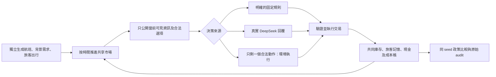

# 共享市場與旅客 Agent

這一版把「旅客描述合理」與「市場交易正確」分開：Agent 只決定當前旅客想做甚麼；環境負責時間、座位、資格、費用、預算、取消與帳目。所有人使用同一個航班庫存，同一會員在多次旅行之間保留自己的預算和歷史。這仍然是合成市場，不能稱為 HK Express 真實客戶需求模型。



## 檔案與介面

| 檔案 | 責任 |
|---|---|
| `backend/shared_market.py` | `create_market`、`next_observation`、`apply_decision`、`summarize`；環境及金額以整數分計帳 |
| `llm_agent/market_adapter.py` | 同一公開 observation 交給 deterministic、probabilistic 或 live；合法動作驗證、Provider 呼叫及快取來源 |
| `llm_agent/market_experiment.py` | 事先固定政策、seed 及開發／驗證分組；有限批次、續跑、成對比較、分享匯出 |
| `llm_agent/behavior_probes.py` | 不執行交易的獨立價格／重複／選項順序／語言診斷 |
| `llm_agent/audit.py` | 私有 JSONL 原始紀錄、秘密遮蔽、安全 run ID |
| `llm_agent/prompts/shared_market_v3_en.txt`、`_zh.txt` | 自利旅客視角，不能替航空公司追求利潤或猜未來資料 |

Observation 包含旅客明示需要、同行人數、當前預算、會籍期限、本人過往交易、目前可選航班及整組人的實付價格。稅費、行李、同行者原價及會員持有人票價分開列出。沒有把未來事件、未來價格、背景需求強度、航空公司利潤或 counterfactual label 交給 Agent。所有固定規則也使用相同公開 observation。

動作如 `JOIN_PASS`、`BUY_MEMBER`、`BUY_REGULAR` 必須引用環境提供的 option ID。環境重新驗證庫存、預算和資格。LLM 回應錯誤或截斷時保留原始資料並停下該 case；不會換成規則輸出。只剩一個合法動作時使用 `environment_forced`，不發送 LLM 呼叫。續期只有明示下一期預算下的意向，不收款、不計為實際續費。

## 可重現的政策實驗

目前三政策是 `NO_OFFER`、固定 P70/V399/50% quota，和候選 P30/V199/75% quota；啟用會員的政策均採固定D28/D14/D7三輪，扣除前輪有效未售配額，詳見[三輪放票規則](THREE_ROUND_RELEASE.md)。原固定方案D14首次開放屬歷史v2實驗設定。這個候選是事前設定的假設，名稱不代表最優。每個 seed 下的人物、出行機會和外部背景需求相同。背景需求由獨立生成路徑決定，不使用 NHPP 預測均值當作未來真相。

```bash
python -m llm_agent.market_experiment create --output data/private/market_demo --seeds 117 --modes deterministic
python -m llm_agent.market_experiment run --output data/private/market_demo --max-calls 0 --max-steps 10000
python -m llm_agent.market_experiment report --output data/private/market_demo
python -m llm_agent.market_experiment export --output data/private/market_demo --destination llm_agent/experiments/market_demo
```

使用 live 必須配置 server-only 環境變數，再以 `--modes live` 建立獨立實驗。`--max-calls` 限制這一批的外部呼叫嘗試；到達限制即暫停，只有明確續跑才會追加預算。失敗不自動重試。同一個實驗以 OS lock 防止兩個 worker 同時修改；live 每次交易落盤，deterministic 每 25 個動作及批次結束落盤。中斷後 deterministic 可以重播未保存的區段，audit 可能保留該區段的舊嘗試；市場帳目仍由已保存狀態恢復。Prompt、引擎、NHPP、生成器、人物及校準檔案 hash 固定，修改後要新建實驗。

私有原始輸入／輸出在 `data/private/llm_runs/<run_id>/events.jsonl`。公開匯出壓縮 audit、報告、實驗設定及 SHA256；排除認證 headers，並遮蔽當前環境中已知秘密。API 的 inline audit 有筆數限制；離線匯出使用串流，不因 5,000 筆限制截斷。

## 指標如何閱讀

`contribution` 是本次比較範圍的收入減成本，排除代收稅費和固定飛機營運成本。`profit` 相容欄位是同一個 contribution，不能解讀成航空公司淨利。新會籍收入只收一次；會員服務成本、計劃成本、乘客及行李邊際成本在帳目內。D28 之前已售座位的既有收入和成本不重複計算。

報告的 `paired_switched_trips` 以相同 `(customer_id, occasion_id)` 配對：基準實際完成正常票旅程、政策實際完成會員票旅程才標示切換，另保留兩邊航班及票價。`extra_background_denied` 是背景旅客被容量拒絕的差額。這些是解釋指標，相關影響已在兩個政策的收入差內，不能再扣一次「蠶食損失」。同 seed 所有政策會計與容量檢查通過後才列入排名。

`runtime` 分開列出外部嘗試、有效回覆、transport failure、驗證失敗、快取重播、固定規則與環境強制動作。不同回覆來源不能加總成「獨立 LLM 樣本」。開發 seed 與驗證 seed 的成績分開；看過驗證結果再改候選價格，需要新的 holdout 才能重新作確認性比較。

## 已完成的真實 Provider 診斷（2026-11-14）

原本的 v2.1 獨立旅客世界完成 112 個世界 × 六階段 = 672 個有效 DeepSeek 決策，無快取。它的某些入會選擇對價格非單調，且各價格條件購票人數相同，不能拿來直接估計需求曲線或保證盈利。

新 v3 固定情境診斷使用三位指定合成人物、P0/P30/P70/P100、會費固定 HKD199。每組做英文基準、兩次全新英文重複、逆序選項及中文 prompt，共 60 個真實、未使用快取的有效回覆，消耗 106,676 tokens。先前 sandbox DNS 造成 60 次未獲 Provider 回覆的失敗嘗試，原始紀錄完整保留；放行網路後成功完成 60 次，不能把 120 次嘗試稱為 120 個有效樣本。

| 診斷 | 結果 | 可作的結論 |
|---|---:|---|
| 同一輸入三次回覆 | 12 組中 3 組不一致 | temperature=0 仍不能假設逐次輸出完全穩定 |
| 選項順序反轉 | 12 組中 0 組改變動作 | 這個小樣本沒有觀察到順序翻轉 |
| 英文／中文 system prompt | 12 組中 0 組改變動作 | 這個小樣本沒有觀察到語言翻轉 |
| 每人／每種呈現的四價格比較 | 15 條序列中 0 條出現較低價格拒絕、較高價格加入 | 不能證明真實需求單調，也沒有校準彈性係數 |

三組重複不一致都出現在需要提前安排／協助的情境：P0 的動作為拒絕、加入、加入；P30 和 P70 均為拒絕、拒絕、加入。原始理由和完整輸入輸出在 `llm_agent/experiments/behavior_probes_20261114/`。這些人是刻意選來排查舊模型問題的案例，不是隨機市場樣本。Probe fixture 在執行前固定，不因後續共享市場引擎改動而回寫。

三個預先指定 live 驗證 seed 已完成 1,383 次全新有效回覆和 1,390 個環境動作，零快取及失敗。已與相同外部資料的固定規則版本逐世界核對。成本假設下的政策結果、履約、正常票切換、原始紀錄及校準檔案 provenance 限制，見 [完整驗證分析](SHARED_MARKET_VALIDATION.md)。
