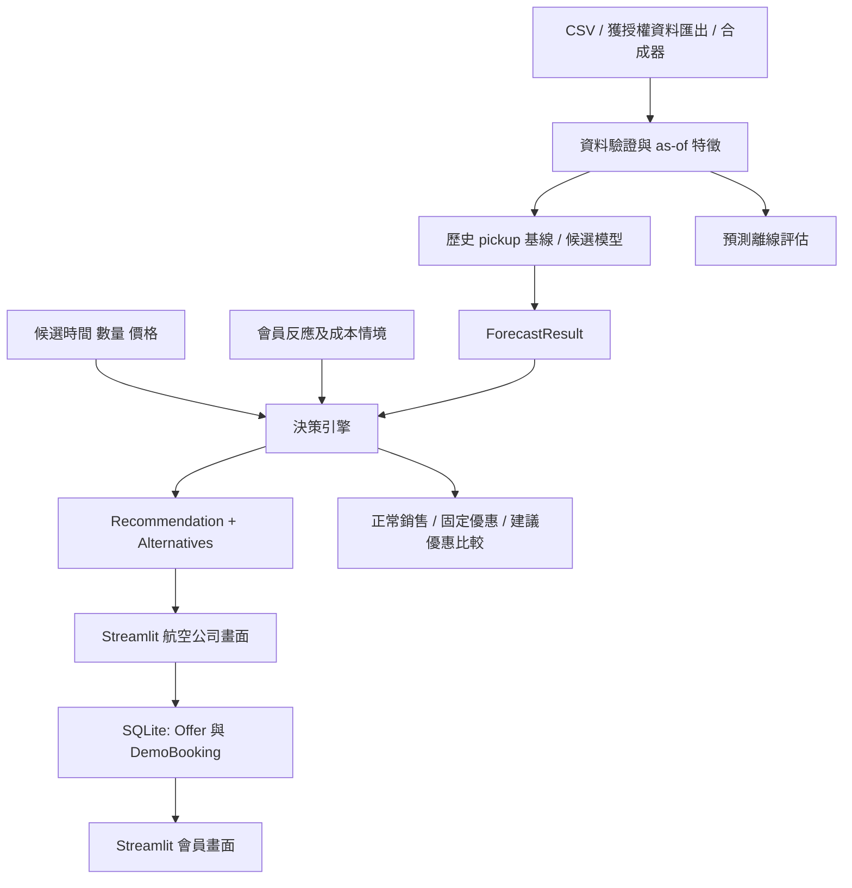

# UOption Fly Pass — Hackathon 技術設計

**2026-11-07｜版本 0.1｜狀態：待實作的 MVP 設計**

[README](../README.md) · [團隊產品與分工](PROJECT_PLAN.md) · [Agent 交接](../agent.md)

本文把核心拆成可實作的模組、資料合約、候選方案計算和驗收。數據欄位、技術棧、公式、候選網格及工作順序均為建議。團隊已確認的是 **28 天窗口，以及 WHEN／HOW MANY／WHAT FARE 三項核心輸出**。

## 1. MVP 的輸入、輸出與完成標準

**輸入：** 一班飛機、分析時點、當時已知的容量／訂位／正常票價、歷史預測資料、候選優惠參數及商業假設。

**輸出：** `OPEN_AT` 或 `NO_OFFER`，以及推薦開放時間、釋出數量、會員基本票價、預期會員訂位／未售座位／增量貢獻、理由、限制和替代方案。`OPEN_AT` 可以是窗口內未來某天的計劃，須在發布時重新驗證庫存。

**核心完成標準：** 真正計算多個開放時間 × 多個座位數 × 多個基本票價組合，與不開優惠比較；不是固定輸出一組硬編碼建議。至少能演示一個推薦優惠情境和一個不應開優惠情境。

範圍：單程航班、有限示例路線、每班一個 active offer、固定 demo 會員、模擬購票。來回組合及多輪釋出留待主流程完成後。

## 2. 架構與技術選擇

建議使用 **單一 Python 應用**：Streamlit 畫面、pandas 資料處理、scikit-learn 候選預測模型、SQLite 保存 offer 和模擬訂單。先用 CSV 作資料介面；圖表使用 Streamlit 可用的簡單圖表能力即可。

這是降低 Hackathon 整合成本的建議，不是已安裝的環境。Streamlit 適合 Python 資料應用，scikit-learn 提供回歸／集成模型，而 SQLite 可在本地提供無獨立 server 的儲存。參考：[Streamlit 官方文件](https://docs.streamlit.io/)、[scikit-learn 監督學習](https://scikit-learn.org/stable/supervised_learning.html)、[Python sqlite3](https://docs.python.org/3/library/sqlite3.html)。實作時選擇相容版本並鎖定依賴；此刻沒有可執行程式或 requirements 檔。



資料、預測、決策與評估使用純 Python 函式；Streamlit 負責輸入和呈現，不把所有計算寫在 UI。第一版不需要獨立 REST server、微服務、雲端資料倉庫或 LLM。

建議的未來檔案配置（下列程式檔目前尚不存在）：

```text
app.py
src/
  data.py          # schema、來源、時間一致性、檢查
  forecast.py      # pickup baseline、預測合約
  decisions.py     # 候選方案、可行性、評分及推薦
  scenarios.py     # 會員反應、成本、三種策略比較
  store.py         # SQLite offer / booking、交易與去重
scripts/
  generate_demo_data.py
  evaluate.py
data/
  synthetic/      # 可重現、明示為合成的樣本
  private/        # 本地授權資料，須設 Git 忽略
artifacts/        # 評估報告；模型是否可分享依資料授權
```

## 3. 三個展示畫面

| 畫面 | 必須呈現 | 操作 |
| --- | --- | --- |
| 決策 dashboard | 資料來源、flight/as-of、當前訂位、預測餘位、推薦日期／量／價、候選比較、假設 | 選航班、調參、重新計算、採用建議 |
| 會員頁 | 示例 plan、目的地／日期、合資格優惠、價格拆分、剩餘優惠位 | 比較、選擇、模擬確認 |
| 評估與會費頁 | 預測與 baseline、三種策略結果、簡化會費供需試算、限制 | 改情境、重播、匯出結果 |

價格拆分：基本票價＋燃油附加費＋稅／必收費＋已選附加項目＝本次付款。會費另列。真實數據缺少分項時顯示未知或改用完整標記的示例，不能把未知稅費填 0。

<a id="data-contract"></a>
## 4. 數據合約及具體例子

**本節所有 flight ID、日期、航班數字、票價、成本和反應數值均為虛構示例。** 可用於設計與 demo，不代表 HK Express 的實際表現。模型樣本應有多個獨立航班；以下一班只為展示欄位和連接方式。

### 4.1 我們要從哪幾種資料回答甚麼問題

| 資料 | 必要程度 | 直接支援 | 不足時的處理 |
| --- | --- | --- | --- |
| 航班日期、路線、容量 | 核心 | 識別航班、供應上限 | 合成航班／容量，標示來源 |
| 歷史訂位快照＋最終淨訂位 | 預測核心 | 學習未來淨新增訂位 | 合成曲線可接通流程，無法證實真實準確率 |
| 當前可售庫存 | 發布核心 | 限制實際可放出的座位 | demo 自有庫存，不能聲稱可出票 |
| 正常報價歷史及分項 | 定價與展示核心 | 正常價格基準、完整價格 | 明示示例價錢 |
| 航班級正常銷售成交／貢獻 | 商業評估重要 | 被取代正常銷售的價值 | 用合理區間作情境參數，非實測利潤 |
| 促銷時機、釋出量、價格、曝光／購買 | 決策效果重要 | 時間和價格對需求的影響 | 顯式需求反應假設，不能用一般餘位模型代替 |
| 星期／季節／兩地假期 | 預測重要 | 日曆特徵 | 使用有來源且當時已知的日曆 |
| 會員偏好、使用量、成本 | 方案評估重要 | 供需、會費與每單貢獻 | 合成人物和低／中／高情境 |

**報價、成交價和會員候選價是三種資料。** 不能用歷史網站價格當成實際每單收入，也不能只憑票價變動推斷餘位或價格彈性。

### 4.2 航班表 `flights.csv`

最少欄位：`flight_id`、`origin`、`destination`、`departure_at`、`origin_timezone`。可加 carrier／flight number／機型；同一航班號在不同日期要有不同 flight_id。

```csv
flight_id,origin,destination,departure_at,origin_timezone,source_kind
DEMO-001,HKG,FUK,2026-10-30T04:00:00Z,Asia/Hong_Kong,synthetic
```

容量會隨時間變化，放在快照和最終結果中，避免把事後換機容量覆蓋歷史紀錄。目的地機場和產品路線是示例，非已確定的會員覆蓋。

### 4.3 訂位快照 `booking_snapshots.csv`

最少欄位：`flight_id`、`observed_at`、`available_at`、`sellable_capacity`、`net_booked_seats`、`available_to_sell`。可加新增、取消、改期、封鎖位原因。`available_at` 是資料真正可被系統讀取的時間。

```csv
flight_id,observed_at,available_at,sellable_capacity,net_booked_seats,available_to_sell
DEMO-001,2026-10-02T04:00:00Z,2026-10-02T04:00:00Z,180,90,90
DEMO-001,2026-10-09T04:00:00Z,2026-10-09T04:00:00Z,180,108,72
DEMO-001,2026-10-16T04:00:00Z,2026-10-16T04:00:00Z,180,130,50
DEMO-001,2026-10-23T04:00:00Z,2026-10-23T04:00:00Z,180,150,30
DEMO-001,2026-10-27T04:00:00Z,2026-10-27T04:00:00Z,180,158,22
DEMO-001,2026-10-29T04:00:00Z,2026-10-29T04:00:00Z,180,162,18
```

這些分別是 D28、D21、D14、D7、D3、D1。例子假設無封鎖位；真實 `available_to_sell` 未必等於容量減訂位。淨訂位可能因取消而下降，不能強制成單調上升。

### 4.4 最終結果 `outcomes.csv`

最少欄位：`flight_id`、`sales_cutoff_at`、`label_available_at`、`final_sellable_capacity`、`final_net_booked_seats`。`boarded_passengers` 可選。售票截止時間需要資料方確認，下面只是假設。

```csv
flight_id,sales_cutoff_at,label_available_at,final_sellable_capacity,final_net_booked_seats,boarded_passengers
DEMO-001,2026-10-30T03:00:00Z,2026-10-31T00:00:00Z,180,165,161
```

本例：最終未售座位是 `180 - 165 = 15`；實際未坐人的座位是 19，差異包含 4 個 no-show。D14 的後續淨訂位是 `165 - 130 = 35`。**最終結果只用於歷史訓練標籤／評估，不能輸入 D14 當下的預測。**

超售、嬰兒、團體及取消的定義需確認；取消航班單獨處理，不能當普通低需求航班。

### 4.5 報價快照 `fares.csv`

最少欄位：flight、quote/available timestamp、產品／渠道、幣別、基本票價、燃油費、稅／必收費、總價、單程／來回口徑、是否可購。MVP 的示例均為一名成人單程，不含可選行李。

```csv
flight_id,quoted_at,currency,fare_kind,base_fare,fuel_surcharge,taxes_and_mandatory_fees,total_payable,journey_basis,is_available
DEMO-001,2026-10-02T04:00:00Z,HKD,regular_quote,380,100,150,630,one_way,true
DEMO-001,2026-10-16T04:00:00Z,HKD,regular_quote,500,100,150,750,one_way,true
DEMO-001,2026-10-23T04:00:00Z,HKD,regular_quote,650,100,150,900,one_way,true
```

為易讀，上例略去 `available_at` 和產品／渠道欄；demo importer 可在 manifest 明確宣告「無延遲、單一產品／渠道」後補齊。真實資料不可未經核實套用此預設。

如候選會員基本票價是 0，本示例每次仍付 HK$250；若基本票價 100，則付 HK$350。會員費另計。例子中的燃油費／稅費不是真實收費標準。

### 4.6 日曆 `calendar.csv`

`date`、`market`、`day_of_week`、`is_public_holiday`、`holiday_name`、`known_at`、`source`。分別連接出發地與目的地市場。先用星期和月份即可；真實假期應由明確來源取得，未來活動只有在分析時點已公布才可用。

### 4.7 優惠反應：有資料才能驗證價格決策

理想欄位：flight、offer 開放／結束時間、基本票價、quota、已售量、曝光／合資格會員數、取消、正常票價、同時促銷、source/channel。

| 示例 offer | 開放日 | 釋出 | 基本票價 | 合資格曝光 | 售出 | 取消 |
| --- | --- | --- | --- | --- | --- | --- |
| SYN-OFFER-1 | D7 | 8 | HK$100 | 40 | 6 | 0 |

這一行只說明記錄方法。它不能單獨證明降至 HK$0 會賣多少，也不能知道 6 人中誰本來會正常購票。即使有大量觀測，價格、時機和需求也可能同時受其他因素影響；因果效果需要適當對照或實驗。

沒有這類數據時，先用可調的會員興趣、價格敏感度和正常銷售替代比例做模擬，畫面明示 `assumed`。

### 4.8 成本、會員及情境配置

用小型 JSON 或表格保存，每項均有 `value / unit / source_or_assumption`：

- `member_interest_by_open_day`：在各開放提前期，可能考慮該航班的會員人數。
- `conversion_intercept`、`price_sensitivity`、`reference_fare`：價格對會員轉換的情境參數。
- `substitution_rate`：優惠訂單中本來會正常購票的比例。
- `normal_contribution_per_booking`：被取代一筆正常訂位所損失的貢獻。
- `ancillary_margin_per_member`、`incremental_passenger_cost`、`offer_service_cost`：會員每次使用的留存附加收入扣相關成本，以及其他增量成本；成本口徑互不重複。
- `total_member_quota`、`fare_candidates`、`quantity_candidates`、候選開放提前期、會員計劃／日期資格。
- 會費試算另需：會員數、會費、期間、使用次數分布、同期間可提供優惠位及營運成本。

金額使用同一幣別，計算避免浮點金額累積誤差。稅費按提供方口徑剔除代收轉付項；燃油附加費亦需核對收入／成本處理。未知成本用區間，不以 0 冒充已知。

### 4.9 來源、取得與品質

向 Cathay／供應商優先要少量航線的匿名化航班級資料：最好 12 個月、每日 D28 至截止快照；若只有 D28／D21／D14／D7／D3／D1，按實際粒度使用。較短資料仍可先接通流程，不能保證足夠訓練。

團隊已申請 OAG Passenger Booking Data 與 Airfare Data。取得樣本後核對 HK Express 覆蓋、直銷／代理涵蓋比例、actual／sample／estimated 性質、取消和歷史 as-of 版本、欄位粒度與訓練／展示授權。Flight Info API 的容量不是淨訂位或可售庫存。

每份資料附 manifest：來源、版本、種子（若合成）、覆蓋範圍、可分享條件、欄位單位及缺值定義。公開 repo 保存 schema／合成器／可分享樣本，憑證及受限檔案放入忽略路徑。

導入檢查：唯一鍵、航班關聯、時間與時區、可用時間、價格加總、容量異常、重複紀錄、缺值、取消航班。歷史結果表與推論特徵分開。

## 5. 預測模組

先完成 **歷史 pickup baseline**：按航線、出發星期和提前期取得過往「之後的淨新增訂位」中位數；群組樣本不足時退回較粗粒度群組。

```text
net_pickup(t) = final_net_booked_seats - net_booked_seats_at_t
predicted_final_bookings = current_bookings + predicted_net_pickup
predicted_unsold = max(assumed_final_capacity - predicted_final_bookings, 0)
```

當前容量 180、D14 已訂 130、預測後續增加 30，則預測未售 20；用上述真實性質為 synthetic 的結果 15 作評估時，誤差是 5 位。

預測可以為負淨 pickup，反映取消；第一版決策模擬可將取消合併在明示的淨 pickup 曲線，並要求每個未來時點訂位非負、不超容量。若資料存在超售或複雜容量變更，先標記、分開評估。

歷史正常需求可能已受促銷影響。有政策標記就分層／控制，沒有則明示模型預測的是歷史混合政策下的結果；其輸出作為「無會員優惠」基線需要額外假設。

P1 可比較一個表格回歸模型，例如梯度提升；模型種類待數據決定。LLM 不負責數值預測或代替候選計算。

### 預測評估

按出發日期劃分 train／validation／test，同一 flight 的所有快照在同一集合。每次歷史推論只能使用當時已可用的特徵與訓練標籤；用 rolling-origin 或足夠時間間隔，避免 D28 的推論用到之後才出現的標籤。

按提前期及航線報告 MAE、RMSE、偏差、樣本量；關注高估餘位造成的風險。零餘位常見，不只用 MAPE。只有經建立並驗證的區間才稱校準區間；否則標為假設上下限。

## 6. 決策引擎：必須算出三個輸出

### 6.1 明確的 MVP 方法：候選搜尋＋情境評分

一次分析固定 `as_of`，只使用當時可知資料。對所有候選開放時間 d、數量 q、基本票價 p，估算需求與貢獻，剔除不合資格方案，排序並與 `NO_OFFER` 比較。此方法可在 Hackathon 實作及解釋；不是對真實航空營運最優性的保證。

建議小網格（全部為可調示例）：

```text
opening_lead_days = [28, 21, 14, 7, 3, 1]
quantities        = [2, 4, 8, 12]
base_fares_hkd    = [0, 100, 200]
```

在 D28 分析時最多比較 72 組，再加 NO_OFFER。在 D14 分析時只保留 D14／D7／D3／D1；已過的 D28 和 D21 不再可選。28 天是固定最大窗口，這份候選清單是原型設定，可改成每天。D0 只有實際時間仍早於售票截止才可加入。

### 6.2 時間怎樣影響決策

對未來開放日的正常訂位／可售量，使用當前預測加上從訓練資料估計的 pickup 時間分布來推算。會員可能來不及安排旅程的影響，放在 `member_interest_by_open_day`；早開優惠對正常購票的替代風險，放在按開放時間／價格調整的情境參數。

**不能在 D28 排序方案時讀取同一班機 D14 的真實訂位或未來真實票價。** 它們只能用來事後評估。這也是為何時點特徵與 outcomes 必須分開。

### 6.3 先算可行性，再算價值

可行性條件：候選開放時間介於 as-of 與售票截止，位於 D28 窗口內；plan 有資格；q 為整數；p 非負且在政策允許價位；quota、預測可供應量和會員需求均有明確來源。

```text
remaining_quota = total_member_quota - consumed_member_seats - outstanding_allocations
feasible_q <= min(
    projected_unallocated_inventory_at_open,
    conservative_unallocated_surplus,
    remaining_quota
)
```

Plan A／B 共用同一航班座位帳本，不能重複分配。庫存已扣保留位就不重複扣；計算前把來源口徑統一。未來 projected inventory 只是計劃值，真正發布時用當時可售庫存重新檢查。

如果假設固定容量且不考慮未來取消，可用當前 available-to-sell 作額外保守上限；如允許取消釋放庫存，必須顯式建模。沒有合適餘位則 NO_OFFER。

### 6.4 需求反應的最低可實作版本

缺少歷史優惠反應時，可用以下情境函式作初版；所有參數在 UI 可見，之後再用真實數據校準。

```text
conversion(p, d) = sigmoid(intercept - sensitivity * p / reference_fare)
expected_member_bookings M = min(q, member_interest_by_open_day[d] * conversion(p, d))
```

`sigmoid(x) = 1 / (1 + exp(-x))`。`reference_fare > 0`，sensitivity 非負，興趣人數非負，substitution_rate 介於 0 與 1。時間透過興趣人數、預計可售量及替代風險影響評分；價格透過轉換和收入影響評分；數量透過供應限制影響評分。M 可為小數期望值，實際 quota／訂單必須是整數。

原型至少提供低／中／高會員需求和替代風險情境。實際出現非單調行為時應重新驗證模型；上述函式僅是可解釋的假設。

### 6.5 貢獻與最終餘位的計算口徑

第一版對單班機採用「會員方案新增部分」算法，假設 baseline 後續正常淨訂位已處理取消，且 baseline 最終訂位介於 0 與容量之間。

```text
B = current_bookings
N = forecast_future_normal_net_bookings
C = assumed_final_capacity
M = expected_member_bookings

substituted_normal = min(M * substitution_rate, max(N, 0))
capacity_displacement = max(B + N - substituted_normal + M - C, 0)
lost_normal = substituted_normal + capacity_displacement
final_bookings = B + N - lost_normal + M
final_unsold = max(C - final_bookings, 0)

member_trip_contribution = member_base_fare + retained_surcharge
                         + ancillary_margin - incremental_passenger_cost
incremental_contribution = M * member_trip_contribution
                         - lost_normal * normal_contribution_per_booking
                         - offer_service_cost
```

只有政策允許且正常訂位能被擠出的未來需求，才可進入 capacity_displacement；不得取消已確認的 B。若方案必須侵犯已有訂位，視為不可行。conservative surplus 控制通常應令 capacity_displacement 很小；情境仍要捕捉需求高於預測的風險。

此處 substituted normal 是原本會買正常票的客人改買會員票；capacity displacement 是其餘新增會員使用容量後，額外擠走的正常需求。兩者分開，避免把同一損失扣兩次。價格和成本皆為同幣別、同一旅客口徑。NO_OFFER 的增量貢獻定義為 0。

若改用完整策略總收入減成本，再減正常銷售基線，以上 lost_normal 損失已包含在差額中，不應再扣一次。

**會費不為每一個候選方案重複加入。** 已收的會費對同一會員／同一期間的單班決策通常不是因該 offer 新增的收入；會費與長期供應價值在方案層試算。若要為會員權益預留價值或服務義務，另訂明確政策，不能用任意分攤會費讓任何虧損優惠看起來有利。

### 6.6 可核對的候選比較例子

以下是另一個獨立的 **D28 決策示例**；所有期望訂位與損失都是情境輸入，並非讀取未來實際結果。假設 retained surcharge＝0、附加服務淨收入＝120、每位增量成本＝60、每筆損失的正常銷售貢獻＝350、offer service cost＝0；候選皆通過容量限制。

| 開放日 | q | p（HKD） | 預期會員訂位 M | 預期損失正常訂位 | 增量貢獻（HKD） |
| --- | --- | --- | --- | --- | --- |
| 不開 | 0 | — | 0 | 0 | 0 |
| D21 | 12 | 100 | 8 | 2 | 580 |
| D14 | 8 | 100 | 6 | 0.5 | 785 |
| D7 | 4 | 200 | 3 | 0.2 | 710 |
| D14 | 8 | 0 | 7 | 0.5 | 245 |

例如 D14／8 位／HK$100：`6 × (100 + 120 - 60) - 0.5 × 350 = 785`。在這四個已評分優惠中該組最高；不可宣稱它是整個市場的最佳方案。真正程式需產生完整候選評分，而非照抄這張表。

如果所有優惠分數都不高於 0，回傳 NO_OFFER。平手時先選較低正常需求損失，再選較少釋出量；其他平手用固定排序保持可重現。庫存少、資料缺失或沒有會員需求也應有明確原因碼。

## 7. 模組介面與狀態

以下為建議 Python 合約；不是已存在的 endpoints。

| 函式 | 最小輸入 | 最小輸出 |
| --- | --- | --- |
| `load_data(source)` | 檔案、manifest | 驗證後 tables、quality report |
| `forecast(flight_id, as_of, data)` | 當時可知快照、訓練產物 | baseline pickup、餘位、時間分布、方法版本、假設區間 |
| `recommend(flight_state, forecast, policy, scenario)` | 狀態、預測、候選、成本／需求假設 | best action、全部 candidates、排除原因、scenario/model/data IDs |
| `publish_offer(recommendation, effective_now)` | 採用的建議、實際或 demo 時鐘 | 經重新驗證的 offer 或失敗原因 |
| `list_offers(member, preferences, now)` | 方案、目的地、日期、預算 | active 且合資格、有庫存的 offer |
| `confirm_demo_booking(offer_id, member_id, request_id, now)` | 去重 key、使用條件 | 模擬確認、價格快照、剩餘量 |
| `evaluate(dataset, configurations)` | 時間切分、策略、情境 | 分提前期預測及商業結果 |

`Recommendation` 必須攜帶 `as_of`、`opening_at`、`quantity`、`base_fare`、`currency`、`expected_member_bookings`、`expected_unsold`、`incremental_contribution`、`assumption_set_id`、`source_kind` 及候選表。NO_OFFER 的日期和價格可空、數量為 0，附原因。

Offer 狀態：`draft → approved/scheduled → active → exhausted/expired/withdrawn`。未來 opening_at 不得立即標 active。demo 可明示調整模擬時鐘以展示開放和訂票，不需要背景排程服務。

SQLite 以 transaction 重新檢查 active、時間、資格和庫存後扣減；request_id 唯一，防止重複確認扣兩次。`confirmed_at` 用來計算實際預訂提前期；這和推薦開放提前期不同。保留價格快照，避免訂單跟著後續改價變動。

## 8. 評估、會費與資料限制

比較三種策略：NO_OFFER 正常銷售；固定時間／量／價；決策引擎的建議。使用相同 flight、需求生成規則、成本及可比較的隨機種子。固定策略在測試前設定，不能事後挑一個特別差的比較對象。

評估未售座位、會員訂位、正常銷售損失、增量貢獻、推薦開放提前期、實際預訂提前期、會員需求滿足率。離線預測指標與策略模擬結果分開。歷史已有結果不能直接告訴我們另一個價格政策會造成甚麼結果，策略成效仍依賴情境或後續實驗。

會費配套先做一張表：同一期間的會費收入＋會員旅程增量貢獻－方案營運成本；供應不足的使用請求記為未滿足，不能假設每人想飛幾次就能飛幾次。Plan A／B 共享的座位不重複計入供應。年費情境採年度供需假設；不要把幾天 demo 無條件外推成年利潤。

只用合成資料時，至少保留不同需求情境作測試；不要把同一產生公式的重現分數當成真實航空預測能力。沒有資料可測的商業參數，清楚顯示低／中／高假設及結果敏感度。

## 9. 實作順序與驗收

以下是在主辦方允許的 24 小時開發時段內的建議分配，不構成對賽前開發規則的判斷。

| 時段 | 工作 | 完成時應看得到 |
| --- | --- | --- |
| 0–2 小時 | 確定 schema／合約／情境，建立幾班 demo 資料 | 同一 flight 可連接快照、票價和結果 |
| 2–6 小時 | A 做 baseline；B 做候選與評分；C 做畫面骨架；D 定 demo 與檢查 | 用相同 fixture 跑通各模組 |
| 6–12 小時 | 串接三項決策與候選比較 | 一班機實際算出時間／量／價或 NO_OFFER |
| 12–16 小時 | 會員頁、模擬訂位、會費表、評估圖 | 從建議到會員使用可完整操作 |
| 16–20 小時 | 驗證數字、失敗情境、資料說明、可重現啟動 | 關鍵測試通過、另一人可重現 |
| 20–24 小時 | 修正阻礙展示的問題，整理 slides／poster／錄影備份，排練 | 展示材料與實際原型一致 |

時間不足時先保留 baseline，減少路線與 UI 裝飾，保留三項候選比較及 no-offer 分支。

### 關鍵測試（針對錯誤風險）

1. D14 分析不能產生 D21 開放的建議，也不能使用 D7 才可用的資料；所有 opening 在 D28 與售票截止之間。
2. final outcomes 不進推論特徵；同一航班快照不跨 train/test。
3. 每個候選符合 quota 和庫存；不同 plan 不重複分配；不侵犯已確認正常訂位。
4. 用上述候選例子核對四個分數；所有分數非正時回傳 NO_OFFER。
5. 改變價格敏感度／替代風險後確實重算候選，而非只改說明文字；建立至少一組能切換決策的 fixture。
6. 0 元基本票價仍正確加費；會員費不重複計入每個 offer。
7. 未來、過期、售罄或不合資格優惠不可確認；最後一席並發請求只成功一次；重複 request_id 不重複扣位。
8. 同資料／配置／種子重跑能重現結果；畫面顯示 real／synthetic／assumed 的來源差異。

實作後才在 README 加入經實際驗證的安裝、啟動、資料產生及評估命令。以可跑完端到端 demo 和上述關鍵風險驗證作交付標準，不以程式檔數量或模型複雜程度作標準。
