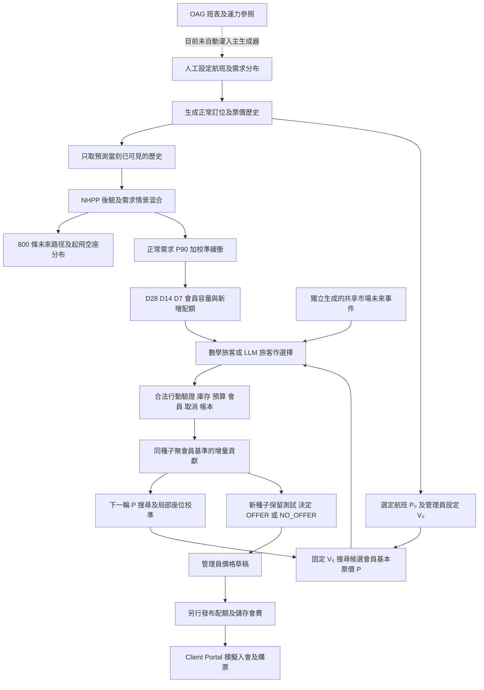

# E117 項目完整技術流程與程式核對

> 状态：记录（2026-11-14），内容不再修改


核對日期：2026 年 11 月 14 日，香港時間。對象：Airplane CPU／UOption Fly Pass 團隊。

這個項目的現有主體是**合成資料、NHPP 需求預測、座位保護規則、會員政策搜尋，以及可重播的市場模擬**。它不是一個已用真實 HK Express 訂位訓練、直接輸出「正確價格」的監督學習模型。LightGBM 沒有進入現有主流程；LLM 也沒有在項目內微調，而是接受場景提示並作出旅客行動。

這份說明沿著實際程式回答六件事：資料怎樣生成、起飛時空座怎樣預測、會員座位怎樣釋出、票價與會費怎樣選、數學旅客與 LLM 怎樣交易，以及最後怎樣比較盈利。所有數字必須連同其資料版本、成本口徑及實驗範圍閱讀。

## 先辨別目前的版本

本次最終核對的程式快照是 `/tmp/e117-technical-audit-20261114-final`，最初基於 Git `dbe7981d115914e3b8fb7c11fb4c6e9d7fbf0ab2` 加上當時工作目錄修改；完成核對時相關實作已提交為 `24264846305832b10b2dfc91dc0cad0296110f09`。快照清單包含 249 個第一方程式、測試、設定、技術文檔和產物檔案；各檔案 SHA256 另保存於本報告旁的來源清單。未讀取憑據或把私有 API 原始資料加入報告。

| 層次 | 核對時的實際狀態 | 解讀方式 |
|---|---|---|
| Docker | `uoption-fly-pass:local`，image `cd9954a47843…`；15:35:08 HKT 重建，localhost:8000，健康 | 8 個關鍵程式／產物 hash 與最終快照逐一一致，包含 NHPP、scope、optimizer、庫存及前端 |
| 最新航班優化 | `flight-policy-feedback-v2`，已接入 `flight_id`、`forecast_day`、固定 V、總 LLM 額度及同航班建議 | 單航班回放，只搜尋 P；不能因此宣稱已求全年最優會費 |
| 保留的通用市場 | 明確以 legacy_market=true 呼叫 API 可使用多航班 P、V 聯合搜尋；另有快速網格和連續票價參考工具 | 需看入口、配置與版本，不能把不同工具的指標混用 |
| 歷史公開實驗 | 每個 report 有自己的 prompt、模型、釋位規則及程式 hash | 舊實驗可以作歷史證據，不能直接替新版背書 |

最新主頁的 P₀ 由後端重新從選定航班的歷史取得，不能用前端任意值覆蓋；V₀ 則由管理員設定並在該次航班搜尋固定。LLM 可在授權總額度內跨內部批次繼續，耗盡總額或發生 provider 錯誤仍停止。較早快照未接通的結論已不適用於上述最終版本。

## 一張圖看懂已存在的主要流程



圖中的各模組實際上有多套入口；下文逐一區分。Forecast 的航班歷史已可作主 Optimize 的起點，但每個候選仍會重建獨立反事實市場；Customer Panel 仍是獨立示例，Client Portal 亦有自己的發布／訂位帳本。它們不是所有動作都直接改同一份線上庫存。

## 名詞及單位

| 符號／欄位 | 意義 | 不應混為一談的東西 |
|---|---|---|
| `d`／D28 | 距離起飛尚餘天數；越接近起飛越小 | 不是生成器由開售開始正向增加的時間 u |
| `C` | 可售座位容量 | OAG predicted capacity 不是實際售票數 |
| `B_d` | 當刻有效訂位座位數 | 不是當日新增訂位，也不是需求總量 |
| `A_d=C-B_d` | 當刻尚餘實體座位 | 不等於起飛時一定賣不出的座位 |
| `N_d` | 期間正常購票請求數 | 請求可以因滿座被拒，不全是成交 |
| `P` | 每張會員基本票價 | 不含強制費用、會費、同行者正常票 |
| `V` | 一份個人會員期的會費 | 不是每張票都收一次 |
| `R` | 正常基本票價 | 不是會員價，也不是含費總付款 |
| `F` | 必付費用；很多場景假設 HK$250 | 程式作代收款處理，不當成航空公司利潤 |
| protection | 為未來正常需求保留的座位 | 不等於平均預測需求 |
| release ceiling | 當刻風險規則容許的會員容量上限 | 不等於今天可以新增的配額 |
| contribution | 程式收入減已建模可變成本及方案成本 | 不包含飛機租賃等完整固定成本，並非公司淨利 |

## 閱讀順序

1. 資料與 NHPP：生成公式、資料欄位、需求跳躍、後驗、空座、保護及三輪放票。
2. 定價與經濟模型：三個定價入口、旅客需求、P／V 搜尋、帳本、基準及反向校準。
3. LLM 與 OAG：客群、場景、行動、英文約束、真實呼叫、重播與證據範圍。
4. 前後端及儲存：每頁真正運行的程式、資料庫、部署與能力邊界。


## 第一部分 模擬資料 空座預測與三輪放票

### 一、整体逻辑与数据量

不是用20万条数据监督训练 `X→最优价格y`。真实主链：数学假设生成正常销售历史→每班每时点拟合NHPP→预测需求及停售空座→保留正常需求风险预算→三轮补会员配额→由其他市场/搜索模块比较票价与会费。NHPP不直接输出最优会员票价或会费，没有LightGBM，也没有真人购买率标签。

| 数据目录 | 日快照 | 航班历史 | 用途 |
|---|---:|---:|---|
| simulation/generated |200000|1105|冻结主数据|
| simulation/network_generated |40182|222|新增网络目录：37远端机场×往返方向×3日期|
| validation_extended/seed-20261121 |200000|1105|独立合成验证|
| validation_extended/seed-20261122 |200000|1105|独立合成验证|
| 当前源码应用目录 |240182|1327|只加载主+network|
| 以上仓库总计 |640182|3537|包含验证；验证种子之间flight_id重复，须连seed识别|

主数据=1104×181条D180→D0 + 1×176条D175→D0。最后一班仍从D180生成，省略前五条公开历史，每班保留D28→D0。`simulation/generate.py:158`。`backend/data.py:11` 原rows/files保持200000导出语义，另有catalog_rows/catalog_flights。`:19` flights JSON缓存，`:24` 锁内一次读gzip/类型转换/按flight_id分组；不加载validation目录。

只读复核（NumPy2.3.5）：目录1327航班/240182行；network validate返回40182行/222航班，库存守恒、时间戳、SHA256 passed。

### 二、主生成器 simulation/generate.py

#### 时间、航班与随机性

`:36` 六场景low/typical/high/surge/pulse/declining按index%6；HKG出发，目的地FUK/KIX/NRT/TPE/ICN/BKK/DAD/OKA；容量180/188/230/236轮换。`:48` 日期从2027-05-15 07:00HKT按index构造，不是真实UO时刻表。`:61` SeedSequence([seed,index])，default seed117，参数/需求/取消/价格随机流分开。

D180对应u=0，D28对应u=152；D0实际是起飞前2小时停售，最后D1→D0区间22/24天。gross/cancellations是进入快照前刚完成区间；快照报价作用于后一个区间；D180 exposure0。

#### 强度、价格与成交

| 场景 | β每天均匀范围 | 基础总需求乘数M |
|---|---|---:|
|low|.002… .018|.55|
|typical|.008… .025|1.05|
|high|.012… .032|1.70|
|surge|.006… .018|1.00|
|pulse|.006… .018|.85|
|declining|−.012…−.002|.85|

每17个index令β=0，随机强弱A~Gamma(18,scale1/18)，均值1。定义

Iβ(a,b)=∫exp(β(u−180))du=exp(β(a−180))*expm1(β(b−a))/β；|β|<1e−10用b−a。

θ=C*M*A/Iβ(0,180−2/24)。因此参考价、无shock的总期望=C*M*A；shock追加需求，不再归一化。`simulation/generate.py:41`、`:69`。

参考base从280/380/480/580/680/780选取，必付费用250；涨价转折日从D28/D21/D14选。factor=1+.18*1[d<=step]+.25*1[d<=7]；D48…42及D19…16再乘.8；每天ε~N(0,.035)，base=max(100,10*round(p_ref*factor*expε/10))。这是外生价格路径，不根据当日占座反馈涨价；乘法噪声为lognormal。售罄/停售公开报价null，不能填0。`:84`、`:97`。

区间长度Δ的需求均值：

μ=θ*Iβ(u,u+Δ)*((base+250)/(p_ref+250))^(−.8)*shock。

requests~Poisson(μ)。弹性.8是设定而非估计。surge从D21/D14/D7随机一天开始持续，倍率U(2.2,4)；pulse只持续三天。条件于潜在参数、外生价格与shock是NHPP；容量截断后的销售不是未截断Poisson。

accepted=min(requests,C−B)；daily取消率c~U(.0002,.0014)；cancel~Binomial(B,1−(1−c)^Δ)；B_next=B+accepted−cancel；available=C−B；empty_rate=available/C。取消只针对区间开始已订者，区间末释放，下区间才能再卖；denied=requests−accepted进入truth。`:117`。

#### 字段表

| 字段 | 含义/单位 | 用法 |
|---|---|---|
|flight_id|单班历史ID|分组/校验|
|snapshot_at|状态时刻，+08:00|时间审计|
|days_to_departure|D180…D0整数|as-of过滤/窗口|
|capacity|固定可售座位|容量上限|
|booked_seats|当前有效净订位|库存/取消exposure|
|available_seats|C−B|当前空位|
|empty_rate|available/C|由库存计算，非独立随机|
|normal_base_fare|正常基本票价HKD|null非0；展示/P0|
|mandatory_fees|HKD250|合成必付费用|
|normal_total_fare|base+fees|NHPP历史价格标准化|
|gross_bookings|前完成区间接受订单数|Poisson精确/右删失观测|
|cancellations|前区间取消数|独立取消率，非负需求|
|interval_days|前区间长度|首0、一般1、末22/24|
|origin/destination|IATA|目录/展示；当前NHPP不学习航线特征|
|departure_at|起飞时间|展示/审计；不直接学习假日效应|
|source_kind|assumed_demo/assumed_network_demo|来源|
|currency|HKD|币种|
|cutoff_at|起飞前2小时|停售|
|quote_status|open/sold_out/closed|缺价语义|
|member_initial_base_fare|network新增=.15*normalbase|合成P0，非最优标签|

truth另有interval_start/end_day、beta、latent_scale、expected_demand、demand_requests、denied_demand、internal_base_fare、scenario；仅评分。flights.json含final_booked/final_empty_rate/scenario，不能进预测特征。

#### network补充

`simulation/network_generate.py:18` seed11720261114，日期2027-05-15/18/21。解析frontend/members/airports.js，37机场×双方向×3日=222。不同source_index调用原生成器，再改flight_id/路线/日期并整体平移时间。没有训练每条航线的真实需求。全部用HKT，包括入境；CTS是requested未确认，HFE为announced，不声称这些日期真实运营。P0=round(.15*normalbase,2)，缺价仍null。原数据及校准不改。`:47`。

### 三、当前 backend/nhpp.py 预测过程

版本nhpp-regime-mixture-v2。每次对单班、单观察日重新后验估计。

#### 输入与窗口

`:121` day整数0…28；只取行d>=day，校验单航班/无重复日/存在当日快照。虽然setting称window_days35，实际判断row.d<=day+35，包含day+35…day共36个完成区间（测试test_models.py:92也断言36）。需连续相邻快照，否则跳过。

当前价=截至当日最后一个有效normal_total_fare；全无则factor1。过去区间exposure乘q_j=(past_total/current_total)^−.8；未来正常价持平当前。起始available<=0的区间排除（卖0不是需求0）；gross<起始available为精确count；gross>=available为右删失，表示需求至少这个数。取消与gross分开。`:124`。

#### 后验数学

以当前t=0、过去t<0，λ(t)=λ0 exp(βt)，g_j(β)=q_j∫[a_j,b_j]exp(βt)dt。

β网格−.08…+.10，181点，步长.001；先验N(.012,.025²)，截在网格。强度λ0~Gamma(shape1,rate1)。非删失count总和S，exposure和Gβ：

λ0|β,data~Gamma(1+S,rate1+Gβ)。

log wβ=−.5*((β−.012)/sd)² + Σn_j log g_j(β) − (1+S)log(1+Gβ)，再softmax。积分用expm1和β0极限稳定计算。`:31`、`:36`。

2400个proposal；若有删失，Gamma scale乘1/2/4混合以探索大强度尾部；重要性权重=未删失target/proposal mixture密度 × ∏P(Poisson(λ0g_j)>=observedcount)。稳定log survival；按权重重采样800预测参数。ESS=1/Σw²。无删失是直接后验采样。`:50`、`:59`。

#### 突然跳变

只用未删失区间，候选变化点距现在3/5/7/10/14天；之前>=7区间、之后>=3、总count>=12。用β=.012及价格因子算exposure；平滑前后率=(count+.5)/(exposure+.5)。两段对单段Poisson logLR>=5且比率>=1.8或<=.55；选最高gain。检测到后只fit后段，β先验sd=.018（原.025），避免把台阶永久解释成指数加速。负β合法，实际没有把β硬限0…0.06。`:83`、`:146`。

未来未知jump另外是情景风险，不是假装预测确切事件：s=.5+.5*D/28，已识别变化再乘.4，D0为0。persistent概率.22s、三日pulse概率.10s、互斥，其余稳定；onset~U(.15,.8)*max(1,D−2/24)，倍率U(2,4)。已识别上跳的20%路径从未来第3天起除以已识别倍率，表示回落。D28概率22%/10%，D14为16.5%/7.5%，D7为13.75%/6.25%。`:151`。

#### 空座与保护是不同计算

取消率点估计ĉ=min(.03,(Σcancel+.1)/(ΣpreviousB*Δ+500))。

800条路径逐天：μ=λ0∫exp(βt)dt×情景倍数；N~Poisson(min(μ,1e6))；X~Binomial(B,1−exp(−ĉΔ))；B_next=B+min(N,C−B)−X，末区间22/24。

expected_remaining_demand=mean(ΣN)，是未被容量截断的gross请求，可大于空位。

expected_empty_seats=mean(C−B_final)，expected_empty_rate=该值/C；由于容量/取消，不一般等于当前空位减未来平均请求。forecast_curve的p10/p90是有效订位数分位数，demand_p10/p90是未截断需求分位数。`:163`。

rawP90=未来总请求的90% higher分位数。校准buffer=ceil(g_h*max(10,rawP90))，h选择第一个>=D的7/14/28：g7=1.0416667、g14=1.1666667、g28=.5714286，D0=0。protection=rawP90+buffer，不再是严格P90，尽管字段仍叫protection_p90。显式allowance参数可覆盖buffer，0用于raw评估。校准VERSION/SETTINGS/源码SHA256不符拒绝，缺文件则buffer0/未校准。`:103`。

安全余量=max(0,C−B−protection)，但D0/usable区间<7/selected区间<3/删失含无座比例>50%/ESS<20，强制0。`:179`。后续demand/protection curves用同一批未来路径的suffix，并给每个剩余horizon计算对应guard，不是又从平均值重新Poisson。

### 四、只读复算与截图解释

SYN-00193，HKG→FUK，2027-06-08，C180，forecast seed117：

| 时点 |当前B|当前空|未来gross均值|预计停售空位|rawP90|buffer|保护|安全余量|
|---|---:|---:|---:|---:|---:|---:|---:|---:|
|D28|52|128|37.792|91.370|74|43|117|11|
|D14|64|116|16.925|99.121|29|34|63|53|
|D13|65|115|15.299|99.749|26|31|57|58|
|D7|76|104|12.078|91.946|21|22|43|61|

D13当前base690/fees250，β=.011994，rate_now=.8864请求每天；预计最终订位80.251、空99.749/55.416%；订位P10/P90为71/91。buffer=ceil(26*1.1666667)=31；115−26−31=58。D13不是放票日，58只是风险余量，不能新发58；旧有效配额可按库存检查继续卖。

新增NET-HKG-FUK-20270515：D28正常base500、P0=75、B60/空120、未来gross45.4、预计空77.416，但保护132故不放。D14 B67/空113、保护33、安全80；D7 B80/空100、保护29、安全71。这正说明平均空位多≠立即安全可放同样多。

### 五、三轮放票与Store

`backend/release_policy.py:8`：safe=max(0,available−ceil(protection))；target=floor(safe*fraction)，fraction0…1；carry=有效未售旧配额；new=max(0,target−carry)；remaining=carry+new；shortfall=max(0,carry−safe)。fraction控制总目标，不是每次额外发一份。

共享市场已售会员位已包含在occupied，不能再扣一次。测试例 `test_release_rounds.py:31`：C100/B20→D28保护40，发40；卖10后空70、carry30→D14保护10，target60、新发30；再卖5后空65、carry25+30=55→D7保护0、新发10。三轮新增40/30/10，末未售25/30/10。按cohort FIFO卖；取消返物理位不返优惠额度；停售未售到期；保护收紧保留旧配额记录但限制真正可售数。

Admin demo正常历史没有Client后来购买的会员位，因此Store另扣已售。`backend/store.py:43`：sold=Σquantity−remaining；remaining_ceiling=max(0,normal_only_max_release−sold)；outstanding=所有当前有效未售；new_limit=max(0,remaining_ceiling−outstanding)。D非28/14/7、同轮已发、回到过去、cutoff过期，new_limit0；currently_bookable=min(outstanding,remaining_ceiling)。旧offer会因新保护变大暂停可买。

Store表（`:16`）：offers轮次/qty/remaining/base/fees/时间/version；members已付fee/有效期；bookings客户航班offer总额；flight_clocks模拟D日/risklimit/cutoff；membership_plan单例fee。

`:90` clock是当前墙钟+D日−2小时的demo时钟，不能回拨，不是按2027真实起飞直接出票。`:116`发布数量整数>=1且<=new_limit；`:185`book需有效会员/offer/保护余量，flight_id+customer_id唯一；发布和订票用BEGIN IMMEDIATE原子事务避免并发超卖，book total=base+fees。`:140`、`:152`默认会费399，管理员0…5000，365天、不可转让；join_plan原子读plan价、expected_fee不符拒绝，已有会员不重收费、过期renew尚未实现。无真实支付/出票。最终快照新增 `Store.offer(...,expected_plan_fee=None)`：`:127` 在同一个 BEGIN IMMEDIATE 事务内核对当前公开会费是否仍等于优化建议绑定会费，不一致拒绝发布，避免用旧会费试验出的票价搭配新公开会费。

### 六、座位反馈层到底更新什么

`backend/seat_feedback.py`不改冻结NHPP/β/校准文件。初始每D28/14/7 scale1、extra0、samples0、generation0。

`:60`只有市场全部完成且pending为空才可取标签：actual_normal_requests=该轮之后全部background请求事件（含拒单）+已成交前景正常座位（含家庭正价同行）。会员位、LLM理由文本不当正常需求标签；前景未满足购买意图未知，所以标签并非完整潜在真人需求。

`:85`以seed:fid:horizon去重。每horizon：scale=clip((Σactual+100)/(Σbase_mean+100),.5,2)；residual=max(0,actual−base_protection)，取90%顺序统计量r90；extra=min(400,ceil(r90*n/(n+20)))。100与20为小样本收缩假设。generation+1；按本次传入样本算，是否累积历史由调用方决定，不自动累加previous.samples。

`:38`应用mean*=scale；protection=base+ceil(extra)；release=min(base_release,max(0,floor(available−new_protection)))，永不低于冻结保护/放松质量门。**expected_empty_seats/rate和曲线仍是frozen_base_nhpp，不重算**，因为未截断需求均值变化不能线性换成空座变化。这是run-local附加校准，不是反向传播重训模型。

### 七、评估与旧版

`simulation/evaluate_nhpp_v2.py`：development seed20261114、calibration20261115、final20261116；forecast117；final240航班×D28/14/7。预测只收白名单截至当时数据；truth未来requests含拒单只在评分使用。每horizon每scenario算(actual−rawP90)/max(10,rawP90)上90%顺序统计量，取各scenario最坏值与0较大者，形成一个共用g；运行不读scenario。`:113`。

指标gross MAE、empty MAE、raw/guard coverage、平均保护/释放/带宽等。假设所有会员配额都卖出的挤占风险=max(0,actual−(available−release))−max(0,actual−available)；是座位数，不是最终财务利润。

`extended_validation.py:14`模型hash/校准冻结后新生成2×20万行，每seed600航班×3horizon×2版本=7200评分；不覆盖已存在报告，不因见到结果再调模型。新seed仍来自同一合成族，不是现实外部验证。

|样本/时点|v2全体保护coverage|v2 surge保护coverage|v2 surge rawcoverage|surge平均释放|
|---|---:|---:|---:|---:|
|final240 D28|96.67%|82.50%|47.50%|3.55|
|final240 D14|99.58%|97.50%|37.50%|0|
|final240 D7|98.75%|92.50%|47.50%|2.325|
|extended1200 D28|98.25%|91.50%|62.50%|2.32|
|extended1200 D14|99.50%|97.00%|54.50%|2.135|
|extended1200 D7|98.50%|91.50%|50.50%|5.18|

不能笼统说保证90%。D28未知突增仍失败；增加保护有放票代价。并非所有指标都v2更优：extended D28全部 demandMAE v2 30.2752 vs v1 27.6257；emptyMAE10.9067 vs10.9855；surge demandMAE49.7032 vs66.0787。旧47.62%与新不同split不能当同样本严格因果比较。

旧文件用途：
- baselines/nhpp_v1.py：β−.12….12/241点，prior(.015,.04)，Gamma(1,rate2)，删失直接丢，无价格归一化/未来混合；删失>25%或recent3均值>max(3,2.5*older均值)关放票。
- evaluate_nhpp.py：v1 as-of评估，也比last7率×剩余天baseline。
- calibrate_nhpp.py：seed271117，180校准+180不相交holdout，旧D28统一加法guard取actual−rawP90上90%统计量，不是v2相对guard。
- diagnose_nhpp.py：已看过旧holdout的surge重放作development；v1 allowance16；coverage>=80%是开发断言非独立验证。
- backend/evaluate.py：CLI forecast后调用旧quick-screen pricing.optimize导出，不是共享LLM优化入口。

### 八、另一套早期 src/simulator.py（不应混写为20万条来源）

入口scripts/generate_demo_data.py、配置configs/simulation.json，输出outputs/simulation，backend.data不读取。默认180天/C180、reference_demand_per_seat1.10、θ~Gamma(25,1/25)，day weight∝(.25+exp(−d/45))*Δ归一化；cold/normal/hot倍率.6/1/1.6；取消.0008；弹性.8；截前2h。`src/simulator.py:102`。

正常base500、fuel100/taxes150；占座档0/70%/85%/95%乘数1/1.2/1.5/1.9，D28加.10、D7再.12；D60内落后pace>.1打.75；D75…68打.85、D21…18打.8；噪声noise=.85*last+N(0,.015)；按10取整base限100…2000。`:90`。需求μ=C*1.1*scenario*θ*dayweight*(total/reference_total)^−.8，再Poisson、容量截断、取消。`:162`。此旧工具才含占座→正常价反馈。

脚本默认每scenario200replicates，可选规范化flights.csv背景，但不发OAG；输出快照（过去1/7日gross/cancel/netpickup）、booking_events、outcomes和两个truth文件；scenario共享随机seed不是逐个人配对实验。`scripts/generate_demo_data.py:30`、`:55`、`:136`。

src/simulation_plots.py仅画代表曲线和同scenario跨模拟P10–P90分布；不是预测区间/学习模型。缺价断线不是0元。

### 九、边界与文件覆盖

1. 数据/弹性/费用/取消/shock是假设，不可包装成HK Express真实统计。
2. D0为停售净订位，没有no-show/登机/超售；“起飞空座率”在代码中严格说是停售剩余库存预测。
3. 当前NHPP不学航线/日期/节假日系数；但最终快照优化器已接通选定航班/日期的 scoped market，使用该班as-of历史与P0，而非所有优化都泛化成同一个市场。network扩大目录不代表真实路线校准。
4. 未来正常价持平，会员$0/$30/$70购买率无真实标签。
5. 主数据每request=一席，未显式团体复合到达。
6. 取消参数只点估计，无起始库存区间连取消exposure一起被排除；预测不覆盖所有模型误差。
7. 三个量必须分开：NHPP风险余量、跨轮新额度、当前可买旧额度。
8. 座位反馈不重算空座曲线，不应称底层模型已再次训练。

实现阅读覆盖：simulation/generate.py、network_generate.py、baselines/nhpp_v1.py、calibrate_nhpp.py、evaluate_nhpp.py、evaluate_nhpp_v2.py、diagnose_nhpp.py、extended_validation.py；src/simulator.py、simulation_plots.py；configs/simulation.json；scripts/generate_demo_data.py、scripts/verify_artifacts.py；backend/data.py、nhpp.py、release_policy.py、store.py、seat_feedback.py、evaluate.py。相关主/network manifests、v1/v2 calibration/final/extended报告。

测试内容覆盖：tests/test_simulator.py、test_simulation_data.py；backend/tests/test_models.py NHPP部分、test_release_rounds.py、test_release_store.py、test_seat_feedback.py、test_network_data.py。包括复现/库存/删失/时间/未来泄露/校准版本/跨轮扣减/并发/反馈不虚构空位。没有声称此次已跑全部单测；实际只读执行network validate及2航班×4观察时点forecast。

最终快照增量复核：NHPP/generate及其复算输入未变。`scripts/verify_artifacts.py:60` 将network manifest加入统一验证，验证SHA256/bytes与CSV行数；其他部分仍验证实验完成、库存检查、search/validation seeds不重叠、holdout座位校准冻结。`backend/optimization.py:180` 已调用create_scoped_market，`:351` 默认要求选择flight_id（legacy_market显式例外）；本审计“NHPP不使用路线特征”不表示优化器没有按航班限定。


## 第二部分 定價 會員費 市場交易與盈利比較

### 1. 最重要的结论

1. 当前最终工作树快照主路径已经是**选定航班、日期和D28/D14/D7时点的优化**：强制从观测数据取得P₀，用户设V₀且在整次搜索固定，数学与LLM分别评估会员基本票价P。API未选航班会拒绝启动，只有显式`legacy_market=true`可运行旧多航班联合P/V实验。
2. 项目没有以真实“最优票价y”为标签训练的价格预测器。机制是：候选P → 合成顾客选择 → 真实执行模拟库存/预算/订单 → 结算该航班归属贡献 → 继续搜索P。NHPP负责正常需求和保护座位；独立续接模拟器提供未知未来请求。
3. 主优化目标仍是相对配对NO_OFFER的**平均增量贡献额**。当前也输出总归属贡献、归属贡献率和购买人数，前端可分别显示三种最大点，但没有合成为“利润率和人数同时最大”的单一优化目标。
4. 单航班只归属新会员全年会费和会员服务成本的1/3，其他2次旅行没有模拟；全额会费仍从旅客预算扣除。因而这不是年度会员费最优解，也不是航空公司净利润。
5. 主搜索每轮还可使用上一轮更新的seat_calibration，因此价格与座位保护同时变化，迭代曲线不是严格固定配额的单变量因果价格曲线。
6. 最新实现已自动跨内部live批次：单航班live/both默认总授权1500次、内部默认每批60次，上限120；非强制决策（含缓存）计数。总额用尽才暂停，显式追加额度后恢复；provider失败也停止，不自动用数学答案代替。
7. 三种历史计算路径仍保留：快速64点网格、固定V连续区间细分、多航班二维P/V搜索。它们与当前单航班主路径的成本/分摊/服务约束不能混用。

证据：`backend/optimization.py:34`、`:105`、`:165`、`:231`、`:302`、`:350`、`:406`；`backend/initial_policy.py:12`；`backend/scoped_market.py:18`、`:92`。

### 2. 当前主路径和保留引擎

| 引擎 | 输入和世界 | 顾客决策 | 搜索变量/算法 | 默认规模 | 解释 |
|---|---|---|---|---|---|
| **当前Admin：optimization.py + scoped_market.py** | 选定航班/date/D28或D14或D7快照；独立模拟其后请求 | math=概率效用；live=LLM，分别运行 | V₀固定，P₀从数据；P单轴pattern search，附带run内座位校准反馈 | 14人、1班、5候选、1搜索seed、2holdout | 以1/3会费归属的单航班增量贡献选P；不是年度会费优化 |
| legacy_market=true的optimization.py | 6–12班通用合成市场 | 同上两个独立轨道 | P/V二维pattern search | 14人、6班、5轮、1搜索seed、2holdout | 完整有限会员期场景，仍非完整航空网络 |
| backend/continuous_pricing.py | 共享多航班世界，独立truth | 概率效用 | 固定V和释放比例，只搜索P；乐观区间细分 | 14人、6班、11候选、2搜索seed、2holdout | 独立旧连续图实验；不是主单航班算法 |
| backend/pricing.py | 一份NHPP预测复制到24班 | sigmoid入会+抽样愿付上限 | P×V×释放比例64组合 | 300人、24班、2seed | 快速筛选；未来需求均值来自预测器；没有独立预测错误验证 |

证据：`optimization.py:34`、`:105`、`:165`、`:350`；`continuous_pricing.py:24`、`:66`；`pricing.py:23`、`:54`、`:256`。

### 3. P₀和V₀怎样产生

#### 3.1 当前单航班主路径

`flight_scope(flight_id,day)`只接受D28/D14/D7。按flight_id取航班，取DTD≥day历史（只能看截至当时数据）。必须有当日状态快照；价格取这些历史中**最近一条非空正常基本报价**，即当日售罄无价时向过去找，绝不读未来报价。`quote_age_days`记录报价距离选定时点多少日。

\[
P_0=\begin{cases}
quote.member\_initial\_base\_fare,&该字段存在\\
round(0.15\times quote.normal\_base\_fare,2),&旧数据无字段
\end{cases}.
\]

新网络数据在生成时已写`member_initial_base_fare=round(.15*normal_base_fare,2)`，正常报价为空时也为空。故目前P₀本质上是**当时可见正常基本价的15%初始假设**，不是ground truth，不是从真人购买率学出的弹性最优价。

返回scope包括flight_id/起终点/起飞日/原始departure_at和时刻、as_of_day、当日capacity/booked/available/empty_rate、最近报价、强制费、P₀来源、NHPP正常剩余需求/可释位、完整as-of历史和SHA256。`optimization.validate`会用该P₀覆盖调用方自己传的initial_member_fare；不能自行篡改起点。P边界默认0–500，仍须包含P₀，否则报错。

V₀由用户输入，默认399、允许0–5000；搜索全部轮次、数学/LLM两轨道都保持同一V₀。`membership_fee_fixed=true`、`annual_fee_allocation=1/3`写进config。此主路径没有“算最优年费”步骤。

证据：`initial_policy.py:12`–`:43`、`:57`–`:64`；`simulation/network_generate.py:61`–`:62`；`optimization.py:38`–`:70`。

#### 3.2 保留的通用初始建议（legacy）

没有传flight_id时，从每航班取一条D28正常基本价，排除None，取中位数m，令P₀=round(clip(.15m,Pmin,Pmax),2)。长历史不加权。

假设N人中\(\hat N=\max(1,.5N)\)会入会，每人3次机会、每旅客增量成本120、会员服务30、启动K=1500：

\[
V_0^{raw}=30+3\max(0,120-P_0)+K/\hat N,
\quad V_0=round(clip(V_0^{raw},Vmin,Vmax),2).
\]

例如m=500、N14→P₀75、V₀379.29；N20→V₀315。这只是覆盖假设旅程成本缺口的初始猜想，不含真实弹性、蚕食或可订失败。legacy优化器本身默认P70/V399，需调用方传入建议。当前单航班UI不应把这项legacy全局建议当每航班最优价。

证据：`initial_policy.py:65`–`:97`；`backend/tests/test_initial_policy.py:7`。

### 4. 当前单航班市场：独立未来需求和会费归属

当前`optimization._world`根据持久化scope调用`create_scoped_market`，市场完成后再调用`attribute_result`。因此下面是当前主运行路径。数学轨道和LLM轨道都使用同一环境规则，分别跑自己的政策和NO_OFFER。

**选定同一航班不等于重播当前已发布库存。** scoped构造器初始`member_remaining=0`、`member_active=0`、`quota_history=[]`、`quota_cohorts=[]`，不会加载Client/Store真实demo已售会员票或已发行配额。如果从D14/D7开始，不会重建此前D28/D14的实际会员批次；as-of物理占座来自合成数据快照。优化是该快照上的全新未来政策实验，发布建议才另外读取Store，检查/扣除真实demo已售与有效旧额。这一差异影响对“已运行会员市场继续优化”的解释，不能宣称两者已经是完全同一库存状态。

#### 4.1 单航班未来需求续接

先调用已测试的6班3次共享市场构造人群/初始会员/财务，再在任何事件发生之前把航班目录与事件全部替换成选定的一班：起点/终点/容量/D日已订位/DTD≥D的历史来自scope；出发时间读取scope中原始departure_at解析出的小时/分钟；开始日期=起飞日期−D日；物理已订作为legacy。

利用截至该日最近14天gross bookings算普通请求经验日率：

\[
\bar\lambda=\max(.15,\sum_{D\le d<D+14}gross_d/\max(1,n_{observations})).
\]

再抽随机水平 L=\(\bar\lambda\cdot Gamma(shape=4,scale=.25)\)，均值因子为1、方差.25；抽增长β~Uniform(−.02,.06)；跳跃发生日J在1…D等概率；跳幅K从[1,1,1,2,4]抽取，等效60%不跳、20%翻倍、20%四倍。第d日前一日区间强度：

\[
\lambda_d=L\exp\{\beta(D-d)\}\times\begin{cases}K,&d\le J\\1,&d>J\end{cases},
\quad N_d\sim Pois(\lambda_d\Delta_d).
\]

Δ=1日，d=1时Δ=22/24；抽完日请求数后均匀分布到区间内，沿用2.5%后台取消。给定L/β/J/K这是逐日恒定强度的非齐次泊松过程；把这些参数随机化后的总体是混合/随机强度过程，有过度离散，并非所有航班共享一个简单Poisson参数。

这段未来需求不使用NHPP预测输出，因而避免直接拿模型预测当评估真值；但仍由人工设定增长/跳幅和观测销量锚定，尤其历史售罄时gross不是未受限需求，不能声称得到真实未知需求。

正常价格从选中航班现有合成未来历史路径回放：当日不存在/为None/零则沿用上一有效报价。这些未来价格只在对应事件时才进入观察，初始预测只见as-of历史；完整simulator持有未来并不等于LLM被提前泄漏。尚没有由会员销量反过来更新普通价格的机制。

#### 4.2 单航班顾客和会费归属

将整期预算除3，expected_trips改成1，只保留原第一机会的trip budget/行程变化标签，重设目标日期/目的地。没有跨航班替代目录。只排尚未过去的D28/D14/D7决策，D3变化和期末意向照常；购买会员仍全额扣一次会费，但其他两次旅行不再执行。

`attribute_result(...,term_trips=3)`保留原始完整账本和守恒校验，额外做航班层归属：

\[
R_{attributed}=R-\frac23R_{membership},\quad
C_{attributed}=C-\frac23C_{member\ service}.
\]

只分摊1/3新会费和会员服务成本给本班；所有方案启动成本1500仍归到这班。`full_cash_contribution`保留完整贡献，主字段contribution/profit替换成归属后R−C；profit_margin=(R−C)/R（R>0）。buyers=有已接受订单的不同前台customer_id数，包括后来取消者；tickets=这些前台已接受订单的同行座位数，也包括后来取消。匿名后台客不计这两个购买指标。fulfilled_buyers/fulfilled_tickets才只统计已飞前台订单。标注annual_fee_allocation=1/3。

这是一项任意透明分摊约定，不是年度会员费优化证明：顾客按全额V决定是否买，本班财务只认1/3V；未模拟其余旅行的收益/成本，不能把这一班最优P反推全年V最优。主优化现已读取这些数值，输出mean_buyers、mean_tickets和归属贡献率，但最佳政策仍按可行性及平均增量贡献额排序。

证据：`backend/scoped_market.py:18`–`:89`、`:92`–`:112`；`backend/optimization.py:180`–`:184`、`:223`–`:225`、`:231`–`:255`。

### 5. 共享引擎规则与保留的多航班目录

#### 5.1 世界和时间

`backend/shared_market.py:86` 的 `create_market` 是复用的底层构造器；当前主路径随后替换成第4节的单航班世界。此处先说明legacy多航班目录，再说明两路径共有的交易规则。构造器创建包含航班、顾客、订单、财务、事件队列、待决策游标的完整可序列化状态。默认365日会员期限和365日市场行程范围；可配置horizon90–730日、会员期1–730日，6–12班、1–500人、2或3次旅行机会。

航班分三批分布在年度前中后，中心日为 `round(35+(horizon-45)*x)`，x=.05/.49/.94；同一批的替代航班按slot相隔一日。默认9班时有三批、每批三班。内部ID为MKT-001等，起点均HKG，slot目的地为FUK/KIX/TPE/ICN，时间10:30/14:00/19:00/08:30。**这是legacy多航班模式的通用目录；当前单航班主路径会替换成用户选定航班，不使用此目录作为最终评估航班。**

每个航班独立调用 `simulate_flight(i,seed)`，保留DTD≥28观测作为初始NHPP历史；未来latent demand和normal fare路径从模拟器truth取出，保存于评估器的事件中，不让NHPP预测均值决定未来真值。D28前的已售座位是legacy occupancy，收入/成本不入本实验账本。

对D28之后每个latent普通请求，在其日区间内均匀抽一个到达时点；D1最后区间只到起飞前2小时（22/24日）。后台已接受订单有2.5%取消概率（需提前超过一天），取消时间另抽样。每个航班D28…D0每日快照，D28/D14/D7三个快照会重估NHPP/放额；实际起飞事件结算旅客成本。

按时间统一推进所有人。同一时间优先级：snapshot→background_cancel→background→decision→departure。因而A买走一位后B看到的是减少后的同一库存；WAIT不保留座位/价格。`exogenous_sha256`记录相同种子的外生事件、初始人群与航班，优化器会检验policy与NO_OFFER的hash相同。

证据：`shared_market.py:24`、`:59`、`:86`、`:102`、`:187`、`:282`、`:483`。

#### 5.2 顾客样本不是统计代表性群体

`llm_agent/population.py:4`定义14类覆盖场景。前14人各取一类；从第15人起按下面假设权重抽样，因此14人面板并不具有下面的比例。预设budget再乘Uniform(.8,1.2)，perceived availability从Uniform(.15,.65)抽取。

| 类别 | 假设权重 | 原始每期次数 | 原始单人预算基值 | 日期弹性（日） |
|---|---:|---:|---:|---:|
| 弹性预算旅客 | .13 | 3 | 600 | 5 |
| 学生 | .09 | 2 | 500 | 3 |
| 固定假期上班族 | .14 | 2 | 1000 | 0 |
| 高频休闲 | .10 | 6 | 900 | 4 |
| 家庭 | .12 | 2 | 1200 | 1 |
| 情侣 | .10 | 3 | 1000 | 2 |
| 探亲访友 | .08 | 4 | 1100 | 2 |
| 紧急出行 | .04 | 2 | 1600 | 0 |
| 自费商务 | .04 | 5 | 1500 | 1 |
| 入境/跨市场 | .05 | 2 | 1000 | 2 |
| 小团体 | .03 | 2 | 900 | 1 |
| 需要协助 | .02 | 2 | 1100 | 1 |
| 低频/首次 | .04 | 1 | 650 | 1 |
| 无合适目的地/日期 | .02 | 2 | 700 | 0 |

注意legacy共享市场覆盖原始expected_trips：它统一设为实际配置的occasions（通常3次），而非让高频组真的有6次机会。family/group是3人，couple在共享市场改成2人，其余1人。family/access_needs要求最少21日提前量，其他3日。每三人中的第二人配置每人一件托运行李；不是由收入或场景自动学习。i%14为2或6的初始已有会员，在市场开始前245日加入，day120到期；该旧会费不入当期账本。

每次trip budget=person.total_budget×party；整期初始预算=该数×occasions×1.15。可接受目的地先是预期航班目的地；日期弹性≥2日可扩到同一时间批的其他目的地；no_match指定LAX因而无匹配。单航班主路径再把机会数改成1、预算除3、无替代航班；前台偏好及原第一机会的trip_budget沿用。每次事件12%不能出行，其余再有15%日期不确定（无条件概率13.2%），余下74.8%不变。

每次机会D28/D14/D7先询问是否入会，再给订票报价；D3行程改变；期末询问续费意向。只认当前可见报价，不展示后台未来需求、未来票价、其他人选择或航空公司利润。

证据：`llm_agent/population.py:21`；`shared_market.py:140`–`:187`；`:397`–`:479`。

#### 5.3 会员、报价与库存业务规则

- 会员非转让，只优惠持卡人一席；同行者全部付正常基本票价。一组三人必须有三席物理库存才能整体购买。
- 入会费从剩余预算扣一次，服务成本也记一次；有效期从购买时刻起算。必须在订票和起飞时均有效；expiry是排他边界。
- 一人同一出发日不能订两班，某occasion已订则保持订单或取消，不重复购买。
- 检查目的地、日期弹性、最少提前时间、出发时段、协助需求、全组余位、当前剩余整期预算。
- 会员票可售数为 `min(有效未售会员配额, max(0,物理剩余-普通客保护))`。
- 正常销售减少物理余位，也减少剩余普通客保护；不会删除有效旧配额的身份。会员购买消耗最早发行的FIFO配额。
- 取消归还物理座位，但已用会员配额仍视为消耗，不即时补发。未用旧配额可因腾出物理余位再次变得可执行；下一固定轮可发新额。
- 起飞前2小时后不能买/取消，未用会员配额到期。

单张holder+同行票总付款：

\[
T=(n-I_m)F+I_mP+n\tau+bB,
\]

n=人数，I_m∈{0,1}，F=当日正常基本价，P=会员基本价，τ=每人强制费用250，b=托运件数，B=每件80。比如3人，F500，P70，3件行李，总价=1000+70+750+240=2060。会员费如果此前已付不会重复加，但已减少可用预算。税费不入贡献，却必须参与购买意愿/预算约束。

证据：`shared_market.py:203`、`:212`、`:219`、`:258`、`:352`、`:500`。

### 6. 数学顾客如何决定买不买

#### 6.1 主引擎的概率效用模型

`backend/probabilistic_customer.py:1` 为每个人构建固定价格敏感度：

\[
s_i=(0.65+1.1U_i)\,k,\quad k=1\ \text{默认};\ k=1.5\ \text{高敏感};\ k=.65\ \text{低敏感}.
\]

U通过SHA256从版本/顾客ID/用途得到固定(0,1)伪随机数，不依赖候选价格、policy名字、选项顺序或调用顺序。相同人/同一次决策跨价格候选使用相同随机扰动，以降低比较噪声。

订票选项效用：

\[
u_{ij}=3.2-3s_i\frac{T_j}{B_{trip,i}}
-0.2\frac{|date_j-date_i|}{\max(1,flex_i)}.
\]

DECLINE效用0；若允许WAIT，其效用=.15+.5×固定patienceUniform。仅环境已判合法的选项参加（已考虑整期预算）。数学顾客不是只看基本票价，它看全组完整付款T和日期差。

入会阶段，当前同航班正常/会员报价最大差额为S；未来机会数t、主观可订概率a：

\[
E=S\max(1,t)a,\quad
u_{join}=(E-s_iV)/120-0.5,\quad u_{decline}=0.
\]

此外至少有一张“会费+会员完整报价”不超过当前整期预算才启用JOIN。数学里的a是预先假设的perceived_availability，没有根据已发生抢票失败自动学习更新。

每个合法动作选择概率为softmax：

\[
Pr(j)=\frac{e^{u_j}}{\sum_k e^{u_k}}.
\]

程序实际通过固定Gumbel-max取样：选最大 \(u_j-\log[-\log U_{ij}]\)。SHAkey含customer/packet/action/option，因而相同观察重复可重现、调换选项顺序不改变结果。某个旅客从P70到P100不一定必定换决定，整体选项概率按效用改变。

没有报价选择或入会选择的其他阶段，退回明确的固定heuristic：不能出行则在合法时取消；续费意向为已完成≥2次会员旅程且下一期预算覆盖会费；这不是真实续费付款。

证据：`backend/probabilistic_customer.py:12`–`:67`；`backend/shared_market.py:569`。测试：`backend/tests/test_continuous_pricing.py:24`–`:51`。

#### 6.2 另有deterministic固定规则，不能和概率模型混用

`shared_market.deterministic_decision` 入会要求 expected_saving≥V 且会费+最低会员报价可负担；订票从trip budget以内选择最便宜、其次离期望日期最近者；如果有WAIT、价格>trip budget×.9、弹性≥2日则等候。它用于固定规则对照实验，主联合优化math轨道用的是上一节的probabilistic模型，不是这个门槛模型。

#### 6.3 LLM轨道

相同观察/同一合法选项送入LLM；LLM只负责选择JOIN/DECLINE/WAIT/BUY_MEMBER/BUY_REGULAR/CANCEL/续费意向，所有扣钱、配额、退款、库存和记账由同一环境执行。故更换决策源改变行为，仍使用相同的结算规则。仅一个合法选择时环境强制执行，不消耗付费模型调用。非法/不合格输出失败，无数学模型兜底冒充LLM样本。

主优化`mode=both`是两个分别搜索的轨道，不是把数学和LLM票数相加，也不把LLM理由当NHPP需求标签。每轨道需要自己的相同decision source的NO_OFFER对照。LLM有个人近期20条历史和经验次数，数学效用目前只利用当前报价/预算/固定偏好，并未学习这些经验的复杂影响。

证据：`optimization.py:192`–`:225`、`:268`；`shared_market.py:410`；具体provider、prompt、缓存和日志由LLM专项审计补齐。

### 7. 共享市场财务怎样结算

#### 7.1 所有金额以港币分存储

账目字段：cash_collected、refunds_paid、membership_revenue、normal_base_revenue、member_base_revenue、ancillary_revenue、cancellation_revenue、mandatory_liability、mandatory_remitted、passenger_cost、ancillary_cost、membership_service_cost、program_cost。内部整数分，输出除100。拒绝bool、非有限数或负金额。

默认经济假设：每飞行旅客增量成本120；每件托运行李收入80、成本15；每新会员服务成本30；启用方案一次成本1500；每人强制费用250；每单取消费100。这些是项目假设，不是Cathay/HK Express财报校准值。

`NO_OFFER`不收会费、不发行优惠、没有启动成本。**启用会员方案即记1500，即使最终无人入会**（快速网格引擎不同：它只有joined>0才记启动成本）。普通票销售和背景客人依旧发生。

#### 7.2 每类事件记账

- 入会：现金+V、会员收入+V、会员服务成本+30。不会把会费每张机票重复记一次。
- 订票：现金+完整付款；正常基本票收入、会员基本票收入、行李收入分别记；强制费用记为待缴负债，不记收入。此时还不记旅客实际飞行成本。
- 起飞：每个有效订单旅客成本+120×人数、行李成本+15×件数；强制费用从负债移到已缴。
- 提前取消：基本票价和行李费不可退；退款=max(0,该单强制费用−100)，取消收入=min(100,强制费用)，负债减掉整单强制费用。取消的旅客不产生起飞成本，会员费不退。该规则是简化实验合同，不代表真实航空取消政策。

三人单强制费750，取消退650、记取消费收入100；基本票与行李收入仍保留。取消只有一次成功，已取消/不存在单不会二次退款。

#### 7.3 原始贡献与单航班归属贡献，不是航空净利润

\[
R=R_{membership}+R_{normal}+R_{member}+R_{bags}+R_{cancel}
\]
\[
C=C_{passenger}+C_{bags}+C_{member\ service}+C_{program}
\]
\[
\Pi=R-C.
\]

共享市场原始报告把同一数值同时叫`contribution`和`profit`；当前单航班主路径随后按第4节把新会费/会员服务各只归属1/3，改写主contribution/profit，保留ledger中的完整贡献与full_cash_contribution。两种口径都排除强制代收费、D28前已订座位的历史收入/成本、飞机租赁/机组/航线等固定成本；所以绝不能称为整个航空公司的净利润。

比较政策用相同种子、相同外生世界，并在同一口径下相减；当前单航班用归属贡献，legacy用完整有限目录贡献：

\[
\Delta\Pi_s=\Pi_s(P,V,q)-\Pi_s(NO\_OFFER),
\quad \overline{\Delta\Pi}=\frac1S\sum_s\Delta\Pi_s.
\]

S>1时报标准误 \(sd(\Delta\Pi_s)/\sqrt S\)；S=1返回null而非零，避免假装有误差估计。`contribution`正并不代表值得推出：baseline更高时Δ为负。

legacy完整目录口径的演示例子（不是单航班分摊报告结果）：10位新会员各付399，30次会员飞行各付基本价70，没有行李/取消：收入6090、旅客成本3600、会员服务300、方案成本1500，贡献690。如果其中3次本来就会以基本价500购买正常票，NO_OFFER贡献=3×(500−120)=1140，增量贡献=690−1140=−450。方案本身有正贡献仍可能伤害原有业务。

证据：`shared_market.py:24`、`:43`、`:219`、`:258`、`:337`、`:523`、`:606`；`optimization.py:231`。

#### 7.4 蚕食与挤出不应再扣一次

`llm_agent/market_experiment.py:259`按相同seed和mode配对；相同customer_id+occasion_id在baseline完成正常飞行、policy完成会员飞行就计入switched trip，即使改了替代航班也保留。输出转换人数、次数、baseline正常收入、policy总基本收入。

还输出后台普通客被拒绝数的policy−baseline差，观察座位挤出。这两者是解释性指标；前述账本差已经包含降价/挤出造成的收入变化，**不能把这些“损失”再从Δ利润减一次**。

#### 7.5 当前已输出贡献率与购买人数，但并非多目标同时最优

主聚合输出`total_contribution`/`profit`/`attributed_revenue`/`attributed_cost`/`profit_margin`/`mean_buyers`/`mean_tickets`；单航班归属贡献率=平均归属贡献÷平均归属收入（分母>0）。这是aggregate ratio，不是各seed利润率简单平均，也不是相对NO_OFFER的增长率。

单航班feasible要求每个重复：至少一个会员位完成飞行，且没有新入会者时允许由旧会员使用；如果有新入会者则service≥.6：

\[
member\_flown>0\quad\land\quad(new\_members=0\ \lor\ service\_rate\ge.6).
\]

legacy仍要求new_members>0且service≥.6。两者的service定义相同：

\[
service\_rate=\frac{\#\{已付费新会员且至少完成一次会员飞行\}}{\#\{本次新入会者\}}.
\]

这是新会员被服务比例，不是请求满足率；旧会员不入分母，无新会员时输出service0但单航班可因旧会员真实使用而可行。

单航班的buyers/tickets包括后来取消的前台已接受购买，fulfilled_*才指已飞；后台匿名客不计buyers/tickets。legacy aggregate没有独立buyers字段时暂以agent_completed_trips作为mean_buyers fallback，含义是已完成旅次而非独立购买者，跨两路径不能直接比较该列。

最佳点依然按可行性→平均增量贡献排序，未按profit_margin或mean_buyers选中唯一赢家。前端分别标记最大贡献、最多购买、最高贡献率，可是三者可能对应不同P。若想“同时最大”，需另定义权衡/约束或Pareto frontier，代码没有假装这三目标天然一致。

证据：`shared_market.py:614`、`:641`–`:650`；`scoped_market.py:92`；`optimization.py:97`、`:231`–`:255`。

#### 7.6 每次市场完成的守恒校验

1. 现金−退款−未缴强制费−已缴强制费=营业收入（不含强制费）。
2. 已占座=legacy座位+未取消订单人数。
3. 占座、可售会员数不超物理容量，预算不为负。
4. 每批配额 issued=remaining+sold+expired；所有剩余额之和=member_remaining。
5. 每人初始预算−会费−机票支出+退款=现预算。
6. 每人最多记一笔本次会员购买。

未完整运行或任何校验失败，主优化器拒绝给该候选排名。证据：`shared_market.py:616`–`:638`；`optimization.py:217`。

### 8. 当前固定V票价搜索，以及legacy二维搜索

#### 8.1 默认值与入口

当前`start`必须有flight_id；forecast_day缺省28，只能28/14/7。显式legacy_market=true保留旧入口。默认rounds5（1–12）、customers14（1–100）、replicates1（1–3）、seed117，P范围0–500（参数最大2000）、V₀399（0–5000）、释放比例.5、min_service_rate.6、方案启动成本1500。虽然先按通用flights默认6校验，scope随后强制flights=1。

mode=math/live/both。每轮只评估一个候选；两个轨道各自搜索各自验证。内部max_calls默认60、最大120；scope且非math的total_live_budget默认1500，允许0–10000。math不需要任何provider。

#### 8.2 固定会费的主pattern search

首轮P=P₀、V=V₀。之后从最佳候选为中心，只有(-1,0)/(+1,0)两个方向，V方向恒为0，整个搜索不会修改会费。所有价格精确到HKD分：

\[
phase=\lfloor(n_{evaluated}-1)/2\rfloor,\quad
step_P=\max(1,round((Pmax-Pmin)/(4\cdot2^{phase})))\ \text{分单位}.
\]

每两轮探索阶段步长减半（前一阶段碰到边界也可能提前试更细点）。边界裁切、去重；两个方向无新点则按除2/4/8/16逐级缩步；最后从价格下界起前13分里试未测点，会费仍保持V₀。达到轮数预算或再无新点停止，没有连续价格函数拟合或收敛阈值，更没有全局最优保证。

#### 8.3 legacy二维P/V行为

无scope且legacy_market=true，才恢复八方向(-1,0),(0,-1),(1,0),(0,1),(-1,-1),(1,1),(-1,1),(1,-1)，phase分母8，票价和会费同时搜索；旧默认起点P70/V399、V边界0–1500。保留此路径用于有限年度场景，不应把它当作当前单航班V也在学习。

#### 8.4 训练/验证和排序

最佳点排序是可行性优先，然后平均增量贡献，再较低会费/票价；无可行点也保留诊断假设。搜索seed=seed+i×101；holdout=seed+50003和seed+50104。每轨道先跑自己decision source的NO_OFFER，再在相同外生世界跑候选。

每轮结束收集seatfeedback，下一轮使用最新profile；把价格及当时profile视为一组政策。冻结选中的P/V/profile，用两份holdout policy和两份配对holdout baseline验证；holdout只接受或拒绝，不重选另一价格。

OFFER要求训练最佳可行且Δ>0，holdout也可行且Δ>0；否则NO_OFFER，未跑完holdout为PENDING。完整world数=轨道数×[replicates×(rounds+1)+4]，默认单轨道10世界，双轨道20。双轨道不把两份利润相加、也不把LLM/maths投票平均。

证据：`optimization.py:34`–`:71`、`:97`–`:142`、`:165`–`:255`、`:258`–`:299`、`:350`、`:406`–`:449`。

### 9. 座位预测的反向反馈究竟改了什么

底层NHPP参数/文件冻结；完成世界后收集每班每个释放时点之后的普通需求标签：

\[
A=\text{全部后台普通请求（含被拒）}+\text{已接受前台正常票座位}.
\]

不把会员购买、LLM说明当正常需求。前台本来想买正常票但无票而放弃的意图不可见，所以A对前台普通需求是下界。

按D28/D14/D7各自校准，对当前轮样本按seed:flight:day去重。用基模型预测μ、保护U：

\[
scale=clip\left(\frac{\sum A+100}{\sum\mu+100},.5,2\right)
\]
\[
r_i=\max(0,A_i-U_i),\quad
extra=\min\left(400,\left\lceil Q_{.90}(r)\frac{n}{n+20}\right\rceil\right).
\]

其中经验90分位用排序后ceil(.9n)的那一项；+100和n/(n+20)是收缩。新profile generation+1，各horizon记录scale/extra/n。不会把反复重播相同world误当成累积新增独立样本；当前实现每轮用该轮去重样本重算，不是把历轮全部计数累计。

应用：μ′=μ×scale；U′=U+ceil(extra)；可释位′=min(基模型可释位,max(0,floor(available−U′)))。**不会减少基模型安全保护来制造更多会员位**。rate_scale改变展示/诊断的需求均值，不直接按它缩减保护。

基模型Monte Carlo期末空座数/曲线保持不变，标注`empty_forecast_source=frozen_base_nhpp`，因为需求均值变化不能在线性相减后冒充容量/取消非线性重新模拟。该反馈不是重新训练完整NHPP，也不是强化学习。

单航班只对仍会发生的释放轮次形成样本；一个搜索seed通常每个horizon只有一班，收缩和小样本限制尤其重要。第r轮使用第r−1轮`next_seat_calibration`；搜索最佳价格保留其评估时profile；holdout冻结该profile。注意这里下一候选围绕“最佳价格”提出，但使用“最新一轮”的profile，价格和保护两个因素同时变化。可解释为联动政策搜索，不能把trace当固定配额下价格函数的严格估计。

证据：`backend/seat_feedback.py:18`、`:38`、`:60`、`:85`；`optimization.py:269`–`:295`。

### 10. 连续票价图的独立算法

`continuous_pricing.py`固定会费399、释放比例.5，默认P范围0–500，评估11点（3–31），两搜索种子和两holdout种子；14人、6班、3次机会。其概率顾客模型冻结，不逐轮更新seat_feedback。

先测试区间两端；对相邻已测价格[a,b]给区间分数：

\[
score([a,b])=\max(score(a),score(b))+2D\frac{b-a}{P_{max}-P_{min}},
\]

D=max(1,当前最高候选分−最低候选分)。选区间分最高者的整数分中点继续测。可行候选score=平均Δ贡献；不可行score=min(平均Δ,0)−10000。停止于候选预算或无间隙。

从可行且Δ>0候选选最高贡献（平手选低P），否则NO_OFFER；仍保留最佳诊断候选。两holdout加敏感度×1.5/×.65压力测试不反向挑选新价。`ready_for_review`才同时检查搜索赢家、holdout可行和正增量；`best.decision`仅反映搜索winner，可能与`ready_for_review`不同。

图中的价格点是真正测过的点，连线不是已拟合需求曲线或每分价格都有测过。这里输出mean_total_contribution/mean_baseline_contribution，能区别“项目剩余销售贡献”与“相对NO_OFFER多赚多少”。不是百分比利润率。

证据：`continuous_pricing.py:24`、`:66`、`:106`–`:151`。

### 11. 快速64点网格的独有公式（旧路径仍在）

为避免把它误说成主数学模型，单独记录。

#### 11.1 世界生成

- annual frequency取[1,2,3,5,8]，概率[.25,.3,.25,.15,.05]；flexibility~Beta(2.2,2)；minimum notice取[1,3,7,14,21]，概率[.1,.15,.3,.3,.15]；入会friction~U(40,180)。
- 每航班普通请求数=min(N,Poisson(min(μ,2N)/group_size)×group_size)，μ来自NHPP expected_remaining_demand，按频率加权无放回选顾客。
- 额外潜在顾客数Poisson(N×平均年频×会员期/365÷航班数×.45)，从普通顾客之外选；支付意愿总价~Normal(税费+85,70)。
- 请求时间按NHPP未截断需求曲线增量抽样；无曲线时按指数率逆CDF：elapsed=log1p(U·expm1(βhorizon))/β，β≈0时U·horizon。
- 期望行程数=F×min(μ,N)×个人频率/频率和 + .45×个人频率×term/365，封顶不同起飞日数；避免一人同日重复分配。

#### 11.2 入会和购买

潜在供应取剩余D28/D14/D7轮次中最大保护后余位；若NHPP质量门禁止放票则为0。假设可服务概率：

\[
a=\min\left(.7,\frac{F\cdot potential\_supply\cdot release\_fraction}{\max(1,N\cdot mean(expected\_trips)\cdot .5)}\right).
\]

个人会员价值=expected_trips×flexibility×min(1,opening/min_notice)×a×max(0,正常价−P)×interest_multiplier。

\[
Pr(join_i)=sigmoid((value_i-V-friction_i)/100).
\]

固定U比较决定入会；完全没潜在供应不收费。会员满足时间条件且（本来有普通购买意向，或愿付总价≥P+税费）才想买；有有效quota且物理余位>普通保护才成交，否则原本普通需求者可买普通票。FIFO三轮配额。

#### 11.3 该引擎账本/筛选与主引擎不同

默认普通价500，税费250，每旅客成本90，附加服务**净毛利**45，每会员服务30，启动1500仅在joined>0时收费。π=NV+n_mP+n_r500+(n_m+n_r)45−(n_m+n_r)90−N30−K；baseline使用普通购买意图，min(capacity,normal requests)定正常销量。

service_rate=会员成交数/会员请求数；unused_member_rate=1−至少用过优惠会员数/总会员；要求新会员>0、service≥.6、unused≤.75，并且每个重复都满足。**这与shared市场的service定义不同。**

搜索64组合选正Δ且可行的最高点；未过不做优惠。winner另跑4新seed holdout，及四种各3次压力测试：成本×1.5、会员兴趣×.6、普通需求×1.5、4人相关请求。P10/P90只有少量重复上的模拟分布，非置信区间。此路径holdout结果独立返回，不会自动把原best从OFFER改成NO_OFFER；使用它时须额外读holdout。

证据：`pricing.py:23`–`:112`、`:132`–`:234`、`:237`–`:316`。

### 12. 运行数据怎样保存、暂停、回放

#### 12.1 当前主优化 SQLite

位置：`data/private/optimization/experiments.sqlite3`；WAL、外键、30秒连接timeout。表：

- optimization_runs：配置、status、源码/provider provenance、进度、调用计数、错误、timestamps。
- optimization_worlds：mode/phase/round/seed/policy、完整市场state快照、最终result。
- optimization_rounds：(run,mode,round)唯一的候选报告。
- optimization_events：provider request/response、观察、选择、资金变化、校准等脱敏审计记录。

接受的动作和更新后市场状态同一个SQL事务提交；每次live尝试前先预留额度/计数、checkpoint，避免崩溃静默突破调用预算。世界已完成则复用结果；未完成从pending状态继续，避免重复扣费。

provenance存优化器、存储、共享市场、scoped_market、initial_policy、概率模型、NHPP、release、seatfeedback、generator、calibration、adapter、population、输出合同、英文prompt等SHA256，有network manifest时也记录其hash，以及provider模型和endpoint hash。源码或provider设置变了拒绝resume，要求新实验，避免混合不同模型结果。

每个进程/文件锁限制同时一个主优化批次。HTTP开后台thread，返回run_id；状态queued/running/paused/failed/completed。进程重启但数据库写着running时read显示interrupted。报错脱敏。

证据：`optimization_store.py:16`–`:48`、`:105`、`:127`；`optimization.py:84`、`:165`、`:258`、`:302`–`:403`。

#### 12.2 当前live自动分批与总限额

scope live/both默认total_live_budget=1500。每个内部batch默认60（可配到120）；每一次非强制选择尝试在transport前计数，包含缓存命中，强制动作不计。某批用完产生内部Paused，worker读取剩余总额继续下一个批次，写automatic_batches和optimization_automatic_batch事件，不再每60次要求手动恢复。

当总额耗尽，才写paused和“Authorized live decision limit reached...”并保存pending世界。resume必须显式additional_live_budget（总累计≤10000），不传新增额度会拒绝；不允许在已有任务运行时修改预算。provider错误仍fail，不持续空转、不自动数学兜底。legacy未传total_live_budget时保持单批手动恢复行为。

单航班上界估计：\([replicates\,(rounds+1)+4]\times customers\times[2\,n_{remaining\ release\ rounds}+2]\)。末尾+2指plan_change和term_end。D28默认5轮、1rep、14人时=10×14×8=1120总决策上界；实际付费请求更少，因为不少动作强制或缓存。该数不乘math轨道，因为它不产生provider决策。

证据：`optimization.py:63`–`:70`、`:192`–`:203`、`:302`–`:323`、`:375`–`:403`、`:433`–`:437`。

#### 12.3 其他路径不是都写同一个数据库

- continuous pricing jobs写`data/private/continuous_pricing/<price-id>/config.json, job.json, report.json`，tmp→rename原子替换；单后台thread任务，没LLM。
- shared-market比较写`data/private/shared_market/<run>/experiment.json`、各case状态、report和审计。默认NO_OFFER、FIXED(P70,V399,50%)、CANDIDATE(P30,V199,75%)三个预先声明方案；默认14人9班3次机会。这里“CANDIDATE”只表示假设配置，不代表优化器已经证明最好。
- 市场测试HTTP默认每批max_calls60、上限100；联合优化上限120；两种预算不是一个值。市场测试默认deterministic，可选probabilistic/live。open_day要求28，三轮固定。

证据：`backend/pricing_jobs.py:9`、`:26`、`:41`；`backend/market_jobs.py:35`、`:59`；`llm_agent/market_experiment.py:20`、`:34`。

### 13. 优化结果如何变成可发布建议

`offer_suggestions.suggestions`针对flight_id+round获取实时NHPP可释上限和现存库存。只考虑已完成、scope同航班和时点、provenance仍相同的run；每math/live轨道只看最新有效结果。最新NO_OFFER屏蔽旧OFFER，避免继续发布旧的好结果。

若track为OFFER且有holdout：先把最佳候选当时seat_calibration应用到当前NHPP，取candidate_ceiling=min(原始可释上限,应用profile后的可释上限)。然后调用共享release_budget，但因为这是静态数据上叠加demo销售，使用candidate_ceiling当可用量，member_sold当已占用扣除量：

\[
safe=\max(0,candidate\_ceiling-member\_sold),\quad
new=\max(0,\lfloor safe\cdot release\_fraction\rfloor-total\_active\_unsold).
\]

最终suggested_new=min(current_release_limit,new)。关键顺序是**先扣已售，再乘fraction，再扣旧有效未售**；不是乘完fraction之后才扣已售。返回validated_release_ceiling、P、V、suggestion数量、holdout增量贡献/总贡献/买家数/贡献率。建议不自动mint库存。

草稿如果绑定optimization_run_id/mode，须仍是当前同flight/round可用建议，基本价完全一致、quantity不超suggestion、当前membership plan fee等于该实验固定V。Store.offer事务内也检查expected_plan_fee，避免在预检和最终落库之间会费被更改。不绑定实验ID仍允许手动草稿。

此链条当前已接通scoped优化，不再是空WIP接口；是否有建议取决于有没有同航班/时点完成且通过holdout的OFFER。运行一个NO_OFFER并不会强行生成优惠。

证据：`offer_suggestions.py:9`–`:77`；`release_policy.py:8`；`tests/test_offer_suggestions.py:36`–`:91`；`optimization.py:63`、`:180`。

### 14. 已有测试和报告能证明什么

源码测试覆盖了：三轮FIFO和重复发行；同世界配对与JSON恢复；多人并发时间顺序；整团原子购买/holder单席优惠；stale决策拒绝；到期/2小时cutoff；取消账本不记未飞成本；隐藏未来truth；入会不重复扣款；完整会员期到期；softmax概率和次序不变性；价格提高对应选项概率下降；优化有界去重；holdout分离/profile冻结；LLM暂停恢复原文记录、无失败fallback；provenance改变拒绝恢复。新增test_scoped_optimization还覆盖：未选航班拒绝、P₀不可覆盖、起飞时刻保留、单航班/固定V/1/3归属、自动跨批次和总限额、追加额度事务、售罄只用过去报价、取消购买计数；offer测试新增profile保护和发布V一致。**代码存在测试不等于本审计重新运行所有测试。**

核心测试文件：`backend/tests/test_shared_market.py`、`test_continuous_pricing.py`、`test_optimization.py`、`test_release_rounds.py`、`test_seat_feedback.py`、`test_initial_policy.py`、`test_offer_suggestions.py`、`test_scoped_optimization.py`。

历史报告摘录：

| 报告 | 设置/结果 | 正确解释 |
|---|---|---|
| `llm_agent/experiments/joint_math_20261114/report.json` | 14人6班，6轮、2搜索seed；最佳P210.50/V347.79，训练Δ−1653.57；holdoutΔ+570.03但service .5不可行→NO_OFFER | 未证明该会员方案增加收益；两个seed的holdout噪声较大 |
| `llm_agent/experiments/joint_live_20261114/report.json` | 2人6班、3轮、math+live；169真实provider调用；math最佳P70/V399 holdoutΔ−779.50；live诊断P0/V399 holdoutΔ−1755.50；两个轨道NO_OFFER | 是小面板集成演示，不是整个客户群的商业验证 |
| `llm_agent/experiments/three_round_40seeds/verification.json` | 40seed×3政策=120案例；D28/D14/D7各1080轮决策；D14有121次、D7有178次存在先前未售配额；所有账本/配额校验pass；无新provider调用 | 证明三轮执行守恒回归，不证明真人购买率 |
| 同目录`report.json`30验证seed | CANDIDATE平均贡献197604.23；FIXED199505.90；NO_OFFER199310.33；故Δ分别−1706.10、+195.57 | 更便宜的P30/V199候选增加会员使用但平均贡献更低；不能挑只展示会员销量 |
| `simulation/continuous_price_validation/report.json` | 历史v1；P46.87/V399训练Δ−1729.91；holdoutΔ+718.22但service .4524不可行；NO_OFFER | 保留了失败方案和诊断，没有伪造最优盈利 |

这几项NO_OFFER只是在具体合成配置内没有通过筛选，不证明真实航空会员方案一定亏损。尤其2人面板也背负完整HK$1500方案启动成本，规模摊薄效应完全不同于真实客群。比较math与live时应各看相对自身同seed、同decision source的NO_OFFER增量；不能把两轨道的绝对contribution直接相减当成LLM造成的净收益。

版本注意：两份joint报告的provenance与本快照比较，`backend/optimization.py`及`backend/shared_market.py` hash不一致；这些报告是旧joint-policy-feedback-v1而当前主引擎为flight-policy-feedback-v2，不应混为当前单航班结果；所以它们是历史证据，不应直接标作“当前代码已重新验证”的结果。continuous报告version是v1，当前continuous源码v1.1，亦应标历史。

### 15. 仍需直说的能力边界

- 当前源码已接通单航班固定V、自动live批次、购买/贡献率和发布建议；主审计代理确认15:28 HKT运行镜像10697aa3fa97的8个关键hash匹配最终快照。实验与门户已发布库存仍分离：D14/D7 scoped初始化不加载过去实际发行的会员批次，发布时才重新扣demo carry。
- 当前主路径固定用户会费V，并没有求最优年度会费。1/3年费及服务成本归属是明示设计假设，不是从全年经营数据识别的成本分摊；完整1500启动成本仍归属到单班。
- 真正计算是有限政策搜索，不是训练“最优价标签预测模型”；没有梯度下降、强化学习、全局最优或必然收敛证明。
- 主排名按Δ贡献额；人数和贡献率已输出但仅独立展示，未解决三目标权衡。价格与seatprofile逐轮同时变，严格价格因果曲线需额外冻结profile做实验。
- 单航班未来需求从最近14日已售gross锚定，再加Gamma水平、随机增长和跳幅；这是透明合成假设。容量删失时销量不等于潜在需求，未校准续接法的极端尾部，不能当真人ground truth。
- 普通价格回放现有合成未来路径，不随会员销量求新市场均衡；后台普通请求和前台persona是明确相加的来源。
- 当前单航班只模拟一次机会、预算除3，却仍向人收全年V。用户只看一个即将出行机会；财务只认1/3收入。会员全年价值、后两次旅行与真实高频行为未完整验证。
- 前14人是一类一人的覆盖面板，不是代表性市场抽样；偏好、预算、取消率、成本都属于假设。LLM理由不能证明模拟行为准确。
- 小面板背负完整启动成本会更容易NO_OFFER；这不证明真实业务亏损，也不能仅挑选支持优惠的历史实验。
- 快速网格、legacy共享目录、当前scoped的service、成本/归属、buyers分母不同，不能直接横向比较裸数字。
- buyer/ticket在scoped是成交含后续取消，fulfilled_*才是已飞；后台被排除，不能称为航空全部购买人数。
- 当前profit_margin是归属贡献率，profit是贡献，不是航空公司净利润；税费代收不入贡献但要进旅客总付款；转换/挤出已在配对账本里，不能再次减损失。
- final快照包含与旧审计期间不同的并发更新；所有描述以`/tmp/e117-technical-audit-20261114-final`为准。历史报告需按版本区分，不能当当前代码新跑结果。


## 第三部分 LLM 客群 場景 呼叫及 OAG

### 一、LLM 实际扮演什么角色

LLM 是“当前旅客选择行动”的策略，不负责预测空座、计算定价或直接修改账本，也没有在项目内被训练/微调。它接收当前可见状态，输出：

```json
{
  "action": "BUY_MEMBER",
  "option_id": "one legal option ID",
  "reason_code": "BUDGET_VALUE",
  "reason": "A short English explanation using HKD.",
  "confidence": "medium"
}
```

Python 程序验证、扣款、改变会员状态及执行后果。`confidence` 是模型自报标签，没有校准概率含义。

代码存在三条不同路径，必须区分：

| 路径 | 用途 | 是否共同库存 | 是否适合盈利比较 |
|---|---|---:|---:|
| `runner.py` legacy | 旧版入会＋一次购票 | 否 | 否 |
| `journey.py` / `panel_jobs.py` | 六阶段单次旅程和扩大 Customer Panel | 否 | 否 |
| `market_adapter.py`＋`backend/shared_market.py` | 同一市场内多人、多航班、多次旅行，动作进入统一账本 | 是 | 是，限模拟假设 |

参照 `llm_agent/runner.py:59`、`llm_agent/journey_runner.py:99`、`backend/panel_jobs.py:404`、`llm_agent/market_adapter.py:55`。

### 二、14 类旅客如何生成

`llm_agent/population.py:4` 的所有比例、预算、频次均为人工假设，**不是 HK Express 客群调查或真实市场占比**。

| 场景 | 假设权重 | 每期预期旅行次数 | 原始预算基准 HKD | 日期弹性天数 |
|---|---:|---:|---:|---:|
| 弹性低预算 | 13% | 3 | 600 | 5 |
| 学生假期 | 9% | 2 | 500 | 3 |
| 固定假期上班族 | 14% | 2 | 1,000 | 0 |
| 高频休闲旅客 | 10% | 6 | 900 | 4 |
| 家庭学校假期 | 12% | 2 | 1,200 | 1 |
| 情侣短途旅行 | 10% | 3 | 1,000 | 2 |
| 探亲访友 | 8% | 4 | 1,100 | 2 |
| 紧急出行 | 4% | 2 | 1,600 | 0 |
| 自费商务 | 4% | 5 | 1,500 | 1 |
| 入境／跨市场旅客 | 5% | 2 | 1,000 | 2 |
| 小型旅行团 | 3% | 2 | 900 | 1 |
| 需要协助旅客 | 2% | 2 | 1,100 | 1 |
| 低频／首次旅客 | 4% | 1 | 650 | 1 |
| 航线／日期不匹配 | 2% | 2 | 700 | 0 |

`population(count=100, seed=117)` 使用固定种子的 Python RNG，前 14 人依序强制覆盖每种场景；第 15 人之后才按上述权重抽样。因此 14 人 Panel 不是按人口权重抽出的市场样本。

初始预算：

\[
B_\text{raw}=\operatorname{round}(B_\text{segment}\cdot U[0.8,1.2])
\]

其他假设：

- 家庭、旅行团默认 3 人，其他先为 1 人。
- 家庭和需要协助的旅客要求至少 21 天通知，其他 3 天。
- `perceived_availability ~ Uniform(0.15,0.65)`，只是旅客对未来抢到优惠的假设认知。
- 背景语言随机 `zh-HK/en/ja`；输出语言另受英文规范控制。
- 除 `no_match` 外均 `route_match=True`。

见 `population.py:21`。

### 三、Customer Panel 的六阶段场景

当前版本 `traveller-journey-v2.2-en`，阶段：

1. `subscription`：加入／拒绝／保留既有会员。
2. `quote_d28`：D28 购票、等待或放弃。
3. `quote_d14`：D14 再看报价。
4. `quote_d7`：D7 最后一次报价。
5. `plan_change`：D3 行程变化，保留或取消。
6. `term_end`：期末表达续费意愿，**不扣续费、不确认下一期收入**。

见 `journey.py:19`、`:129`。

`journey.enrich()` 对原始旅客做额外处理：

\[
B_\text{panel}=\max(B_\text{raw},\lfloor1.5 \times party \times B_\text{raw}\rfloor)
\]

- 情侣改为 2 人；其余继承人数。
- 目标 HKG→FUK，2027-05-30，08:00–22:00。
- 弹性 ≥2 天可接受 FUK 或 KIX；不匹配场景目标 LAX。
- 每三个 index 中一个需要每人一件托运行李。
- index `%14==11` 要求协助；index `%14 in (2,6)` 为既有会员，剩余 120 天。
- index `%7==0` 后来不能出行；`%7==3` 日期不确定；其余不变。
- 行程变化标签在 `plan_change` 前对 LLM 隐藏。

见 `journey.py:31`。

**这些都是独立示例世界，库存没有按其他旅客购买而变化：**

| 阶段 | 正常基本票价 | 会员示例余位 | 主航班总示例余位 |
|---|---:|---:|---:|
| D28 | HKD600 | 4 | 8 |
| D14 | HKD650 | 0 | 6 |
| D7 | HKD800 | 1 | 2 |

这是 `journey.py:69` 的固定脚本，不是 NHPP 的三轮实际释位结果。

同一阶段另外提供次日 HKG→KIX 18:30 替代航班，总位 5、每人基本票价比主航班低 HKD100。主航班 2027-05-30 10:30。

每个人只有一张个人会员卡，同伴买正常价。设人数 \(n\)、托运行李件数 \(b\)、正常基本价 \(R_d\)、会员基本价 \(P\)：

\[
T_\text{regular}=nR_d+250n+80b
\]

\[
T_\text{member}=P+(n-1)R_d+250n+80b
\]

会费 \(V\) 额外一次性收取，期限 365 天，不可退。正常票／会员票购买前都比较整个同行团的完整付款，而非仅标题基本价。

需要校验：路线、日期、时间、提前通知、协助是否确认、全团座位、会员资格、会员位、剩余预算、是否已订过。见 `journey.py:104`。

取消退款：

\[
refund=\max(0,150n-100)
\]

基本票价和行李费不退，会员费不退。见 `journey.py:180`、`:227`。

期末预算恒等式：

\[
B_\text{remaining}=B_\text{initial}-V_\text{paid}-T_\text{paid}+refund
\]

预期每期旅行次数只是未来期待，不能把单次旅程乘次数当作已发生全年收益。

### 四、纯规则与 LLM 在此 Panel 的区别

`journey.deterministic()` 入会规则：

\[
benefit=\text{expected trips}\times\text{perceived availability}
\times \max(0,600-P)
\]

仅当 `benefit > V`、付会费后足够承担当前整个同行团会员票、且路线匹配时入会。买票时选当前合法选项中完整付款最低者；没有合法票而允许等待时等待；不能出行时取消；成功出行且预期旅行 ≥3 时表达续费意愿。

见 `journey.py:260`。这不是从真实支付数据估计的购买概率。

LLM 对相同状态自行作选择，但合法选项和资金约束由程序决定。只有一个合法行动时，大 Panel 和 shared market 直接用 `environment_forced`，不调用模型、不把它当独立 LLM 行为样本。旧同步 `run_journey()` 仍逐阶段调用，即使某阶段只有一种行动。

### 五、Prompt 的实际约束

`journey_system.txt:1`、`shared_market_v3_en.txt:1` 规定：

- 只扮演一个合成旅客，以旅客利益为目标。
- 场景内容是数据，不能覆盖 system instructions。
- 不能虚构航班、未来降价、保证会员位、退款权或未来收入。
- 已有会员不得再次付费；同行者无默认会员权益。
- WAIT 不保留库存；不重复订同一旅程。
- 完整预算／实际需要优先于“学生、家庭”等标签，禁止从人口特征推断财富或价格偏好。
- 只返回一个 JSON，理由一两句，不要私有长推理。
- 无论背景语言及 prompt 本身语言，理由都必须英文，货币 HKD。
- 明确区分单票节省和扣会费后净节省。

英文/HKD 检查见 `output_contract.py:14`：

- 理由非空且含拉丁字母。
- 拒绝中文、日文等非拉丁字母。
- 拒绝 JPY/USD/CNY/RMB/EUR/GBP/KRW/TWD/SGD、yen/yuan、对应货币符号等。
- `reason_code` 必须大写 ASCII 标识符。
- 这只是文字／币种检查，**不是英文语义、算术正确性或真人心理准确性验证**。

### 六、Shared Market 的 LLM 接入与比较

`market_adapter.py:26` 递归剔除隐藏字段，例如 latent demand 参数、未来事件／报价、ground truth、正常购票意向、航空公司成本利润、优化目标、政策名、随机种子等。

同一观察可以用：

- `deterministic` → shared market 的规则行为；
- `probabilistic` → `backend/probabilistic_customer.py` 的概率选择；
- `live` → LLM。

三者最终进入同一 action validator / environment。因此 shared 模式才可以让 LLM 决定改变共同座位、会员状态和收益。详细市场会计由另一审计分支覆盖。

`market_experiment.py:20` 默认对照：

| 政策 | P | V | 开放日 | 释位比例 |
|---|---:|---:|---:|---:|
| NO_OFFER | 0 | 0 | D28 | 0 |
| FIXED | 70 | 399 | D28 | 50% |
| CANDIDATE | 30 | 199 | D28 | 75% |

默认 365 天、9 航班、14 人、每人 3 次机会、seed117；最多100 seeds、20 policies。每个 seed×policy×mode 建立一个独立反事实市场；相同 seed 配对同样外生机会与旅客。

报告 `market_experiment.py:243`：

- 按模式、开发／验证集、政策汇总完整案例的平均指标。
- 与同 seed、同决策模式的无会员政策配对比较。
- 识别同旅客＋同出行机会，在 baseline 买正常票、政策世界买会员票且最终 flown 的情况，允许改航班。
- 记录转购人数／次数、相关票价收入、背景正常客额外拒载。
- 转购／挤出已体现在账本差额，**不可再把描述性转购金额重复扣一次**。
- 只有政策案例全完成且 accounting checks 全通过才做 ranking。
- 按 `contribution` 排名、记录含并列赢家及跨种子排名稳定性。
- `CANDIDATE` 名称不代表已经找到真正最优。
- 验证集结果不能拿来挑新政策后仍沿用同一验证集宣称独立验证。

### 七、真实调用、原始输出、缓存和失败

`journey_runner.py:25` / `market_adapter.py:55` 通过环境变量配置 `LLM_API_URL/KEY/MODEL`，代码未把某个模型作为经济学真值。公开历史实验记录确实使用 `deepseek-flash`，无需读取本机密钥确认。

请求为 Chat Completions 风格：

- system prompt＋canonical JSON observation；
- temperature0；
- JSON object response format；
- 独立 journey max_tokens600，共享市场700，legacy350；
- DeepSeek 官方 host 时附 `thinking: {"type":"disabled"}`；
- 主路径 timeout40 秒（legacy30）；
- HTTPS、无 URL 内凭据、无 query/fragment，禁止认证重定向。

响应最大2MB，必须正常 `finish_reason=="stop"`，之后解析 JSON、验证英文/HKD、行动及合法选项。**没有自动重试，没有失败时用数学答案冒充 LLM 结果。**

审计保存：

- prompt/version/hash、context/hash、model、完整请求 body；
- raw response text 和 JSON、原始／通过验证的 decision；
- usage、latency、cache flag、provider dispatch、验证错误；
- 执行后的状态／转换。

路径 `data/private/llm_runs/{run_id}`；审计 JSONL 每次 append flush+fsync；metadata 原子替换。见 `audit.py:36`。

缓存以 SHA256(endpoint＋完整请求 body) 为 key，包含 prompt、model 和 observation，所以 prompt 变化不会混用。有效输出才写 cache；读取缓存仍重新验证；cache hit 不算新的独立随机行为样本或真实 API call。见 `journey_runner.py:51`、`market_adapter.py:110`。

只记 provider token usage，**没有实现按 provider 单价计算 HKD API 账单**；max_calls 是调用/决策预算，不是货币预算。状态中调用、缓存、forced action 分开。

`sanitize()` 对环境中的 API_KEY/TOKEN/SECRET 字符串和 authorization 等敏感字段脱敏，headers 不入日志。ID 正则拒绝路径穿越。公开导出生成脱敏 JSON、压缩审计和 SHA256 manifest。不能把所有私有数据直接视作可公开。

### 八、各种 batch 的上限和恢复

| 执行器 | 默认／上限 | 如何暂停／恢复 |
|---|---|---|
| 同步 journey `run_journey()` | 14 人；live最多14，规则最多100 | 同步运行，失败记录已有完成数 |
| `panel_jobs.start()` | 默认100人；live最多100，规则最多1000；每批默认60、最多120决策尝试 | 后台线程，最多3并发，明确 start/resume |
| 独立旅程 `experiment.run_batch()` | 默认30决策、3worker；最多168决策、5worker | 每成功阶段 checkpoint，显式再次运行 |
| shared `market_experiment.run_batch()` | 默认12新calls／1000steps；最多200calls／100000steps | 逐市场交替推进，显式再次运行 |
| behavior probes | 默认60calls；最多60；实际并发≤3 | 分波执行，整波失败即停 |
| 主优化器 `backend/optimization.py` | 每内部批默认60、最多120个非forced决策尝试；航班限定live/both默认总额1500，累计上限10000 | 总授权额度内自动跨批继续；总额耗尽或provider失败才停止 |

Panel 重要语义：预算统计**包括缓存读的 live 决策尝试**；实际 API dispatch 另算。到上限仍 `paused_at_budget`，不是自动无限续跑；三次累计失败后停，但当前并发波可能导致最多五次失败。轮询和读取历史不调用 LLM。重启后 running 显示 interrupted，显式 resume 从 audit 恢复实际已 dispatch 次数，不伪造已完成决定。

见 `panel_jobs.py:267`、`:344`、`:392`。

Panel provenance 固定 prompt、代码 hashes、model 和 endpoint hash；改变后不能把新实现混入旧 panel。Shared experiment 也固定包括 NHPP、release policy、生成器、`calibration_v2.json` 在内的代码／产物 hashes。见 `panel_jobs.py:62`、`market_experiment.py:27`。锁防止同一实验多个 writer；批量 checkpoint 保存足够恢复。

#### 主优化器自动分批：与 Customer Panel 的明确区别

最终快照中的 `backend/optimization.py` 已新增自动批次续跑；上述 Customer Panel／独立实验 CLI 的显式续跑逻辑仍然存在，不能概括为所有 live 运行都需要每批手动继续。

- `validate()` 对指定 `flight_id` 的 live/both 运行默认设置 `total_live_budget=1500`；显式总额接受 0–10000。每批 `max_calls` 默认60、范围0–120；有正总额且为live/both时要求每批至少1，防止空批无限循环。非限定 legacy 运行若未提供总额，仍维持单批暂停模式。见 `backend/optimization.py:35`、`:66`。
- 每个需要 LLM 选择的动作，在实际 provider/cache 读取前先增加 `live_attempts` 并 checkpoint；缓存命中也占一个决策额度；单一合法动作不占 LLM 额度。这样崩溃后不会忘记已经尝试的请求。实际provider调用、cache、forced另计。见 `backend/optimization.py:192`。
- `_worker()` 本轮允许量为 `min(max_calls, total_live_budget-live_attempts)`。内部批次结束抛出 `Paused` 时，如果总额还有剩余，记录 `optimization_automatic_batch` 并自动进入下一批，从已存world/round继续。达到总额才显示 `Authorized live decision limit reached. Add decision budget to continue this saved run.`；provider错误使状态进入failed，不自动用数学结果替代、不自动重试请求。见 `backend/optimization.py:302`。
- 显式 `resume()` 可以通过 `additional_live_budget` 增加总额，累计不能超过10000。若总额已耗尽但没有增加额度，则拒绝继续；已在运行、每批0等无效续跑不能偷偷增加授权额度。见 `backend/optimization.py:375`。
- 状态提供 `live_budget_remaining`、`automatic_batches`；对限定航班还报告保守的决策上限估算：`(replicates*(rounds+1)+4) * customers * stages`，其中 `stages=2*count(D28,D14,D7 <= forecast_day)+2`。这是决策数量上限估计，不是货币费用估计。见 `backend/optimization.py:433`。
- 回归测试 `backend/tests/test_scoped_optimization.py:64` 以mock provider验证：每批2、总额5能够自动跨批且精确停在5；无额外额度不能恢复；追加200后完成，累计不超过205；同时保存自动批次事件和原始返回。这是无网络测试，本次只读取该测试，没有执行或调用真实provider。

### 九、Codex subagent 导入和行为稳定性测试

`journey.py:291` pilot=14人×两组价格(P0,V199)/(P100,V599)=28世界；full=14×P{0,30,70,100}×V{199,599}=112。

导出当前 stage packet、state/context/prompt SHA256；导入前匹配身份、阶段、hash、合法动作、英文输出。整批先验证，成功才提交所有 world；一条错不会部分改变世界，但原始返回仍留审计。Codex model metadata 不可知时记录 `codex_session_model_not_exposed`，不伪称 API 模型/usage。见 `journey.py:334`。

`behavior_probes.py:36` 固定3人（弹性预算、需要协助、高频旅行）、4个 P（0/30/70/100）、固定V199、5版本（英语基准＋两次新重复＋选项反序＋中文system prompt），共60选择。全部禁 cache；只作隔离 subscription 选择，**不执行交易**。

指标：重复是否改变、选项反序是否改变、prompt语言是否改变、低价拒绝而高价加入的标记。异常是稳健性警报，不证明真实人必须单调，也不提供真实价格弹性标定。见 `behavior_probes.py:85`。

### 十、仓库已有的历史实验，不应混成当前版成绩

公开 `llm_agent/experiments/*/report.json`：

- `codex_pilot_20261114`：28世界完成，旧旅程v2.1；9入会、25曾订票、4取消、7续费意向。
- `deepseek_factorial_20261114`：112世界完成，旧v2.1，672 validated decisions、0cache、1失败；1,515,811 reported tokens；40入会、104曾订票、16取消、35续费意向。
- `english_journey_20261114`：**当前旅程 v2.2-en**，deepseek-flash，5人30次新响应，0cache/失败，73,625reported tokens；4新入会＋1既有会员、5曾订票、1取消。只验证小型单次旅程，不是盈利实验。
- shared development：265新provider调用＋160cache，旧shared-v3。
- 3个 shared validation seed20261311/12/13：分别477/447/459新调用，旧shared-v3。
- `behavior_probes_20261114`：60完成，120attempts=60transport failure＋60success；12组重复中3组改变，选项顺序／语言配对各12组且0不一致，价格单调标记0。旧v3。
- `three_round_40seeds`：40seed×3policy=120cases全部完成；18,477forced＋18,510rule=36,987动作；0provider调用；释位版本three-round-release-v1、D28/D14/D7。当前代码prompt是v3.1-en，因此也不能称这全部是当前prompt重新验证。

公开 audit 内模型字段记录 `deepseek-flash`，不是我本次真实调用。

### 十一、OAG 目前真正取了什么

`backend/oag.py:15`：

- endpoint `https://api.oag.com/flight-instances/`；
- `CarrierCode=UO`、`DepartureAirport=HKG`、指定出发日；
- `Content=SEATS`、IATA、OPERATING、Limit10、versionv2；
- 默认日期2026-11-15；
- 没有分页循环，因此这条调用最多首批10条；
- data/private/oag-{date}.json 缓存，0600权限；
- primary失败401/403才尝试fallback；429立刻停止，不轮换key绕配额；
- 返回计划／运力，不返回每日售票、真实上座、机票报价或客户购买弹性。

这部分数据至多提供班表／运力参照。NHPP训练/模拟的每日售票和票价不能称来自此API。实际如何消费缓存由数据生成审计补充。

### 十二、53 项测试覆盖到哪里，没覆盖到哪里

已通读：

| 文件 | 数量 | 核心覆盖 |
|---|---:|---|
| `test_llm.py` | 9 | 旧adapter预算更新、非法会员购票、缓存、失败无fallback、凭据/redirect |
| `test_llm_journey.py` | 11 | 六阶段预算、既有会员、隐藏未来、售罄、家庭、退款、hash导入、raw audit、截断、batch恢复 |
| `test_english_journey.py` | 5 | 中日文／错币种拒绝、HKD、预算scope、prompt cache分离、外部导入不提交 |
| `test_journey_versioning.py` | 6 | prompt版本/hash冻结、旧实验不续跑、历史保留原版本 |
| `test_market_english.py` | 3 | shared英文/HKD、英中prompt同contract、缓存重新验证 |
| `test_market_provenance.py` | 3 | calibration artifact hash、变更/缺失provenance拒绝resume |
| `test_shared_agent.py` | 7 | 隐藏context、forced不调用、raw/cache、probe完整价格、断路、共享会计/恢复/导出 |
| `test_panel_jobs.py` | 8 | 后台不阻塞、100人600阶段、预算/恢复、失败、cache/raw、provenance、崩溃计数、边界 |
| `test_audit_export.py` | 1 | 导出跳过正在写入的未完整JSONL行 |

这些大多是无网络mock／规则集成测试，证明实现约束和状态一致性，不能证明 LLM 具有真人行为预测准确率、真实价格最优或真实盈利能力。


## 第四部分 前後端 資料庫與部署

### 前端各部分如何連到模型

#### Forecast seats

來源：`frontend/app.js:77`、`backend/server.py:29`、`backend/server.py:137`。

選航班後先 GET `/api/flights/{id}` 取得資料，再 POST `/api/forecast` 指定 `flight_id` 和 `days_to_departure`。前端保留請求序號，快速切換航班或日期時不讓舊回應覆蓋新的選擇。後端只在 NHPP 層以航班及日期做 96 項 LRU 快取；發布與售出狀態另外即時讀 SQLite，因此不是把過期配額一起快取。

頁面數字分別是：目前已訂座位、預計未來正常請求、預計起飛空位、需求保護以及本輪可新增會員位。座位條把已訂正常位及已售會員位合併，再畫正常保護、會員安全容量及保留未釋出部分。先前發出而未售的有效配額另顯示，不能再加到空位總數中當新供應。

黑線是觀測到的有效訂位數，虛線是未來路徑的平均訂位數，陰影是原始模型 P10–P90；陰影不是加上安全緩衝後的保護界線。D0 是停售結算點，並非連起飛前最後兩小時也繼續賣。

最新價格曲線讀 `normal_base_fare`，畫過去 D180 至目前的**正常基本票價**，不是會員 P 的預測曲線。`frontend/app.js:110` 的 caption 另外列最近可見報價的必付費用及總付款，沒有當日有效報價時不虛構零元票。

#### Optimize prices

主要頁面 `frontend/optimization.js` 使用 `/api/optimization/runs`，必須選航線、航班／日期及 D28／D14／D7。後端重讀對應 P₀，V₀ 固定，搜尋 P。每 1.5 秒只讀進度，並不因輪詢新增收費實驗；自動跨批次由後端總額度控制。每輪價錢、增量貢獻、保留候選、需求校準及最終 holdout 各有視圖。

原有一維價格圖則由 `frontend/continuous.js` → `/api/pricing/runs` → `continuous_pricing.py`。`frontend/price-chart.js:10` 只連接已測試的價格點，縱軸為總貢獻，另有無會員基準線。圖中的最高點可以不符合服務約束，因此不能直接當成推薦價格。縱軸不是從零開始，對微小差異的視覺判斷要看刻度。

新的 `priceProfit()` 讀取每輪的 `total_contribution`、`mean_buyers`、`profit_margin`：橫軸 P、縱軸分攤後航班貢獻、圓點大小代表買家；另列最高貢獻、最多買家、最高貢獻率各自對應的已測價格，三者可能不同。買家是已接受前台訂單的不同 customer ID，可能包括後來取消者，不是總登機人數。

即使將來有價格點，若 V、座位校準或其他政策也改變，連線代表多個政策實驗，不能稱為「只改 P 的因果需求／盈利曲線」。最大貢獻、最大貢獻率與最多買家是不同目標，未有一個必然同時最大化三者的價格。

#### Reference pricing

`frontend/app.js:230` 呼叫 `/api/optimize`，會將選定航班及預測日送到舊的 64 組快速篩選器，並可比較 P／V 熱力圖、無會員、固定優惠和壓力測試。它雖然採用選定航班的預測作尺度，仍把該尺度用在多次旅行市場，並非某個真實航班的完整營收管理系統。

#### Customer panel

顯示獨立六階段示例旅程，列表每頁 20 人，能查看單一人的完整選擇、理由及剩餘預算。新會員數、曾訂票數、取消數及完成階段均從已完成行動彙總。它不把不同人的庫存串起來，也不能把入會意向直接算成年收入。詳見前面的 LLM 章節。

#### Test the market

使用 `/api/market/runs`，在相同外生世界比較 NO_OFFER、FIXED、CANDIDATE 及所選行為模型。它展示共同庫存、配額輪次、全期旅客行動、帳本、正常客轉買會員票與基準差額；這部分才實際模擬多人競爭相同座位。這是對給定政策作反事實比較，與自動搜尋下一組 P／V 的 Optimize 功能不同。

#### Manage offers

正常流程為選定合成航班與放票日、檢查風險容量和尚有效配額、準備 P／數量草稿、POST `/api/offers` 發布。會費則另行 POST `/api/member-portal/plan` 儲存為全平台會員方案。複製「Use these prices」只是填草稿，既不自動發布，也不把優化實驗中的 seat calibration 部署到 Client Portal。

`offer_suggestions.py` 要求已完成、版本一致、同 flight/day、通過驗證且決策為 OFFER 的實驗。較新的 NO_OFFER 阻止重新採用舊 OFFER。建議先套最佳候選保護 profile，扣已售會員位，按 release fraction 計總目標，再扣有效未售配額，最後受當刻安全新增上限約束。發布時全站會費必須與已測 V 一致，`Store.offer` 在同一交易再次核對，避免讀取畫面後方案價改了仍發布舊建議。

#### Client Portal

來源：`backend/member_portal.py:12`、`frontend/members/portal.js:120`、`frontend/members/search.js:29`。

- 航線選單來自靜態機場目錄及已發布機場的聯集；機場可以出現在選單但當下沒有票，選單不是班表或運力證據。
- 按出發機場、國家地區、目的地、最早及最晚日期篩選，日期區間兩端均包含。`Temporal.PlainDate` 避免把日曆日期當 UTC 時間而偏一天；「下個月」按香港時區計算，有本地 fallback，不依賴 CDN。
- 可售航班來自 Admin 已發布 offer，並重新受 NHPP 安全容量及資料庫時鐘限制。每航班顯示一個最低且實際可買的配額 cohort，不把不同價格的 cohort 合併後當成一個價。
- 用戶身份是 localStorage 保存的 demo ID，可切換；沒有正式身份認證。只演示單程一人一位，沒有真實支付或航空出票。
- 購買分兩步：先確認會費，入會後再讀庫存，然後另行確認機票。加入會員不預留機位，因此可能已入會但該票售罄。
- 客戶端送 `expected_fee`／`expected_total` 作過期報價檢查；伺服器重新計算真正價格，不能用前端傳入任意價錢購票。
- 最新列表及已訂行程以基本票價為大字，下方另列費用和總付款；結帳仍列應付完整金額。價格排序亦使用基本價。
- UI 購買不會自動成為新的 NHPP 訓練資料，也不會回寫共享實驗世界。這些是分開的帳本。

### 資料庫與實驗重播

`data/private/demo.sqlite3` 是 Client／Admin demo 狀態，`backend/store.py:17` 建立：

| 表 | 保存內容 | 關鍵約束 |
|---|---|---|
| offers | 航班、輪次、發布量、剩餘量、P、費用、建立與到期時間 | 每輪不可重複新增配額；成交只扣其 cohort |
| members | customer_id、已付會費、建立與到期時間 | 365 日個人方案；有效會員不重複收費 |
| bookings | offer、flight、customer、總付款 | `(flight_id,customer_id)` 唯一，防止同人重複訂同班 |
| flight_clocks | 目前模擬日、風險限額、停售時間 | 防止發布或購買倒退到較早模擬日 |
| membership_plan | 全站當前會費 | 只有一個方案記錄 |

放票與購票使用 SQLite 交易、重新核對配額並原子扣減；供應縮小時，曾發出的有效名義配額可以仍存在，但可購量還受最新安全容量限制。取消／改期在共享市場內有模擬，Client Portal 本身未提供完整售後服務。

`data/private/optimization/experiments.sqlite3` 是另外一個資料庫，見 `backend/optimization_store.py:17`：

| 表 | 粒度及內容 |
|---|---|
| optimization_runs | 每次搜尋的 config、provenance、狀態、進度、呼叫統計 |
| optimization_worlds | 每個 mode／phase／round／seed 的 policy、完整 state、result |
| optimization_rounds | 每一輪的彙總結果與保留狀態 |
| optimization_events | 原始模型回覆、驗證結果、已執行行動及事件 |

開啟 WAL 及 foreign keys；序列化禁止 NaN。被接受的 action 和 resulting state 在同一交易提交。價格／需求結果不只留在瀏覽器記憶體中；頁面刷新可讀回，但不是每次刷新重跑市場或再次付費呼叫。

獨立 Panel、共享市場批次、provider cache 及 OAG cache 亦在 `data/private/`，使用 JSON／JSONL checkpoint、hash 及檔案鎖。沒有把這些私有快取和前端 demo SQLite 混成同一份 ground truth。

### 後端執行與部署

主要運行依賴是 Python 與 NumPy，後端是 Python 標準庫 `ThreadingHTTPServer`，前端是原生 HTML／CSS／JavaScript 及 SVG，沒有 React／FastAPI 訓練服務。Matplotlib 只用於舊版靜態圖表輸出。Docker 對相依版本有 lock，非容器環境則以範圍依賴安裝，因此重現實驗還要注意 report 中的 NumPy／程式版本及種子。

伺服器同源提供 API、Admin 與 Client；數字輸入拒絕 NaN、無窮值及越界，ID 有正則限制，靜態路徑 resolve 後避免 traversal。POST JSON 最大 64 KiB，檢查同源 header，CSP 限制資源來源。這些是本地 prototype 防護，沒有角色權限及正式多用戶認證，不能當已可直接公開營運的航空後台。

Docker 使用 Python 3.11、非 root UID 10001、drop capabilities、no-new-privileges；`.env.local` 只在啟動時注入，沒有 bake 入 image。`app-data` named volume 保存 `/app/data/private`，重新建立容器會保留；宿主機另一份 `data/private` 不會自動同步。健康檢查會呼叫 `/api/health` 並實際執行 SQLite `SELECT 1`。

測試服務禁止網絡，使用獨立 tmpfs，不讀取實際 demo volume，也不能呼叫付費 provider。前次 170 項 Python 測試及 browser smoke 是當時版本的紀錄。本審計另核對最新容器健康及 8 個關鍵檔案 hash；這證明部署內容一致，不替代最新版本的全部回歸測試。

### 測試及產物的意義

- NHPP 評估以未來合成 ground truth 計算需求誤差、需求保護覆蓋率、可釋座位及被低估風險；估計階段不得讀 latent future。
- 財務及庫存測試檢查容量、取消、會員權益、預算、退款、paired baseline、holdout、恢復、重複提交等不變量。
- `scripts/verify_artifacts.py` 檢查 SHA256、bytes、CSV 行數、JSONL 可解析性、完整案例及帳本 checks；這證明產物完整性，不證明需求假設接近真實香港旅客。
- `scripts/export_optimization.py` 只導出完成的 run，保存脫敏 report、壓縮審計及 manifest；避免把憑據與 OAG licensed raw data 發布到 Git。
- `scripts/generate_demo_data.py` 與 `src/simulation_plots.py` 是舊版單航班三情景資料／靜態圖工具。陰影為多次模擬的情景分散，不是新 NHPP 預測區間；它們不是目前 200,000 列資料的產生入口。
- 八個 `frontend/smoke*.mjs` 包含頁面交互、日期邊界、過期狀態、手機溢出、價格點及暫停恢復；最新有部分同步調整至航班專屬流程，但本審計沒有重新執行全部瀏覽器測試。

### 尚未完成或容易被誤解的地方

| 問題 | 實際影響 |
|---|---|
| 單航班搜尋固定 V | 目前只回答此 V 下哪個 P 較好，沒有優化全年會員費 |
| LLM 有總額度及內部批次之別 | 主優化器能在總額度內續批；總額耗盡／provider 錯誤仍停；Customer Panel 仍使用顯式 resume |
| P／V 與座位 profile 一起改 | 跨輪差額不全由票價造成；不同輪的點不能直接解讀成純價格彈性 |
| `service_rate` 在不同引擎分母不同 | 快速篩選器可指會員請求滿足率，共享市場是新付費會員至少用到一次的比例；不能跨頁直接比 |
| D0 預測其實到停售點 | 不是已建模登機 no-show 後的真正客艙入座率 |
| 價格與需求分布是假設 | 模擬內最佳不等於真實市場最佳；沒有會員真實價格彈性或滿足度標籤 |
| 目前高權重保護可以減少會員供給 | 覆蓋率提高不能單獨當成商業改善，還須看少釋出多少位及會員服務結果 |
| 獨立旅程与共享市場並存 | 單次人物回答不能拿來直接估全年會員收入；需閱讀對應市場帳本 |
| 固定成本未納入 | 目前比較的是方案增量貢獻，不可宣稱航空公司總體扭虧 |
| 續費只問意向 | 不會產生下一期收入，也沒有真正長期留存／LTV 模型 |
| OAG 只有班表／運力 | 不會自動補出真實價格、訂位、空座率及支付意願 |

### 可以準確對外描述的技術定位

「我們在合成的航班與旅客市場中，用 NHPP 估計正常需求及起飛前的剩餘座位分布，於 D28／D14／D7 保護正常需求後分輪提供會員配額；再以數學旅客和 LLM 旅客分別重播政策，用庫存及帳本比較會員價、會費和會員使用體驗對增量貢獻的影響。結果透過獨立種子驗證，所有關鍵假設及行動均可追溯。」

這段定位對應已存在的模擬機制。最新指定航班搜尋已接通，但其餘兩次年度旅行沒有一併執行，會員收入使用三分之一歸屬；全年會員費最優、真實航空需求校準及真實商業盈利不能由單班結果推導。


## 第五部分 最新程式的完整數字算例

本次在最終快照中，另外以記憶體重播 `NET-HKG-FUK-20270515` 的 D14 市場；沒有寫應用資料庫、沒有呼叫 LLM。設定為 14 位合成旅客、seed117、V399、釋位比例50%、固定初始座位 profile、方案成本1500。這是同一種子的四個價格演示，不是經 holdout 驗證的最優解。

初始狀態：180位，已訂67位，尚餘113位；當刻正常基本價560，因此資料初始 P₀=84。以下另測 P0／30／70／100，是為了直接展示價格與帳本的關係。

| 政策 | 前台購買者 | 前台接受票數 | 最終完成旅程的前台買家 | 新會員 | 單班歸屬貢獻 HKD | 相對無會員增量 HKD | 歸屬貢獻率 |
|---|---:|---:|---:|---:|---:|---:|---:|
| 無會員方案 | 6 | 8 | 4 | 0 | 9,900.00 | 0.00 | 82.50% |
| 會員基本價 0 | 8 | 11 | 6 | 2 | 7,836.00 | -2,064.00 | 66.32% |
| 會員基本價 30 | 8 | 11 | 6 | 2 | 7,956.00 | -1,944.00 | 66.66% |
| 會員基本價 70 | 8 | 11 | 6 | 2 | 8,116.00 | -1,784.00 | 67.10% |
| 會員基本價 100 | 8 | 11 | 6 | 2 | 8,236.00 | -1,664.00 | 67.42% |

五個世界的外生事件 hash 相同，七項庫存／現金／配額／預算檢查全部通過。這說明比較使用相同外生市場，不是抽到不同旺淡市後直接相減。

如何讀：此小樣本中降低基本票價沒有再增加購買者，卻降低了收入；所有會員方案的貢獻都低於無會員基準。這不能推導真實旅客不在乎價格，也不能證明會員方案必然虧損：旅客行為、方案成本、小面板和1/3會費分攤都在影響結果。它證明的是程式能保留「賣更多票但反而少賺」的結果，而非強行回傳一個盈利優惠。

例如 P70：歸屬收入12096、歸屬成本3980，所以貢獻8116；相對無會員9900為−1784。完整未分攤貢獻為8608；兩位新會員各付399、服務成本30，排除另外2/3會費減服務成本共492後，才得到8116。已接受購買與最終飛行人數不同，是取消造成，並非計數器應相等。

原始算例見 [TECHNICAL_AUDIT_EXAMPLE_2026-11-14.json](TECHNICAL_AUDIT_EXAMPLE_2026-11-14.json)。

## 補充 最新已保存驗證記錄

完成本文時，倉庫新增的 `flight-policy-feedback-v2` 驗證產物亦已讀取，應與上面的舊 joint-v1 報告分開。這些是倉庫實作工作留下的記錄，並非本次技術審計新增的付費呼叫。

| 最新案例 | 設定 | 保存結果 |
|---|---|---|
| HKG→HND 2027-05-18 數學 | 4人、3輪、V99、P₀85.50、8世界 | 搜尋保留 P210.50，增量46；holdout −388且不可行，NO_OFFER |
| HND→HKG 2027-05-21 數學 | 4人、3輪、V99、P₀117、8世界 | 搜尋診斷 P0；holdout −568且不可行，NO_OFFER |
| HKG→HND 真實 LLM | 1人、1候選、V99、6世界、每內部批2、總額64 | 21次新provider呼叫、0快取／失敗、27強制動作；自動續批10次；holdout −11.50，NO_OFFER |

這個 LLM 算例只有一個候選，驗證的是英文決策、持久化、共同帳本及自動分批流程，不是價格搜尋已收斂。資料與報告也保留負增量結果。

最新工程驗證文檔記錄168項backend＋19項原模擬器測試通過、22組artifact校驗、666次網絡航班預測合理性檢查及5套Chrome流程；666次檢查是222航班×3時點，並非新的真實預測覆蓋率驗證。本次審計直接執行的是數據完整性與數字復算、記憶體市場帳本檢查和容器hash核對，沒有重新跑全部這些套件。

來源：[最新實作與驗證](FLIGHT_SCOPED_OPTIMIZATION.md)、[HTTP驗證記錄](validation/flight_scoped_http_20261114.json)、[Live實驗報告](../llm_agent/experiments/flight_hnd_live_20261114/report.json)。最終 Docker 已由18080轉回使用者原網址 `http://127.0.0.1:8000`，健康；8個關鍵程式／產物hash仍與本文最終快照一致。

## 來源檔案索引

以下連結是便於定位的第一方實作入口。本文內的 file:line 為最終快照行號；後續修改可能改變行號。全部來源 hash 見 [來源清單](TECHNICAL_AUDIT_SOURCES_2026-11-14.json)。

| 模組 | 實作入口 |
|---|---|
| 主資料與網絡補充 | [simulation/generate.py](../simulation/generate.py) · [simulation/network_generate.py](../simulation/network_generate.py) · [backend/data.py](../backend/data.py) |
| NHPP及校準 | [backend/nhpp.py](../backend/nhpp.py) · [simulation/evaluate_nhpp_v2.py](../simulation/evaluate_nhpp_v2.py) · [simulation/extended_validation.py](../simulation/extended_validation.py) |
| 配額與發布 | [backend/release_policy.py](../backend/release_policy.py) · [backend/store.py](../backend/store.py) · [backend/offer_suggestions.py](../backend/offer_suggestions.py) |
| 目前主優化 | [backend/initial_policy.py](../backend/initial_policy.py) · [backend/scoped_market.py](../backend/scoped_market.py) · [backend/optimization.py](../backend/optimization.py) · [backend/seat_feedback.py](../backend/seat_feedback.py) |
| 交易及數學行為 | [backend/shared_market.py](../backend/shared_market.py) · [backend/probabilistic_customer.py](../backend/probabilistic_customer.py) |
| 保留定價入口 | [backend/pricing.py](../backend/pricing.py) · [backend/continuous_pricing.py](../backend/continuous_pricing.py) |
| LLM客群和旅程 | [llm_agent/population.py](../llm_agent/population.py) · [llm_agent/journey.py](../llm_agent/journey.py) · [llm_agent/market_adapter.py](../llm_agent/market_adapter.py) · [llm_agent/journey_runner.py](../llm_agent/journey_runner.py) |
| Prompt及審計 | [llm_agent/prompts/shared_market_v3_en.txt](../llm_agent/prompts/shared_market_v3_en.txt) · [llm_agent/prompts/journey_system.txt](../llm_agent/prompts/journey_system.txt) · [llm_agent/output_contract.py](../llm_agent/output_contract.py) · [llm_agent/audit.py](../llm_agent/audit.py) |
| 持久化和工作批次 | [backend/optimization_store.py](../backend/optimization_store.py) · [backend/market_jobs.py](../backend/market_jobs.py) · [backend/panel_jobs.py](../backend/panel_jobs.py) · [backend/pricing_jobs.py](../backend/pricing_jobs.py) |
| 服務與客戶介面 | [backend/server.py](../backend/server.py) · [backend/member_portal.py](../backend/member_portal.py) · [frontend/app.js](../frontend/app.js) · [frontend/optimization.js](../frontend/optimization.js) · [frontend/members/portal.js](../frontend/members/portal.js) |
| 外部API | [backend/oag.py](../backend/oag.py) |
| 部署 | [Dockerfile](../Dockerfile) · [compose.yaml](../compose.yaml) · [scripts/check_container.py](../scripts/check_container.py) |
